# Source-image gallery: Dora Ella Newnam Stone

Sixty-one JPEG images captured from NARA microfilm (via Internet Archive) during this case. They are ordered by **the date of the census they record or index**, not by the date the film was scanned.

Soundex and Miracode cards sit with the census year they index, immediately after any original population schedules for that year.

| Role | Meaning |
|---|---|
| **Family hit** | Names Dora or a documented relative |
| **Rejected same-name** | A Dora, Samuel, Thomas, or similar who fails the same-person test |
| **Negative search** | The alphabetical or dwelling slot where our person would appear — they are not there |
| **Context** | Adjacent page or divider, kept so the search window can be verified |

Diplomatic transcriptions: [`08-transcriptions.md`](08-transcriptions.md). Citations: [`04-evidence.md`](04-evidence.md). Checksums: [`sources/INVENTORY.txt`](sources/INVENTORY.txt). Master biography: [`book/Dora-Ella-Newnam-Stone-A-Life.md`](book/Dora-Ella-Newnam-Stone-A-Life.md).

---

## Contents

| # | Record date | Role | Image |
|---|---|---|---|
| 1 | 29 Jun 1870 | Context | [Sturgeon Precinct, page 3 (stamped 337)](sources/census/1870-lee-ky-sturgeon-p337a-context.jpg) |
| 2 | 29 Jun 1870 | Family hit | [John, Elizabeth, and infant Samuel Newman](sources/census/1870-lee-ky-sturgeon-p337b-john-elizabeth-samuel.jpg) |
| 3 | 1 Jun 1880 | Family hit | [John and Mary Newnam; Samuel, aged 11](sources/census/1880-lee-ky-ed59-sheet1-p725-john-samuel.jpg) |
| 4 | 1 Jun 1880 | Rejected same-name | [Samuel McQueary, 13 — not a Newnam](sources/census/1880-lee-ky-ed59-sheet2-p726-mcqueary-samuel.jpg) |
| 5 | 5 Jun 1880 | Family hit | [Elias and Mary Newnam; Dora, aged 8](sources/census/1880-lee-ky-ed59-sheet6-p730-elias-dora.jpg) |
| 6 | 1880 (index) | Family hit | [Soundex card — Elias Newnam household](sources/soundex/ky1880-n550-p2105-elias-newnam.jpg) |
| 7 | 1880 (index) | Family hit | [Soundex continuation — Dora and Catharine](sources/soundex/ky1880-n550-p2106-elias-continuation-dora.jpg) |
| 8 | 13 Jun 1900 | Rejected same-name | [Douglas County, Missouri — Thomas and Nancy E. Stone](sources/census/1900-douglas-mo-ed159-stone-sheet.jpg) |
| 9 | 13 Jun 1900 | Rejected same-name | [Douglas County Stone household (crop)](sources/census/1900-douglas-mo-ed159-stone-hh-crop.jpg) |
| 10 | 1900 (index) | Rejected same-name | [Missouri S-350 — Thomas Stone, 44, Douglas County](sources/soundex/mo1900-s350-p1678-stone-thomas-44-douglas.jpg) |
| 11 | 1900 (index) | Rejected same-name | [Missouri S-350 — Douglas continuation, “Jesse C.”](sources/soundex/mo1900-s350-p1679-stone-thomas-douglas-jesse.jpg) |
| 12 | 1900 (index) | Rejected same-name | [Missouri S-350 — Thomas Stone, 50, Caldwell County](sources/soundex/mo1900-s350-p1680-stone-thomas-50-caldwell.jpg) |
| 13 | 1900 (index) | Rejected same-name | [Missouri S-350 — Thomas A. Stone, 32, Dunklin County](sources/soundex/mo1900-s350-p1684-stone-thomas-a-32-dunklin.jpg) |
| 14 | 1900 (index) | Rejected same-name | [Missouri S-350 — Thomas A. Stone, 24, Cooper County](sources/soundex/mo1900-s350-p1685-stone-thomas-a-24-cooper.jpg) |
| 15 | 1900 (index) | Rejected same-name | [Missouri S-350 — Tom Stone, 21, Black](sources/soundex/mo1900-s350-p1727-stone-tom-black-21.jpg) |
| 16 | 1900 (index) | Rejected same-name | [Missouri S-350 — Tom Stone, 31, Vernon County](sources/soundex/mo1900-s350-p1728-stone-tom-31-vernon.jpg) |
| 62 | Jun 1900 | Negative search | [Bollinger Liberty ED 4 sheet 5 A header](sources/census/1900-bollinger-liberty-ed4-sh5a-hdr.jpg) |
| 63 | Jun 1900 | Negative search | [Bollinger Liberty ED 4 sheet 7 B names (ED tail)](sources/census/1900-bollinger-liberty-ed4-sh7b-names-bot.jpg) |
| 64 | 1900 (index) | Context | [Missouri C-563 — Jacob Conrad of Lorance](sources/soundex/mo1900-c563-p2985-jacob-lorance.jpg) |
| 65 | 1900 (index) | Negative search | [Missouri C-563 — John after Jib; no Jesse](sources/soundex/mo1900-c563-p2998-john-after-jib-no-jesse.jpg) |
| 66 | 1900 (index) | Rejected same-name | [Missouri N-550 — Bella, 25, St Louis](sources/soundex/mo1900-n550-p406-bella-stlouis-rejected.jpg) |
| 67 | 1900 (index) | Rejected same-name | [Missouri N-550 — Belle, 29, Virginia, Kansas City](sources/soundex/mo1900-n550-p407-belle-kc-rejected.jpg) |
| 68 | 23 Jun 1900 | Context | [Bollinger Lorance ED 6 sheet 14 A header](sources/census/1900-bollinger-lorance-ed6-sh14a-hdr.jpg) |
| 69 | 23 Jun 1900 | Context | [Jacob I Conrad household — Lorance ED 6 sheet 14 A](sources/census/1900-bollinger-lorance-ed6-sh14a-jacob-conrad.jpg) |
| 70 | Jun 1900 | Negative search | [Bollinger Liberty ED 5 sheet 15 A header](sources/census/1900-bollinger-liberty-ed5-sh15a-hdr.jpg) |
| 71 | Jun 1900 | Context | [George E Conrad household — Lorance ED 6 sheet 1 B](sources/census/1900-bollinger-lorance-ed6-sh1b-george-conrad.jpg) |
| 72 | 1910 (index) | Negative search | [Missouri C-563 — Jesse window; no Liberty card](sources/soundex/mo1910-c563-p140-jesse-window-no-liberty.jpg) |
| 73 | 1910 (index) | Context | [Missouri C-563 — Francis M Conrad of Bollinger](sources/soundex/mo1910-c563-p120-francis-m-bollinger.jpg) |
| 74 | 1900 (index) | Rejected same-name | [Missouri C-563 — Francis E Conrad of Whitewater](sources/soundex/mo1900-c563-p2897-francis-e-whitewater.jpg) |
| 75 | 1900 (index) | Context | [Missouri C-563 — Francis M Conrad of Whitewater (elder)](sources/soundex/mo1900-c563-p2898-francis-m-whitewater.jpg) |
| 76 | 1900 (index) | Rejected same-name | [Missouri C-563 — Francis M Conrad of Whitewater (younger)](sources/soundex/mo1900-c563-p2899-francis-m-younger-whitewater.jpg) |
| 77 | 1900 (index) | Context | [Missouri C-563 — George E Conrad of Lorance](sources/soundex/mo1900-c563-p2936-george-e-lorance.jpg) |
| 78 | Jun 1900 | Negative search | [Bollinger Lutesville ED 7 sheet 1 A header](sources/census/1900-bollinger-lutesville-ed7-sh1a-hdr.jpg) |
| 79 | Jun 1900 | Context | [Bollinger Whitewater ED 10 sheet 8 A header](sources/census/1900-bollinger-whitewater-ed10-sh8a-hdr.jpg) |
| 80 | Jun 1900 | Context | [Francis M Conrad household — Whitewater ED 10 sheet 8 A](sources/census/1900-bollinger-whitewater-ed10-sh8a-francis-m.jpg) |
| 81 | 1 Jun 1900 | Negative search | [Bollinger Whitewater ED 10 sheet 1 A header](sources/census/1900-bollinger-whitewater-ed10-sh1a-hdr.jpg) |
| 82 | Jun 1900 | Rejected same-name | [Frank E Conrad household — Whitewater ED 10 sheet 7 A](sources/census/1900-bollinger-whitewater-ed10-sh7a-frank-e.jpg) |
| 83 | Jun 1900 | Context | [Luke Conrad and Francis C Conrad widow — Whitewater ED 10 sheet 7 B](sources/census/1900-bollinger-whitewater-ed10-sh7b-luke-francis-c.jpg) |
| 84 | Jun 1900 | Context | [Peter R and John E Conrad — Whitewater ED 10 sheet 15 B](sources/census/1900-bollinger-whitewater-ed10-sh15b-peter-john.jpg) |
| 85 | Jun 1900 | Rejected same-name | [David Conrad household — Union ED 8 sheet 3 B](sources/census/1900-bollinger-union-ed8-sh3b-david-conrad.jpg) |
| 86 | Jun 1900 | Negative search | [End of Union ED 8 — Dalton’s last sheet](sources/census/1900-bollinger-union-ed8-sh12b-end.jpg) |
| 87 | 1 Jun 1900 | Context | [Wayne Township ED 9 sheet 1 A header](sources/census/1900-bollinger-wayne-ed9-sh1a-hdr.jpg) |
| 88 | Jun 1900 | Rejected same-name | [George A Conrad household — Wayne ED 9 sheet 6 B](sources/census/1900-bollinger-wayne-ed9-sh6b-george-a-conrad.jpg) |
| 89 | 27 Jun 1900 | Negative search | [End of Wayne ED 9 — Craff’s last occupied lines](sources/census/1900-bollinger-wayne-ed9-sh23b-end.jpg) |
| 90 | 27 Jun 1900 | Context | [Wayne Township ED 9 sheet 23 B header](sources/census/1900-bollinger-wayne-ed9-sh23b-hdr.jpg) |
| 91 | 1 Jun 1900 | Context | [Crooked Creek Township ED 1 sheet 1 A header](sources/census/1900-bollinger-crooked-creek-ed1-sh1a-hdr.jpg) |
| 92 | Jun 1900 | Rejected same-name | [Sullivan J. L. household — Crooked Creek ED 1 sheets 11 B–12 A](sources/census/1900-bollinger-crooked-creek-ed1-sh11b-sullivan-jl.jpg) |
| 93 | 30 Jun 1900 | Negative search | [End of Crooked Creek ED 1 — Myers’s last sheet](sources/census/1900-bollinger-crooked-creek-ed1-sh15b-end.jpg) |
| 94 | 15 Jun 1900 | Rejected same-name | [Francis household — Fillmore ED 2 sheet 9 A](sources/census/1900-bollinger-fillmore-ed2-sh9a-francis-lethy.jpg) |
| 95 | 4 Jun 1900 | Rejected same-name | [Joe Stone household — German ED 3 sheet 2 B](sources/census/1900-bollinger-german-ed3-sh2b-stone-joe.jpg) |
| 96 | 24 Jun 1900 | Negative search | [End of German ED 3 — James’s last occupied lines](sources/census/1900-bollinger-german-ed3-sh15b-end.jpg) |
| 97 | 1 Jun 1900 | Context | [Lorance Township ED 6 sheet 1 A header — Marble Hill](sources/census/1900-bollinger-lorance-ed6-sh1a-hdr.jpg) |
| 98 | 2 Jun 1900 | Rejected same-name | [County Jail and village end — Lorance ED 6 sheet 3 B](sources/census/1900-bollinger-lorance-ed6-sh3b-jail-end.jpg) |
| 99 | 29 Jun 1900 | Negative search | [End of Lorance ED 6 — Stevens’s last occupied lines](sources/census/1900-bollinger-lorance-ed6-sh18a-end.jpg) |
| 100 | 29 Jun 1900 | Context | [Lorance Township ED 6 sheet 18 A header](sources/census/1900-bollinger-lorance-ed6-sh18a-hdr.jpg) |
| 101 | 1900 (index) | Rejected same-name | [Indiana S-415 — Francis M Sullivan household (front)](sources/soundex/in1900-s415-p999-francis-m-lethia.jpg) |
| 102 | 1900 (index) | Rejected same-name | [Indiana S-415 — Lethia M, age 1](sources/soundex/in1900-s415-p1000-lethia-m.jpg) |
| 103 | 1900 (index) | Rejected same-name | [Indiana C-563 — Jessie Conrad, 42, Indianapolis](sources/soundex/in1900-c563-p1081-jessie-42-indianapolis.jpg) |
| 104 | 1900 (index) | Rejected same-name | [Kentucky C-563 — Jerry C Conrad, 35, Kenton](sources/soundex/ky1900-c563-p2825-jerry-c-kenton.jpg) |
| 105 | 1900 (index) | Rejected same-name | [Indiana C-563 — Jessie, age 3, Miami County](sources/soundex/in1900-c563-p1080-jessie-age3-miami.jpg) |
| 106 | 1900 (index) | Rejected same-name | [Illinois C-563 — Jesse Conrad, 17, Scott County](sources/soundex/il1900-c563-p2569-jesse-17-scott.jpg) |
| 107 | 1900 (index) | Rejected same-name | [Illinois C-563 — Jessie Conrad, 41, Decatur](sources/soundex/il1900-c563-p2570-jessie-41-decatur.jpg) |
| 108 | 1900 (index) | Negative search | [Tennessee C-563 — Jennie Conrad, 36, Lincoln County](sources/soundex/tn1900-c563-p3036-jennie-lincoln.jpg) |
| 109 | 1900 (index) | Context | [Tennessee C-563 — John Coonrod, 10, Coffee County](sources/soundex/tn1900-c563-p3037-john-coffee.jpg) |
| 110 | 1900 (index) | Rejected same-name | [Arkansas C-563 — Jesse R Conrad, 34, Izard County](sources/soundex/ar1900-c563-p619-jesse-r-izard.jpg) |
| 111 | 1900 (index) | Rejected same-name | [Indiana S-415 — Jessie Sullivan, 28, Greene County](sources/soundex/in1900-s415-p1220-jessie-lula-greene.jpg) |
| 112 | 1900 (index) | Rejected same-name | [Indiana S-415 — Leeley Sullivan, Daviess County](sources/soundex/in1900-s415-p1398-leeley-sullivan.jpg) |
| 113 | 1900 (index) | Rejected same-name | [Indiana S-415 — Lethen Penner, age 2](sources/soundex/in1900-s415-p1399-lethen-penner-sd.jpg) |
| 114 | 1900 (index) | Negative search | [Indiana S-415 — Leslie T; Letha slot empty](sources/soundex/in1900-s415-p1402-leslie-t-then-levi.jpg) |
| 115 | 1900 (index) | Context | [Indiana S-415 — Levi M, immediately after Leslie](sources/soundex/in1900-s415-p1403-levi-m-after-leslie.jpg) |
| 116 | 1900 (index) | Rejected same-name | [Texas C-563 — J.B. Conrad, 21, Frio County](sources/soundex/tx1900-c563-p5-jb-21-frio.jpg) |
| 117 | 1900 (index) | Rejected same-name | [Ohio C-563 — Jessie Coonrod, 30, Paulding County](sources/soundex/oh1900-c563-p1544-jessie-30-paulding.jpg) |
| 118 | 1900 (index) | Rejected same-name | [Ohio C-563 — Jessie L, 64, Toledo](sources/soundex/oh1900-c563-p1545-jessie-l-64-toledo.jpg) |
| 119 | 1900 (index) | Rejected same-name | [Iowa C-563 — Jesse Conrad, 37, Cerro Gordo County](sources/soundex/ia1900-c563-p1886-jesse-37-cerro-gordo.jpg) |
| 120 | 1900 (index) | Rejected same-name | [Iowa C-563 — Jessie F Conrad, 42, Ringgold County](sources/soundex/ia1900-c563-p1887-jessie-f-42-ringgold.jpg) |
| 121 | 1900 (index) | Rejected same-name | [Kansas C-563 — Jay J Conrad, 27, Brown County](sources/soundex/ks1900-c563-p1872-jay-j-27-brown.jpg) |
| 122 | 1900 (index) | Rejected same-name | [Oklahoma C-563 — Jessie C Conrad, 58, Custer County](sources/soundex/ok1900-c563-p2525-jessie-c-58-custer.jpg) |
| 124 | 1900 (index) | Rejected same-name | [Indiana S-415 — John Sullivan; brother Daniel B, 44, Missouri](sources/soundex/in1900-s415-p1227-john-daniel-b-mo.jpg) |
| 125 | 1900 (index) | Negative search | [Alabama C-563 — John L after Henry D; Jesse slot empty](sources/soundex/al1900-c563-p679-john-l-after-henry.jpg) |
| 126 | 1900 (index) | Rejected same-name | [Mississippi C-563 — J.M. Conrad, 24, Coahoma County](sources/soundex/ms1900-c563-p1988-jm-24-coahoma.jpg) |
| 127 | 1900 (index) | Context | [Mississippi C-563 — Joe, immediately after J.M.](sources/soundex/ms1900-c563-p1990-joe-45-warren.jpg) |
| 128 | 1900 (index) | Rejected same-name | [Nebraska C-563 — James Conrad, 27, South Omaha](sources/soundex/ne1900-c563-p2702-james-27-omaha.jpg) |
| 129 | 1900 (index) | Negative search | [Nebraska C-563 — Johanna Conradson, immediately after James](sources/soundex/ne1900-c563-p2703-johanna-after-james.jpg) |
| 130 | 1900 (index) | Rejected same-name | [Indiana S-415 — William H continuation; Nora, 2, Indiana](sources/soundex/in1900-s415-p1830-william-h-nora-2.jpg) |
| 131 | 1900 (index) | Rejected same-name | [Michigan C-563 — Jessie Conrod, 33, daughter of Horace Ford](sources/soundex/mi1900-c563-p1606-jessie-33-ford-daughter.jpg) |
| 132 | 1900 (index) | Rejected same-name | [Michigan C-563 — John Conrad, 35, New York; first John after Jessie](sources/soundex/mi1900-c563-p1613-john-35-ny.jpg) |
| 133 | 1900 (index) | Rejected same-name | [North Carolina C-563 — Jesse Conrad, 72, Forsyth County](sources/soundex/nc1900-c563-p36-jesse-72-forsyth.jpg) |
| 134 | 1900 (index) | Rejected same-name | [North Carolina C-563 — James Conrad, 27, Haywood County boarder](sources/soundex/nc1900-c563-p33-james-27-boarder.jpg) |
| 135 | 1900 (index) | Rejected same-name | [West Virginia C-563 — Jesse Conrad, 68, Grant District](sources/soundex/wv1900-c563-p40-jesse-68-grant.jpg) |
| 136 | 1900 (index) | Rejected same-name | [West Virginia C-563 — Jessie M Conrad, 34, Gilmer County](sources/soundex/wv1900-c563-p60-jessie-m-34-gilmer.jpg) |
| 137 | 1900 (index) | Negative search | [Wisconsin C-563 — John-tab divider after James H](sources/soundex/wi1900-c563-p1244-john-tab-after-james.jpg) |
| 138 | 1900 (index) | Negative search | [Minnesota C-563 — Jerome H Conrad, immediately before John](sources/soundex/mn1900-c563-p2580-jerome-before-john.jpg) |
| 139 | 1900 (index) | Rejected same-name | [Florida C-562 — Jesse P Congers, 29, Sumter County](sources/soundex/fl1900-c562-p371-jesse-p-congers.jpg) |
| 140 | 1900 (index) | Rejected same-name | [Florida C-565 — Jessie I Cameron, 19, Lake County](sources/soundex/fl1900-c565-p372-jessie-cameron.jpg) |
| 141 | 1900 (index) | Negative search | [Florida C-563 — John Sr Coonrod, immediately after James H](sources/soundex/fl1900-c563-p383-john-coonrod.jpg) |
| 142 | 1900 (index) | Rejected same-name | [Georgia C-563 — John Cunard, 27, Jasper County](sources/soundex/ga1900-c563-p3326-john-cunard.jpg) |
| 143 | 1900 (index) | Rejected same-name | [Virginia C-563 — Joe W Canard, 30, Fauquier County](sources/soundex/va1900-c563-p1517-joe-w-canard.jpg) |
| 144 | 1900 (index) | Rejected same-name | [Virginia C-563 — Lee A Conrad, 37, Richmond; not Jesse](sources/soundex/va1900-c563-p1530-lee-a-not-jesse.jpg) |
| 145 | 1900 (index) | Rejected same-name | [Pennsylvania C-563 — Jesse H Conrad, 22, Dauphin County](sources/soundex/pa1900-c563-p3318-jesse-h-22.jpg) |
| 146 | 1900 (index) | Rejected same-name | [Pennsylvania C-563 — Jessie E Conrad, 24, Northumberland County](sources/soundex/pa1900-c563-p3320-jessie-e.jpg) |
| 147 | 1900 (index) | Rejected same-name | [California C-563 — Jessie R Conrad, 17, Siskiyou County](sources/soundex/ca1900-c563-p3887-jessie-r.jpg) |
| 148 | 1900 (index) | Rejected same-name | [California C-563 — Cornelius Conrad, 27, Sacramento; Kansas-born](sources/soundex/ca1900-c563-p3800-cornelius-27-ks.jpg) |
| 149 | 1900 (index) | Rejected same-name | [California C-563 — John Conrad, 30; wife Mary, 27, Missouri](sources/soundex/ca1900-c563-p3889-john-after-jessie.jpg) |
| 150 | 1900 (index) | Rejected same-name | [Maryland C-563 — J.A. Conrad, 19, Washington County](sources/soundex/md1900-c563-p3400-j-a-19-pa.jpg) |
| 151 | 1900 (index) | Rejected same-name | [New York C-563 — Jerome B Conrad, 51, Albany County](sources/soundex/ny1900-c563-p3886-jerome-b.jpg) |
| 152 | 1900 (index) | Rejected same-name | [New York C-563 — John Conrad after Jerome; no Jesse leaf](sources/soundex/ny1900-c563-p3888-john-after-jerome.jpg) |
| 153 | 1900 (index) | Rejected same-name | [Washington C-563 — James E Conrad, 24, Missouri-born boarder](sources/soundex/wa1900-c563-p1426-james-e-24-mo.jpg) |
| 154 | 1900 (index) | Rejected same-name | [Washington C-563 — James J Conrad, 33; wife Jessie, 32, Wisconsin](sources/soundex/wa1900-c563-p1429-james-j-jessie-wife.jpg) |
| 155 | 1900 (index) | Rejected same-name | [Washington C-563 — John Conrad, 20, Seattle; no Jesse leaf](sources/soundex/wa1900-c563-p1430-john-after-james.jpg) |
| 156 | 1900 (index) | Rejected same-name | [New Jersey C-563 — Jasper Conyard, 69, Elizabeth](sources/soundex/nj1900-c563-p2799-jasper.jpg) |
| 157 | 1900 (index) | Rejected same-name | [New Jersey C-563 — Joe Conrady, 37, Germany](sources/soundex/nj1900-c563-p2800-joe.jpg) |
| 158 | 1900 (index) | Rejected same-name | [Massachusetts C-563 — Jessie Conrad, 17, North Adams](sources/soundex/ma1900-c563-p2596-jessie-17.jpg) |
| 159 | 1900 (index) | Rejected same-name | [Massachusetts C-563 — Jo Conrad, 38, China; living alone](sources/soundex/ma1900-c563-p2597-jo-38-china.jpg) |
| 160 | 1900 (index) | Rejected same-name | [Connecticut C-563 — Jennie Conrad, 36, Illinois; no Jesse leaf](sources/soundex/ct1900-c563-p3528-jennie-before-john.jpg) |
| 161 | 1900 (index) | Rejected same-name | [Oregon C-563 — James C Conrad, 59, Missouri, Wallowa](sources/soundex/or1900-c563-p953-james-c-59-mo.jpg) |
| 162 | 1900 (index) | Rejected same-name | [Oregon C-563 — Jesse H Conrad, 60, New York, Albany](sources/soundex/or1900-c563-p955-jesse-h-60-ny.jpg) |
| 163 | 1900 (index) | Rejected same-name | [Maine C-563 — James E Conrad, 32, Calais](sources/soundex/me1900-c563-p400-james-e.jpg) |
| 164 | 1900 (index) | Negative search | [Rhode Island C-563 — code divider; no Conrad leaf](sources/soundex/ri1900-c563-p187-divider.jpg) |
| 165 | 1900 (index) | Rejected same-name | [Rhode Island C-565 — Cameron, Albert D, after the empty C-563 slot](sources/soundex/ri1900-c565-p188-cameron-after-divider.jpg) |
| 166 | 1900 (index) | Rejected same-name | [Idaho C-563 — James H Conrad, 34, Missouri, Mullan](sources/soundex/id1900-c563-p174-james-h-34-mo.jpg) |
| 167 | 1900 (index) | Rejected same-name | [Idaho C-563 — Isaac Conrad, 34, Indiana, Rathdrum](sources/soundex/id1900-c563-p160-isaac-34-in.jpg) |
| 168 | 1900 (index) | Rejected same-name | [Idaho C-563 — John H Coonrod, 60, Illinois; no Jesse leaf](sources/soundex/id1900-c563-p186-john-h-coonrod.jpg) |
| 169 | 1900 (index) | Rejected same-name | [Vermont C-563 — Canerdy, Jesse H, 32, Vermont, Duxbury](sources/soundex/vt1900-c563-p783-jesse-h-32-vt.jpg) |
| 170 | 1900 (index) | Rejected same-name | [Vermont C-563 — Coonerty, Jennie C, 37, Massachusetts](sources/soundex/vt1900-c563-p782-jennie-c.jpg) |
| 171 | 1900 (index) | Rejected same-name | [New Hampshire C-563 — Conrad, James, 35, New Hampshire, Portsmouth](sources/soundex/nh1900-c563-p1250-james-35-nh.jpg) |
| 172 | 1900 (index) | Rejected same-name | [New Hampshire C-563 — Choinard, John B, 54, Canada; no Jesse leaf](sources/soundex/nh1900-c563-p1251-john-b-after-james.jpg) |
| 173 | 1900 (index) | Rejected same-name | [Delaware C-562 — Conrad, James R, 52, Pennsylvania, South Milford](sources/soundex/de1900-c562-p1874-james-r-52-pa.jpg) |
| 174 | 1900 (index) | Rejected same-name | [Arizona C-563 — Conrad, G. W. L., 46, Missouri, Chloride](sources/soundex/az1900-c563-p912-gwl-46-mo.jpg) |
| 175 | 1900 (index) | Negative search | [Arizona C-560 — code divider before the interleaved Conrad run](sources/soundex/az1900-c560-p880-divider.jpg) |
| 176 | 1900 (index) | Rejected same-name | [Nevada C-563 — Conrad, Jacob, 51, Prussia, Lamoille Valley](sources/soundex/nv1900-c563-p463-jacob-51-prussia.jpg) |
| 177 | 1900 (index) | Rejected same-name | [Nevada C-563 — Conrad, Louis, 20, Germany, Virginia City; no Jesse leaf](sources/soundex/nv1900-c563-p475-louis-20-germany.jpg) |
| 178 | 1900 (index) | Rejected same-name | [New Mexico C-563 — Conrad, Katie, 2, Missouri, Las Vegas](sources/soundex/nm1900-c563-p759-katie-2-mo.jpg) |
| 179 | 1900 (index) | Rejected same-name | [Montana C-563 — Conrad, Jessie, 23, Missouri, Spring Hill](sources/soundex/mt1900-c563-p1683-jessie-23-mo.jpg) |
| 180 | 1900 (index) | Rejected same-name | [Montana C-563 — Conrad, James S, 54, Pennsylvania, Belt](sources/soundex/mt1900-c563-p1682-james-s-54-pa.jpg) |
| 181 | 1900 (index) | Rejected same-name | [Wyoming C-563 — Conrad, James, 26, Nebraska, Laramie hired man](sources/soundex/wy1900-c563-p1588-james-26-ne.jpg) |
| 182 | 1900 (index) | Rejected same-name | [Wyoming C-563 — Conrad, James M, 58, New York; no Jesse leaf](sources/soundex/wy1900-c563-p1589-james-m-58-ny.jpg) |
| 183 | 1900 (index) | Rejected same-name | [Utah C-563 — Conrad, Jasper, 54, Pennsylvania, Draper](sources/soundex/ut1900-c563-p1915-jasper-54-pa.jpg) |
| 184 | 1900 (index) | Rejected same-name | [North Dakota C-563 — Conrad, Jos. E., 31, Iowa, Bottineau](sources/soundex/nd1900-c563-p3646-jos-e-31-ia.jpg) |
| 185 | 1900 (index) | Rejected same-name | [South Dakota C-563 — Conrad, Inez, 58, Ohio, Montrose; no Jesse leaf](sources/soundex/sd1900-c563-p3204-inez.jpg) |
| 186 | 1900 (index) | Rejected same-name | [District of Columbia C-563 — Conrad, J. H., 48, Pennsylvania](sources/soundex/dc1900-c563-p1233-jh-48-pa.jpg) |
| 187 | 1900 (index) | Rejected same-name | [District of Columbia C-563 — Conrad, John W., 26, Maryland; wife Jessie P](sources/soundex/dc1900-c563-p1242-john-w-26-md.jpg) |
| 188 | 1900 (index) | Rejected same-name | [District of Columbia C-563 — Conard, Joseph W., 55, Pennsylvania](sources/soundex/dc1900-c563-p1243-joseph-w-55-pa.jpg) |
| 189 | 1900 (index) | Rejected same-name | [Alaska C-563 — Conrad, Edw., 38, Wisconsin, Ft. Independence](sources/soundex/ak1900-c563-p3003-edw-38-wi.jpg) |
| 190 | 1900 (index) | Rejected same-name | [Alaska C-563 — Conrad, H. R., Nome passenger; before the J-gap](sources/soundex/ak1900-c563-p3016-hr-passenger.jpg) |
| 191 | 1900 (index) | Rejected same-name | [Alaska C-563 — Conrad, W. J., Nome passenger; no Jesse leaf](sources/soundex/ak1900-c563-p3035-wj-passenger.jpg) |
| 192 | 1900 (index) | Rejected same-name | [Hawaii C-563 — Conradt, Wm., Hawaiian Islands; daughter Dora, 2](sources/soundex/hi1900-c563-p1957-wm-conradt.jpg) |
| 193 | 1900 (index) | Rejected same-name | [Hawaii C-563 — Conradt, Wm., 18, Hawaiian Islands, Puna; no Jesse leaf](sources/soundex/hi1900-c563-p1959-wm-18.jpg) |
| 194 | 1900 (index) | Negative search | [Kentucky S-415 — Sullivan, Leslie, 28, Russell; last leaf before Letha](sources/soundex/ky1900-s415-p2956-leslie.jpg) |
| 195 | 1900 (index) | Negative search | [Kentucky S-415 — Lewis, after Leslie; Letha slot empty](sources/soundex/ky1900-s415-p2957-lewis-after-leslie.jpg) |
| 196 | 1900 (index) | Negative search | [Arkansas S-415 — Sullivan, Lester L., 29, Scott; last leaf before Letha](sources/soundex/ar1900-s415-p2676-lester.jpg) |
| 197 | 1900 (index) | Negative search | [Arkansas S-415 — Levi P., after Lester; Letha slot empty](sources/soundex/ar1900-s415-p2677-levi-after-lester.jpg) |
| 198 | 1900 (index) | Negative search | [Illinois S-415 — Sullivan, Leslie, 18, Peoria; last leaf before Letha](sources/soundex/il1900-s415-p3174-leslie.jpg) |
| 199 | 1900 (index) | Negative search | [Illinois S-415 — Lewis, after Leslie; Letha slot empty](sources/soundex/il1900-s415-p3176-lewis-after-leslie.jpg) |
| 200 | 1900 (index) | Negative search | [Tennessee S-415 — Sullivan, Leon, 6, Shelby; last leaf before Letha](sources/soundex/tn1900-s415-p195-leon.jpg) |
| 201 | 1900 (index) | Negative search | [Tennessee S-415 — Levi J., after Leon; Letha slot empty](sources/soundex/tn1900-s415-p196-levi-j.jpg) |
| 202 | 1900 (index) | Rejected same-name | [Tennessee S-415 — Sullivan, Lottie, 22, Henry County; not Letha](sources/soundex/tn1900-s415-p205-lottie-22-henry.jpg) |
| 203 | 1900 (index) | Rejected same-name | [Tennessee S-415 — Sulevine, Lothier, 26, Carroll County; not Letha](sources/soundex/tn1900-s415-p204-lothier-sulevine.jpg) |
| 204 | 1900 (index) | Rejected same-name | [Arkansas S-415 — Sullivan, John, 55, Wisconsin, Benton Osage; Leta family](sources/soundex/ar1900-s415-p2627-john-leta.jpg) |
| 205 | 1900 (index) | Rejected same-name | [Arkansas S-415 — Leta, daughter, 2, Arkansas, on John of Benton; not C244](sources/soundex/ar1900-s415-p2628-leta-2.jpg) |
| 206 | 1900 (index) | Context | [Arkansas S-415 — Sullivan, John, 27, Missouri, Yell Dardanelle; no Letha](sources/soundex/ar1900-s415-p2622-john-yell-dardanelle.jpg) |
| 207 | 1900 (index) | Context | [Kentucky S-415 — Sullivan, John, 64, Missouri, Fleming; no children](sources/soundex/ky1900-s415-p2849-john-64-mo-fleming.jpg) |
| 208 | 1900 (index) | Rejected same-name | [Arkansas S-415 — Sullivan, Viola, 11/12, Pulaski; not C244](sources/soundex/ar1900-s415-p2804-viola-pulaski.jpg) |
| 209 | 1900 (index) | Context | [Arkansas S-415 — Sullivan, James W., 35, Missouri, Yell Magazine; no children](sources/soundex/ar1900-s415-p2588-james-w-yell-mo.jpg) |
| 210 | 1900 (index) | Rejected same-name | [Illinois S-415 — James P., Piatt; Lella, 1/12; not C244](sources/soundex/il1900-s415-p2539-james-p-lella.jpg) |
| 211 | 1900 (index) | Rejected same-name | [Illinois S-415 — James and Bettie of Mason; Lelia, 3; not C244](sources/soundex/il1900-s415-p2414-james-bettie-mo-lelia.jpg) |
| 212 | 1900 (index) | Rejected same-name | [Tennessee S-415 — Sullivan, Viola, 6, Mason County; not C244](sources/soundex/tn1900-s415-p0386-viola-6-mason.jpg) |
| 213 | 1900 (index) | Rejected same-name | [Tennessee S-415 — William J., Macon; Lea, 2; not C244](sources/soundex/tn1900-s415-p0448-william-j-lea-2.jpg) |
| 214 | 1900 (index) | Rejected same-name | [Illinois S-415 — Leta, 13, on Zachariah F.; not C244](sources/soundex/il1900-s415-p0250-zachariah-leta-13.jpg) |
| 215 | 1900 (index) | Context | [Tennessee S-415 — Jerry continuation; Hettie L., 1](sources/soundex/tn1900-s415-p0063-jerry-hettie-1.jpg) |
| 216 | 1900 (index) | Rejected same-name | [Missouri S-415 — William P., 39, Indiana, Holt; Lela, 5; not C244](sources/soundex/mo1900-s415-p0263-william-p-lela-5.jpg) |
| 217 | 1900 (index) | Rejected same-name | [Missouri S-415 — Sylvinus, Vicee, 9/12, Bollinger Lorance; not C244](sources/soundex/mo1900-s415-p0163-vicee-bollinger.jpg) |
| 218 | 1900 (index) | Rejected same-name | [Missouri S-415 — William C., Lewis Reddish; wife Viola C., 30; not C244](sources/soundex/mo1900-s415-p0236-william-c-viola-wife.jpg) |
| 219 | 1900 (index) | Context | [Missouri S-415 — Edward M., 33, Indiana, Jasper Galena](sources/soundex/mo1900-s415-p3202-edward-m-33-in.jpg) |
| 220 | 1900 (index) | Rejected same-name | [Missouri S-415 — Francis, 46, Indiana, Jackson; Frankie A., 2](sources/soundex/mo1900-s415-p3265-francis-46-in-frankie.jpg) |
| 221 | 1900 (index) | Rejected same-name | [Missouri S-415 — Geo M. continuation; Ettie, 2](sources/soundex/mo1900-s415-p3310-geo-m-ettie-2.jpg) |
| 222 | 1900 (index) | Rejected same-name | [Missouri S-415 — Charles continuation; Loret, 10/12; not C244](sources/soundex/mo1900-s415-p3056-charles-loret.jpg) |
| 223 | 1900 (index) | Context | [Missouri S-415 — Daniel, 54, Ireland, Bollinger Wayne](sources/soundex/mo1900-s415-p3117-daniel-bollinger-wayne.jpg) |
| 224 | 1900 (index) | Rejected same-name | [Indiana S-415 — Daniel C., 42, Indiana; wife Dora E., 41, Ohio; not P001](sources/soundex/in1900-s415-p0909-daniel-c-dora-e.jpg) |
| 225 | 1900 (index) | Rejected same-name | [Kentucky S-415 — Edwin, Boone; Lettie, 5/12; not C244](sources/soundex/ky1900-s415-p2620-edwin-lettie.jpg) |
| 226 | 1900 (index) | Rejected same-name | [Kentucky S-415 — Patrick T.; wife Kate A., 34, Missouri; not C244](sources/soundex/ky1900-s415-p3091-patrickt-kate-mo.jpg) |
| 227 | 1900 (index) | Context | [Tennessee S-415 — Michel, 39, Indiana, Memphis boarder](sources/soundex/tn1900-s415-n0250-michel-39-indiana.jpg) |
| 228 | 1900 (index) | Context | [Arkansas S-415 — George W., 40, Indiana, Yell Mason; Sarah E., 3](sources/soundex/ar1900-s415-p2519-george-w-40-in-yell.jpg) |
| 229 | 1900 (index) | Rejected same-name | [Arkansas S-415 — Mike J., 32, Missouri, Pulaski; Mildred, 1; not C244](sources/soundex/ar1900-s415-p2720-mike-j-mildred.jpg) |
| 230 | 1900 (index) | Rejected same-name | [Arkansas S-415 — Ed J. continuation; Roberts, Lottie, 3; not C244](sources/soundex/ar1900-s415-p2471-edj-lottie-roberts.jpg) |
| 231 | 1900 (index) | Rejected same-name | [Illinois S-415 — George, 33, Indiana, Butler Grove; sons only; not C244](sources/soundex/il1900-s415-p2245-george-33-in-sons.jpg) |
| 232 | 1900 (index) | Context | [Illinois S-415 — Frank, 32, Missouri, Chicago brother-in-law](sources/soundex/il1900-s415-p2200-frank-32-mo-bil.jpg) |
| 233 | 1900 (index) | Context | [Illinois S-415 — Michael F., 30, Indiana, Chicago roomer](sources/soundex/il1900-s415-p3551-michael-f-30-in-roomer.jpg) |
| 234 | 1900 (index) | Rejected same-name | [Illinois S-415 — Mike, 34, Indiana, Toluca; Francie, SD 1; not C244](sources/soundex/il1900-s415-p3602-mike-34-in-francie.jpg) |
| 235 | 1900 (index) | Rejected same-name | [Kentucky S-415 — Daniel A., 42, Indiana, Louisville; Lilly, 10; not C244](sources/soundex/ky1900-s415-n2576-daniela-42-in-lilly-10.jpg) |
| 236 | 1900 (index) | Rejected same-name | [Kentucky S-415 — Perry; wife Lilitha, 40, Kentucky; not C244](sources/soundex/ky1900-s415-n3097-perry-lilitha-40.jpg) |
| 237 | 1900 (index) | Rejected same-name | [Kentucky S-415 — Slavin, Peter L.; Docia, 8/12; not C244](sources/soundex/ky1900-s415-n3100-slavin-peterl-docia.jpg) |
| 238 | 1900 (index) | Rejected same-name | [Arkansas S-415 — Joseph L.; Viola E., 7; not C244](sources/soundex/ar1900-s415-n2656-joseph-l-viola-e-7.jpg) |
| 239 | 1900 (index) | Rejected same-name | [Tennessee S-415 — Paul, Henry; Lettie, 5; not C244](sources/soundex/tn1900-s415-n0306-paul-lettie-5.jpg) |
| 240 | 1900 (index) | Rejected same-name | [Tennessee S-415 — Peter, 48, West Virginia, Knox; Lena, 4; not C244](sources/soundex/tn1900-s415-n0310-peter-lena-4.jpg) |
| 241 | 1900 (index) | Rejected same-name | [Illinois S-415 — Joseph, 36, Indiana, Geneva; Marry B., 1; not C244](sources/soundex/il1900-s415-n3050-joseph-36-in-marryb-1.jpg) |
| 242 | 1900 (index) | Context | [Illinois S-415 — Charles, 27, Indiana, Chicago Heights boarder](sources/soundex/il1900-s415-n1660-charles-27-in-boarder.jpg) |
| 243 | 1900 (index) | Rejected same-name | [Tennessee S-415 — Charles, 47, Virginia, Nashville; Eddie, 14, Indiana; not C244](sources/soundex/tn1900-s415-n3783-charles-va-mo-in.jpg) |
| 244 | 1900 (index) | Rejected same-name | [Illinois S-415 — Josephine, 3, Chicago cousin; not C244](sources/soundex/il1900-s415-n3074-josephine-3-cousin.jpg) |
| 245 | 1900 (index) | Rejected same-name | [Indiana S-415 — Andy, 42, North Carolina; Laura, 1; not C244](sources/soundex/in1900-s415-n0791-andy-laura-1.jpg) |
| 246 | 1900 (index) | Rejected same-name | [Indiana S-415 — Samuel D., 39, Indiana, Charlestown; Ruby, 1; not C244](sources/soundex/in1900-s415-n1677-samueld-39-in-ruby-1.jpg) |
| 247 | 1900 (index) | Rejected same-name | [Indiana S-415 — Hezekiah, 34, Indiana, Plymouth; Gail, 1; not C244](sources/soundex/in1900-s415-n1101-hezekiah-34-in-gail-1.jpg) |
| 248 | 1900 (index) | Rejected same-name | [Indiana S-415 — Richard H., 34, Indiana; wife Viola A., 37; not C244](sources/soundex/in1900-s415-n1654-richardh-34-in-violaa.jpg) |
| 249 | 1900 (index) | Rejected same-name | [Missouri S-415 — Hue L., 26, Indiana, Winona; Burnie, 2; not C244](sources/soundex/mo1900-s415-n3381-huel-26-in-burnie-2.jpg) |
| 250 | 1900 (index) | Rejected same-name | [Missouri S-415 — Randolph V.; Leta B., granddaughter, 6; not C244](sources/soundex/mo1900-s415-n0005-randolphv-letab-6.jpg) |
| 251 | 1900 (index) | Context | [Missouri S-415 — Sam F., 39, Bollinger Lorance; sons only](sources/soundex/mo1900-s415-n0043-samf-lorance-bollinger.jpg) |
| 252 | 1900 (index) | Context | [Missouri S-415 — Sarah E., 19, Bollinger Liberty, Moore daughter](sources/soundex/mo1900-s415-n0053-sarahe-liberty-bollinger.jpg) |
| 253 | 1900 (index) | Rejected same-name | [Kentucky S-415 — J.M., 37, Indiana, Covington; Chas R., 11; not C244](sources/soundex/ky1900-s415-n2734-jm-37-in-chasr-11.jpg) |
| 254 | 1900 (index) | Rejected same-name | [Kentucky S-415 — Richard C.; Tellie G., 4; not Lettie](sources/soundex/ky1900-s415-n3117-richardc-tellie-4.jpg) |
| 255 | 1900 (index) | Rejected same-name | [Arkansas S-415 — Andy, 61, Mississippi, Yell Ward; Dixie A., 1; not C244](sources/soundex/ar1900-s415-n2414-andy-dixiea-1.jpg) |
| 256 | 1900 (index) | Rejected same-name | [Arkansas S-415 — Samuel, 37, Tennessee; Ula, 3; not C244](sources/soundex/ar1900-s415-n2774-samuel-ula-3.jpg) |
| 257 | 1900 (index) | Rejected same-name | [Illinois S-415 — Henry A., 32, Indiana, Jamaica; Dorothy L., 1; not C244](sources/soundex/il1900-s415-n2322-henrya-32-in-dorothyl-1.jpg) |
| 258 | 1900 (index) | Context | [Illinois S-415 — A.F., 42, Indiana, Whitmore; adults only](sources/soundex/il1900-s415-n1400-af-42-in-adults.jpg) |
| 259 | 1900 (index) | Rejected same-name | [Tennessee S-415 — Rufus, Haywood; Linnie, 1; not C244](sources/soundex/tn1900-s415-n0337-rufus-linnie-1.jpg) |
| 260 | 1900 (index) | Rejected same-name | [Tennessee S-415 — Sullivant, Henry, Haywood; Rosie L., 5/12; not C244](sources/soundex/tn1900-s415-n3936-henry-rosiel-5-12.jpg) |
| 261 | 1900 (index) | Rejected same-name | [Indiana S-415 — A.F., 35, Indiana, Lafayette Twp; Pamela, 2/12; not C244](sources/soundex/in1900-s415-n0760-af-35-in-pamela-2-12.jpg) |
| 262 | 1900 (index) | Rejected same-name | [Indiana S-415 — Arthur, 23, Indiana, Washington Twp; Iola E., 2; not C244](sources/soundex/in1900-s415-n0800-arthur-23-in-iola-2.jpg) |
| 263 | 1900 (index) | Rejected same-name | [Indiana S-415 — Isaac R., 47, Indiana, Indianapolis; Fern, 3; not C244](sources/soundex/in1900-s415-n1114-isaacr-47-in-fern-3.jpg) |
| 264 | 1900 (index) | Rejected same-name | [Indiana S-415 — Stevenson D., 42, Indiana, Dubois; Bonnie H., 1; not C244](sources/soundex/in1900-s415-n1702-stevensond-42-in-bonnieh-1.jpg) |
| 265 | 1900 (index) | Rejected same-name | [Illinois S-415 — A.F. continuation, Whitmore; Lindie P., 2; not C244](sources/soundex/il1900-s415-n1401-af-cont-lindiep-2.jpg) |
| 266 | 1900 (index) | Rejected same-name | [Missouri S-415 — Allen N., 45, Indiana, Dade Polk Twp](sources/soundex/mo1900-s415-n2962-allenn-45-in-dade.jpg) |
| 267 | 1900 (index) | Rejected same-name | [Missouri S-415 — Allen N. continuation; Claud, son, 2; not C244](sources/soundex/mo1900-s415-n2963-allenn-claud-s-2.jpg) |
| 268 | 1900 (index) | Rejected same-name | [Missouri S-415 — Lawrence, Oregon Thayer; Lea, 2; not C244](sources/soundex/mo1900-s415-n3721-lawrence-lea-2.jpg) |
| 269 | 1900 (index) | Rejected same-name | [Missouri S-415 — Ward B., Perry Brazeau; Iva J., 1; not C244](sources/soundex/mo1900-s415-n0183-wardb-ivaj-1.jpg) |
| 270 | 1900 (index) | Rejected same-name | [Missouri S-415 — Walter A., 24, Kansas; wife Viola, 20; not C244](sources/soundex/mo1900-s415-n0182-waltera-viola-wife.jpg) |
| 271 | 1900 (index) | Context | [Arkansas S-415 — A.J., Washington Prairie; Mrs. E. Newman, 72, mother-in-law](sources/soundex/ar1900-s415-n2393-aj-newman-mil.jpg) |
| 272 | 1900 (index) | Context | [Tennessee S-415 — Slavin, Anderson continuation; not Andrew](sources/soundex/tn1900-s415-n3718-anderson-cont.jpg) |
| 273 | 1900 (index) | Rejected same-name | [Tennessee S-415 — Burrell L. continuation; Baby, 10/12; not C244](sources/soundex/tn1900-s415-n3766-burrell-baby-d.jpg) |
| 274 | 1900 (index) | Rejected same-name | [Kentucky S-415 — Louie, Woodford; wife Jeni, 44, Indiana; not an Indiana father](sources/soundex/ky1900-s415-n2969-louie-jeni-in.jpg) |
| 275 | 1900 (index) | Rejected same-name | [Indiana S-415 — Levi M continuation; Gladium, 3; Vella R, 11/12; not C244](sources/soundex/in1900-s415-p1404-levi-m-gladium-vella.jpg) |
| 276 | 1900 (index) | Rejected same-name | [Illinois S-415 — Elmer, Clay Flora; Charlotta, 5/12; not C244](sources/soundex/il1900-s415-n2089-elmer-charlotta-5-12.jpg) |
| 277 | 1900 (index) | Rejected same-name | [Illinois S-415 — Elmer J, Springfield; Corena F, 4/12; not C244](sources/soundex/il1900-s415-n2091-elmerj-corena-f-4-12.jpg) |
| 278 | 1900 (index) | Rejected same-name | [Illinois S-415 — Eugene L, Whiteside Clyde; Eugenie, 5/12; not C244](sources/soundex/il1900-s415-n2137-eugenel-eugenie-5-12.jpg) |
| 279 | 1900 (index) | Rejected same-name | [Illinois S-415 — Florence, 50, Indiana, Carroll Savanna; sons only; not C244 father](sources/soundex/il1900-s415-n2154-florence-50-in-sons.jpg) |
| 280 | 1900 (index) | Rejected same-name | [Illinois S-415 — Elizabeth, 53, Massachusetts, Cook Lyons; Viola, 23; not C244](sources/soundex/il1900-s415-n2050-elizabeth-viola-23.jpg) |
| 281 | 1900 (index) | Rejected same-name | [Indiana S-415 — Marion, 45, Indiana, Madison Lafayette; not C244 father](sources/soundex/in1900-s415-n1448-marion-45-in.jpg) |
| 282 | 1900 (index) | Rejected same-name | [Indiana S-415 — Marion continuation; Lillie, 3, and Laura M, 4/12; not C244](sources/soundex/in1900-s415-n1449-lillie-3-lauram-4-12.jpg) |
| 283 | 1900 (index) | Rejected same-name | [Indiana S-415 — Noah, 46, Indiana, Miami Jefferson; not C244 father](sources/soundex/in1900-s415-n1584-noah-46-in.jpg) |
| 284 | 1900 (index) | Rejected same-name | [Indiana S-415 — Noah continuation; Nellie R, 2; not C244](sources/soundex/in1900-s415-n1585-nellie-r-2.jpg) |
| 285 | 1900 (index) | Rejected same-name | [Missouri S-415 — M.J., 25, Illinois, New Madrid Como; Ella, 1; not C244](sources/soundex/mo1900-s415-n3755-mj-ella-1.jpg) |
| 286 | 1900 (index) | Rejected same-name | [Missouri S-415 — M. John, 33, Missouri, Pettis Sedalia; M.E., 1; not C244 father](sources/soundex/mo1900-s415-n3756-mjohn-me-1.jpg) |
| 287 | 1900 (index) | Rejected same-name | [Missouri S-415 — M. John continuation; Ina M, 2/12; not C244](sources/soundex/mo1900-s415-n3757-inam-2-12.jpg) |
| 288 | 1900 (index) | Rejected same-name | [Missouri S-415 — Martha, 29, Illinois, Stoddard Duck Creek; Jane, 1; not C244](sources/soundex/mo1900-s415-n3787-martha-jane-1.jpg) |
| 289 | 1900 (index) | Rejected same-name | [Missouri S-415 — Mary, 28, Missouri, Wayne Williams; Lucy, 9/12; not C244](sources/soundex/mo1900-s415-n3832-mary-lucy-9-12.jpg) |
| 123 | 1900 (index) | Context | [Texas C-563 — J-tab divider](sources/soundex/tx1900-c563-p1-j-divider.jpg) |
| 17 | Apr 1910 | Negative search | [Kentucky N-550 — Millie / Missouri; no McCoy](sources/soundex/ky1910-n550-p329-millie-missouri.jpg) |
| 18 | Apr 1910 | Negative search | [Kentucky N-550 — Monroe; still no McCoy](sources/soundex/ky1910-n550-p330-monroe-no-mccoy.jpg) |
| 19 | Apr 1910 | Rejected same-name | [Kentucky N-550 — Sam / Samuel, none is the husband](sources/soundex/ky1910-n550-p342-sam-samuel-not-p002.jpg) |
| 20 | Apr 1910 | Rejected same-name | [Kentucky N-550 — Samuel E. of Muhlenberg](sources/soundex/ky1910-n550-p343-samuel-e-muhlenberg-not-p002.jpg) |
| 21 | Apr 1910 | Rejected same-name | [Kentucky S-350 — Dora Stone, servant, Louisville](sources/soundex/ky1910-s350-p149-dora-servant-louisville.jpg) |
| 22 | Apr 1910 | Rejected same-name | [Kentucky S-350 — Dora Stone, 18, Wolfe County](sources/soundex/ky1910-s350-p150-dora-18-wolfe.jpg) |
| 23 | Apr 1910 | Negative search | [Arkansas N-550 — Cora / Dan; no Coy](sources/soundex/ar1910-n550-p678-cora-dan-no-coy.jpg) |
| 24 | Apr 1910 | Negative search | [Arkansas N-550 — Dan E.; no Dora](sources/soundex/ar1910-n550-p679-dan-e-no-dora.jpg) |
| 25 | Apr 1910 | Negative search | [Arkansas N-550 — Mary / Mayme](sources/soundex/ar1910-n550-p701-mary-mayme.jpg) |
| 26 | Apr 1910 | Negative search | [Arkansas N-550 — Melvina; no McCoy](sources/soundex/ar1910-n550-p702-melvina-no-mccoy.jpg) |
| 27 | Apr 1910 | Negative search | [Missouri N-550 — Cyrus / Daisy; no Coy](sources/soundex/mo1910-n550-p710-cyrus-daisy-no-coy.jpg) |
| 28 | Apr 1910 | Rejected same-name | [Missouri N-550 — Dora L. Neimann of St. Louis](sources/soundex/mo1910-n550-p714-dollie-dora-l-neimann.jpg) |
| 29 | Apr 1910 | Negative search | [Missouri N-550 — May / Michael; no McCoy](sources/soundex/mo1910-n550-p819-may-michael-no-mccoy.jpg) |
| 30 | Apr 1910 | Negative search | [Oklahoma N-550 — Newman sample; no Dora](sources/soundex/ok1910-n550-newman-sample.jpg) |
| 31 | Apr 1910 | Negative search | [Texas N-550 — Dennis Newman sample](sources/soundex/tx1910-n550-newman-dennis.jpg) |
| 32 | Apr 1910 | Negative search | [Tennessee N-550 — “D” tab; no Coy](sources/soundex/tn1910-n550-p2177-d-tab-no-coy.jpg) |
| 33 | Apr 1910 | Negative search | [Tennessee N-550 — Mary D.](sources/soundex/tn1910-n550-p2461-mary-d.jpg) |
| 34 | Apr 1910 | Negative search | [Tennessee N-550 — Mek. G.; not McCoy](sources/soundex/tn1910-n550-p2463-mek-g-not-mccoy.jpg) |
| 35 | Apr 1910 | Negative search | [Tennessee N-550 — Melvin of Giles](sources/soundex/tn1910-n550-p2465-melvin-giles.jpg) |
| 36 | Apr 1910 | Negative search | [Tennessee N-550 — Minerva](sources/soundex/tn1910-n550-p2466-minerva.jpg) |
| 37 | Apr 1910 | Negative search | [Tennessee N-550 — Mitchell, after the McCoy slot](sources/soundex/tn1910-n550-p2469-mitchell-after-mccoy-slot.jpg) |
| 38 | Apr 1910 | Context | [Kentucky P-142 — Peebles/Peeples/Peoples block begins](sources/soundex/ky1910-p142-p235-p142-starts.jpg) |
| 39 | Apr 1910 | Negative search | [Kentucky P-142 — Dottie / Clyde; no Dora](sources/soundex/ky1910-p142-p238-dottie-clyde-no-dora.jpg) |
| 40 | Apr 1910 | Rejected same-name | [Kentucky P-142 — Edora Peoples, 65, Graves County](sources/soundex/ky1910-p142-p239-edora-peoples-65-graves-rejected.jpg) |
| 41 | Apr 1910 | Negative search | [Arkansas P-142 — Clyde / Dave; no Dora ~39](sources/soundex/ar1910-p142-p188-d-window-clyde-dave-no-dora.jpg) |
| 42 | Apr 1910 | Rejected same-name | [Arkansas P-142 — E. Edd Peoples of Yell County](sources/soundex/ar1910-p142-p189-yell-e-edd-peoples-not-dora.jpg) |
| 43 | Apr 1910 | Rejected same-name | [Arkansas P-142 — Dora Sykes, 19, stepdaughter](sources/soundex/ar1910-p142-p190-ed-peebles-dora-sykes-19-rejected.jpg) |
| 44 | Apr 1910 | Rejected same-name | [Arkansas P-142 — Dora Bell Peoples, 16](sources/soundex/ar1910-p142-p200-julius-dora-bell-16-rejected.jpg) |
| 45 | Apr 1910 | Context | [Fincastle ED 96 sheet 7A — Internet Archive PDF page 499](sources/census/1910-po478-p0499-lee-fincastle-ed96-sheet7a.jpg) |
| 46 | 15 Apr 1910 | Context | [Sturgeon ED 99 sheet 1A — the precinct begins](sources/census/1910-lee-ky-ed99-p551.jpg) |
| 47 | 21 Apr 1910 | Rejected same-name | [Sturgeon ED 99 sheet 4A — Richard Newnam; dwelling 67 is Hamilton](sources/census/1910-lee-ky-ed99-p557.jpg) |
| 48 | 21 Apr 1910 | Negative search | [Sturgeon ED 99 sheet 4A (second capture)](sources/census/1910-po478-p0557-lee-sturgeon-ed99-sheet4a.jpg) |
| 49 | Apr 1910 | Rejected same-name | [Sturgeon ED 99 sheet 5A — Elijah Newnan, dwelling 66](sources/census/1910-po478-p0559-lee-sturgeon-ed99-sheet5a-elijah-newnan.jpg) |
| 50 | 26 Apr 1910 | Rejected same-name | [Sturgeon ED 99 sheet 6A — Harry, Albert, John and Ollie Newman](sources/census/1910-lee-ky-ed99-p561.jpg) |
| 51 | Apr 1910 | Negative search | [Sturgeon ED 99 sheet 6B — dwelling 67 is Garrett](sources/census/1910-po478-p0560-lee-sturgeon-ed99-sheet6b-dw67-garrett.jpg) |
| 52 | 27 Apr 1910 | Rejected same-name | [Sturgeon ED 99 sheet 7A — Reuben Newnam](sources/census/1910-lee-ky-ed99-p563.jpg) |
| 53 | 27 Apr 1910 | Rejected same-name | [Sturgeon ED 99 sheet 7A (second capture) — Ruben Newnam](sources/census/1910-po478-p0563-lee-sturgeon-ed99-sheet7a-ruben-newnam.jpg) |
| 54 | Apr 1910 | Context | [Sturgeon ED 99 sheet 9B — Ancestry image 499 = this PDF page 568](sources/census/1910-po478-p0568-lee-sturgeon-ed99-sheet9b.jpg) |
| 55 | Apr 1910 | Rejected same-name | [Sturgeon ED 99 sheet 13B — a different John H. Newman](sources/census/1910-lee-ky-ed99-p576.jpg) |
| 56 | Jan 1920 | Rejected same-name | [Kentucky N-550 — Dora Newman, 29, Paducah](sources/soundex/ky1920-n550-p4201-dora-29-paducah-rejected.jpg) |
| 57 | Jan 1920 | Rejected same-name | [Kentucky N-550 — Dora E. Newman, 10, Cumberland](sources/soundex/ky1920-n550-p4203-dora-e-10-cumberland-rejected.jpg) |
| 58 | Jan 1920 | Negative search | [Kentucky N-550 — “E” tab after the Dora window](sources/soundex/ky1920-n550-p4205-e-tab-after-dora.jpg) |
| 59 | Jan 1920 | Family hit | [Kentucky N-550 — E. T. Neuman, grandfather, Beattyville](sources/soundex/ky1920-n550-p4208-et-newnam-beattyville.jpg) |
| 60 | 12 Jan 1920 | Family hit | [Beattyville ED 111 sheet 6A — C. B. Burke and E. T. Newman](sources/census/1920-lee-ky-ed111-sh6a-burke-et-newman.jpg) |
| 61 | 12 Jan 1920 | Family hit | [Burke household crop — E. T. Newman, grandfather](sources/census/1920-lee-ky-ed111-sh6a-burke-hh-crop.jpg) |

---

## 1870 — original population schedules

### 1 · 29 Jun 1870 · Sturgeon Precinct, page 3 (stamped 337)

**Role:** Context  
**File:** [`sources/census/1870-lee-ky-sturgeon-p337a-context.jpg`](sources/census/1870-lee-ky-sturgeon-p337a-context.jpg)  
**Source:** S042

Lee County, Kentucky, had been a county for one year. Enumerator Chas. D. Tyler took this sheet on 29 June 1870. Households Young, Kelly, Flanery, Horn and Bryant (dwelling 18) sit immediately before John Newman’s house on the next page.

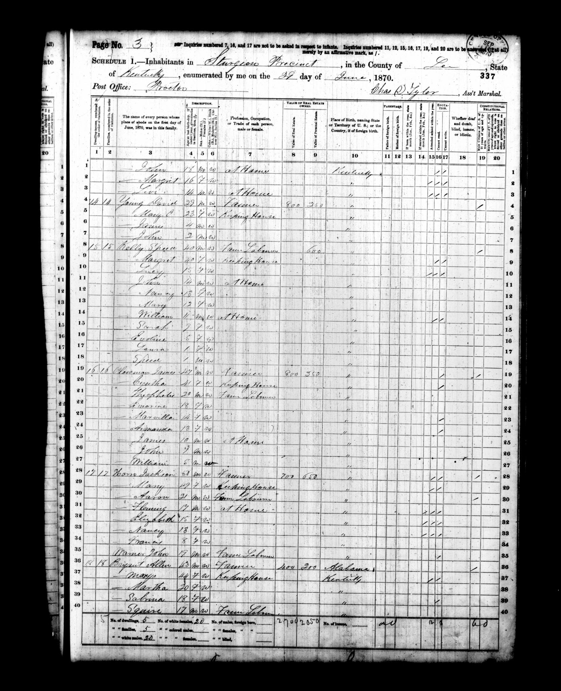

### 2 · 29 Jun 1870 · John, Elizabeth, and infant Samuel Newman

**Role:** Family hit  
**File:** [`sources/census/1870-lee-ky-sturgeon-p337b-john-elizabeth-samuel.jpg`](sources/census/1870-lee-ky-sturgeon-p337b-john-elizabeth-samuel.jpg)  
**Source:** S042 · C062

Dwelling 19/19: Newman, John, 50, farm labourer; Elizabeth, 25, keeping house; and Samuel, aged 1, with eight others. This is the probable natal home of Dora’s later husband. Elizabeth, 25, cannot be the mother of Mary, 21 — the older girls belong to a prior wife or another relationship the schedule does not name. Not silently merged with the 1880 John-and-Mary house (conflict #9).

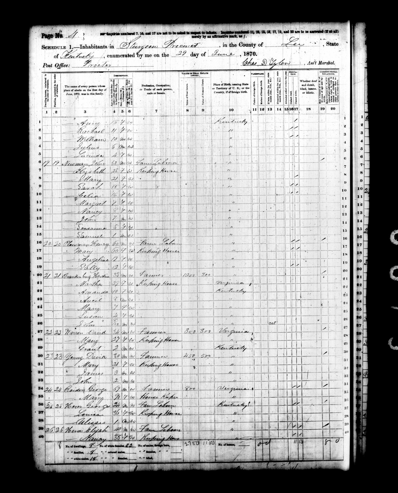

## 1880 — schedules and Soundex

### 3 · 1 Jun 1880 · John and Mary Newnam; Samuel, aged 11

**Role:** Family hit  
**File:** [`sources/census/1880-lee-ky-ed59-sheet1-p725-john-samuel.jpg`](sources/census/1880-lee-ky-ed59-sheet1-p725-john-samuel.jpg)  
**Source:** S040 · C060 · C061

Lee County ED 59, dwelling 3: John Newnam, 69, farmer (father born North Carolina); Mary, 57; Eli, 16; Susan, 20; Samuel, 11; Hannah, 9. Age 11 in June 1880 matches the June 1869 birth of Dora’s husband and the sixteen-year-old of the 1885 marriage return. Identification remains probable pending conflict #9.

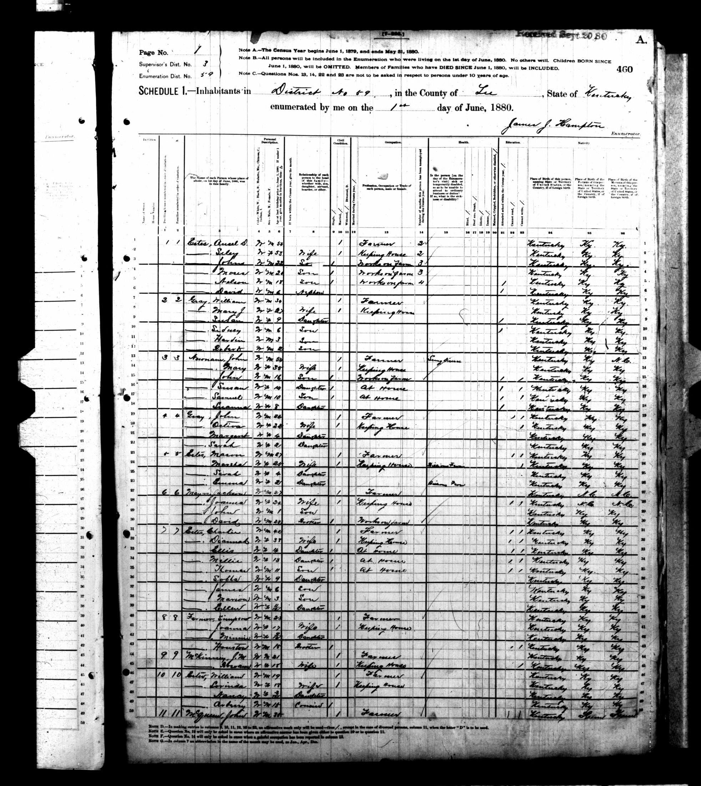

### 4 · 1 Jun 1880 · Samuel McQueary, 13 — not a Newnam

**Role:** Rejected same-name  
**File:** [`sources/census/1880-lee-ky-ed59-sheet2-p726-mcqueary-samuel.jpg`](sources/census/1880-lee-ky-ed59-sheet2-p726-mcqueary-samuel.jpg)  
**Source:** S044 · C063

Continuation of dwelling 11, the McQueary household. Samuel, 13, is Samuel McQueary. The only Samuel Newnam in ED 59 is the eleven-year-old in Plate 3.

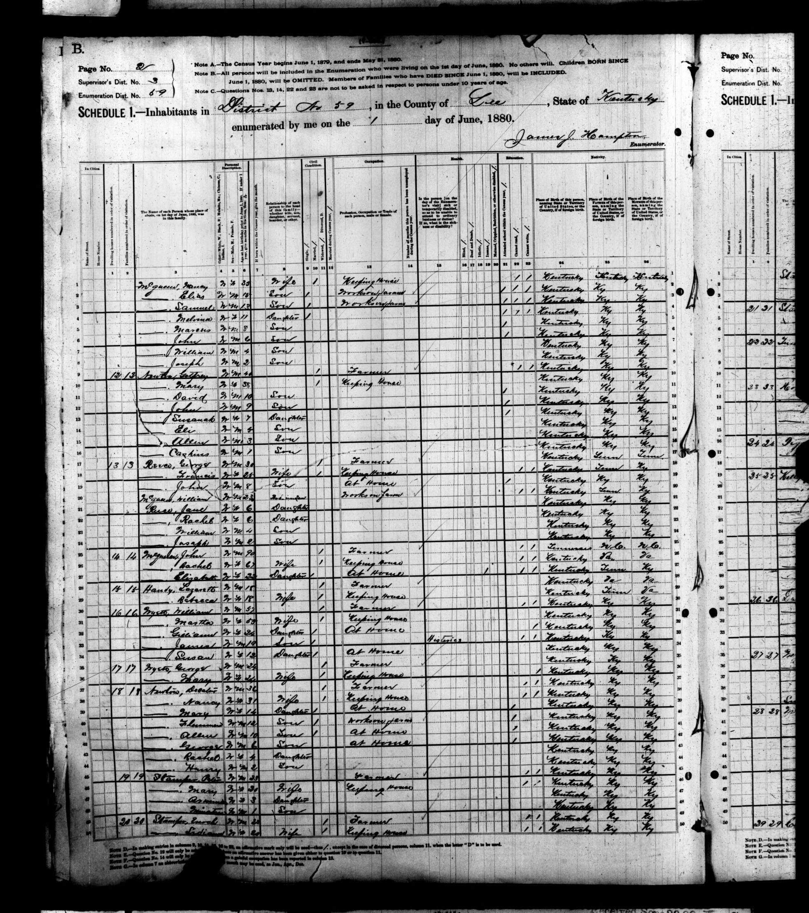

### 5 · 5 Jun 1880 · Elias and Mary Newnam; Dora, aged 8

**Role:** Family hit  
**File:** [`sources/census/1880-lee-ky-ed59-sheet6-p730-elias-dora.jpg`](sources/census/1880-lee-ky-ed59-sheet6-p730-elias-dora.jpg)  
**Source:** S010 · C001 · C003 · C004

The childhood record. Dwelling 46: Elias Newnam, 38, farmer; Mary, 38; William, 21; Malissa, 16; Francis, 14; Mary, 10; Dora, 8; Catharine, 6. A child of eight on 5 June 1880 was born in 1871 or early 1872. The death certificate’s year 1868 cannot stand. Neighbors: Joseph Newnam, 38, and John Newnam, 60.

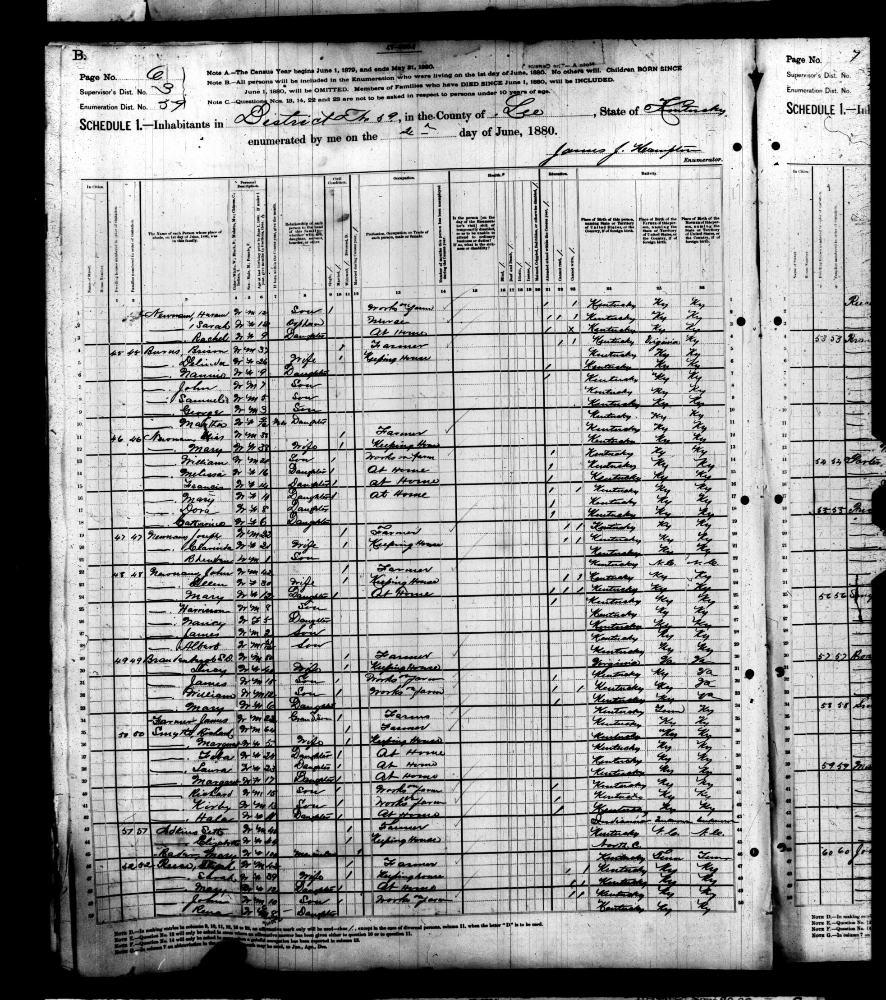

### 6 · 1880 (index) · Soundex card — Elias Newnam household

**Role:** Family hit  
**File:** [`sources/soundex/ky1880-n550-p2105-elias-newnam.jpg`](sources/soundex/ky1880-n550-p2105-elias-newnam.jpg)  
**Source:** S001

NARA T750, code N-550. Family card for Newnam, Elias, 38, Lee County, vol. 18, ED 59, sheet 6, line 11. Lists Mary, William, Melissa (schedule: Malissa), Francis, and Mary. Footer “#1 see #2”.

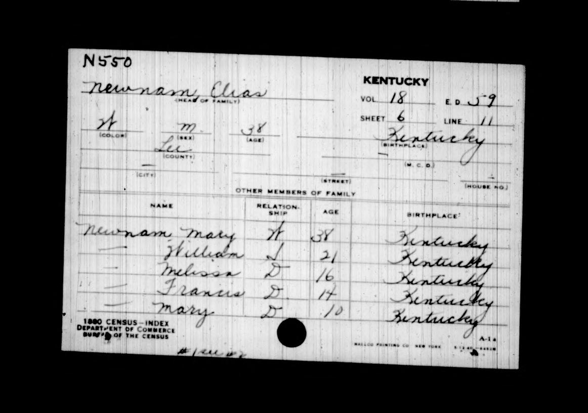

### 7 · 1880 (index) · Soundex continuation — Dora and Catharine

**Role:** Family hit  
**File:** [`sources/soundex/ky1880-n550-p2106-elias-continuation-dora.jpg`](sources/soundex/ky1880-n550-p2106-elias-continuation-dora.jpg)  
**Source:** S002

Continuation card: Newnam, Dora, daughter, 8, Kentucky; Catharine, daughter, 6. This is the index confirmation of Plate 5.

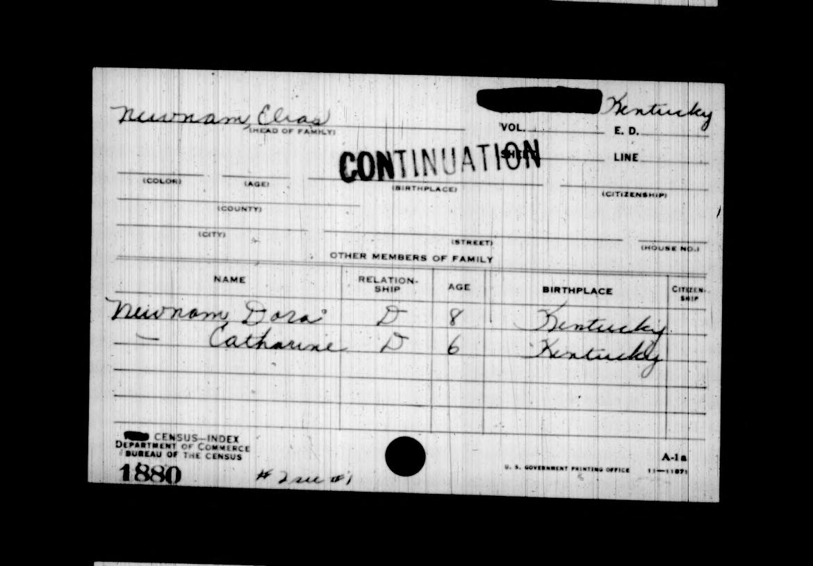

## 1900 — Missouri Stone search (Tom A. candidates)

### 8 · 13 Jun 1900 · Douglas County, Missouri — Thomas and Nancy E. Stone

**Role:** Rejected same-name  
**File:** [`sources/census/1900-douglas-mo-ed159-stone-sheet.jpg`](sources/census/1900-douglas-mo-ed159-stone-sheet.jpg)  
**Source:** S085 · C101

Buchanan Township, ED 159, sheet 9B. Thomas Stone, woodchopper, born May 1856, age 44, with wife Nancy E. and five daughters. Closest-age 1900 Missouri Thomas to the 1920 Arkansas widower Tom A. Stone — still not merged (no middle initial; wife living; conflict #11).

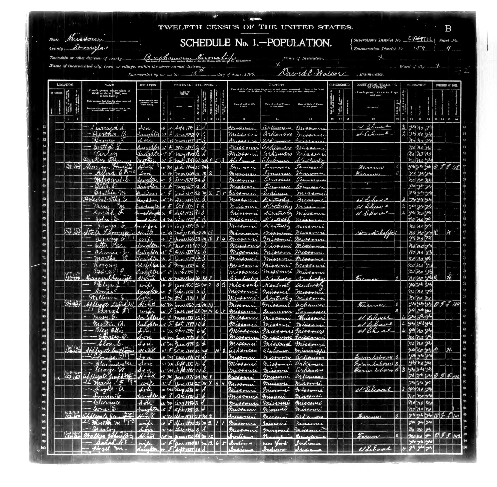

### 9 · 13 Jun 1900 · Douglas County Stone household (crop)

**Role:** Rejected same-name  
**File:** [`sources/census/1900-douglas-mo-ed159-stone-hh-crop.jpg`](sources/census/1900-douglas-mo-ed159-stone-hh-crop.jpg)  
**Source:** S085 · C102

Crop of the Thomas and Nancy E. Stone lines. The Soundex clerk later wrote “Jesse C., son”; the original reads Ossie P., daughter.

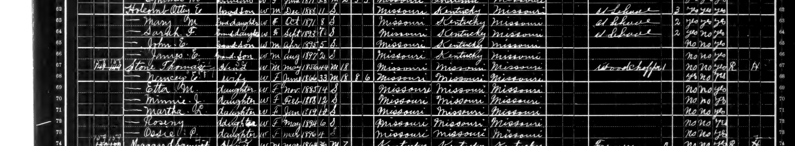

### 10 · 1900 (index) · Missouri S-350 — Thomas Stone, 44, Douglas County

**Role:** Rejected same-name  
**File:** [`sources/soundex/mo1900-s350-p1678-stone-thomas-44-douglas.jpg`](sources/soundex/mo1900-s350-p1678-stone-thomas-44-douglas.jpg)  
**Source:** S085 · C092

Soundex card for the household in Plates 8–9. Finding aid only; the original schedule is the authority.

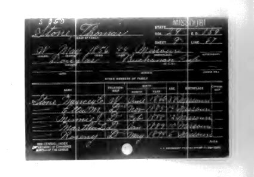

### 11 · 1900 (index) · Missouri S-350 — Douglas continuation, “Jesse C.”

**Role:** Rejected same-name  
**File:** [`sources/soundex/mo1900-s350-p1679-stone-thomas-douglas-jesse.jpg`](sources/soundex/mo1900-s350-p1679-stone-thomas-douglas-jesse.jpg)  
**Source:** S085 · C102

Clerk error: “Jesse C., son” is Ossie P., daughter, on the original (Plate 9). Not a son of Tom A. of Perry County.

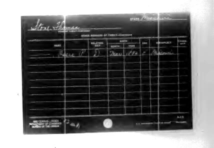

### 12 · 1900 (index) · Missouri S-350 — Thomas Stone, 50, Caldwell County

**Role:** Rejected same-name  
**File:** [`sources/soundex/mo1900-s350-p1680-stone-thomas-50-caldwell.jpg`](sources/soundex/mo1900-s350-p1680-stone-thomas-50-caldwell.jpg)  
**Source:** S085 · C092

Wrong county, wrong age trajectory versus 1920 Tom A. of Perry County, Arkansas. Rejected.

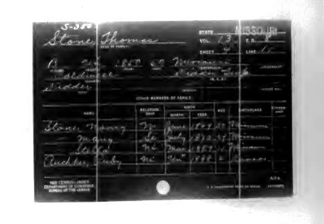

### 13 · 1900 (index) · Missouri S-350 — Thomas A. Stone, 32, Dunklin County

**Role:** Rejected same-name  
**File:** [`sources/soundex/mo1900-s350-p1684-stone-thomas-a-32-dunklin.jpg`](sources/soundex/mo1900-s350-p1684-stone-thomas-a-32-dunklin.jpg)  
**Source:** S085 · C092

Has the middle initial A. Age 32 (born February 1868) with wife Matilda. Too young for the 1920 sixty-two-year-old. Not merged.

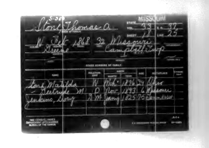

### 14 · 1900 (index) · Missouri S-350 — Thomas A. Stone, 24, Cooper County

**Role:** Rejected same-name  
**File:** [`sources/soundex/mo1900-s350-p1685-stone-thomas-a-24-cooper.jpg`](sources/soundex/mo1900-s350-p1685-stone-thomas-a-24-cooper.jpg)  
**Source:** S085 · C092

Nephew, born March 1876. Fails age. Not merged.

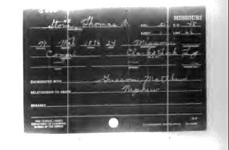

### 15 · 1900 (index) · Missouri S-350 — Tom Stone, 21, Black

**Role:** Rejected same-name  
**File:** [`sources/soundex/mo1900-s350-p1727-stone-tom-black-21.jpg`](sources/soundex/mo1900-s350-p1727-stone-tom-black-21.jpg)  
**Source:** S085 · C092

Fails race, age, and household. Not Tom A. of 1920 Arkansas.

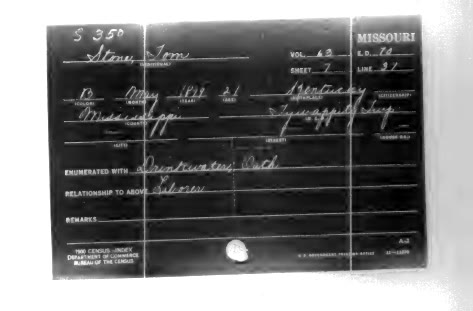

### 16 · 1900 (index) · Missouri S-350 — Tom Stone, 31, Vernon County

**Role:** Rejected same-name  
**File:** [`sources/soundex/mo1900-s350-p1728-stone-tom-31-vernon.jpg`](sources/soundex/mo1900-s350-p1728-stone-tom-31-vernon.jpg)  
**Source:** S085 · C092

Coal-miner boarder, born May 1869. No wife, no daughters matching 1920. Not merged.

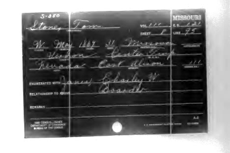

### 62 · Jun 1900 · Bollinger Liberty ED 4 sheet 5 A header

**Role:** Negative search  
**File:** [`sources/census/1900-bollinger-liberty-ed4-sh5a-hdr.jpg`](sources/census/1900-bollinger-liberty-ed4-sh5a-hdr.jpg)  
**Source:** S271 · C290

Supervisor 12, ED 4, sheet 5 A, enumerator James R. Hughey. First sheet after the pass-54 close of sheets 1–4. The name column has Null, Baker, Davis, Crites — no Conrad, Sullivan, or Newman.

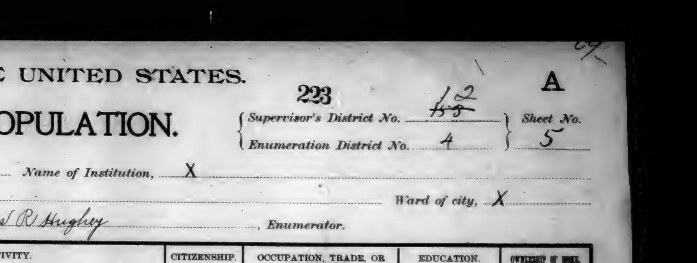

### 63 · Jun 1900 · Bollinger Liberty ED 4 sheet 7 B names (ED tail)

**Role:** Negative search  
**File:** [`sources/census/1900-bollinger-liberty-ed4-sh7b-names-bot.jpg`](sources/census/1900-bollinger-liberty-ed4-sh7b-names-bot.jpg)  
**Source:** S271 · C290 · C294

Last sheet of Liberty ED 4. Myers, Day, Huffstetter, Baker, Crites, Barret. Child Dorse E. Baker (November 1898, age 1) is not P001. The next PDF page is ED 5 sheet 1 A.

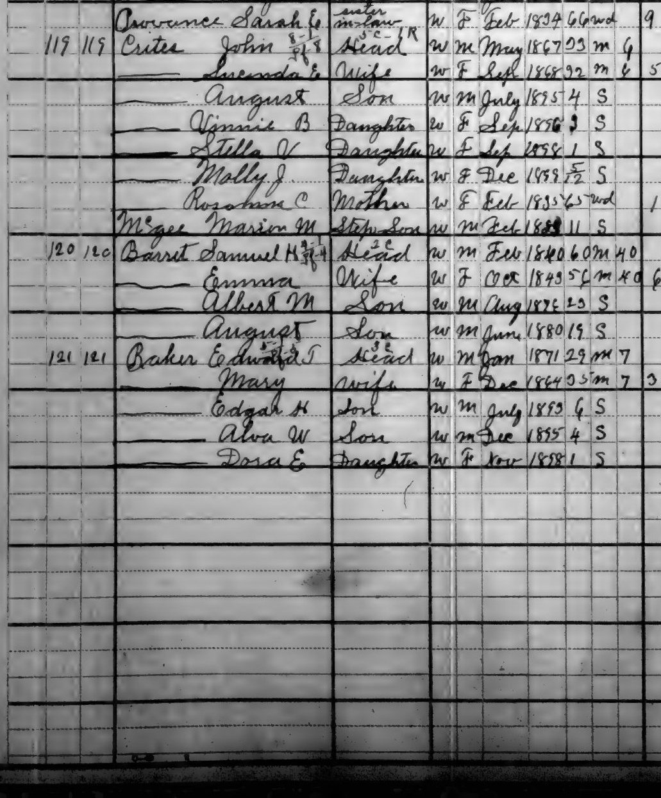

### 64 · 1900 (index) · Missouri C-563 — Jacob Conrad of Lorance

**Role:** Context  
**File:** [`sources/soundex/mo1900-c563-p2985-jacob-lorance.jpg`](sources/soundex/mo1900-c563-p2985-jacob-lorance.jpg)  
**Source:** S272 · C292

Inverted Soundex card. Conrad, Jacob I, Bollinger Lorance, born December 1835, age 64. Local FAN of the 1910 Liberty Jesse Conrad household. Other members Maud 22 and a child 19 — no Jesse, no infant Letha.

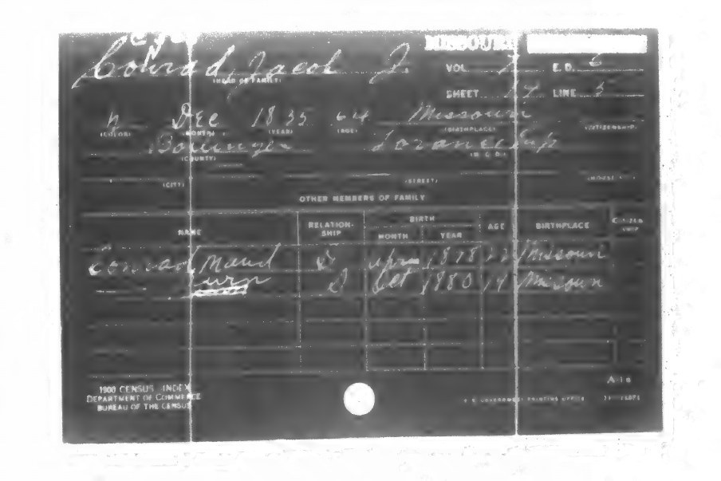

### 65 · 1900 (index) · Missouri C-563 — John after Jib; no Jesse

**Role:** Negative search  
**File:** [`sources/soundex/mo1900-c563-p2998-john-after-jib-no-jesse.jpg`](sources/soundex/mo1900-c563-p2998-john-after-jib-no-jesse.jpg)  
**Source:** S272 · C291

The Conrad given-name run jumps from Jib (p.2997) to John (p.2998). No Jesse, Jessie, or Jess head card in 1900 Missouri Soundex C-563.

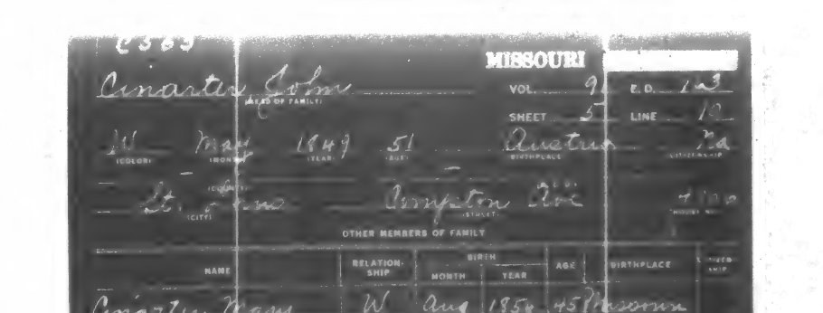

### 66 · 1900 (index) · Missouri N-550 — Bella, 25, St Louis

**Role:** Rejected same-name  
**File:** [`sources/soundex/mo1900-n550-p406-bella-stlouis-rejected.jpg`](sources/soundex/mo1900-n550-p406-bella-stlouis-rejected.jpg)  
**Source:** S273 · C293

Individual card. Newman, Bella, about 1874, age 25, St Louis, Laclede Avenue 3751. Not the 1910 Liberty widow (age and city fail).

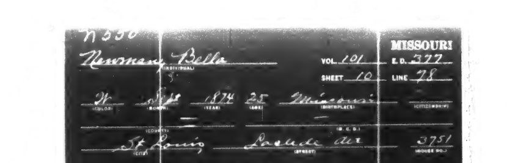

### 67 · 1900 (index) · Missouri N-550 — Belle, 29, Virginia, Kansas City

**Role:** Rejected same-name  
**File:** [`sources/soundex/mo1900-n550-p407-belle-kc-rejected.jpg`](sources/soundex/mo1900-n550-p407-belle-kc-rejected.jpg)  
**Source:** S273 · C293

Individual card. Newman, Belle, February 1871, age 29, born Virginia, Jackson County, Kansas City, Broadway 1021. Not the 1910 Liberty widow (birthplace and city fail).

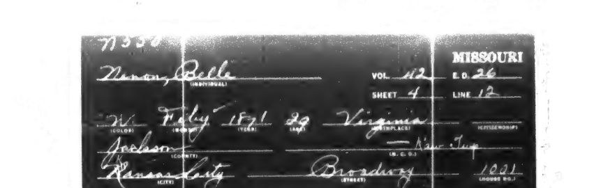

### 68 · 23 Jun 1900 · Bollinger Lorance ED 6 sheet 14 A header

**Role:** Context  
**File:** [`sources/census/1900-bollinger-lorance-ed6-sh14a-hdr.jpg`](sources/census/1900-bollinger-lorance-ed6-sh14a-hdr.jpg)  
**Source:** S274 · C297

Supervisor 12, ED 6, sheet 14 A, stamped 74-01, enumerator Thomas H. Stevens, 23 June 1900. This is the sheet the Soundex clerk mis-cited as sheet 17.

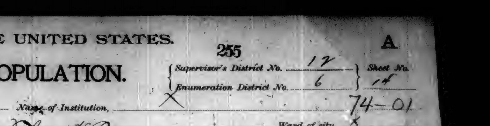

### 69 · 23 Jun 1900 · Jacob I Conrad household — Lorance ED 6 sheet 14 A

**Role:** Context  
**File:** [`sources/census/1900-bollinger-lorance-ed6-sh14a-jacob-conrad.jpg`](sources/census/1900-bollinger-lorance-ed6-sh14a-jacob-conrad.jpg)  
**Source:** S274 · C296 · C292

Dwelling 265/266. Conrad, Jacob I, December 1835, age 64, married 39 years; daughter Maud, April 1878, 21; son Buen, October 1880, 19. No wife on the lines. No Jesse. No Letha. Local FAN of the 1910 Liberty Jesse Conrad house — not merged.

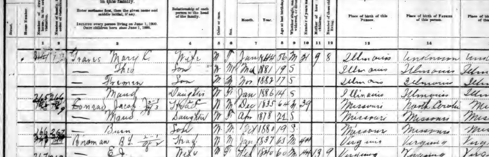

### 70 · Jun 1900 · Bollinger Liberty ED 5 sheet 15 A header

**Role:** Negative search  
**File:** [`sources/census/1900-bollinger-liberty-ed5-sh15a-hdr.jpg`](sources/census/1900-bollinger-liberty-ed5-sh15a-hdr.jpg)  
**Source:** S275 · C298

Supervisor 12, ED 5, sheet 15 A, enumerator DeKalb Westenhaver. First of the two sheets past the pass-58 close of sheets 1–14. Combined with those, Liberty ED 5 is complete — no Conrad, Sullivan, or Newman target.

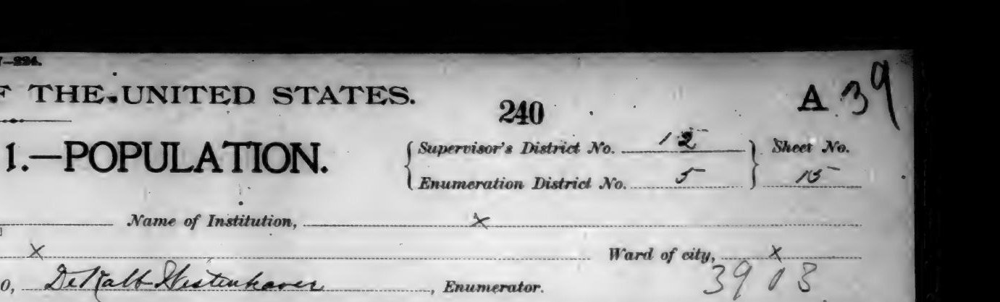

### 71 · Jun 1900 · George E Conrad household — Lorance ED 6 sheet 1 B

**Role:** Context  
**File:** [`sources/census/1900-bollinger-lorance-ed6-sh1b-george-conrad.jpg`](sources/census/1900-bollinger-lorance-ed6-sh1b-george-conrad.jpg)  
**Source:** S275 · C301

Household 16. Conrad, Geo E, March 1852, age 48, married 7 years; wife Flora A, March 1874, 26, 3/3. The three children were born 1894–1897. No Jesse. No Letha. Another local FAN — not merged.

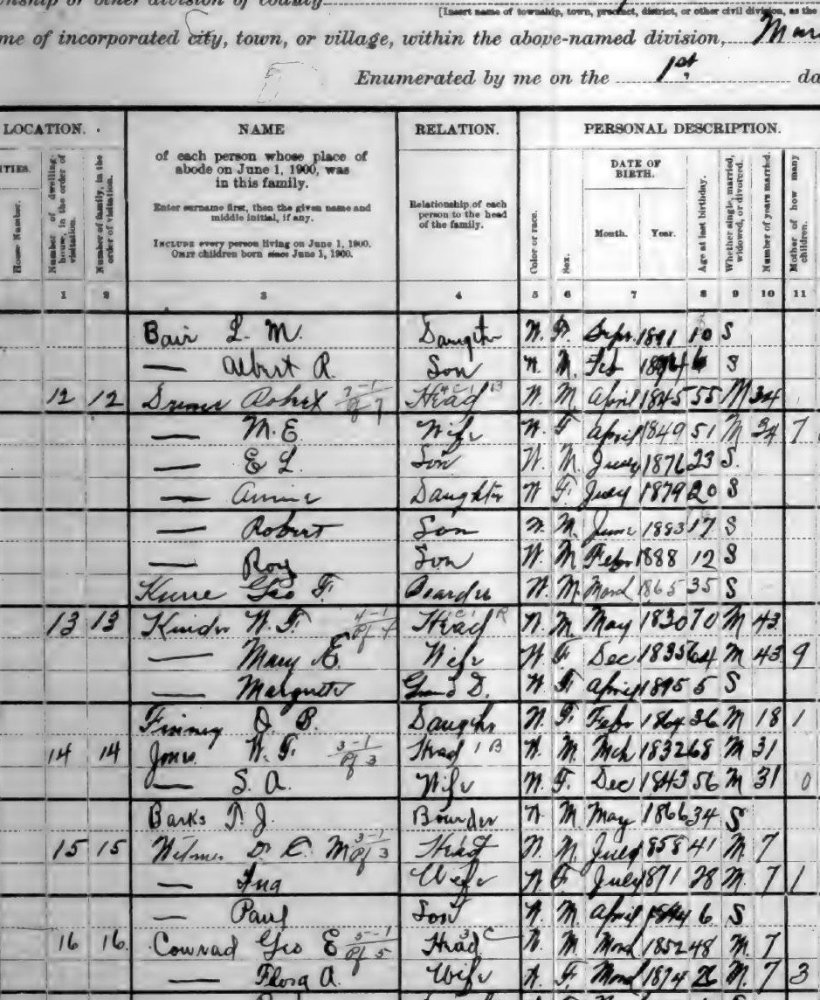

## 1910 — Soundex, Peebles test, and Sturgeon ED 99

### 72 · 1910 (index) · Missouri C-563 — Jesse window; no Liberty card

**Role:** Negative search  
**File:** [`sources/soundex/mo1910-c563-p140-jesse-window-no-liberty.jpg`](sources/soundex/mo1910-c563-p140-jesse-window-no-liberty.jpg)  
**Source:** S276 · C302

Typed Miracode. Jesse/Jessie heads are Pike Jessica 44, Buchanan Jesse 36 with Faerl, and Buchanan Jno 35 living alone. None is the Liberty Jesse 37 + Letha 12 household already read on the original.

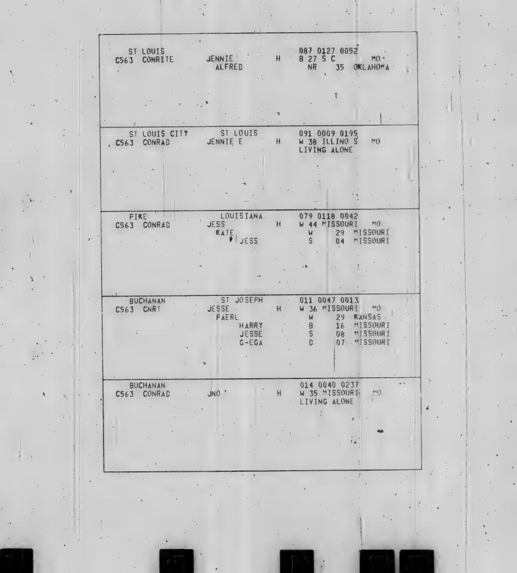

### 73 · 1910 (index) · Missouri C-563 — Francis M Conrad of Bollinger

**Role:** Context  
**File:** [`sources/soundex/mo1910-c563-p120-francis-m-bollinger.jpg`](sources/soundex/mo1910-c563-p120-francis-m-bollinger.jpg)  
**Source:** S276 · C303

Typed Miracode. Conrad, Francis M, Bollinger, age 68, with John R in the household. Local FAN of the Liberty Jesse house — not merged.

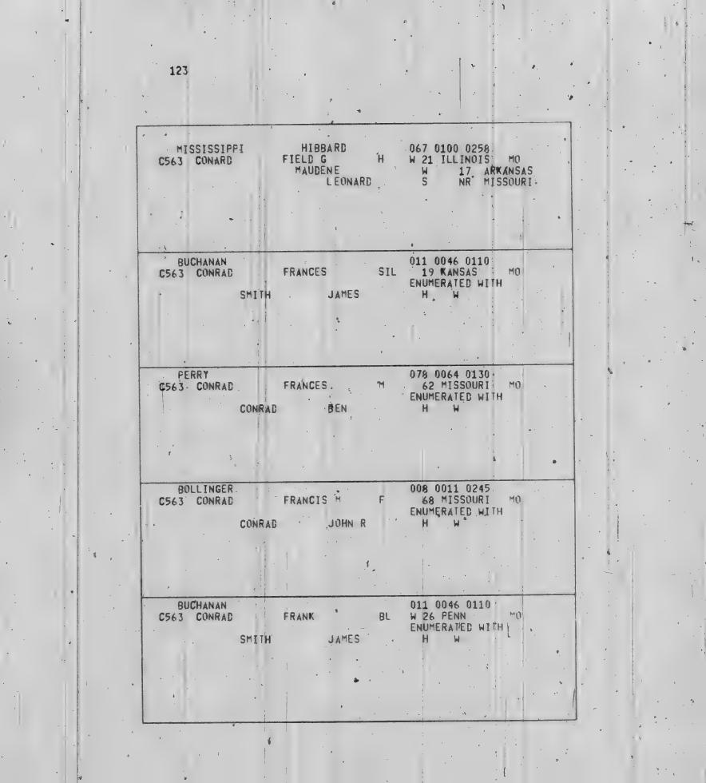

## 1900 — Missouri Stone search (Tom A. candidates)

### 74 · 1900 (index) · Missouri C-563 — Francis E Conrad of Whitewater

**Role:** Rejected same-name  
**File:** [`sources/soundex/mo1900-c563-p2897-francis-e-whitewater.jpg`](sources/soundex/mo1900-c563-p2897-francis-e-whitewater.jpg)  
**Source:** S277 · C306

Inverted Soundex card. Conrad, Francis E, Bollinger Whitewater, September 1868, age 32, with toddlers Willie (1897) and Iva (1898). Not Jesse Conrad.

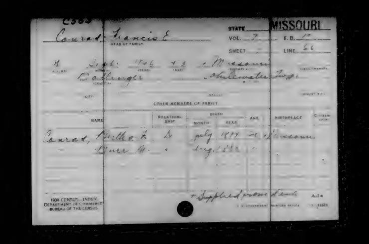

### 75 · 1900 (index) · Missouri C-563 — Francis M Conrad of Whitewater (elder)

**Role:** Context  
**File:** [`sources/soundex/mo1900-c563-p2898-francis-m-whitewater.jpg`](sources/soundex/mo1900-c563-p2898-francis-m-whitewater.jpg)  
**Source:** S277 · C305 · C312

Inverted Soundex card. Conrad, Francis M, July 1841, age 58, Whitewater ED 10 sheet 8. Member list (W.I., Nella) is a clerk approximation — prefer the original on Plate 80.

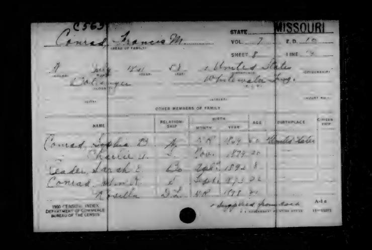

### 76 · 1900 (index) · Missouri C-563 — Francis M Conrad of Whitewater (younger)

**Role:** Rejected same-name  
**File:** [`sources/soundex/mo1900-c563-p2899-francis-m-younger-whitewater.jpg`](sources/soundex/mo1900-c563-p2899-francis-m-younger-whitewater.jpg)  
**Source:** S277 · C307 · C314

Inverted Soundex card. Conrad, Francis M, March 1871, age 29, wife Mary C, April 1876, 24. Not Jesse. The card’s sheet 8 line 5 locator fails on the original.

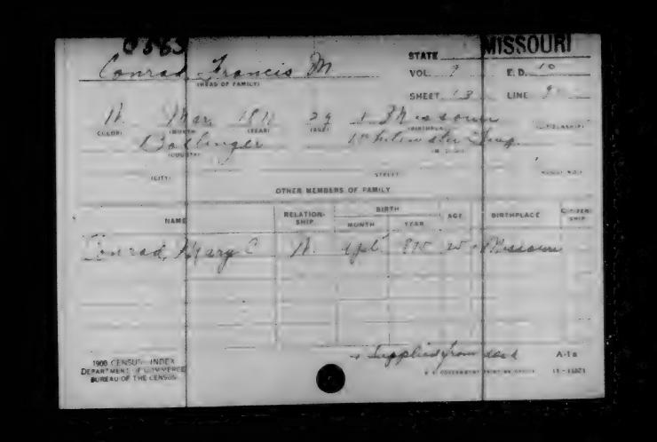

### 77 · 1900 (index) · Missouri C-563 — George E Conrad of Lorance

**Role:** Context  
**File:** [`sources/soundex/mo1900-c563-p2936-george-e-lorance.jpg`](sources/soundex/mo1900-c563-p2936-george-e-lorance.jpg)  
**Source:** S277 · C308 · C301

Inverted Soundex card. Conrad, Geo. E, March 1852, age 48, Lorance Marble Hill, ED 6 sheet 1. Matches the original on Plate 71.

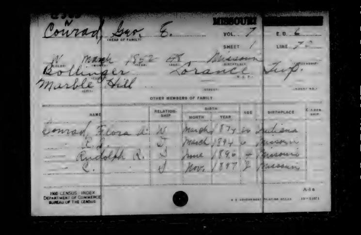

### 78 · Jun 1900 · Bollinger Lutesville ED 7 sheet 1 A header

**Role:** Negative search  
**File:** [`sources/census/1900-bollinger-lutesville-ed7-sh1a-hdr.jpg`](sources/census/1900-bollinger-lutesville-ed7-sh1a-hdr.jpg)  
**Source:** S278 · C309

Supervisor 12, ED 7, sheet 1 A, Lutesville Village, stamped 260. First of seventeen sheets. Combined with sheets 1–17 B, Lutesville is complete — no Conrad, Sullivan, or Newman target.

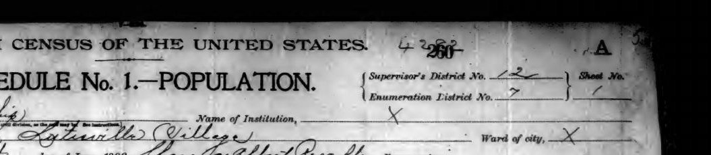

### 79 · Jun 1900 · Bollinger Whitewater ED 10 sheet 8 A header

**Role:** Context  
**File:** [`sources/census/1900-bollinger-whitewater-ed10-sh8a-hdr.jpg`](sources/census/1900-bollinger-whitewater-ed10-sh8a-hdr.jpg)  
**Source:** S279 · C311

Supervisor 13, ED 10, sheet 8 A, Whitewater Township, stamped 319. The sheet the Soundex clerk cited for Francis M elder.

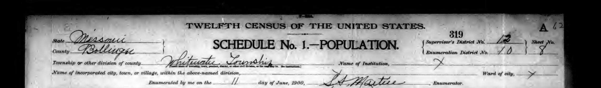

### 80 · Jun 1900 · Francis M Conrad household — Whitewater ED 10 sheet 8 A

**Role:** Context  
**File:** [`sources/census/1900-bollinger-whitewater-ed10-sh8a-francis-m.jpg`](sources/census/1900-bollinger-whitewater-ed10-sh8a-francis-m.jpg)  
**Source:** S279 · C311 · C315 · C313

Dwelling 136/140. Conrad, Francis M, July 1841, age 58, married 39 years; wife Sophia B, 3 children / 2 living; son Recie, 20; boarder Sarah E. Seales, 8; son John R, 26, married, with a daughter-in-law. No Jesse. No Letha. Sophia’s 3/2 means Jesse is not a living child of this couple. Same man as the 1910 Francis M, 68, on Plate 73.

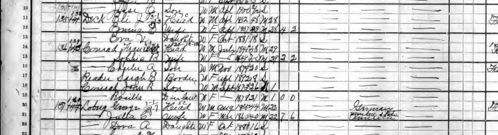

### 81 · 1 Jun 1900 · Bollinger Whitewater ED 10 sheet 1 A header

**Role:** Negative search  
**File:** [`sources/census/1900-bollinger-whitewater-ed10-sh1a-hdr.jpg`](sources/census/1900-bollinger-whitewater-ed10-sh1a-hdr.jpg)  
**Source:** S280 · C316

Supervisor 13, ED 10, sheet 1 A, Whitewater Township. First of sixteen sheets. Combined with sheets 1–16 A, Whitewater is complete — no Jesse Conrad, Sullivan, or Letha.

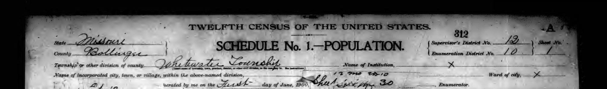

### 82 · Jun 1900 · Frank E Conrad household — Whitewater ED 10 sheet 7 A

**Role:** Rejected same-name  
**File:** [`sources/census/1900-bollinger-whitewater-ed10-sh7a-frank-e.jpg`](sources/census/1900-bollinger-whitewater-ed10-sh7a-frank-e.jpg)  
**Source:** S280 · C317 · C318

Dwelling 123/129. Conrad, Frank E, about 1868, age 31, married 8 years; wife Cora or Eva, about 32, 6/7 children. This is the Soundex Francis E man. Not Jesse. The Soundex children’s names (Willie, Iva) do not match the original.

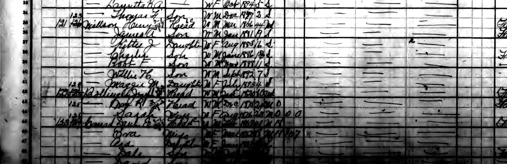

### 83 · Jun 1900 · Luke Conrad and Francis C Conrad widow — Whitewater ED 10 sheet 7 B

**Role:** Context  
**File:** [`sources/census/1900-bollinger-whitewater-ed10-sh7b-luke-francis-c.jpg`](sources/census/1900-bollinger-whitewater-ed10-sh7b-luke-francis-c.jpg)  
**Source:** S280 · C319 · C320

Continuation of the Frank E children, then Conrad, Luke, 34, with Anna B, and Conrad, Francis C, female widow, 56. Local FAN — not Jesse.

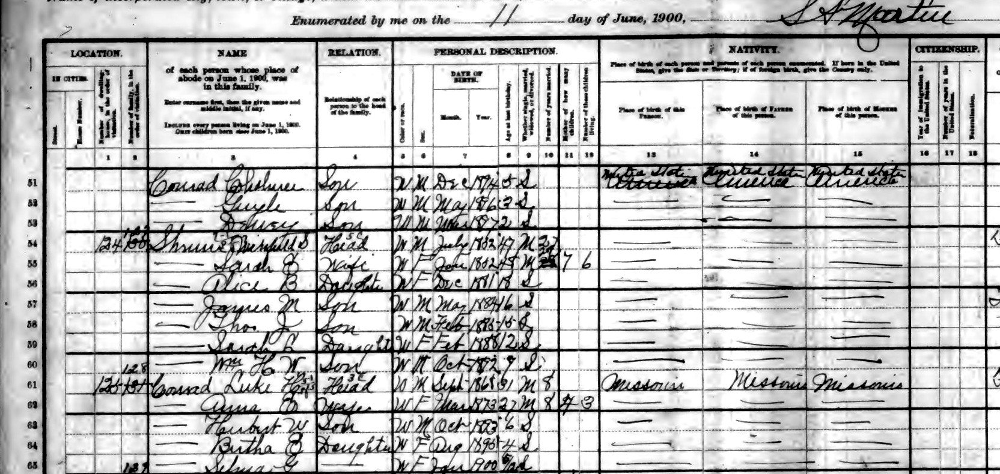

### 84 · Jun 1900 · Peter R and John E Conrad — Whitewater ED 10 sheet 15 B

**Role:** Context  
**File:** [`sources/census/1900-bollinger-whitewater-ed10-sh15b-peter-john.jpg`](sources/census/1900-bollinger-whitewater-ed10-sh15b-peter-john.jpg)  
**Source:** S280 · C321

Conrad, Peter R, January 1834, age 66, wife Emma E born Denmark; Conrad, John E, May 1867, age 33, wife Josephine, 8/7 children. Two more Whitewater FAN households — not Jesse.

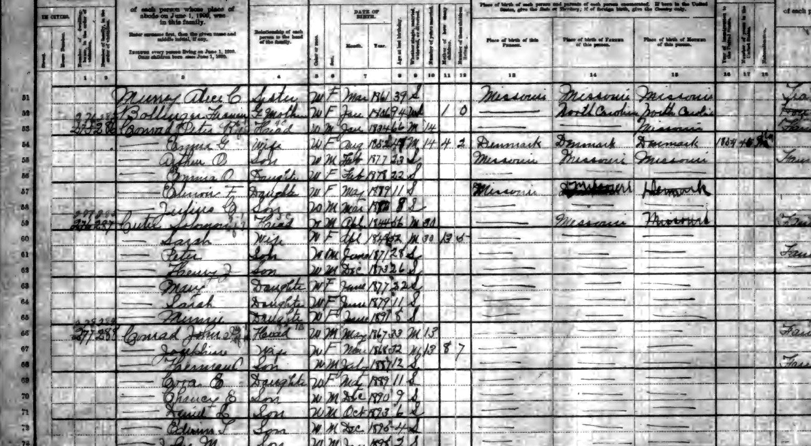

### 85 · Jun 1900 · David Conrad household — Union ED 8 sheet 3 B

**Role:** Rejected same-name  
**File:** [`sources/census/1900-bollinger-union-ed8-sh3b-david-conrad.jpg`](sources/census/1900-bollinger-union-ed8-sh3b-david-conrad.jpg)  
**Source:** S296 · C347

Dwelling 50/51. Conrad, David, January 1871, age 29, married 3 years; wife Miranda G, March 1881, age 19, 2/1; son Asa D, August 1898, age 1. Local FAN — not Jesse (different given name, marriage length, no Letha).

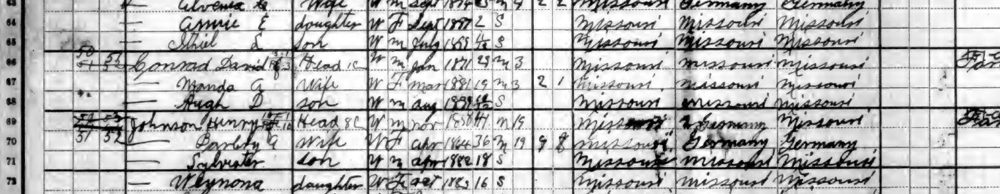

### 86 · Jun 1900 · End of Union ED 8 — Dalton’s last sheet

**Role:** Negative search  
**File:** [`sources/census/1900-bollinger-union-ed8-sh12b-end.jpg`](sources/census/1900-bollinger-union-ed8-sh12b-end.jpg)  
**Source:** S296 · C348

Oliver A. Dalton wrote that this is the end of his enumeration. Last Union names are Bollinger, Mungle, and Edell. No Jesse Conrad, no Sullivan, no Newman, no Letha.

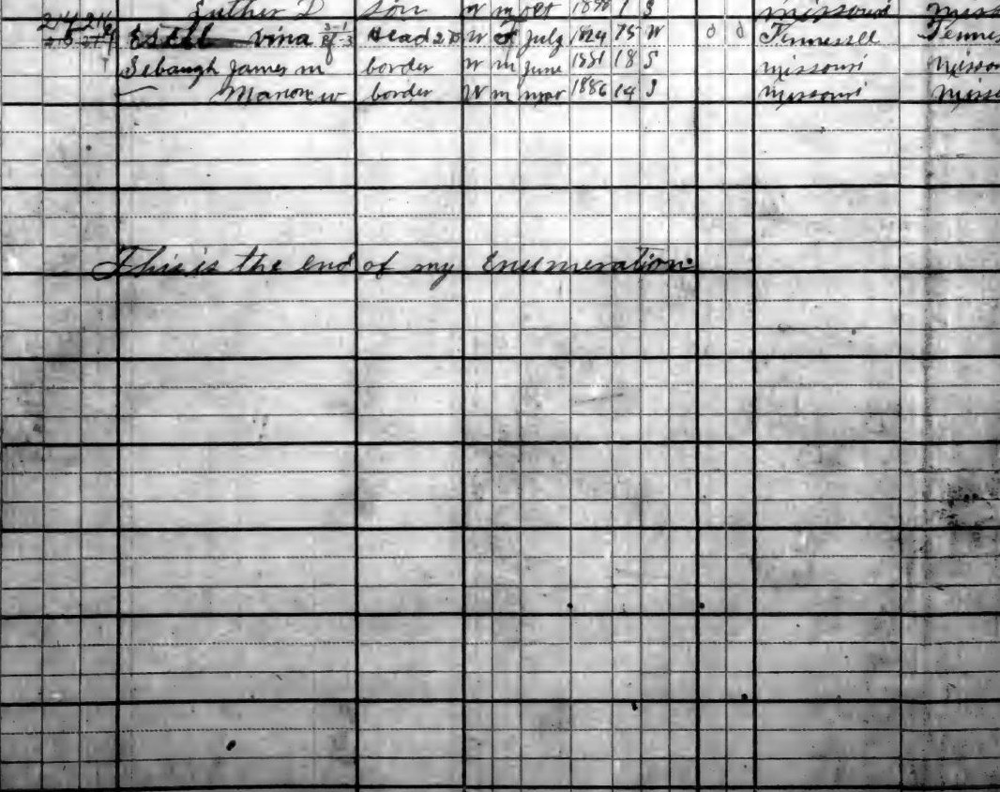

### 87 · 1 Jun 1900 · Wayne Township ED 9 sheet 1 A header

**Role:** Context  
**File:** [`sources/census/1900-bollinger-wayne-ed9-sh1a-hdr.jpg`](sources/census/1900-bollinger-wayne-ed9-sh1a-hdr.jpg)  
**Source:** S296 · S297 · C350

Bollinger County ED 9 begins at T623-840 PDF page 92. Enumerator William Craff. Dwelling numbers restart at 1. Name-column sweep of every sheet 1 A–23 B is now complete (C350).

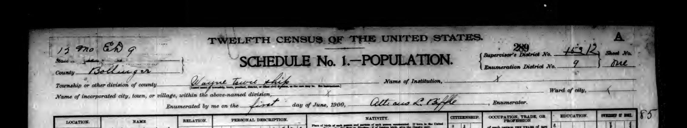

### 88 · Jun 1900 · George A Conrad household — Wayne ED 9 sheet 6 B

**Role:** Rejected same-name  
**File:** [`sources/census/1900-bollinger-wayne-ed9-sh6b-george-a-conrad.jpg`](sources/census/1900-bollinger-wayne-ed9-sh6b-george-a-conrad.jpg)  
**Source:** S297 · C349

Dwelling 112/117. Conrad, George A, May 1871, age 29, married 1 year; wife Mary L, October 1867, age 32, 1/1; son Ethel C, June 1899, 11/12. Local FAN — not Jesse (different given name, marriage length, infant son not Letha).

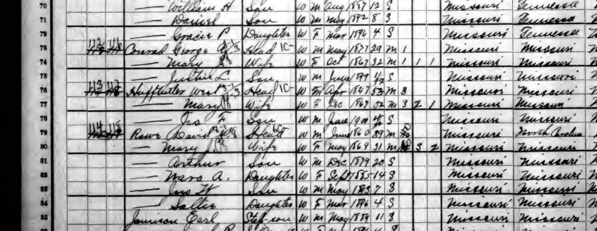

### 89 · 27 Jun 1900 · End of Wayne ED 9 — Craff’s last occupied lines

**Role:** Negative search  
**File:** [`sources/census/1900-bollinger-wayne-ed9-sh23b-end.jpg`](sources/census/1900-bollinger-wayne-ed9-sh23b-end.jpg)  
**Source:** S297 · C350

Sheet 23 B, lines 72–73: Cummins/Cunnins, Richard, June 1874, age 26, and wife Elsie, January 1884, age 16. Lines 74–100 blank. Combined with sheets 1 A–23 A, Wayne Township is complete — no Jesse Conrad, no Sullivan, no Newman, no Letha Viola.

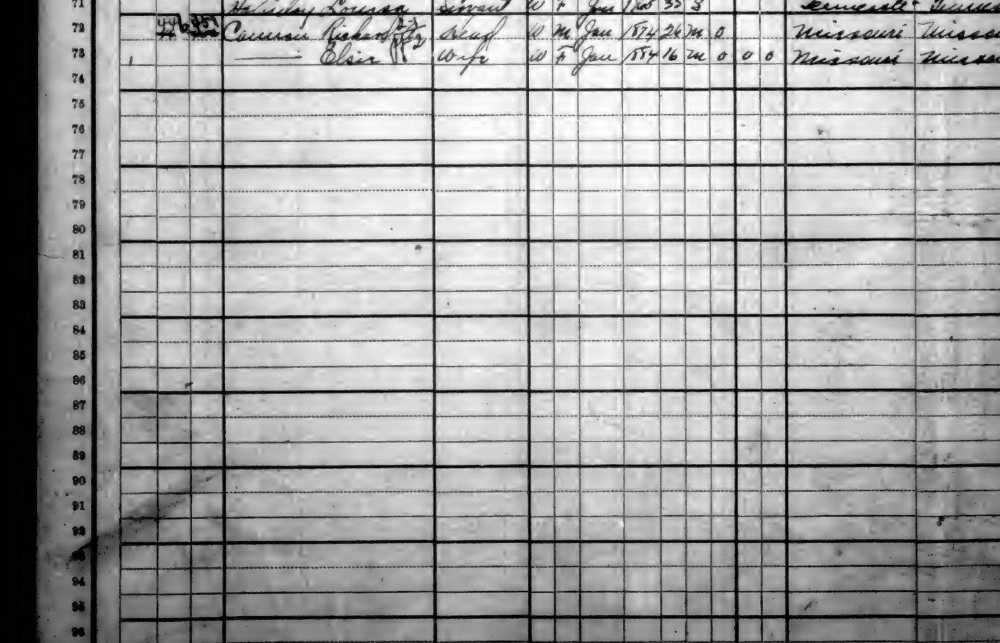

### 90 · 27 Jun 1900 · Wayne Township ED 9 sheet 23 B header

**Role:** Context  
**File:** [`sources/census/1900-bollinger-wayne-ed9-sh23b-hdr.jpg`](sources/census/1900-bollinger-wayne-ed9-sh23b-hdr.jpg)  
**Source:** S297 · C350

Last Wayne sheet. Supervisor 12, sheet 23 B, enumerated 27 June 1900 by William Craff. The ED digit on this verso is written loosely (can be read as 7); township, enumerator, and sheet 23 match the 23 A header (ED 9).

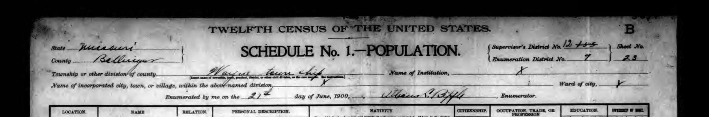

### 91 · 1 Jun 1900 · Crooked Creek Township ED 1 sheet 1 A header

**Role:** Context  
**File:** [`sources/census/1900-bollinger-crooked-creek-ed1-sh1a-hdr.jpg`](sources/census/1900-bollinger-crooked-creek-ed1-sh1a-hdr.jpg)  
**Source:** S299 · C351

Bollinger County ED 1 begins at T623-839 PDF page 1005, stamped 176. Enumerator Francis P. Myers, 1 June 1900. Name-column sweep of every sheet 1 A–15 B is now complete (C351).

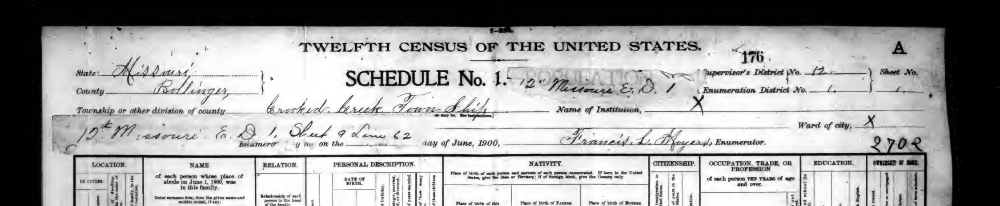

### 92 · Jun 1900 · Sullivan J. L. household — Crooked Creek ED 1 sheets 11 B–12 A

**Role:** Rejected same-name  
**File:** [`sources/census/1900-bollinger-crooked-creek-ed1-sh11b-sullivan-jl.jpg`](sources/census/1900-bollinger-crooked-creek-ed1-sh11b-sullivan-jl.jpg)  
**Source:** S299 · C352

Dwelling 213/213. Sullivad/Sullivan, J. L., December 1857, age 42, married 13 years; wife Susan, December 1870, age 29, 4/3; sons Jimmie 11, John 9, Barney 3. Local FAN — not Jesse (age 42 vs ~27; three sons, no Letha).

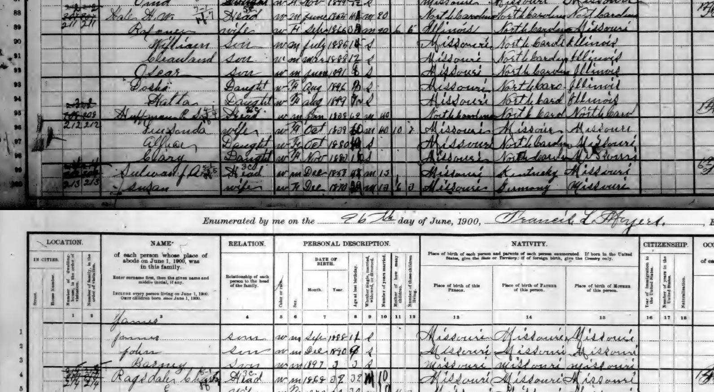

### 93 · 30 Jun 1900 · End of Crooked Creek ED 1 — Myers’s last sheet

**Role:** Negative search  
**File:** [`sources/census/1900-bollinger-crooked-creek-ed1-sh15b-end.jpg`](sources/census/1900-bollinger-crooked-creek-ed1-sh15b-end.jpg)  
**Source:** S299 · C351

Sheet 15 B line 77: Myers wrote “Here Ends This Enumeration.” Lines 78–100 blank. Combined with sheets 1 A–15 A, Crooked Creek is complete — no Conrad, no Newman, no Letha Viola.

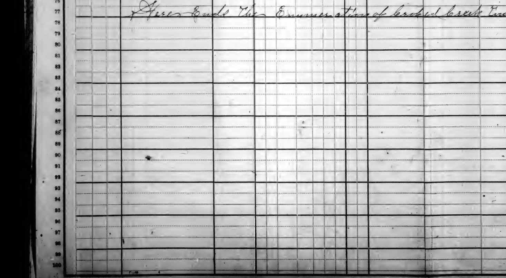

### 94 · 15 Jun 1900 · Francis household — Fillmore ED 2 sheet 9 A

**Role:** Rejected same-name  
**File:** [`sources/census/1900-bollinger-fillmore-ed2-sh9a-francis-lethy.jpg`](sources/census/1900-bollinger-fillmore-ed2-sh9a-francis-lethy.jpg)  
**Source:** S300 · C354

Dwelling 164/159. Francis, William B, May 1853, age 47, married 32 years; wife Martha J; daughter Lethy J, August 1882, age 17; daughter Dora Ellen, July 1897, age 2. Lethy is 17, not ~2. Dora Ellen’s father is William B Francis, Missouri-born — not P001 (age 28, Kentucky, at Sturgeon the same night).

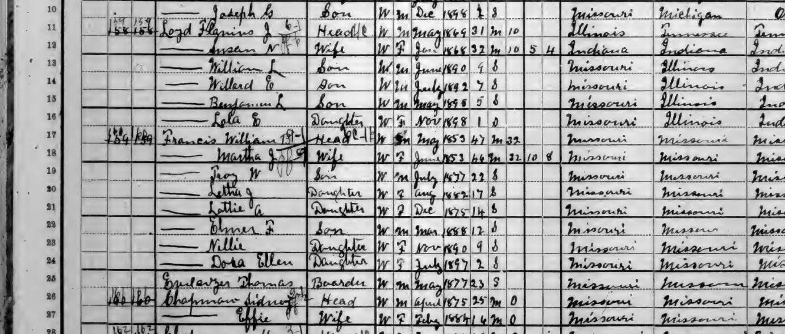

### 95 · 4 Jun 1900 · Joe Stone household — German ED 3 sheet 2 B

**Role:** Rejected same-name  
**File:** [`sources/census/1900-bollinger-german-ed3-sh2b-stone-joe.jpg`](sources/census/1900-bollinger-german-ed3-sh2b-stone-joe.jpg)  
**Source:** S301 · C355

Dwelling 32/32. Stone, Joe, March 1857, age 42, married 15 years; wife Sarah E, September 1863, age 36, 6/6, Kentucky-born; six children Hovy L through Henry B. Local FAN — not T. A. Stone (widower, older) and not Henry C. Stone. No child Dora.

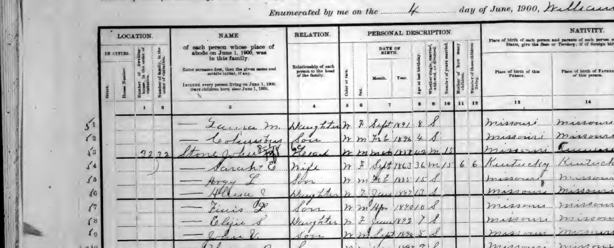

### 96 · 24 Jun 1900 · End of German ED 3 — James’s last occupied lines

**Role:** Negative search  
**File:** [`sources/census/1900-bollinger-german-ed3-sh15b-end.jpg`](sources/census/1900-bollinger-german-ed3-sh15b-end.jpg)  
**Source:** S298 · S301 · C356

Sheet 15 B, last household Seabaugh, Jesse L, April 1860, age 40, plus Ida M, Ella, and James R. Lines 56–100 blank. Combined with sheets 1 A–15 A, German Township is complete — no Conrad, no Sullivan, no Newman, no Letha.

### 97 · 1 Jun 1900 · Lorance Township ED 6 sheet 1 A header — Marble Hill

**Role:** Context  
**File:** [`sources/census/1900-bollinger-lorance-ed6-sh1a-hdr.jpg`](sources/census/1900-bollinger-lorance-ed6-sh1a-hdr.jpg)  
**Source:** S302 · C358

Bollinger County ED 6 begins at T623-839 PDF page 1137, stamped 242. Enumerator Thomas H. Stevens, 1 June 1900, Marble Hill Village. Combined with T623-840 sheets 4 A–18 A, Lorance is complete (C358).

### 98 · 2 Jun 1900 · County Jail and village end — Lorance ED 6 sheet 3 B

**Role:** Rejected same-name  
**File:** [`sources/census/1900-bollinger-lorance-ed6-sh3b-jail-end.jpg`](sources/census/1900-bollinger-lorance-ed6-sh3b-jail-end.jpg)  
**Source:** S302 · C360

Institution line: County Jail, lines 82–90. Prisoner Killien/Killion Jesse, October 1858, age 41 — not Conrad Jesse (~27). Last village household: Mowell/Joe, daughter Dora, March 1884, age 16 — not P001. Stevens then wrote that the village enumeration ends. Sheet 4 A resumes the rural township on T623-840.

### 99 · 29 Jun 1900 · End of Lorance ED 6 — Stevens’s last occupied lines

**Role:** Negative search  
**File:** [`sources/census/1900-bollinger-lorance-ed6-sh18a-end.jpg`](sources/census/1900-bollinger-lorance-ed6-sh18a-end.jpg)  
**Source:** S302 · C358 · C359

Sheet 18 A line 10: Stevens wrote that here ends the enumeration of Lorance Township (the part not in Marble Hill Village). Lines 11–50 blank. Combined with sheets 1 A–17 B, Lorance is complete — no Jesse Conrad household, no Sullivan, no Newman, no Letha Viola. With Passes 62–68 this closes all ten 1900 Bollinger EDs (C359).

### 100 · 29 Jun 1900 · Lorance Township ED 6 sheet 18 A header

**Role:** Context  
**File:** [`sources/census/1900-bollinger-lorance-ed6-sh18a-hdr.jpg`](sources/census/1900-bollinger-lorance-ed6-sh18a-hdr.jpg)  
**Source:** S302 · C358

Last Lorance sheet. Supervisor 12, enumeration district 6, sheet 18 A, stamped 259. Enumerated 29 June 1900 by Thomas H. Stevens. T623-840 page 33 is an unused verso; page 34 is Lutesville ED 7 sheet 1 A (already C309).

### 101 · 1900 (index) · Indiana S-415 — Francis M Sullivan household (front)

**Role:** Rejected same-name  
**File:** [`sources/soundex/in1900-s415-p999-francis-m-lethia.jpg`](sources/soundex/in1900-s415-p999-francis-m-lethia.jpg)  
**Source:** S304 · C363

Brown County, Van Buren Township, volume 7, ED 26, sheet 8, line 47. Sullivan, Francis M, February 1868, age 32, Indiana-born; wife Rosa B, September 1870, age 29, Indiana. Children Ethel M, Minerva E, Sophronia A, and John W. Continuation names Lethia M (Plate 102). Mother’s Indiana nativity fails vs 1910 Letha Sullivan (mother Missouri).

### 102 · 1900 (index) · Indiana S-415 — Lethia M, age 1

**Role:** Rejected same-name  
**File:** [`sources/soundex/in1900-s415-p1000-lethia-m.jpg`](sources/soundex/in1900-s415-p1000-lethia-m.jpg)  
**Source:** S304 · C363

Continuation of Francis M. Sullivan, Lethia M, daughter, February 1899, age 1, Indiana. Close given-name and age to Letha Viola ~2, but mother Rosa B is Indiana-born and the household is intact with five children. Not merged with C244.

### 103 · 1900 (index) · Indiana C-563 — Jessie Conrad, 42, Indianapolis

**Role:** Rejected same-name  
**File:** [`sources/soundex/in1900-c563-p1081-jessie-42-indianapolis.jpg`](sources/soundex/in1900-c563-p1081-jessie-42-indianapolis.jpg)  
**Source:** S303 · C361 · C362

Colored head, October 1857, age 42, born North Carolina, Marion County, Indianapolis Center Township. The only Jessie/Jesse Conrad head in the Indiana 1900 C-563 J-window. Race, age, and nativity all fail vs 1910 Jesse Conrad (White, ~27, Missouri). Next card is Joel, 50 — no White Jesse ~27.

### 104 · 1900 (index) · Kentucky C-563 — Jerry C Conrad, 35, Kenton

**Role:** Rejected same-name  
**File:** [`sources/soundex/ky1900-c563-p2825-jerry-c-kenton.jpg`](sources/soundex/ky1900-c563-p2825-jerry-c-kenton.jpg)  
**Source:** S305 · C364 · C365

August 1864, age 35, Kenton County, Independence; wife Mary, July 1865, age 34. This is the J-given card immediately before the John block. No Jesse Conrad head ~27 sits between Jerry and John on the Kentucky 1900 C-563 reel.

### 105 · 1900 (index) · Indiana C-563 — Jessie, age 3, Miami County

**Role:** Rejected same-name  
**File:** [`sources/soundex/in1900-c563-p1080-jessie-age3-miami.jpg`](sources/soundex/in1900-c563-p1080-jessie-age3-miami.jpg)  
**Source:** S303 · C361

Individual card, July 1896, age 3, Peru, Miami County, enumerated with a Kennedy household. The card immediately before Indianapolis Jessie, 42. A toddler, not Jesse Conrad ~27.

### 106 · 1900 (index) · Illinois C-563 — Jesse Conrad, 17, Scott County

**Role:** Rejected same-name  
**File:** [`sources/soundex/il1900-c563-p2569-jesse-17-scott.jpg`](sources/soundex/il1900-c563-p2569-jesse-17-scott.jpg)  
**Source:** S306 · C366 · C367

Individual card, November 1882, age 17, Indiana-born, Point Pleasant Township, boarder with William Richardson, volume 146, ED 136, sheet 4, line 61. The only Jesse given-name card in the Illinois 1900 C-563 J-window. A teenager, not Jesse Conrad ~27.

### 107 · 1900 (index) · Illinois C-563 — Jessie Conrad, 41, Decatur

**Role:** Rejected same-name  
**File:** [`sources/soundex/il1900-c563-p2570-jessie-41-decatur.jpg`](sources/soundex/il1900-c563-p2570-jessie-41-decatur.jpg)  
**Source:** S306 · C366 · C368

White head, July 1858, age 41, born Indiana, Macon County, Decatur Township. Children Pearl, Henry, Blanche (Ohio) and Nellie (Illinois). The Jessie head immediately after Jesse, 17. Age and a four-child household fail vs 1910 Jesse Conrad. Next cards are Joe.

### 108 · 1900 (index) · Tennessee C-563 — Jennie Conrad, 36, Lincoln County

**Role:** Negative search  
**File:** [`sources/soundex/tn1900-c563-p3036-jennie-lincoln.jpg`](sources/soundex/tn1900-c563-p3036-jennie-lincoln.jpg)  
**Source:** S307 · C369

White head, October 1865, age 36, Tennessee-born, 24th Civil District, volume 43, ED 76, sheet 13, line 56. Last J-given card before the John block. Combined with Plate 109, no Jesse sits between Jennie and John on the Tennessee 1900 C-563 reel.

### 109 · 1900 (index) · Tennessee C-563 — John Coonrod, 10, Coffee County

**Role:** Context  
**File:** [`sources/soundex/tn1900-c563-p3037-john-coffee.jpg`](sources/soundex/tn1900-c563-p3037-john-coffee.jpg)  
**Source:** S307 · C369

Individual card, July 1889, age 10, Tennessee-born, 6th Civil District, volume 9, ED 31, sheet 9, line 96. The first John card. It is the leaf immediately after Jennie (Plate 108).

### 110 · 1900 (index) · Arkansas C-563 — Jesse R Conrad, 34, Izard County

**Role:** Rejected same-name  
**File:** [`sources/soundex/ar1900-c563-p619-jesse-r-izard.jpg`](sources/soundex/ar1900-c563-p619-jesse-r-izard.jpg)  
**Source:** S308 · C370 · C371

White head, December 1865, age 34, born Tennessee, Claiborne Township, volume 17, ED 159, sheet 2, line 2. Wife Sarah B, October 1873, age 26, Arkansas; children Mary, Baxter L, and Honey, all Arkansas-born. The only Jesse head on the Arkansas 1900 C-563 reel. Age, nativity, and an intact Arkansas household fail vs 1910 Jesse Conrad. No Letha.

### 111 · 1900 (index) · Indiana S-415 — Jessie Sullivan, 28, Greene County

**Role:** Rejected same-name  
**File:** [`sources/soundex/in1900-s415-p1220-jessie-lula-greene.jpg`](sources/soundex/in1900-s415-p1220-jessie-lula-greene.jpg)  
**Source:** S309 · C372

White head, December 1871, age 28, Indiana-born, Center Township, volume 25, ED 23, sheet 7, line 39. Wife Lula, December 1878, age 21, Indiana. No children. Not the 1910 Letha Sullivan household and not a Missouri-born wife.

### 112 · 1900 (index) · Indiana S-415 — Leeley Sullivan, Daviess County

**Role:** Rejected same-name  
**File:** [`sources/soundex/in1900-s415-p1398-leeley-sullivan.jpg`](sources/soundex/in1900-s415-p1398-leeley-sullivan.jpg)  
**Source:** S310 · C375

White head, June 1858, age 49, Indiana-born, Steele Township, volume 12, ED 11, sheet 20, line 14. Wife Vina, April 1869, age 31, Indiana, and four Indiana-born Sullivan children. Continuation (Plate 113) adds Penner stepchildren including Lethen, age 2. Not C244.

### 113 · 1900 (index) · Indiana S-415 — Lethen Penner, age 2

**Role:** Rejected same-name  
**File:** [`sources/soundex/in1900-s415-p1399-lethen-penner-sd.jpg`](sources/soundex/in1900-s415-p1399-lethen-penner-sd.jpg)  
**Source:** S310 · C375

Continuation of Leeley Sullivan. Penner, Lola and Daisy, stepdaughters, and Lethen, July 1897, age 2, Indiana. Close given-name and age to Letha Viola ~2, but the surname is Penner and the mother Vina is Indiana-born. Not merged with C244. Leslie T (Plate 114) is the next L-head.

### 114 · 1900 (index) · Indiana S-415 — Leslie T; Letha slot empty

**Role:** Negative search  
**File:** [`sources/soundex/in1900-s415-p1402-leslie-t-then-levi.jpg`](sources/soundex/in1900-s415-p1402-leslie-t-then-levi.jpg)  
**Source:** S310 · C374

Sullivan, Leslie T, June 1867, age 32, Indiana, Marion County, Center Township, Indianapolis. The next leaf is Levi M (Plate 115). No Letha, Letta, Lethia, or Lettie card sits between them.

### 115 · 1900 (index) · Indiana S-415 — Levi M, immediately after Leslie

**Role:** Context  
**File:** [`sources/soundex/in1900-s415-p1403-levi-m-after-leslie.jpg`](sources/soundex/in1900-s415-p1403-levi-m-after-leslie.jpg)  
**Source:** S310 · C374

Sullivan, Levi M, November 1864, age 35, Indiana, Wells County, Chester Township. Combined with Plate 114 this closes the Indiana 1900 S-415 L-window for Letha/Letta/Lethia/Lettie as a given name.

### 116 · 1900 (index) · Texas C-563 — J.B. Conrad, 21, Frio County

**Role:** Rejected same-name  
**File:** [`sources/soundex/tx1900-c563-p5-jb-21-frio.jpg`](sources/soundex/tx1900-c563-p5-jb-21-frio.jpg)  
**Source:** S311 · C377 · C378

White head, September 1878, age 21, born Missouri, Frio County, precinct 7. Wife Bee, February 1881, age 19, Texas; son Joseph K, August 1899, age 1, Texas. The only Missouri-born young Conrad head in the Texas 1900 C-563 J-window. Initials, age, and an intact Texas son fail vs 1910 Jesse Conrad. No Jesse head sits between Jefferson P and Joe.

### 117 · 1900 (index) · Ohio C-563 — Jessie Coonrod, 30, Paulding County

**Role:** Rejected same-name  
**File:** [`sources/soundex/oh1900-c563-p1544-jessie-30-paulding.jpg`](sources/soundex/oh1900-c563-p1544-jessie-30-paulding.jpg)  
**Source:** S312 · C379 · C380

White head, April 1869, age 30, born Ohio, Harrison Township. Wife Marthy, April 1873, age 27, Ohio. The Jessie head immediately before the John tab. Nativity and wife fail vs 1910 Jesse Conrad.

### 118 · 1900 (index) · Ohio C-563 — Jessie L, 64, Toledo

**Role:** Rejected same-name  
**File:** [`sources/soundex/oh1900-c563-p1545-jessie-l-64-toledo.jpg`](sources/soundex/oh1900-c563-p1545-jessie-l-64-toledo.jpg)  
**Source:** S312 · C379

Individual card, May 1836, age 64, born Pennsylvania, Lucas County, Toledo, enumerated with John Barr. The Jessie card immediately after Paulding Jessie, 30, and immediately before the John tab.

### 119 · 1900 (index) · Iowa C-563 — Jesse Conrad, 37, Cerro Gordo County

**Role:** Rejected same-name  
**File:** [`sources/soundex/ia1900-c563-p1886-jesse-37-cerro-gordo.jpg`](sources/soundex/ia1900-c563-p1886-jesse-37-cerro-gordo.jpg)  
**Source:** S313 · C381 · C383

White head, February 1863, age 37, born Ohio, Lincoln Township. Wife Jessie, April 1876, age 24, Iowa; son Carl E, May 1895, age 5, Iowa. The only Jesse given-name head in the Iowa 1900 C-563 J-window. Age, Ohio nativity, and an Iowa son fail vs 1910 Jesse Conrad.

### 120 · 1900 (index) · Iowa C-563 — Jessie F Conrad, 42, Ringgold County

**Role:** Rejected same-name  
**File:** [`sources/soundex/ia1900-c563-p1887-jessie-f-42-ringgold.jpg`](sources/soundex/ia1900-c563-p1887-jessie-f-42-ringgold.jpg)  
**Source:** S313 · C382 · C383

White head, February 1858, age 42, born Indiana, Clinton Township. Wife Alice L, February 1859, age 41, Iowa. The Jessie head immediately after Jesse, 37. Next cards are Joe.

### 121 · 1900 (index) · Kansas C-563 — Jay J Conrad, 27, Brown County

**Role:** Rejected same-name  
**File:** [`sources/soundex/ks1900-c563-p1872-jay-j-27-brown.jpg`](sources/soundex/ks1900-c563-p1872-jay-j-27-brown.jpg)  
**Source:** S314 · C384 · C385

White head, March 1873, age 27, born Indiana, Horton. Wife Mable, July 1876, age 23, Iowa. Age matches 1910 Jesse, but the given name is Jay and the nativity is Indiana. James F precedes; John follows. No Jesse head on the Kansas 1900 C-563 reel.

### 122 · 1900 (index) · Oklahoma C-563 — Jessie C Conrad, 58, Custer County

**Role:** Rejected same-name  
**File:** [`sources/soundex/ok1900-c563-p2525-jessie-c-58-custer.jpg`](sources/soundex/ok1900-c563-p2525-jessie-c-58-custer.jpg)  
**Source:** S315 · C386 · C387

White head, February 1842, age 58, born Missouri, Grant Township. Wife Melora, February 1850, age 50, Missouri; Missouri-born children into 1891. The only Jessie/Jesse Conrad head in the Oklahoma 1900 C-563 body. Age and an intact older household fail vs 1910 Jesse Conrad.

### 124 · 1900 (index) · Indiana S-415 — John Sullivan; brother Daniel B, 44, Missouri

**Role:** Rejected same-name  
**File:** [`sources/soundex/in1900-s415-p1227-john-daniel-b-mo.jpg`](sources/soundex/in1900-s415-p1227-john-daniel-b-mo.jpg)  
**Source:** S316 · C388 · C389

White head, May 1855, age 45, Indiana-born, Charlestown Township, Clark County, volume 9, ED 4, sheet 18, line 79. Brothers Daniel B, January 1856, age 44, Missouri; Alonzo, 32, Indiana; Charles, 27, Indiana; Thomas, 23, Indiana. Daniel is a brother, not a wife. Combined with 114 John family-section crops, no Missouri-born wife and Letha about 2 sit on an Indiana 1900 S-415 John card.

### 125 · 1900 (index) · Alabama C-563 — John L after Henry D; Jesse slot empty

**Role:** Negative search  
**File:** [`sources/soundex/al1900-c563-p679-john-l-after-henry.jpg`](sources/soundex/al1900-c563-p679-john-l-after-henry.jpg)  
**Source:** S317 · C390

Coonrod, John L, February 1871, age 29, born Florida, Henry County. Henry D's continuation (Lilla, Jay, Baby, all Alabama) precedes; two C-564 Conerly cards intervene. No Jesse or Jessie card sits in the Alabama 1900 C-563 J-window.

### 126 · 1900 (index) · Mississippi C-563 — J.M. Conrad, 24, Coahoma County

**Role:** Rejected same-name  
**File:** [`sources/soundex/ms1900-c563-p1988-jm-24-coahoma.jpg`](sources/soundex/ms1900-c563-p1988-jm-24-coahoma.jpg)  
**Source:** S318 · C391 · C392

White individual, November 1876, age 24, born Mississippi, Clarksdale. Initials, age, and Mississippi nativity fail vs 1910 Jesse Conrad. Israel, 20, is the next leaf; Joe, 45, Arkansas, follows (Plate 127).

### 127 · 1900 (index) · Mississippi C-563 — Joe, immediately after J.M.

**Role:** Context  
**File:** [`sources/soundex/ms1900-c563-p1990-joe-45-warren.jpg`](sources/soundex/ms1900-c563-p1990-joe-45-warren.jpg)  
**Source:** S318 · C391

Conrad, Joe, April 1855, age 45, born Arkansas, Warren County, Fostoria. Combined with Plate 126 this closes the Mississippi 1900 C-563 Jesse slot: Henry, then J.M., Israel, then Joe. No Jesse head.

### 128 · 1900 (index) · Nebraska C-563 — James Conrad, 27, South Omaha

**Role:** Rejected same-name  
**File:** [`sources/soundex/ne1900-c563-p2702-james-27-omaha.jpg`](sources/soundex/ne1900-c563-p2702-james-27-omaha.jpg)  
**Source:** S320 · C394 · C395

White individual, August 1872, age 27, born Kansas, Douglas County, South Omaha. Age matches 1910 Jesse, but the given name is James, the nativity is Kansas, and the card is individual — no Letha. Johanna Conradson (Plate 129) is the next leaf.

### 129 · 1900 (index) · Nebraska C-563 — Johanna Conradson, immediately after James

**Role:** Negative search  
**File:** [`sources/soundex/ne1900-c563-p2703-johanna-after-james.jpg`](sources/soundex/ne1900-c563-p2703-johanna-after-james.jpg)  
**Source:** S320 · C394

Conradson, Johanna, November 1854, age 45, born Norway, Knox County, Raymond Township. Combined with Plate 128 this closes the Nebraska 1900 C-563 Jesse slot. John, 64, Germany, follows.

### 130 · 1900 (index) · Indiana S-415 — William H continuation; Nora, 2, Indiana

**Role:** Rejected same-name  
**File:** [`sources/soundex/in1900-s415-p1830-william-h-nora-2.jpg`](sources/soundex/in1900-s415-p1830-william-h-nora-2.jpg)  
**Source:** S321 · C399

Margaret, daughter, February 1895, age 5, Indiana; Nora, daughter, February 1898, age 2, Indiana. Footer “#2 see #1”. Combined with 91 William family-section cards, no Letha about 2 sits on an Indiana 1900 S-415 William card. Nora is not Letha.

### 131 · 1900 (index) · Michigan C-563 — Jessie Conrod, 33, daughter of Horace Ford

**Role:** Rejected same-name  
**File:** [`sources/soundex/mi1900-c563-p1606-jessie-33-ford-daughter.jpg`](sources/soundex/mi1900-c563-p1606-jessie-33-ford-daughter.jpg)  
**Source:** S322 · C400 · C401

White individual, October 1866, age 33, born Michigan, Kent County, Grattan Township, volume 41, ED 93, sheet 2, line 26. Enumerated with Ford, Horace, as daughter. Jerome precedes; John follows. No male Jesse about 27 born Missouri sits in the Michigan 1900 C-563 J-window.

### 132 · 1900 (index) · Michigan C-563 — John Conrad, 35, New York; first John after Jessie

**Role:** Rejected same-name  
**File:** [`sources/soundex/mi1900-c563-p1613-john-35-ny.jpg`](sources/soundex/mi1900-c563-p1613-john-35-ny.jpg)  
**Source:** S322 · C402

White head, October 1865, age 35, born New York, Macomb County, Armada Township. Wife Mary, 32, Michigan; son Raymond, 6 months, Michigan. A contact-sheet reading of “Missouri” was a misread of Newyork. Combined with Plate 131 this closes the Michigan 1900 C-563 Jesse slot.

### 133 · 1900 (index) · North Carolina C-563 — Jesse Conrad, 72, Forsyth County

**Role:** Rejected same-name  
**File:** [`sources/soundex/nc1900-c563-p36-jesse-72-forsyth.jpg`](sources/soundex/nc1900-c563-p36-jesse-72-forsyth.jpg)  
**Source:** S323 · C403 · C404

White head, January 1828, age 72, born North Carolina, Old Jamestown Township, volume 25, ED 29, sheet 17, line 89. Mary A, daughter, October 1840, age 59, North Carolina. Jeremiah B precedes; John follows. Age and nativity fail vs 1910 Jesse Conrad.

### 134 · 1900 (index) · North Carolina C-563 — James Conrad, 27, Haywood County boarder

**Role:** Rejected same-name  
**File:** [`sources/soundex/nc1900-c563-p33-james-27-boarder.jpg`](sources/soundex/nc1900-c563-p33-james-27-boarder.jpg)  
**Source:** S323 · C405

White individual, June 1872, age 27, born North Carolina, Waynesville. Boarder with Elighett S. [Brice?]. Age matches 1910 Jesse, but the given name is James, the nativity is North Carolina, and the card is individual — no Letha. Jesse, 72 (Plate 133), is the next named Jesse leaf.

### 135 · 1900 (index) · West Virginia C-563 — Jesse Conrad, 68, Grant District

**Role:** Rejected same-name  
**File:** [`sources/soundex/wv1900-c563-p40-jesse-68-grant.jpg`](sources/soundex/wv1900-c563-p40-jesse-68-grant.jpg)  
**Source:** S325 · C407 · C408

White head, August 1831, age 68, born West Virginia, volume 7, ED 20, sheet 18, line 13. Wife Elens, 21, West Virginia; daughter Bertha J, 1, Virginia. Age and nativity fail vs 1910 Jesse Conrad.

### 136 · 1900 (index) · West Virginia C-563 — Jessie M Conrad, 34, Gilmer County

**Role:** Rejected same-name  
**File:** [`sources/soundex/wv1900-c563-p60-jessie-m-34-gilmer.jpg`](sources/soundex/wv1900-c563-p60-jessie-m-34-gilmer.jpg)  
**Source:** S325 · C407 · C409

White head, June 1866, age 34, born West Virginia, Glenville District, volume 7, ED 33, sheet 12, line 82. Wife Rosa, 26; Alta Opal, 3; infant, 5 months; Fay L, 14 — all West Virginia. Jeremiah precedes; John, 75, follows. No White Jesse about 27 born Missouri.

### 137 · 1900 (index) · Wisconsin C-563 — John-tab divider after James H

**Role:** Negative search  
**File:** [`sources/soundex/wi1900-c563-p1244-john-tab-after-james.jpg`](sources/soundex/wi1900-c563-p1244-john-tab-after-james.jpg)  
**Source:** S326 · C410

Handwritten divider after James H, 38, Pennsylvania, and Jane, 70, Ireland. Johns begin on the next leaves. Combined with the n1238–1265 every-card walk, Wisconsin 1900 C-563 has no Jesse Conrad head.

### 138 · 1900 (index) · Minnesota C-563 — Jerome H Conrad, immediately before John

**Role:** Negative search  
**File:** [`sources/soundex/mn1900-c563-p2580-jerome-before-john.jpg`](sources/soundex/mn1900-c563-p2580-jerome-before-john.jpg)  
**Source:** S327 · C411

White head, October 1856, age 43, born Wisconsin, Faribault County. Wife Martha, 42; daughter, 12, Dakota. John is the next leaf. Combined with the n2574–2611 every-card walk, Minnesota 1900 C-563 has no Jesse Conrad head.

### 139 · 1900 (index) · Florida C-562 — Jesse P Congers, 29, Sumter County

**Role:** Rejected same-name  
**File:** [`sources/soundex/fl1900-c562-p371-jesse-p-congers.jpg`](sources/soundex/fl1900-c562-p371-jesse-p-congers.jpg)  
**Source:** S328 · C412 · C413

White head, April 1871, age 29, born Florida, Center Hill. Wife Mary A, 26; Pearly E, 6; Allen, 3; Geneva, 1 — all Florida. Surname is Congers, not Conrad. Combined with the interleaved n350–445 walk, Florida 1900 C-563 has no Jesse Conrad head.

### 140 · 1900 (index) · Florida C-565 — Jessie I Cameron, 19, Lake County

**Role:** Rejected same-name  
**File:** [`sources/soundex/fl1900-c565-p372-jessie-cameron.jpg`](sources/soundex/fl1900-c565-p372-jessie-cameron.jpg)  
**Source:** S328 · C414

White individual, July 1880, age 19, born Brazil, Eustis. Boarder with Samuel H. Powers. Surname is Cameron, not Conrad. Age and nativity fail vs 1910 Jesse Conrad.

### 141 · 1900 (index) · Florida C-563 — John Sr Coonrod, immediately after James H

**Role:** Negative search  
**File:** [`sources/soundex/fl1900-c563-p383-john-coonrod.jpg`](sources/soundex/fl1900-c563-p383-john-coonrod.jpg)  
**Source:** S328 · C412

White head, March 1825, age 75, born South Carolina, Jackson County. Walter, Lizzie, Ida, and Peter L, all Florida. James H, 28, Florida, is the preceding C-563 J-name. No Jesse card sits between them.

### 142 · 1900 (index) · Georgia C-563 — John Cunard, 27, Jasper County

**Role:** Rejected same-name  
**File:** [`sources/soundex/ga1900-c563-p3326-john-cunard.jpg`](sources/soundex/ga1900-c563-p3326-john-cunard.jpg)  
**Source:** S329 · C415 · C416

White head, September 1872, age 27, born Georgia, Thompson and Barnes district. Wife Lee Ella, 25; four Georgia children. Age matches 1910 Jesse, but the given name is John and the nativity is Georgia. James, 38, Alabama, and Camarata Joe, 44, Italy, precede; no Jesse card.

### 143 · 1900 (index) · Virginia C-563 — Joe W Canard, 30, Fauquier County

**Role:** Rejected same-name  
**File:** [`sources/soundex/va1900-c563-p1517-joe-w-canard.jpg`](sources/soundex/va1900-c563-p1517-joe-w-canard.jpg)  
**Source:** S330 · C418 · C419

White head, December 1869, age 30, born Virginia, Marshall District. Wife Julia, 30; James E, 5; Anna Timber, 12 — all Virginia. James, 26, precedes; John, 80, follows. No Jesse card in the Virginia 1900 C-563 J-window.

### 144 · 1900 (index) · Virginia C-563 — Lee A Conrad, 37, Richmond; not Jesse

**Role:** Rejected same-name  
**File:** [`sources/soundex/va1900-c563-p1530-lee-a-not-jesse.jpg`](sources/soundex/va1900-c563-p1530-lee-a-not-jesse.jpg)  
**Source:** S330 · C418 · C420

White head, January 1863, age 37, born West Virginia, Beech Street. Wife Victoria B, 30, Virginia. A contact-sheet reading of “Jes A” was Lee A. Combined with the n1508–1572 every-card walk, Virginia 1900 C-563 has no Jesse Conrad head.

### 145 · 1900 (index) · Pennsylvania C-563 — Jesse H Conrad, 22, Dauphin County

**Role:** Rejected same-name  
**File:** [`sources/soundex/pa1900-c563-p3318-jesse-h-22.jpg`](sources/soundex/pa1900-c563-p3318-jesse-h-22.jpg)  
**Source:** S332 · C422 · C423

White individual, July 1878, age 22, born Pennsylvania, Steelton. Brother-in-law of Zigler. Age and nativity fail vs 1910 Jesse Conrad. Jessie, 65, Erie, and Jessie E, 24, Shamokin, are the next named Jessie leaves.

### 146 · 1900 (index) · Pennsylvania C-563 — Jessie E Conrad, 24, Northumberland County

**Role:** Rejected same-name  
**File:** [`sources/soundex/pa1900-c563-p3320-jessie-e.jpg`](sources/soundex/pa1900-c563-p3320-jessie-e.jpg)  
**Source:** S332 · C422 · C425

White head, December 1875, age 24, born Pennsylvania, Coal Township, Shamokin. Wife Liddie, 27; daughter Violet, 4 months — both Pennsylvania. Combined with the n3288–3345 every-card walk, Pennsylvania 1900 C-563 has no White Jesse about 27 born Missouri.

### 147 · 1900 (index) · California C-563 — Jessie R Conrad, 17, Siskiyou County

**Role:** Rejected same-name  
**File:** [`sources/soundex/ca1900-c563-p3887-jessie-r.jpg`](sources/soundex/ca1900-c563-p3887-jessie-r.jpg)  
**Source:** S335 · C429 · C430

White individual, July 1882, age 17, born California, Yreka. Servant of George A. Tebbe. Jerome precedes; John follows. Age and nativity fail vs 1910 Jesse Conrad.

### 148 · 1900 (index) · California C-563 — Cornelius Conrad, 27, Sacramento; Kansas-born

**Role:** Rejected same-name  
**File:** [`sources/soundex/ca1900-c563-p3800-cornelius-27-ks.jpg`](sources/soundex/ca1900-c563-p3800-cornelius-27-ks.jpg)  
**Source:** S335 · C431

White head, April 1873, age 27, born Kansas, Sacramento. Wife Mamie, 22, California; infant Cornelius Jr; sister-in-law May White, 25, Kansas. Age matches 1910 Jesse; given name and nativity do not.

### 149 · 1900 (index) · California C-563 — John Conrad, 30; wife Mary, 27, Missouri

**Role:** Rejected same-name  
**File:** [`sources/soundex/ca1900-c563-p3889-john-after-jessie.jpg`](sources/soundex/ca1900-c563-p3889-john-after-jessie.jpg)  
**Source:** S335 · C429 · C432

White head, July 1869, age 30, born California, Livermore. Wife Mary, December 1872, age 27, Missouri. The Missouri-born wife is not Letha, about 2. Combined with Plate 147 this closes the California 1900 C-563 Jesse slot.

### 150 · 1900 (index) · Maryland C-563 — J.A. Conrad, 19, Washington County

**Role:** Rejected same-name  
**File:** [`sources/soundex/md1900-c563-p3400-j-a-19-pa.jpg`](sources/soundex/md1900-c563-p3400-j-a-19-pa.jpg)  
**Source:** S333 · C426 · C427

White individual, October 1880, age 19, born Pennsylvania, Williamsport. Stepson of G.P. George. James follows; Jennie then John. Combined with the n3375–3435 every-card walk, Maryland 1900 C-563 has no Jesse Conrad head.

### 151 · 1900 (index) · New York C-563 — Jerome B Conrad, 51, Albany County

**Role:** Rejected same-name  
**File:** [`sources/soundex/ny1900-c563-p3886-jerome-b.jpg`](sources/soundex/ny1900-c563-p3886-jerome-b.jpg)  
**Source:** S336 · C433

White head, age 51, born New York, Rensselaerville. Wife Ida E, 39, New York. The next leaf is the John tab. Combined with the n3780–4020 every-card walk, New York 1900 C-563 has no Jesse Conrad head.

### 152 · 1900 (index) · New York C-563 — John Conrad after Jerome; no Jesse leaf

**Role:** Rejected same-name  
**File:** [`sources/soundex/ny1900-c563-p3888-john-after-jerome.jpg`](sources/soundex/ny1900-c563-p3888-john-after-jerome.jpg)  
**Source:** S336 · C433

White head, August 1868, age 31, New York City. Wife Anna, 28. This is the first John leaf after Jerome B. No Jesse or Jessie card sits between them.

### 153 · 1900 (index) · Washington C-563 — James E Conrad, 24, Missouri-born boarder

**Role:** Rejected same-name  
**File:** [`sources/soundex/wa1900-c563-p1426-james-e-24-mo.jpg`](sources/soundex/wa1900-c563-p1426-james-e-24-mo.jpg)  
**Source:** S338 · C434 · C436

White individual, April 1876, age 24, born Missouri, Pullman. Boarder of Hillis Freeman. Closest Washington leaf on nativity and age; given name is James E, and there is no Letha.

### 154 · 1900 (index) · Washington C-563 — James J Conrad, 33; wife Jessie, 32, Wisconsin

**Role:** Rejected same-name  
**File:** [`sources/soundex/wa1900-c563-p1429-james-j-jessie-wife.jpg`](sources/soundex/wa1900-c563-p1429-james-j-jessie-wife.jpg)  
**Source:** S338 · C437

White head, April 1867, age 33, born Illinois, Tacoma. Wife Jessie, November 1866, age 32, Wisconsin; children Cleon, 6, and Gladys, 3, Washington. The Jessie here is the wife, not Letha, about 2.

### 155 · 1900 (index) · Washington C-563 — John Conrad, 20, Seattle; no Jesse leaf

**Role:** Rejected same-name  
**File:** [`sources/soundex/wa1900-c563-p1430-john-after-james.jpg`](sources/soundex/wa1900-c563-p1430-john-after-james.jpg)  
**Source:** S338 · C434

White head, January 1880, age 20, birthplace unknown, Seattle. Living alone. First John leaf after the James run. Combined with the n1375–1510 every-card walk, Washington 1900 C-563 has no Jesse Conrad head.

### 156 · 1900 (index) · New Jersey C-563 — Jasper Conyard, 69, Elizabeth

**Role:** Rejected same-name  
**File:** [`sources/soundex/nj1900-c563-p2799-jasper.jpg`](sources/soundex/nj1900-c563-p2799-jasper.jpg)  
**Source:** S337 · C435 · C438

Black head, July 1831, age 69, born North Carolina, Mulberry Street. Living alone. Name-trap: Jasper is not Jesse. The New Jersey C-563 block is on soundex1900nj035; the nj034 tail is still C-550 Cannon.

### 157 · 1900 (index) · New Jersey C-563 — Joe Conrady, 37, Germany

**Role:** Rejected same-name  
**File:** [`sources/soundex/nj1900-c563-p2800-joe.jpg`](sources/soundex/nj1900-c563-p2800-joe.jpg)  
**Source:** S337 · C435 · C439

White individual, May 1863, age 37, born Germany, Union Township. Servant of Harry Holek. Johns begin on the next leaf. Combined with the n2760–2860 every-card walk, New Jersey 1900 C-563 has no Jesse Conrad head.

### 158 · 1900 (index) · Massachusetts C-563 — Jessie Conrad, 17, North Adams

**Role:** Rejected same-name  
**File:** [`sources/soundex/ma1900-c563-p2596-jessie-17.jpg`](sources/soundex/ma1900-c563-p2596-jessie-17.jpg)  
**Source:** S339 · C440 · C443

White individual, September 1882, age 17, born Massachusetts, Chase Avenue, North Adams. Stepdaughter of David Beck. Combined with the n2575–2655 every-card walk, Massachusetts 1900 C-563 has no White Jesse Conrad head about 27 born Missouri.

### 159 · 1900 (index) · Massachusetts C-563 — Jo Conrad, 38, China; living alone

**Role:** Rejected same-name  
**File:** [`sources/soundex/ma1900-c563-p2597-jo-38-china.jpg`](sources/soundex/ma1900-c563-p2597-jo-38-china.jpg)  
**Source:** S339 · C440 · C444

Head, color Ch, 1862, age 38, born China, alien, Commercial Street, Lynn. Living alone. A contact-sheet reading of Jesse was Jo. Jockel, 70, then the Johns follow. Combined with Plate 158 this closes the Massachusetts 1900 C-563 Jesse slot.

### 160 · 1900 (index) · Connecticut C-563 — Jennie Conrad, 36, Illinois; no Jesse leaf

**Role:** Rejected same-name  
**File:** [`sources/soundex/ct1900-c563-p3528-jennie-before-john.jpg`](sources/soundex/ct1900-c563-p3528-jennie-before-john.jpg)  
**Source:** S340 · C441

White head, December 1863, age 36, born Illinois, New London. Daughter Maud E, 10, New York. Johns begin on the next leaf. Combined with the n3450–3579 every-card walk, Connecticut 1900 C-563 has no Jesse Conrad head.

### 161 · 1900 (index) · Oregon C-563 — James C Conrad, 59, Missouri, Wallowa

**Role:** Rejected same-name  
**File:** [`sources/soundex/or1900-c563-p953-james-c-59-mo.jpg`](sources/soundex/or1900-c563-p953-james-c-59-mo.jpg)  
**Source:** S341 · C442 · C446

White head, April 1841, age 59, born Missouri, Paradise precinct. Wife Amanda, 58, Missouri; son Theodore D, 24, Missouri. Closest Oregon leaf on nativity. Given name is James C, and Theodore, 24, is not Letha, about 2.

### 162 · 1900 (index) · Oregon C-563 — Jesse H Conrad, 60, New York, Albany

**Role:** Rejected same-name  
**File:** [`sources/soundex/or1900-c563-p955-jesse-h-60-ny.jpg`](sources/soundex/or1900-c563-p955-jesse-h-60-ny.jpg)  
**Source:** S341 · C442 · C445

White head, June 1839, age 60, born New York, West Albany. Wife Mary, September 1843, age 56, New York; two lodgers and three boarders. The only Jesse card on the Oregon C-563 run. Age 60 and New York nativity fail versus 1910 Jesse Conrad about 27 born Missouri.

### 163 · 1900 (index) · Maine C-563 — James E Conrad, 32, Calais

**Role:** Rejected same-name  
**File:** [`sources/soundex/me1900-c563-p400-james-e.jpg`](sources/soundex/me1900-c563-p400-james-e.jpg)  
**Source:** S342 · C447 · C452

White head, April 1868, age 32, born Maine, Calais. Wife Ida M, 34, Massachusetts. Jean Baptiste Chouinard is the next leaf; Conrad John M follows. Combined with the n280–470 every-card walk, Maine 1900 C-563 has no White Jesse Conrad head about 27 born Missouri.

### 164 · 1900 (index) · Rhode Island C-563 — code divider; no Conrad leaf

**Role:** Negative search  
**File:** [`sources/soundex/ri1900-c563-p187-divider.jpg`](sources/soundex/ri1900-c563-p187-divider.jpg)  
**Source:** S343 · C448

Printed Soundex service card stamped mrd 563. The last C-562 leaf is Connors, William J. The next leaf is C-565 Cameron, Albert D. Rhode Island 1900 has no C-563 Conrad card.

### 165 · 1900 (index) · Rhode Island C-565 — Cameron, Albert D, after the empty C-563 slot

**Role:** Rejected same-name  
**File:** [`sources/soundex/ri1900-c565-p188-cameron-after-divider.jpg`](sources/soundex/ri1900-c565-p188-cameron-after-divider.jpg)  
**Source:** S343 · C448

White head, June 1855, age 44, born Florida, Providence. Wife Lucy A, 34, Massachusetts. This is the first card after the C-563 divider. Combined with Plate 164 this closes the Rhode Island 1900 C-563 Jesse slot.

### 166 · 1900 (index) · Idaho C-563 — James H Conrad, 34, Missouri, Mullan

**Role:** Rejected same-name  
**File:** [`sources/soundex/id1900-c563-p174-james-h-34-mo.jpg`](sources/soundex/id1900-c563-p174-james-h-34-mo.jpg)  
**Source:** S344 · C449 · C450

White head, May 1866, age 34, born Missouri, Shoshone County. Wife Leo, 29, Missouri; daughter Nina, 12, Missouri; son Albert L, 9, Oklahoma. Closest Idaho leaf on nativity and age. Given name is James H, and Nina, 12, is not Letha, about 2.

### 167 · 1900 (index) · Idaho C-563 — Isaac Conrad, 34, Indiana, Rathdrum

**Role:** Rejected same-name  
**File:** [`sources/soundex/id1900-c563-p160-isaac-34-in.jpg`](sources/soundex/id1900-c563-p160-isaac-34-in.jpg)  
**Source:** S344 · C449 · C451

White individual, October 1865, age 34, born Indiana, Rathdrum. Brother-in-law of John G. Koch. The next leaf is the J-tab. Combined with Plate 166 this closes the Idaho 1900 C-563 Jesse slot before James H.

### 168 · 1900 (index) · Idaho C-563 — John H Coonrod, 60, Illinois; no Jesse leaf

**Role:** Rejected same-name  
**File:** [`sources/soundex/id1900-c563-p186-john-h-coonrod.jpg`](sources/soundex/id1900-c563-p186-john-h-coonrod.jpg)  
**Source:** S344 · C449

White head, January 1840, age 60, born Illinois, Van Wyck. Wife Mandy J, 53, Illinois; four Kansas-born children. First John-band C-563 leaf after James H. Combined with the n130–320 every-card walk, Idaho 1900 C-563 has no White Jesse Conrad head about 27 born Missouri.

### 169 · 1900 (index) · Vermont C-563 — Canerdy, Jesse H, 32, Vermont, Duxbury

**Role:** Rejected same-name  
**File:** [`sources/soundex/vt1900-c563-p783-jesse-h-32-vt.jpg`](sources/soundex/vt1900-c563-p783-jesse-h-32-vt.jpg)  
**Source:** S345 · C453 · C456

White head, September 1867, age 32, born Vermont, Duxbury Town. Wife Nettie L, 34, Vermont; sons Charles, 10, and Herbert, 7, both Vermont. Surname is Canerdy, nativity is Vermont, and the two sons are not Letha, about 2. Combined with the n730–920 every-card walk, Vermont 1900 C-563 has no White Jesse Conrad head about 27 born Missouri.

### 170 · 1900 (index) · Vermont C-563 — Coonerty, Jennie C, 37, Massachusetts

**Role:** Rejected same-name  
**File:** [`sources/soundex/vt1900-c563-p782-jennie-c.jpg`](sources/soundex/vt1900-c563-p782-jennie-c.jpg)  
**Source:** S345 · C453

White individual, August 1862, age 37, born Massachusetts, Springfield. Daughter of Fred W. Clissold. Immediate leaf before Canerdy Jesse H. Combined with Plate 169 this closes the Vermont 1900 C-563 J-window around Jesse.

### 171 · 1900 (index) · New Hampshire C-563 — Conrad, James, 35, New Hampshire, Portsmouth

**Role:** Rejected same-name  
**File:** [`sources/soundex/nh1900-c563-p1250-james-35-nh.jpg`](sources/soundex/nh1900-c563-p1250-james-35-nh.jpg)  
**Source:** S346 · C454 · C457

White individual, December 1865, age 35, born New Hampshire, Portsmouth, State Street 33. Boarder of William A. Pike. The next leaf is Choinard, John B. Combined with the n1180–1370 every-card walk, New Hampshire 1900 C-563 has no Jesse Conrad head.

### 172 · 1900 (index) · New Hampshire C-563 — Choinard, John B, 54, Canada; no Jesse leaf

**Role:** Rejected same-name  
**File:** [`sources/soundex/nh1900-c563-p1251-john-b-after-james.jpg`](sources/soundex/nh1900-c563-p1251-john-b-after-james.jpg)  
**Source:** S346 · C454

White head, June 1845, age 54, born Canada (French), New Ipswich. Wife Mary L, 46, Canada; four Canada-born children. Immediate leaf after Conrad James. Combined with Plate 171 this closes the New Hampshire 1900 C-563 J-window.

### 173 · 1900 (index) · Delaware C-562 — Conrad, James R, 52, Pennsylvania, South Milford

**Role:** Rejected same-name  
**File:** [`sources/soundex/de1900-c562-p1874-james-r-52-pa.jpg`](sources/soundex/de1900-c562-p1874-james-r-52-pa.jpg)  
**Source:** S347 · C455 · C458

White head, January 1848, age 52, born Pennsylvania, Cedar Creek Hundred, South Milford. Wife Anna, 44, Delaware; son Harvey, 16, Delaware. Code is C-562, not C-563. Combined with the n1800–2120 every-card walk, Delaware 1900 C-563 has no Jesse Conrad head.

### 174 · 1900 (index) · Arizona C-563 — Conrad, G. W. L., 46, Missouri, Chloride

**Role:** Rejected same-name  
**File:** [`sources/soundex/az1900-c563-p912-gwl-46-mo.jpg`](sources/soundex/az1900-c563-p912-gwl-46-mo.jpg)  
**Source:** S349 · C460 · C462

White head, January 1854, age 46, born Missouri, Chloride Precinct. Wife Charlotte Ann, 35, California; daughter Annie, 17, Arizona. Closest Arizona leaf on nativity. Given name is G.W.L., and Annie, 17, is not Letha, about 2. Combined with the n820–980 every-card walk, Arizona 1900 C-563 has no Jesse Conrad head.

### 175 · 1900 (index) · Arizona C-560 — code divider before the interleaved Conrad run

**Role:** Negative search  
**File:** [`sources/soundex/az1900-c560-p880-divider.jpg`](sources/soundex/az1900-c560-p880-divider.jpg)  
**Source:** S349 · C460

Printed Soundex divider stamped mr560. C-552 Cunningham ends n878; C-553 Conant is n879; C-560/565 cards begin n881. Combined with Plate 174 this locates the Arizona 1900 C-563 window.

### 176 · 1900 (index) · Nevada C-563 — Conrad, Jacob, 51, Prussia, Lamoille Valley

**Role:** Rejected same-name  
**File:** [`sources/soundex/nv1900-c563-p463-jacob-51-prussia.jpg`](sources/soundex/nv1900-c563-p463-jacob-51-prussia.jpg)  
**Source:** S350 · C461 · C463

White head, September 1848, age 51, born Prussia, Lamoille Valley. Wife Martha J, 46, Ohio; children Harry, 17, Jessie (daughter), 13, Earl H, 5, and William D, 1, all Nevada. Immediate C-563 leaf before the J-gap. Combined with Plate 177 this closes the Nevada 1900 C-563 Jesse slot.

### 177 · 1900 (index) · Nevada C-563 — Conrad, Louis, 20, Germany, Virginia City; no Jesse leaf

**Role:** Rejected same-name  
**File:** [`sources/soundex/nv1900-c563-p475-louis-20-germany.jpg`](sources/soundex/nv1900-c563-p475-louis-20-germany.jpg)  
**Source:** S350 · C461 · C464

White head, June 1879, age 20, born Germany, Virginia City. Three lodgers. Immediate C-563 leaf after Jacob. Combined with the n460–620 every-card walk, Nevada 1900 C-563 has no Jesse Conrad head.

### 178 · 1900 (index) · New Mexico C-563 — Conrad, Katie, 2, Missouri, Las Vegas

**Role:** Rejected same-name  
**File:** [`sources/soundex/nm1900-c563-p759-katie-2-mo.jpg`](sources/soundex/nm1900-c563-p759-katie-2-mo.jpg)  
**Source:** S348 · C459 · C465

White individual, July 1897, age 2, born Missouri, Las Vegas. Roomer of Byron Hubbard. Female Katie is not Jesse and is not Letha Sullivan. Combined with the n700–860 every-card walk, New Mexico 1900 C-563 has no White Jesse Conrad head about 27 born Missouri.

### 179 · 1900 (index) · Montana C-563 — Conrad, Jessie, 23, Missouri, Spring Hill

**Role:** Rejected same-name  
**File:** [`sources/soundex/mt1900-c563-p1683-jessie-23-mo.jpg`](sources/soundex/mt1900-c563-p1683-jessie-23-mo.jpg)  
**Source:** S352 · C467 · C469

White individual, October 1877, age 23, born Missouri, Spring Hill Precinct. Boarder of George E. Stimson. Closest Montana leaf on name and nativity. Age 23 versus about 27 (October 1877 versus about 1873), Jessie spelling, and no Letha. Combined with the n1540–1760 every-card walk, Montana 1900 C-563 has no White Jesse Conrad head about 27 born Missouri.

### 180 · 1900 (index) · Montana C-563 — Conrad, James S, 54, Pennsylvania, Belt

**Role:** Rejected same-name  
**File:** [`sources/soundex/mt1900-c563-p1682-james-s-54-pa.jpg`](sources/soundex/mt1900-c563-p1682-james-s-54-pa.jpg)  
**Source:** S352 · C467 · C471

White head, November 1845, age 54, born Pennsylvania, Belt Township. Living alone. Immediate C-563 leaf before Jessie. Combined with Plate 179 this closes the Montana 1900 C-563 J-window.

### 181 · 1900 (index) · Wyoming C-563 — Conrad, James, 26, Nebraska, Laramie hired man

**Role:** Rejected same-name  
**File:** [`sources/soundex/wy1900-c563-p1588-james-26-ne.jpg`](sources/soundex/wy1900-c563-p1588-james-26-ne.jpg)  
**Source:** S353 · C468 · C470

White individual, May 1874, age 26, born Nebraska, Laramie. Hired man of Albert Morrie; supplied from desk. Age is close; given name is James and nativity is Nebraska. Combined with Plate 182 this closes the Wyoming 1900 C-563 J-window.

### 182 · 1900 (index) · Wyoming C-563 — Conrad, James M, 58, New York; no Jesse leaf

**Role:** Rejected same-name  
**File:** [`sources/soundex/wy1900-c563-p1589-james-m-58-ny.jpg`](sources/soundex/wy1900-c563-p1589-james-m-58-ny.jpg)  
**Source:** S353 · C468 · C473

White head, September 1841, age 58, born New York, Uinta Election District 13. Son Ernest M, 15, Utah. The next leaf is the John tab. Combined with the n1540–1700 every-card walk, Wyoming 1900 C-563 has no Jesse Conrad head.

### 183 · 1900 (index) · Utah C-563 — Conrad, Jasper, 54, Pennsylvania, Draper

**Role:** Rejected same-name  
**File:** [`sources/soundex/ut1900-c563-p1915-jasper-54-pa.jpg`](sources/soundex/ut1900-c563-p1915-jasper-54-pa.jpg)  
**Source:** S351 · C466 · C472

White head, November 1845, age 54, born Pennsylvania, Draper Precinct. Wife Wilhelmina, 37, Utah; four Utah-born children. C-563 J-window close: Jasper, then C-565 Johns. Combined with the n1780–1970 every-card walk, Utah 1900 C-563 has no Jesse Conrad head.

### 184 · 1900 (index) · North Dakota C-563 — Conrad, Jos. E., 31, Iowa, Bottineau

**Role:** Rejected same-name  
**File:** [`sources/soundex/nd1900-c563-p3646-jos-e-31-ia.jpg`](sources/soundex/nd1900-c563-p3646-jos-e-31-ia.jpg)  
**Source:** S354 · C474 · C477

White head, November 1868, age 31, born Iowa, Bottineau Township. Wife Emma, 33, Iowa; four Iowa- and North Dakota-born children. Only C-563 J-given between Harold and Conrad John. Combined with the n3580–3780 every-card walk, North Dakota 1900 C-563 has no Jesse Conrad head.

### 185 · 1900 (index) · South Dakota C-563 — Conrad, Inez, 58, Ohio, Montrose; no Jesse leaf

**Role:** Rejected same-name  
**File:** [`sources/soundex/sd1900-c563-p3204-inez.jpg`](sources/soundex/sd1900-c563-p3204-inez.jpg)  
**Source:** S355 · C475 · C478

White head, June 1841, age 58, born Ohio, Montrose Township. Last C-563 leaf before the James-band of other codes; Conrad John follows at n3213. Combined with the n3080–3360 every-card walk, South Dakota 1900 C-563 has no Jesse Conrad head.

### 186 · 1900 (index) · District of Columbia C-563 — Conrad, J. H., 48, Pennsylvania

**Role:** Rejected same-name  
**File:** [`sources/soundex/dc1900-c563-p1233-jh-48-pa.jpg`](sources/soundex/dc1900-c563-p1233-jh-48-pa.jpg)  
**Source:** S356 · C476 · C479

White head, April 1858, age 48, born Pennsylvania, Kentucky Avenue S.E. Daughter Ida B, 16, Pennsylvania; card note supplied from death. Files before James of C-562. Combined with Plates 187–188 this closes the District of Columbia 1900 C-563 J-window.

### 187 · 1900 (index) · District of Columbia C-563 — Conrad, John W., 26, Maryland; wife Jessie P

**Role:** Rejected same-name  
**File:** [`sources/soundex/dc1900-c563-p1242-john-w-26-md.jpg`](sources/soundex/dc1900-c563-p1242-john-w-26-md.jpg)  
**Source:** S356 · C476 · C481

White head, June 1873, age 26, born Maryland, Jefferson Street. Wife Jessie P, 28, District of Columbia; two District-born children; sister-in-law Racheal B. Brown, 35. Age is close; given name is John and nativity is Maryland. Jessie P is not Letha about 2.

### 188 · 1900 (index) · District of Columbia C-563 — Conard, Joseph W., 55, Pennsylvania

**Role:** Rejected same-name  
**File:** [`sources/soundex/dc1900-c563-p1243-joseph-w-55-pa.jpg`](sources/soundex/dc1900-c563-p1243-joseph-w-55-pa.jpg)  
**Source:** S356 · C476 · C480

White head, October 1844, age 55, born Pennsylvania, 10th Street N.W. Two lodgers. Immediate C-563 leaf after John W. Combined with the n1200–1340 every-card walk, the District of Columbia 1900 C-563 has no Jesse Conrad head.

### 189 · 1900 (index) · Alaska C-563 — Conrad, Edw., 38, Wisconsin, Ft. Independence

**Role:** Rejected same-name  
**File:** [`sources/soundex/ak1900-c563-p3003-edw-38-wi.jpg`](sources/soundex/ak1900-c563-p3003-edw-38-wi.jpg)  
**Source:** S357 · C482 · C484

White individual, February 1862, age 38, born Wisconsin, Fort Independence. Enumerated with no head shown. Only fully aged White C-563 Conrad leaf in Alaska. Combined with Plates 190–191 this closes the Alaska 1900 C-563 J-window.

### 190 · 1900 (index) · Alaska C-563 — Conrad, H. R., Nome passenger; before the J-gap

**Role:** Rejected same-name  
**File:** [`sources/soundex/ak1900-c563-p3016-hr-passenger.jpg`](sources/soundex/ak1900-c563-p3016-hr-passenger.jpg)  
**Source:** S357 · C482 · C485

Individual, age and nativity not reported, Nome. Passenger on S.S. San Jose. Immediate C-563 leaf before the J-window, which is filled by other codes. Combined with Plate 191, Alaska 1900 C-563 has no Jesse Conrad head.

### 191 · 1900 (index) · Alaska C-563 — Conrad, W. J., Nome passenger; no Jesse leaf

**Role:** Rejected same-name  
**File:** [`sources/soundex/ak1900-c563-p3035-wj-passenger.jpg`](sources/soundex/ak1900-c563-p3035-wj-passenger.jpg)  
**Source:** S357 · C482 · C486

Individual, age and nativity not reported, Nome. Passenger on S.S. Roanoke. Immediate C-563 leaf after the J-window. Combined with the n2980–3160 every-card walk, Alaska 1900 C-563 has no Jesse Conrad head.

### 192 · 1900 (index) · Hawaii C-563 — Conradt, Wm., Hawaiian Islands; daughter Dora, 2

**Role:** Rejected same-name  
**File:** [`sources/soundex/hi1900-c563-p1957-wm-conradt.jpg`](sources/soundex/hi1900-c563-p1957-wm-conradt.jpg)  
**Source:** S358 · C483 · C487

Hawaiian head, born Germany, Pulo District. Wife Emily, 37, Hawaiian Islands; son William, 3; daughter Dora, 2, Hawaiian Islands; two stepdaughters. Dora is not Letha Sullivan. Combined with Plate 193 this closes the Hawaii 1900 C-563 slot.

### 193 · 1900 (index) · Hawaii C-563 — Conradt, Wm., 18, Hawaiian Islands, Puna; no Jesse leaf

**Role:** Rejected same-name  
**File:** [`sources/soundex/hi1900-c563-p1959-wm-18.jpg`](sources/soundex/hi1900-c563-p1959-wm-18.jpg)  
**Source:** S358 · C483 · C488

Caucasian head, December 1881, age 18, born Hawaiian Islands, Puna. Living alone. C-600 divider follows at n1961. Combined with the n1930–2120 every-card walk, Hawaii 1900 C-563 has no Jesse Conrad head.

### 194 · 1900 (index) · Kentucky S-415 — Sullivan, Leslie, 28, Russell; last leaf before Letha

**Role:** Negative search  
**File:** [`sources/soundex/ky1900-s415-p2956-leslie.jpg`](sources/soundex/ky1900-s415-p2956-leslie.jpg)  
**Source:** S359 · C489

White head, February 1872, age 28, born Kentucky, Russell County, volume 67, ED 160, sheet 10, line 37. Immediate L-leaf before Lewis. Combined with Plate 195, Kentucky 1900 S-415 has no Letha, Letta, Lethia, or Lettie head.

### 195 · 1900 (index) · Kentucky S-415 — Lewis, after Leslie; Letha slot empty

**Role:** Negative search  
**File:** [`sources/soundex/ky1900-s415-p2957-lewis-after-leslie.jpg`](sources/soundex/ky1900-s415-p2957-lewis-after-leslie.jpg)  
**Source:** S359 · C489

Colored head, March 1872, age 28, born Kentucky, Jefferson County. First L-e-w leaf after Leslie. No Letha, Letta, Lethia, or Lettie card sits between them. A child of about two would appear only on a parent card.

### 196 · 1900 (index) · Arkansas S-415 — Sullivan, Lester L., 29, Scott; last leaf before Letha

**Role:** Negative search  
**File:** [`sources/soundex/ar1900-s415-p2676-lester.jpg`](sources/soundex/ar1900-s415-p2676-lester.jpg)  
**Source:** S360 · C490

White head, February 1871, age 29, born Tennessee, Scott County, Hickman Township, volume 35, ED 111, sheet 1, line 63. Immediate L-leaf before Levi P. Combined with Plate 197, Arkansas 1900 S-415 has no Letha, Letta, Lethia, or Lettie head.

### 197 · 1900 (index) · Arkansas S-415 — Levi P., after Lester; Letha slot empty

**Role:** Negative search  
**File:** [`sources/soundex/ar1900-s415-p2677-levi-after-lester.jpg`](sources/soundex/ar1900-s415-p2677-levi-after-lester.jpg)  
**Source:** S360 · C490

White head, October 1864, age 35, born Arkansas, Crawford County, Dyer Township. First Levi leaf after Lester. No Letha, Letta, Lethia, or Lettie card sits between them. The Lewis tab follows at n2679.

### 198 · 1900 (index) · Illinois S-415 — Sullivan, Leslie, 18, Peoria; last leaf before Letha

**Role:** Negative search  
**File:** [`sources/soundex/il1900-s415-p3174-leslie.jpg`](sources/soundex/il1900-s415-p3174-leslie.jpg)  
**Source:** S362 · C495

White individual, May 1882, age 18, born Iowa, Peoria County. Immediate L-leaf before Leslie W and Lewis. Combined with Plate 199, Illinois 1900 S-415 has no Letha, Letta, Lethia, or Lettie head. BookReader JPEG rotated 90 degrees clockwise; card read after rotate(-90).

### 199 · 1900 (index) · Illinois S-415 — Lewis, after Leslie; Letha slot empty

**Role:** Negative search  
**File:** [`sources/soundex/il1900-s415-p3176-lewis-after-leslie.jpg`](sources/soundex/il1900-s415-p3176-lewis-after-leslie.jpg)  
**Source:** S362 · C495

White individual, August 1880, age 19, born Illinois, Brown County, Pea Ridge Township. First Lewis leaf after Leslie W n3175. No Letha, Letta, Lethia, or Lettie card sits between them. A child of about two would appear only on a parent card.

### 200 · 1900 (index) · Tennessee S-415 — Sullivan, Leon, 6, Shelby; last leaf before Letha

**Role:** Negative search  
**File:** [`sources/soundex/tn1900-s415-p195-leon.jpg`](sources/soundex/tn1900-s415-p195-leon.jpg)  
**Source:** S363 · C496

White individual, January 1894, age 6, born Tennessee, Shelby County, 14th District. Immediate L-leaf before Levi J. Combined with Plate 201, Tennessee 1900 S-415 has no Letha, Letta, Lethia, or Lettie head.

### 201 · 1900 (index) · Tennessee S-415 — Levi J., after Leon; Letha slot empty

**Role:** Negative search  
**File:** [`sources/soundex/tn1900-s415-p196-levi-j.jpg`](sources/soundex/tn1900-s415-p196-levi-j.jpg)  
**Source:** S363 · C496

White head, January 1842, age 58, born Tennessee, Davidson County, 9th Civil District. First Levi leaf after Leon. No Letha, Letta, Lethia, or Lettie card sits between them. A child of about two would appear only on a parent card.

### 202 · 1900 (index) · Tennessee S-415 — Sullivan, Lottie, 22, Henry County; not Letha

**Role:** Rejected same-name  
**File:** [`sources/soundex/tn1900-s415-p205-lottie-22-henry.jpg`](sources/soundex/tn1900-s415-p205-lottie-22-henry.jpg)  
**Source:** S363 · C497

White individual, September 1877, age 22, born Tennessee, Henry County, First District. Age 22 versus about 2. Rejected as the 1910 Liberty Township nurse.

### 203 · 1900 (index) · Tennessee S-415 — Sulevine, Lothier, 26, Carroll County; not Letha

**Role:** Rejected same-name  
**File:** [`sources/soundex/tn1900-s415-p204-lothier-sulevine.jpg`](sources/soundex/tn1900-s415-p204-lothier-sulevine.jpg)  
**Source:** S363 · C498

White head, July 1873, age 26, born Tennessee, Carroll County, 2nd Civil District. Given name Lothier; surname diplomatic Sulevine. Not Letha Sullivan.

### 204 · 1900 (index) · Arkansas S-415 — Sullivan, John, 55, Wisconsin, Benton Osage; Leta family

**Role:** Rejected same-name  
**File:** [`sources/soundex/ar1900-s415-p2627-john-leta.jpg`](sources/soundex/ar1900-s415-p2627-john-leta.jpg)  
**Source:** S365 · C501

White head, April 1844, age 55, born Wisconsin, Benton County, Osage Township, volume 3, ED 19, sheet 7, line 64. Wife Ann, November 1854, 46, Tennessee. Children on this card include Roger, 11, Arkansas. Continuation on Plate 205 names Leta, daughter, 2.

### 205 · 1900 (index) · Arkansas S-415 — Leta, daughter, 2, Arkansas, on John of Benton; not C244

**Role:** Rejected same-name  
**File:** [`sources/soundex/ar1900-s415-p2628-leta-2.jpg`](sources/soundex/ar1900-s415-p2628-leta-2.jpg)  
**Source:** S365 · C501

Continuation of John of Benton Osage. John, son, March 1892, 8; Osa, son, July 1895, 5; Leta, daughter, October 1898, 2, all born Arkansas. Diplomatic given name Leta, not Letha. Father born Wisconsin versus the 1910 Liberty nurse's father Indiana. Intact Arkansas household. Rejected as C244.

### 206 · 1900 (index) · Arkansas S-415 — Sullivan, John, 27, Missouri, Yell Dardanelle; no Letha

**Role:** Context  
**File:** [`sources/soundex/ar1900-s415-p2622-john-yell-dardanelle.jpg`](sources/soundex/ar1900-s415-p2622-john-yell-dardanelle.jpg)  
**Source:** S365 · C502

White head, October 1872, age 27, born Missouri, Yell County, Dardanelle Township, volume 42, ED 154, sheet 3, line 65. Wife Belle, December 1879, 20, Arkansas; Stabbs, Edward J., 17, Arkansas. No child Letha. Yell geography FAN only; not merged with C244.

### 207 · 1900 (index) · Kentucky S-415 — Sullivan, John, 64, Missouri, Fleming; no children

**Role:** Context  
**File:** [`sources/soundex/ky1900-s415-p2849-john-64-mo-fleming.jpg`](sources/soundex/ky1900-s415-p2849-john-64-mo-fleming.jpg)  
**Source:** S364 · C499

White head, January 1836, age 64, born Missouri, Fleming County, Mag. Dist. 4, Flemingsburg, volume 22, ED 42, sheet 8, line 82. Wife Margaret, August 1832, 67, Kentucky. No children on the card. Not a father of a child about two.

### 208 · 1900 (index) · Arkansas S-415 — Sullivan, Viola, 11/12, Pulaski; not C244

**Role:** Rejected same-name  
**File:** [`sources/soundex/ar1900-s415-p2804-viola-pulaski.jpg`](sources/soundex/ar1900-s415-p2804-viola-pulaski.jpg)  
**Source:** S365 · C509

Colored individual, June 1899, age 11/12, born Arkansas, Pulaski County, Eastman Township, volume 33, ED 98, sheet 2, line 23. Enumerated with Newton, Jasper, as daughter. Race, age, Pulaski household, and Jasper Newton as the father-figure all contradict the 1910 Liberty White nurse. Rejected as C244.

### 209 · 1900 (index) · Arkansas S-415 — Sullivan, James W., 35, Missouri, Yell Magazine; no children

**Role:** Context  
**File:** [`sources/soundex/ar1900-s415-p2588-james-w-yell-mo.jpg`](sources/soundex/ar1900-s415-p2588-james-w-yell-mo.jpg)  
**Source:** S365 · C504

White head, February 1865, age 35, born Missouri, Yell County, Magazine Township, volume 42, ED 152, sheet 19, line 37. Wife Susanah J., February 1860, 40, Missouri. No children. Yell geography FAN only; not a father of Letha.

### 210 · 1900 (index) · Illinois S-415 — James P., Piatt; Lella, 1/12; not C244

**Role:** Rejected same-name  
**File:** [`sources/soundex/il1900-s415-p2539-james-p-lella.jpg`](sources/soundex/il1900-s415-p2539-james-p-lella.jpg)  
**Source:** S366 · C518

White head, November 1871, age 30, born Illinois, Piatt County, Goose Creek Township, De Land, volume 135, ED 129, sheet 1, line 65. Wife Ella, November 1870, 31, Indiana. Daughters Lillie, August 1898, 1, Illinois, and Lella, April 1900, 1/12, Illinois. Diplomatic given name Lella, not Letha. Intact Illinois household. Rejected as C244.

### 211 · 1900 (index) · Illinois S-415 — James and Bettie of Mason; Lelia, 3; not C244

**Role:** Rejected same-name  
**File:** [`sources/soundex/il1900-s415-p2414-james-bettie-mo-lelia.jpg`](sources/soundex/il1900-s415-p2414-james-bettie-mo-lelia.jpg)  
**Source:** S366 · C519

White head, August 1872, age 27, born Illinois, Mason County, Quiver Township. Wife Bettie, September 1878, 21, Missouri. Daughter Lelia, November 1896, 3, Illinois. Name Lelia and age 3 contradict the 1910 Liberty nurse. Not merged.

### 212 · 1900 (index) · Tennessee S-415 — Sullivan, Viola, 6, Mason County; not C244

**Role:** Rejected same-name  
**File:** [`sources/soundex/tn1900-s415-p0386-viola-6-mason.jpg`](sources/soundex/tn1900-s415-p0386-viola-6-mason.jpg)  
**Source:** S367 · C520

Colored individual, May 1894, age 6, born Tennessee, Mason County, 12th Civil District, volume 44, ED 42, sheet 6, line 6. Enumerated with Porter, Ellen, as granddaughter. Race, age 6, Mason household, and Ellen Porter as the grandmother-figure all contradict the 1910 Liberty White nurse. Rejected as C244.

### 213 · 1900 (index) · Tennessee S-415 — William J., Macon; Lea, 2; not C244

**Role:** Rejected same-name  
**File:** [`sources/soundex/tn1900-s415-p0448-william-j-lea-2.jpg`](sources/soundex/tn1900-s415-p0448-william-j-lea-2.jpg)  
**Source:** S367 · C521

White head, January 1868, age 32, born Tennessee, Macon County, 1st Civil District, volume 44, ED 32, sheet 19, line 97. Wife Dona A., August 1877, 22, Tennessee. Daughter Lea, February 1898, 2, Tennessee. Diplomatic given name Lea (three letters), not Leta or Letha. Intact Tennessee household. Rejected as C244.

### 214 · 1900 (index) · Illinois S-415 — Leta, 13, on Zachariah F.; not C244

**Role:** Rejected same-name  
**File:** [`sources/soundex/il1900-s415-p0250-zachariah-leta-13.jpg`](sources/soundex/il1900-s415-p0250-zachariah-leta-13.jpg)  
**Source:** S366 · C522

Continuation of Sullivan, Zachariah F. Leta, daughter, January 1887, 13, Illinois. Age 13 versus about 2. Rejected as the 1910 Liberty Township nurse.

### 215 · 1900 (index) · Tennessee S-415 — Jerry continuation; Hettie L., 1

**Role:** Context  
**File:** [`sources/soundex/tn1900-s415-p0063-jerry-hettie-1.jpg`](sources/soundex/tn1900-s415-p0063-jerry-hettie-1.jpg)  
**Source:** S367 · C514

Continuation of Sullivan, Jerry, Williamson District 1. Jessie M., daughter, March 1895, 5; Hettie L. (initial H versus L uncertain), daughter, March 1899, 1, Tennessee; Williams, Johnie L., March 1892, 8. Father is Jerry, not a target parent name. Not a confirmed Letha-string child.

### 216 · 1900 (index) · Missouri S-415 — William P., 39, Indiana, Holt; Lela, 5; not C244

**Role:** Rejected same-name  
**File:** [`sources/soundex/mo1900-s415-p0263-william-p-lela-5.jpg`](sources/soundex/mo1900-s415-p0263-william-p-lela-5.jpg)  
**Source:** S369 · C527

White head, January 1861, age 39, born Indiana, Holt County, Clay Township, Maitland, volume 38, ED 24, sheet 7, line 35. Wife Nellie, January 1875, 25, Missouri. Daughter Lela, August 1894, 5, Missouri; Herellan, January 1897, 3; Frederic, January 1898, 2. Father Indiana aligns with the 1910 Liberty nurse’s father, but diplomatic Lela and age 5 versus about 2 contradict. Rejected as C244.

### 217 · 1900 (index) · Missouri S-415 — Sylvinus, Vicee, 9/12, Bollinger Lorance; not C244

**Role:** Rejected same-name  
**File:** [`sources/soundex/mo1900-s415-p0163-vicee-bollinger.jpg`](sources/soundex/mo1900-s415-p0163-vicee-bollinger.jpg)  
**Source:** S369 · C528

White individual, September 1899, age 9/12, born Missouri, Bollinger County, Lorance Township, volume 7, ED 6, sheet 18, line 8. Enumerated with Nations, James P., as stepdaughter. Surname Sylvinus, given Vicee. The only Bollinger S-415 card in the Pass 90 parent-band walk. Rejected as C244.

### 218 · 1900 (index) · Missouri S-415 — William C., Lewis Reddish; wife Viola C., 30; not C244

**Role:** Rejected same-name  
**File:** [`sources/soundex/mo1900-s415-p0236-william-c-viola-wife.jpg`](sources/soundex/mo1900-s415-p0236-william-c-viola-wife.jpg)  
**Source:** S369 · C529

White head, March 1860, age 40, born Missouri, Lewis County, Reddish Township, volume 46, ED 53, sheet 12, line 29. Wife Viola C., October 1869, 30, Illinois. Children Albert A. 18, Maudie M. 15, Orval L. 13, Ray 12, all Missouri. Adult wife, not a child. Rejected as C244.

### 219 · 1900 (index) · Missouri S-415 — Edward M., 33, Indiana, Jasper Galena

**Role:** Context  
**File:** [`sources/soundex/mo1900-s415-p3202-edward-m-33-in.jpg`](sources/soundex/mo1900-s415-p3202-edward-m-33-in.jpg)  
**Source:** S370 · C530

White head, February 1866, age 33, born Indiana, Jasper County, Galena Township. Wife Wrea, November 1876, 23, Kansas. Children Iler 4 Colorado, Vera 1 Colorado, James 2 Indiana. Indiana-born father; no Letha-string toddler. Pass 91 Edward-band context.

### 220 · 1900 (index) · Missouri S-415 — Francis, 46, Indiana, Jackson; Frankie A., 2

**Role:** Rejected same-name  
**File:** [`sources/soundex/mo1900-s415-p3265-francis-46-in-frankie.jpg`](sources/soundex/mo1900-s415-p3265-francis-46-in-frankie.jpg)  
**Source:** S370 · C540

White head, August 1854, age 46, born Indiana, Jackson County, Kansas City, Michigan Avenue 1100. Daughters Edna 26 Ohio, Jennie 17 Missouri; son John 13 Missouri; Frankie A., January 1898, 2, Missouri. Diplomatic Frankie, not Letha. Rejected as C244.

### 221 · 1900 (index) · Missouri S-415 — Geo M. continuation; Ettie, 2

**Role:** Rejected same-name  
**File:** [`sources/soundex/mo1900-s415-p3310-geo-m-ettie-2.jpg`](sources/soundex/mo1900-s415-p3310-geo-m-ettie-2.jpg)  
**Source:** S370 · C541

Continuation of Sullivan, Geo M. Ettie, daughter, July 1897, 2, Missouri; Roy J., son, October 1898, 1, Missouri. Diplomatic Ettie (first letter E), not Letha. Rejected as C244.

### 222 · 1900 (index) · Missouri S-415 — Charles continuation; Loret, 10/12; not C244

**Role:** Rejected same-name  
**File:** [`sources/soundex/mo1900-s415-p3056-charles-loret.jpg`](sources/soundex/mo1900-s415-p3056-charles-loret.jpg)  
**Source:** S372 · C552

Continuation of Sullivan, Charles, Howell County, Sisson Township. Lilar M., May 1897, 3, Missouri; Loret, July 1899, 10/12, Missouri. Diplomatic Loret (third letter r), not Lottie or Letha. Rejected as C244.

### 223 · 1900 (index) · Missouri S-415 — Daniel, 54, Ireland, Bollinger Wayne

**Role:** Context  
**File:** [`sources/soundex/mo1900-s415-p3117-daniel-bollinger-wayne.jpg`](sources/soundex/mo1900-s415-p3117-daniel-bollinger-wayne.jpg)  
**Source:** S372 · C554

White head, May 1846, age 54, born Ireland, Bollinger County, Wayne Township, volume 7, ED 9, sheet 10, line 68. Wife Sarah E., July 1852, 48, Missouri. Children James, Agnes, Charlie. The only infant is granddaughter Sarah Storz, October 1899, 6/12, on the continuation. Local FAN; not a Letha household.

### 224 · 1900 (index) · Indiana S-415 — Daniel C., 42, Indiana; wife Dora E., 41, Ohio; not P001

**Role:** Rejected same-name  
**File:** [`sources/soundex/in1900-s415-p0909-daniel-c-dora-e.jpg`](sources/soundex/in1900-s415-p0909-daniel-c-dora-e.jpg)  
**Source:** S374 · C553

White head, May 1858, age 42, born Indiana. Wife Dora E., January 1859, 41, Ohio. Daughters Katie 17, Jennie 14, Johanna 11, Indiana. Age 41 versus 28 and Ohio versus Kentucky reject this wife as Dora Ella Newnam.

### 225 · 1900 (index) · Kentucky S-415 — Edwin, Boone; Lettie, 5/12; not C244

**Role:** Rejected same-name  
**File:** [`sources/soundex/ky1900-s415-p2620-edwin-lettie.jpg`](sources/soundex/ky1900-s415-p2620-edwin-lettie.jpg)  
**Source:** S376 · C570

White head, October 1873, age 26, born Kentucky, Boone County, Mag Dist 3 Big Bone. Wife Avis, May 1874, 26, Kentucky. Daughters Mary, June 1897, 2, and Lettie, January 1900, 5/12, Kentucky. Diplomatic Lettie. After the Edward band. Father Kentucky, not Indiana. Rejected as C244.

### 226 · 1900 (index) · Kentucky S-415 — Patrick T.; wife Kate A., 34, Missouri; not C244

**Role:** Rejected same-name  
**File:** [`sources/soundex/ky1900-s415-p3091-patrickt-kate-mo.jpg`](sources/soundex/ky1900-s415-p3091-patrickt-kate-mo.jpg)  
**Source:** S376 · C571

White head, June 1853, age 46, born Kentucky, Jefferson County, Louisville 20th 625. Wife Kate A., September 1865, 34, Missouri. Daughters Mary 14 and Anna A. 13, Kentucky. Adult Missouri-born wife, not a toddler. Rejected as C244.

### 227 · 1900 (index) · Tennessee S-415 — Michel, 39, Indiana, Memphis boarder

**Role:** Context  
**File:** [`sources/soundex/tn1900-s415-n0250-michel-39-indiana.jpg`](sources/soundex/tn1900-s415-n0250-michel-39-indiana.jpg)  
**Source:** S375 · C560

White individual, January 1861, age 39, born Indiana, Shelby County, Memphis, Front 242. Enumerated with Graff, Louisa, as boarder. Family grid unused. Indiana nativity near-hit; no child. Keep separate from C244.

### 228 · 1900 (index) · Arkansas S-415 — George W., 40, Indiana, Yell Mason; Sarah E., 3

**Role:** Context  
**File:** [`sources/soundex/ar1900-s415-p2519-george-w-40-in-yell.jpg`](sources/soundex/ar1900-s415-p2519-george-w-40-in-yell.jpg)  
**Source:** S378 · C578

White head, December 1859, age 40, born Indiana, Yell County, Mason Township, volume 42, ED 153, sheet 15, line 89. Wife Elizabeth, September 1872, 27, Arkansas. Daughter Sarah E., March 1897, 3, Arkansas. Sister Ollie, July 1873, 26, Indiana. Local FAN; child is Sarah E., not Letha. Not merged with C244.

### 229 · 1900 (index) · Arkansas S-415 — Mike J., 32, Missouri, Pulaski; Mildred, 1; not C244

**Role:** Rejected same-name  
**File:** [`sources/soundex/ar1900-s415-p2720-mike-j-mildred.jpg`](sources/soundex/ar1900-s415-p2720-mike-j-mildred.jpg)  
**Source:** S378 · C579

White head, December 1867, age 32, born Missouri, Pulaski County, Big Rock Township, Little Rock, State 1117. Wife Ada, January 1875, 25, Arkansas. Son Roy J., 3; daughter Mildred, August 1898, 1, Arkansas. Diplomatic Mildred. Head Missouri versus Indiana. Rejected as C244.

### 230 · 1900 (index) · Arkansas S-415 — Ed J. continuation; Roberts, Lottie, 3; not C244

**Role:** Rejected same-name  
**File:** [`sources/soundex/ar1900-s415-p2471-edj-lottie-roberts.jpg`](sources/soundex/ar1900-s415-p2471-edj-lottie-roberts.jpg)  
**Source:** S378 · C577

Continuation of Sullivan, Ed J. Boarders include Windham, Caleb, 60, Missouri. Roberts, Lottie, July 1896, 3, Arkansas, relationship N or W. Surname Roberts; diplomatic Lottie. Not a Sullivan daughter. Rejected as C244.

### 231 · 1900 (index) · Illinois S-415 — George, 33, Indiana, Butler Grove; sons only; not C244

**Role:** Rejected same-name  
**File:** [`sources/soundex/il1900-s415-p2245-george-33-in-sons.jpg`](sources/soundex/il1900-s415-p2245-george-33-in-sons.jpg)  
**Source:** S377 · C585

White head, February 1867, age 33, born Indiana, Montgomery County, Butler Grove Township, volume 137, ED 75, sheet 4, line 40. Wife Effie, February 1867, 33, Illinois. Sons Elonza, August 1897, 3, and Albert, May 1900, 1/12, Illinois. Two sons; no daughter. Rejected as C244.

### 232 · 1900 (index) · Illinois S-415 — Frank, 32, Missouri, Chicago brother-in-law

**Role:** Context  
**File:** [`sources/soundex/il1900-s415-p2200-frank-32-mo-bil.jpg`](sources/soundex/il1900-s415-p2200-frank-32-mo-bil.jpg)  
**Source:** S377 · C588

White individual, January 1868, age 32, born Missouri, Cook County, Chicago, Wabash Avenue 1702. Enumerated with Johns, John W., as brother-in-law. Family grid unused. No child. Keep separate from C244.

### 233 · 1900 (index) · Illinois S-415 — Michael F., 30, Indiana, Chicago roomer

**Role:** Context  
**File:** [`sources/soundex/il1900-s415-p3551-michael-f-30-in-roomer.jpg`](sources/soundex/il1900-s415-p3551-michael-f-30-in-roomer.jpg)  
**Source:** S377 · C586

White individual, May 1870, age 30, born Indiana, Cook County, Chicago, Washington Boulevard 369. Enumerated with Breese, Allen H., as roomer. Family grid unused. Indiana nativity near-hit; no child. Keep separate from C244.

### 234 · 1900 (index) · Illinois S-415 — Mike, 34, Indiana, Toluca; Francie, SD 1; not C244

**Role:** Rejected same-name  
**File:** [`sources/soundex/il1900-s415-p3602-mike-34-in-francie.jpg`](sources/soundex/il1900-s415-p3602-mike-34-in-francie.jpg)  
**Source:** S377 · C587

White head, September 1865, age 34, born Indiana, Marshall County, Toluca, Atchison Place. Wife Catherine, May 1871, 29, Illinois. Stepchildren Daniel Mirtley, 6, Colorado; Emeline, 4, Illinois; Francie, stepdaughter, February 1899, 1, Illinois. Diplomatic Francie. Rejected as C244.

### 235 · 1900 (index) · Kentucky S-415 — Daniel A., 42, Indiana, Louisville; Lilly, 10; not C244

**Role:** Rejected same-name  
**File:** [`sources/soundex/ky1900-s415-n2576-daniela-42-in-lilly-10.jpg`](sources/soundex/ky1900-s415-n2576-daniela-42-in-lilly-10.jpg)  
**Source:** S379 · C610

White head, June 1857, age 42, born Indiana, Jefferson County, Mag Dist 8, Louisville, Clarke Avenue 1073, volume 40, ED 137, sheet 15, line 36. Wife Emma, July 1856, 43, Indiana. Daughters Cora, August 1877, 22, and Lilly, April 1889, 10, Indiana. Diplomatic Lilly. Only Kentucky Indiana-born father with children in the Pass 94 walk. Rejected as C244.

### 236 · 1900 (index) · Kentucky S-415 — Perry; wife Lilitha, 40, Kentucky; not C244

**Role:** Rejected same-name  
**File:** [`sources/soundex/ky1900-s415-n3097-perry-lilitha-40.jpg`](sources/soundex/ky1900-s415-n3097-perry-lilitha-40.jpg)  
**Source:** S379 · C611

White head, December 1857, age 42, born Kentucky, Whitley County, Mag Dist 4, volume 75, ED 139, sheet 22, line 22. Wife Lilitha, July 1859, 40, Kentucky. Sons Doctor F., 17; John R., 10; and a third son, 8. Diplomatic Lilitha (L-i-l-i-t-h-a). Adult wife, Litha-family string only. Rejected as C244.

### 237 · 1900 (index) · Kentucky S-415 — Slavin, Peter L.; Docia, 8/12; not C244

**Role:** Rejected same-name  
**File:** [`sources/soundex/ky1900-s415-n3100-slavin-peterl-docia.jpg`](sources/soundex/ky1900-s415-n3100-slavin-peterl-docia.jpg)  
**Source:** S379 · C612

White head, March 1877, age 23, born Kentucky, Pulaski County, Mag Dist 7, volume 65, ED 120, sheet 10, line 88. Wife Jane, May 1883, 17, Kentucky. Daughter Docia, October 1899, 8/12, Kentucky. Only Peter star card. Surname Slavin. Diplomatic Docia. Rejected as C244.

### 238 · 1900 (index) · Arkansas S-415 — Joseph L.; Viola E., 7; not C244

**Role:** Rejected same-name  
**File:** [`sources/soundex/ar1900-s415-n2656-joseph-l-viola-e-7.jpg`](sources/soundex/ar1900-s415-n2656-joseph-l-viola-e-7.jpg)  
**Source:** S380 · C613

White head, March 1862, age 38, born Arkansas, Hempstead County, Ozan, volume 15, ED 47, sheet 17, line 86. Wife Anna, February 1873, 27, Arkansas. Son Nolan O., 9; daughter Viola E., June 1893, 7, Arkansas; youngest daughter December 1897, 3 (Ivory or Ivey). Father Arkansas. Diplomatic Viola E. Rejected as C244.

### 239 · 1900 (index) · Tennessee S-415 — Paul, Henry; Lettie, 5; not C244

**Role:** Rejected same-name  
**File:** [`sources/soundex/tn1900-s415-n0306-paul-lettie-5.jpg`](sources/soundex/tn1900-s415-n0306-paul-lettie-5.jpg)  
**Source:** S381 · C618

White head, February 1865, age 35, born Tennessee, Henry County, 5 Civil District. Wife Mattie, January 1878, 22. Sons Jessie, 11, and Earl, 8; daughter Lettie, January 1895, 5, Tennessee; Dallas, male, June 1839, 61. Diplomatic Lettie. Deep crop. Father Tennessee. Rejected as C244.

### 240 · 1900 (index) · Tennessee S-415 — Peter, 48, West Virginia, Knox; Lena, 4; not C244

**Role:** Rejected same-name  
**File:** [`sources/soundex/tn1900-s415-n0310-peter-lena-4.jpg`](sources/soundex/tn1900-s415-n0310-peter-lena-4.jpg)  
**Source:** S381 · C617

White head, November 1852, age 48, born West Virginia, Knox County, 14th Civil District. Wife Margaret, 30, France, not naturalized. Daughters Mamie, 7, and Lena, March 1896, 4, Tennessee. Only Tennessee Peter star card. Diplomatic Lena. Rejected as C244.

### 241 · 1900 (index) · Illinois S-415 — Joseph, 36, Indiana, Geneva; Marry B., 1; not C244

**Role:** Rejected same-name  
**File:** [`sources/soundex/il1900-s415-n3050-joseph-36-in-marryb-1.jpg`](sources/soundex/il1900-s415-n3050-joseph-36-in-marryb-1.jpg)  
**Source:** S382 · C625

White head, July 1863, age 36, born Indiana, Kane County, Geneva Township, Geneva Third, volume 102, ED 108, sheet 4, line 73. Wife Julia, March 1863, 37, Illinois. Son Harry A., April 1888, 12; daughters Margaret, July 1894, 5, and Marry B., July 1898, 1, Illinois. Diplomatic Marry B. Closest Illinois Indiana-father plus girl about age 1. Kane County, not Bollinger. Rejected as C244.

### 242 · 1900 (index) · Illinois S-415 — Charles, 27, Indiana, Chicago Heights boarder

**Role:** Context  
**File:** [`sources/soundex/il1900-s415-n1660-charles-27-in-boarder.jpg`](sources/soundex/il1900-s415-n1660-charles-27-in-boarder.jpg)  
**Source:** S382 · C623

White individual, July 1872, age 27, born Indiana, Ford County, Bloom Township, Chicago Heights, volume 18, ED 1139, sheet 6, line 72. Enumerated with Hogins, C.W., as boarder. Family grid unused. Indiana nativity near-hit; no child. Keep separate from C244.

### 243 · 1900 (index) · Tennessee S-415 — Charles, 47, Virginia, Nashville; Eddie, 14, Indiana; not C244

**Role:** Rejected same-name  
**File:** [`sources/soundex/tn1900-s415-n3783-charles-va-mo-in.jpg`](sources/soundex/tn1900-s415-n3783-charles-va-mo-in.jpg)  
**Source:** S381 · C620

White head, September 1852, age 47, born Virginia, Davidson County, Nashville, North 1st 615. Wife Cora, 46, Kentucky. Daughter Josephine, 19, Illinois; sons Lewis, 17, Missouri, Eddie, September 1886, 14, Indiana, and Freddie, 11, Illinois. Indiana is a son, not the father. Deep crop. Rejected as C244.

### 244 · 1900 (index) · Illinois S-415 — Josephine, 3, Chicago cousin; not C244

**Role:** Rejected same-name  
**File:** [`sources/soundex/il1900-s415-n3074-josephine-3-cousin.jpg`](sources/soundex/il1900-s415-n3074-josephine-3-cousin.jpg)  
**Source:** S382 · C627

White individual, June 1896, age 3, born Illinois, Cook County, Chicago, 43rd 731. Enumerated with McCarthy, Edward J., as cousin. Diplomatic Josephine. Not a Letha-string child on a Sullivan head card. Rejected as C244.

### 245 · 1900 (index) · Indiana S-415 — Andy, 42, North Carolina; Laura, 1; not C244

**Role:** Rejected same-name  
**File:** [`sources/soundex/in1900-s415-n0791-andy-laura-1.jpg`](sources/soundex/in1900-s415-n0791-andy-laura-1.jpg)  
**Source:** S383 · C661

White head, May 1858, age 42, born North Carolina, Henry County, Wayne Township. Wife Isabelle, 36, North Carolina. Continuation adds Chas, 4, and Laura, January 1899, age 1, Indiana. Diplomatic Laura (L-a-u-r-a). Father North Carolina versus the 1910 Liberty nurse’s father Indiana. Rejected as C244.

### 246 · 1900 (index) · Indiana S-415 — Samuel D., 39, Indiana, Charlestown; Ruby, 1; not C244

**Role:** Rejected same-name  
**File:** [`sources/soundex/in1900-s415-n1677-samueld-39-in-ruby-1.jpg`](sources/soundex/in1900-s415-n1677-samueld-39-in-ruby-1.jpg)  
**Source:** S383 · C666

White head, February 1861, age 39, born Indiana, Clark County, Charlestown Township. Wife Everlyn, 30, Indiana. Daughters Ethel, 6, and Ruby, May 1899, age 1, Indiana. Diplomatic Ruby. Closest Indiana Samuel Indiana-father plus girl about age 1. Clark County, not Bollinger. Rejected as C244.

### 247 · 1900 (index) · Indiana S-415 — Hezekiah, 34, Indiana, Plymouth; Gail, 1; not C244

**Role:** Rejected same-name  
**File:** [`sources/soundex/in1900-s415-n1101-hezekiah-34-in-gail-1.jpg`](sources/soundex/in1900-s415-n1101-hezekiah-34-in-gail-1.jpg)  
**Source:** S383 · C663

White head, August 1865, age 34, born Indiana, Marshall County, Plymouth. Wife Cora R., 24, Indiana. Sons Harry, 8, Howard, 6, George, 4; daughter Gail, October 1898, age 1, Indiana. Diplomatic Gail. Rejected as C244.

### 248 · 1900 (index) · Indiana S-415 — Richard H., 34, Indiana; wife Viola A., 37; not C244

**Role:** Rejected same-name  
**File:** [`sources/soundex/in1900-s415-n1654-richardh-34-in-violaa.jpg`](sources/soundex/in1900-s415-n1654-richardh-34-in-violaa.jpg)  
**Source:** S383 · C665

White head, November 1865, age 34, born Indiana, Marion County, Indianapolis. Wife Viola A., May 1863, age 37, Tennessee. Son Ralph H., 7, Indiana. Diplomatic Viola A. Adult wife, not a toddler. Rejected as C244.

### 249 · 1900 (index) · Missouri S-415 — Hue L., 26, Indiana, Winona; Burnie, 2; not C244

**Role:** Rejected same-name  
**File:** [`sources/soundex/mo1900-s415-n3381-huel-26-in-burnie-2.jpg`](sources/soundex/mo1900-s415-n3381-huel-26-in-burnie-2.jpg)  
**Source:** S384 · C668

White head, November 1873, age 26, born Indiana, Shannon County, Winona. Wife Lydia A., 26, Indiana. Son William H., 3; daughter diplomatic Burnie or Bernie, March 1898, age 2, Missouri. First letter B, not L. Only Missouri Indiana-father plus girl about age 2 in this walk. Rejected as C244.

### 250 · 1900 (index) · Missouri S-415 — Randolph V.; Leta B., granddaughter, 6; not C244

**Role:** Rejected same-name  
**File:** [`sources/soundex/mo1900-s415-n0005-randolphv-letab-6.jpg`](sources/soundex/mo1900-s415-n0005-randolphv-letab-6.jpg)  
**Source:** S384 · C669

White head, November 1834, age 65, born Kentucky, Monroe County, Monroe Township. Granddaughter Leta B., August 1893, age 6, Missouri; grandson Rex Verd., January 1897, age 3. Diplomatic Leta B. Age 6 versus about 2. Kentucky grandfather. Rejected as C244.

### 251 · 1900 (index) · Missouri S-415 — Sam F., 39, Bollinger Lorance; sons only

**Role:** Context  
**File:** [`sources/soundex/mo1900-s415-n0043-samf-lorance-bollinger.jpg`](sources/soundex/mo1900-s415-n0043-samf-lorance-bollinger.jpg)  
**Source:** S384 · C670

White head, January 1861, age 39, born Missouri, Bollinger County, Lorance Township, Lutesville, volume 7, ED 7, sheet 1, line 23. Wife Rosina, 32. Sons William L., 6, Edward F., 4, and Johnie M., November 1898, age 1. No daughter. Bollinger FAN only; Letha is not on this card.

### 252 · 1900 (index) · Missouri S-415 — Sarah E., 19, Bollinger Liberty, Moore daughter

**Role:** Context  
**File:** [`sources/soundex/mo1900-s415-n0053-sarahe-liberty-bollinger.jpg`](sources/soundex/mo1900-s415-n0053-sarahe-liberty-bollinger.jpg)  
**Source:** S384 · C671

White individual, February 1881, age 19, born Missouri, Bollinger County, Liberty Township, volume 7, ED 5, sheet 10, line 24. Enumerated with Moore, Joseph, as daughter. Adult. Liberty Township is on the reel; Letha is not on this card.

### 253 · 1900 (index) · Kentucky S-415 — J.M., 37, Indiana, Covington; Chas R., 11; not C244

**Role:** Rejected same-name  
**File:** [`sources/soundex/ky1900-s415-n2734-jm-37-in-chasr-11.jpg`](sources/soundex/ky1900-s415-n2734-jm-37-in-chasr-11.jpg)  
**Source:** S385 · C675

White head, December 1862, age 37, born Indiana, Kenton County, Covington, Garrard 540. Wife Laura H., 32, Illinois. Son Chas R., October 1888, age 11, Missouri. Only Kentucky Indiana-father with children in this walk. Son only. J-initial leftover after Henry. Rejected as C244.

### 254 · 1900 (index) · Kentucky S-415 — Richard C.; Tellie G., 4; not Lettie

**Role:** Rejected same-name  
**File:** [`sources/soundex/ky1900-s415-n3117-richardc-tellie-4.jpg`](sources/soundex/ky1900-s415-n3117-richardc-tellie-4.jpg)  
**Source:** S385 · C676

White head, March 1870, age 30, born Kentucky, Ballard County, Wickliffe. Wife Barbara E., 27. Daughters Bertha, 7, Arminta, 5, and Tellie G., March 1896, age 4; son Richard H., August 1899, 9/12. Diplomatic Tellie G. (flat-top T), not Lettie. Deep crop. Rejected as C244.

### 255 · 1900 (index) · Arkansas S-415 — Andy, 61, Mississippi, Yell Ward; Dixie A., 1; not C244

**Role:** Rejected same-name  
**File:** [`sources/soundex/ar1900-s415-n2414-andy-dixiea-1.jpg`](sources/soundex/ar1900-s415-n2414-andy-dixiea-1.jpg)  
**Source:** S386 · C679

Colored head, January 1839, age 61, born Mississippi, Yell County, Ward Township. Continuation adds Dixie A., daughter, August 1898, age 1, Arkansas. Diplomatic Dixie A. Yell FAN only. Rejected as C244.

### 256 · 1900 (index) · Arkansas S-415 — Samuel, 37, Tennessee; Ula, 3; not C244

**Role:** Rejected same-name  
**File:** [`sources/soundex/ar1900-s415-n2774-samuel-ula-3.jpg`](sources/soundex/ar1900-s415-n2774-samuel-ula-3.jpg)  
**Source:** S386 · C680

White head, October 1862, age 37, born Tennessee, Van Buren County, Culpepper. Wife Nettie, 36, Tennessee. Daughters Ava, February 1895, age 5, and Ula, January 1897, age 3. Diplomatic Ula (U-l-a). Rejected as C244.

### 257 · 1900 (index) · Illinois S-415 — Henry A., 32, Indiana, Jamaica; Dorothy L., 1; not C244

**Role:** Rejected same-name  
**File:** [`sources/soundex/il1900-s415-n2322-henrya-32-in-dorothyl-1.jpg`](sources/soundex/il1900-s415-n2322-henrya-32-in-dorothyl-1.jpg)  
**Source:** S387 · C682

White head, August 1867, age 32, born Indiana, Vermilion County, Jamaica Township, volume 152, ED 85, sheet 2, line 49. Wife Lillie M., 30, Illinois. Sons George D., 4, and Harold A., 2; daughter Dorothy L., May 1899, age 1, Illinois. Mother Electra Stearns, 52, Indiana. Diplomatic Dorothy L. Closest Illinois Indiana-father plus girl about age 1 in this walk. Rejected as C244.

### 258 · 1900 (index) · Illinois S-415 — A.F., 42, Indiana, Whitmore; adults only

**Role:** Context  
**File:** [`sources/soundex/il1900-s415-n1400-af-42-in-adults.jpg`](sources/soundex/il1900-s415-n1400-af-42-in-adults.jpg)  
**Source:** S387 · C684

White head, March 1857, age 42, born Indiana, Macon County, Whitmore. Wife Mary E., 42, Indiana. Children Jinnie, 22, Iva, 20, Lillie I., 17, and John, 15. No toddler. Indiana nativity near-hit; keep separate from C244.

### 259 · 1900 (index) · Tennessee S-415 — Rufus, Haywood; Linnie, 1; not C244

**Role:** Rejected same-name  
**File:** [`sources/soundex/tn1900-s415-n0337-rufus-linnie-1.jpg`](sources/soundex/tn1900-s415-n0337-rufus-linnie-1.jpg)  
**Source:** S388 · C685

White head, August 1864, age 35, born Tennessee, Haywood County, 16th Civil District. Wife Catherine, 32. Son Herbert, 5; daughters Lillie, 3, and Linnie, February 1899, age 1. Diplomatic Linnie (L plus n-humps). Father Tennessee. Rejected as C244.

### 260 · 1900 (index) · Tennessee S-415 — Sullivant, Henry, Haywood; Rosie L., 5/12; not C244

**Role:** Rejected same-name  
**File:** [`sources/soundex/tn1900-s415-n3936-henry-rosiel-5-12.jpg`](sources/soundex/tn1900-s415-n3936-henry-rosiel-5-12.jpg)  
**Source:** S388 · C686

White head, August 1872, age 27, born Tennessee, Haywood County, 12th Civil District. Terminal t on Sullivant. Wife Ophelia, 23. Daughter Rosie L., December 1899, age 5/12. Diplomatic Rosie L. Father Tennessee. Rejected as C244.

### 261 · 1900 (index) · Indiana S-415 — A.F., 35, Indiana, Lafayette Twp; Pamela, 2/12; not C244

**Role:** Rejected same-name  
**File:** [`sources/soundex/in1900-s415-n0760-af-35-in-pamela-2-12.jpg`](sources/soundex/in1900-s415-n0760-af-35-in-pamela-2-12.jpg)  
**Source:** S389 · C697

White head, February 1865, age 35, born Indiana, Madison County, Lafayette Township. Wife Jessie E., 18, Indiana. Daughter Pamela, March 1900, age 2/12, Indiana. Closest leftover uncommon-name Indiana father with a girl about 0–2. Diplomatic Pamela. Rejected as C244.

### 262 · 1900 (index) · Indiana S-415 — Arthur, 23, Indiana, Washington Twp; Iola E., 2; not C244

**Role:** Rejected same-name  
**File:** [`sources/soundex/in1900-s415-n0800-arthur-23-in-iola-2.jpg`](sources/soundex/in1900-s415-n0800-arthur-23-in-iola-2.jpg)  
**Source:** S389 · C698

White head, October 1876, age 23, born Indiana, Washington Township. Wife Hattie M., 24. Daughter Iola E., December 1897, age 2. Son William R., 6/12. Diplomatic Iola E. Rejected as C244.

### 263 · 1900 (index) · Indiana S-415 — Isaac R., 47, Indiana, Indianapolis; Fern, 3; not C244

**Role:** Rejected same-name  
**File:** [`sources/soundex/in1900-s415-n1114-isaacr-47-in-fern-3.jpg`](sources/soundex/in1900-s415-n1114-isaacr-47-in-fern-3.jpg)  
**Source:** S389 · C699

White head, August 1853, age 47, born Indiana, Indianapolis, Sheffield Avenue 1130. Daughter Fern, October 1897, age 3, Indiana. Diplomatic Fern. Rejected as C244.

### 264 · 1900 (index) · Indiana S-415 — Stevenson D., 42, Indiana, Dubois; Bonnie H., 1; not C244

**Role:** Rejected same-name  
**File:** [`sources/soundex/in1900-s415-n1702-stevensond-42-in-bonnieh-1.jpg`](sources/soundex/in1900-s415-n1702-stevensond-42-in-bonnieh-1.jpg)  
**Source:** S389 · C700

White head, September 1858, age 42, born Indiana, Dubois County, Madison Township. Wife Laura E., 34. Daughter Bonnie H., April 1899, age 1. Pass 95 Samuel-walk addendum; not in the Pass 95 claim set. Diplomatic Bonnie H. Rejected as C244.

### 265 · 1900 (index) · Illinois S-415 — A.F. continuation, Whitmore; Lindie P., 2; not C244

**Role:** Rejected same-name  
**File:** [`sources/soundex/il1900-s415-n1401-af-cont-lindiep-2.jpg`](sources/soundex/il1900-s415-n1401-af-cont-lindiep-2.jpg)  
**Source:** S393 · C701

Continuation of A.F., 42, Indiana, Macon County, Whitmore (see #2). Daughters Margie L., January 1897, age 3, and Lindie P., February 1898, age 2, both Illinois. Pass 95 C684 adults-only reading is incomplete. Diplomatic Lindie P. Rejected as C244.

### 266 · 1900 (index) · Missouri S-415 — Allen N., 45, Indiana, Dade Polk Twp

**Role:** Rejected same-name  
**File:** [`sources/soundex/mo1900-s415-n2962-allenn-45-in-dade.jpg`](sources/soundex/mo1900-s415-n2962-allenn-45-in-dade.jpg)  
**Source:** S390 · C702

White head, February 1855, age 45, born Indiana, Dade County, Polk Township. Wife Ellen, 34, Missouri. Children through Willie, 5. Footer see #2. Only leftover Missouri Indiana-father with children.

### 267 · 1900 (index) · Missouri S-415 — Allen N. continuation; Claud, son, 2; not C244

**Role:** Rejected same-name  
**File:** [`sources/soundex/mo1900-s415-n2963-allenn-claud-s-2.jpg`](sources/soundex/mo1900-s415-n2963-allenn-claud-s-2.jpg)  
**Source:** S390 · C702

Continuation: Claud, son, April 1898, age 2, Missouri; mother-in-law Margaret Underwood, 60, Tennessee. The toddler is a son. Rejected as C244.

### 268 · 1900 (index) · Missouri S-415 — Lawrence, Oregon Thayer; Lea, 2; not C244

**Role:** Rejected same-name  
**File:** [`sources/soundex/mo1900-s415-n3721-lawrence-lea-2.jpg`](sources/soundex/mo1900-s415-n3721-lawrence-lea-2.jpg)  
**Source:** S390 · C703

White head, June 1873, age 26, born Missouri, Oregon County, Thayer. Wife Oglee, 24. Daughter Lea, March 1898, age 2. Diplomatic Lea, three letters, no t. Father Missouri. Rejected as C244.

### 269 · 1900 (index) · Missouri S-415 — Ward B., Perry Brazeau; Iva J., 1; not C244

**Role:** Rejected same-name  
**File:** [`sources/soundex/mo1900-s415-n0183-wardb-ivaj-1.jpg`](sources/soundex/mo1900-s415-n0183-wardb-ivaj-1.jpg)  
**Source:** S390 · C704

White head, September 1873, age 26, born Missouri, Perry County, Brazeau Township. Wife Malva E., 24, Kentucky. Daughter Iva J., April 1899, age 1. Perry County adjoins Bollinger. Father Missouri. Diplomatic Iva J. Rejected as C244.

### 270 · 1900 (index) · Missouri S-415 — Walter A., 24, Kansas; wife Viola, 20; not C244

**Role:** Rejected same-name  
**File:** [`sources/soundex/mo1900-s415-n0182-waltera-viola-wife.jpg`](sources/soundex/mo1900-s415-n0182-waltera-viola-wife.jpg)  
**Source:** S390 · C708

White head, June 1876, age 24, born Kansas, Cedar County, Box Township. Wife Viola, February 1880, age 20, Nebraska. No children. Hunt-string Viola is the wife. Rejected as C244.

### 271 · 1900 (index) · Arkansas S-415 — A.J., Washington Prairie; Mrs. E. Newman, 72, mother-in-law

**Role:** Context  
**File:** [`sources/soundex/ar1900-s415-n2393-aj-newman-mil.jpg`](sources/soundex/ar1900-s415-n2393-aj-newman-mil.jpg)  
**Source:** S392 · C705

White head, February 1872, age 28, born Arkansas. Daughters Gertie, 3, and Nora, 1/2. Mother-in-law Newman, E. (Mrs), October 1827, age 72, Arkansas, recovered on the deep crop. FAN only; not merged with the dossier Newnams.

### 272 · 1900 (index) · Tennessee S-415 — Slavin, Anderson continuation; not Andrew

**Role:** Context  
**File:** [`sources/soundex/tn1900-s415-n3718-anderson-cont.jpg`](sources/soundex/tn1900-s415-n3718-anderson-cont.jpg)  
**Source:** S394 · C706

Continuation of Slavin, Anderson, Scott County. Son Gales, 16; daughter Ollie, 12. Pass 95 treated this leaf as the start of the Andrew band. Andrew begins at n3719.

### 273 · 1900 (index) · Tennessee S-415 — Burrell L. continuation; Baby, 10/12; not C244

**Role:** Rejected same-name  
**File:** [`sources/soundex/tn1900-s415-n3766-burrell-baby-d.jpg`](sources/soundex/tn1900-s415-n3766-burrell-baby-d.jpg)  
**Source:** S394 · C707

Continuation of Burrell L., 34, Tennessee, Hawkins County. Unnamed daughter Baby, July 1899, age 10/12. Father Tennessee. Rejected as C244.

### 274 · 1900 (index) · Kentucky S-415 — Louie, Woodford; wife Jeni, 44, Indiana; not an Indiana father

**Role:** Rejected same-name  
**File:** [`sources/soundex/ky1900-s415-n2969-louie-jeni-in.jpg`](sources/soundex/ky1900-s415-n2969-louie-jeni-in.jpg)  
**Source:** S391 · C709

White head, March 1854, age 46, born Kentucky, Woodford County, Mortonsville. Wife Jeni, July 1855, age 44, Indiana. Daughter Jennie, 4, Kentucky. Sister-in-law Lida Breadhiff, 38, Indiana. Indiana is the wife. Rejected as C244 father.

### 275 · 1900 (index) · Indiana S-415 — Levi M continuation; Gladium, 3; Vella R, 11/12; not C244

**Role:** Rejected same-name  
**File:** [`sources/soundex/in1900-s415-p1404-levi-m-gladium-vella.jpg`](sources/soundex/in1900-s415-p1404-levi-m-gladium-vella.jpg)  
**Source:** S398 · C723

Continuation of Levi M, November 1864, age 35, Indiana, Wells County, Chester Township. Daughters Gladium, April 1897, age 3, and Vella R, July 1899, age 11/12, both Indiana. Diplomatic Vella is not Viola. Rejected as C244.

### 276 · 1900 (index) · Illinois S-415 — Elmer, Clay Flora; Charlotta, 5/12; not C244

**Role:** Rejected same-name  
**File:** [`sources/soundex/il1900-s415-n2089-elmer-charlotta-5-12.jpg`](sources/soundex/il1900-s415-n2089-elmer-charlotta-5-12.jpg)  
**Source:** S399 · C725

White head, August 1873, age 26, born Illinois, Clay County, Harter Township, Flora. Wife Lillie, 21, Illinois. Daughter Charlotta, January 1900, age 5/12. Father Illinois. Rejected as C244.

### 277 · 1900 (index) · Illinois S-415 — Elmer J, Springfield; Corena F, 4/12; not C244

**Role:** Rejected same-name  
**File:** [`sources/soundex/il1900-s415-n2091-elmerj-corena-f-4-12.jpg`](sources/soundex/il1900-s415-n2091-elmerj-corena-f-4-12.jpg)  
**Source:** S399 · C726

White head, March 1870, age 30, born Illinois, Sangamon County, Springfield Township. Wife Nellie J, 26. Daughters Ida E, 9, and Corena F, February 1900, age 4/12; son William I, 6. Diplomatic Corena F. Father Illinois. Rejected as C244.

### 278 · 1900 (index) · Illinois S-415 — Eugene L, Whiteside Clyde; Eugenie, 5/12; not C244

**Role:** Rejected same-name  
**File:** [`sources/soundex/il1900-s415-n2137-eugenel-eugenie-5-12.jpg`](sources/soundex/il1900-s415-n2137-eugenel-eugenie-5-12.jpg)  
**Source:** S399 · C727

White head, October 1873, age 26, born Wisconsin, Whiteside County, Clyde Township. Wife Laura G, 25, Illinois. Son Samuel J, 1. Daughter Eugenie, December 1899, age 5/12. Diplomatic Eugenie. Father Wisconsin. Rejected as C244.

### 279 · 1900 (index) · Illinois S-415 — Florence, 50, Indiana, Carroll Savanna; sons only; not C244 father

**Role:** Rejected same-name  
**File:** [`sources/soundex/il1900-s415-n2154-florence-50-in-sons.jpg`](sources/soundex/il1900-s415-n2154-florence-50-in-sons.jpg)  
**Source:** S399 · C728

White head, August 1849, age 50, born Indiana, Carroll County, Savanna Township. Wife Elizabeth, 45, Illinois. Sons Roy, 15; Frank, 10; Benson, 5. Indiana nativity; no daughter. Rejected as C244 father.

### 280 · 1900 (index) · Illinois S-415 — Elizabeth, 53, Massachusetts, Cook Lyons; Viola, 23; not C244

**Role:** Rejected same-name  
**File:** [`sources/soundex/il1900-s415-n2050-elizabeth-viola-23.jpg`](sources/soundex/il1900-s415-n2050-elizabeth-viola-23.jpg)  
**Source:** S400 · C729

White head, May 1847, age 53, born Massachusetts, Cook County, Lyons Township, Riverside. Daughters Anna Denigan, 39, Ohio; Viola, March 1877, age 23, Illinois; Lorella, 17. Sons Daniel and William. Continuation n2051 has Herbert, 16, and granddaughters Florence, 9, and May, 6. Adult Viola. Rejected as C244.

### 281 · 1900 (index) · Indiana S-415 — Marion, 45, Indiana, Madison Lafayette; not C244 father

**Role:** Rejected same-name  
**File:** [`sources/soundex/in1900-s415-n1448-marion-45-in.jpg`](sources/soundex/in1900-s415-n1448-marion-45-in.jpg)  
**Source:** S403 · C736

White head, December 1854, age 45, born Indiana, Madison County, Lafayette Township. Wife Ida, 38, Indiana. Children Arthur, 19; Della, 16; W.L., 10. Continuation n1449 has Lillie, 3, and Laura M, 4/12. Intact Indiana household. Rejected as C244.

### 282 · 1900 (index) · Indiana S-415 — Marion continuation; Lillie, 3, and Laura M, 4/12; not C244

**Role:** Rejected same-name  
**File:** [`sources/soundex/in1900-s415-n1449-lillie-3-lauram-4-12.jpg`](sources/soundex/in1900-s415-n1449-lillie-3-lauram-4-12.jpg)  
**Source:** S403 · C736

Continuation of Marion (plate 281). Daughters Lillie, October 1896, age 3, Indiana, and Laura M, January 1900, age 4/12, Indiana. Diplomatic Lillie and Laura M, not Letha. Rejected as C244.

### 283 · 1900 (index) · Indiana S-415 — Noah, 46, Indiana, Miami Jefferson; not C244 father

**Role:** Rejected same-name  
**File:** [`sources/soundex/in1900-s415-n1584-noah-46-in.jpg`](sources/soundex/in1900-s415-n1584-noah-46-in.jpg)  
**Source:** S404 · C738

White head, February 1854, age 46, born Indiana, Miami County, Jefferson Township. Wife Lizzie, 40, Indiana. Children Milan, 16, Michigan; Grover C, 14; Mary, 9; Ruth C, 7. Continuation n1585 has Nellie R, 2. Intact Indiana household. Rejected as C244.

### 284 · 1900 (index) · Indiana S-415 — Noah continuation; Nellie R, 2; not C244

**Role:** Rejected same-name  
**File:** [`sources/soundex/in1900-s415-n1585-nellie-r-2.jpg`](sources/soundex/in1900-s415-n1585-nellie-r-2.jpg)  
**Source:** S404 · C738

Continuation of Noah (plate 283). Daughter Nellie R, October 1897, age 2, Indiana. Brother-in-law Josiah Brower, 65, Ohio. Diplomatic Nellie R, not Letha. Rejected as C244.

### 285 · 1900 (index) · Missouri S-415 — M.J., 25, Illinois, New Madrid Como; Ella, 1; not C244

**Role:** Rejected same-name  
**File:** [`sources/soundex/mo1900-s415-n3755-mj-ella-1.jpg`](sources/soundex/mo1900-s415-n3755-mj-ella-1.jpg)  
**Source:** S405 · C740

White head, July 1874, age 25, born Illinois, New Madrid County, Como Township. Wife Lizzie, 27, Kentucky. Daughter Ella, November 1898, age 1, Missouri. Diplomatic Ella, not Letha. Father Illinois. Rejected as C244.

### 286 · 1900 (index) · Missouri S-415 — M. John, 33, Missouri, Pettis Sedalia; M.E., 1; not C244 father

**Role:** Rejected same-name  
**File:** [`sources/soundex/mo1900-s415-n3756-mjohn-me-1.jpg`](sources/soundex/mo1900-s415-n3756-mjohn-me-1.jpg)  
**Source:** S405 · C741

White head, August 1866, age 33, born Missouri, Pettis County, Sedalia Township. Wife Charlie, 29, Missouri. Children John M, 7; Jas P, 5; Mary, 3; M.E., July 1898, age 1. Continuation n3757 has Ina M, 2/12. Intact Pettis household. Rejected as C244.

### 287 · 1900 (index) · Missouri S-415 — M. John continuation; Ina M, 2/12; not C244

**Role:** Rejected same-name  
**File:** [`sources/soundex/mo1900-s415-n3757-inam-2-12.jpg`](sources/soundex/mo1900-s415-n3757-inam-2-12.jpg)  
**Source:** S405 · C741

Continuation of M. John (plate 286). Daughter Ina M, May 1900, age 2/12, Missouri (raw also readable Iva). Sister Agnes Meyers, 19. Diplomatic Ina M, not Letha. Rejected as C244.

### 288 · 1900 (index) · Missouri S-415 — Martha, 29, Illinois, Stoddard Duck Creek; Jane, 1; not C244

**Role:** Rejected same-name  
**File:** [`sources/soundex/mo1900-s415-n3787-martha-jane-1.jpg`](sources/soundex/mo1900-s415-n3787-martha-jane-1.jpg)  
**Source:** S405 · C742

White female head, September 1870, age 29, born Illinois, Stoddard County, Duck Creek Township, Essex. Johnson daughters Mary, 11, and Cora M, 6. Son Otto, September 1897, age 2. Daughter Jane, 1899, age 1. Sister Christie Worbler, 62, Ohio. Diplomatic Jane; Otto is a son. Closest leftover-M geography (Stoddard abuts Bollinger). Rejected as C244.

### 289 · 1900 (index) · Missouri S-415 — Mary, 28, Missouri, Wayne Williams; Lucy, 9/12; not C244

**Role:** Rejected same-name  
**File:** [`sources/soundex/mo1900-s415-n3832-mary-lucy-9-12.jpg`](sources/soundex/mo1900-s415-n3832-mary-lucy-9-12.jpg)  
**Source:** S405 · C743

White female head, April 1872, age 28, born Missouri, Wayne County, Williams Township. Children Chas E, 10; Minnie, 6; Fred L, 3; Lucy, August 1899, age 9/12. Boarder Benj Couchy, 16. Diplomatic Lucy, not Letha. Wayne is adjacent to Bollinger. Rejected as C244.

### 123 · 1900 (index) · Texas C-563 — J-tab divider

**Role:** Context  
**File:** [`sources/soundex/tx1900-c563-p1-j-divider.jpg`](sources/soundex/tx1900-c563-p1-j-divider.jpg)  
**Source:** S311 · C377

Handwritten divider: Texas 1900, C-563, J. The Texas 1900 C-563 J-window begins on the next leaves. Combined with Plate 116, the run has no Jesse Conrad head.

## 1910 — Soundex, Peebles test, and Sturgeon ED 99

### 17 · Apr 1910 · Kentucky N-550 — Millie / Missouri; no McCoy

**Role:** Negative search  
**File:** [`sources/soundex/ky1910-n550-p329-millie-missouri.jpg`](sources/soundex/ky1910-n550-p329-millie-missouri.jpg)  
**Source:** S021 · C031

Typed Miracode page for Kentucky Newman/Newnam. Alphabetically this is the slot immediately before Monroe, where a McCoy card would sit. None is printed. Dora’s son is not indexed in Kentucky that April.

### 18 · Apr 1910 · Kentucky N-550 — Monroe; still no McCoy

**Role:** Negative search  
**File:** [`sources/soundex/ky1910-n550-p330-monroe-no-mccoy.jpg`](sources/soundex/ky1910-n550-p330-monroe-no-mccoy.jpg)  
**Source:** S021 · C031

The next printed page, beginning Monroe. Combined with Plate 17, Kentucky has no McCoy Newman/Newnam in 1910.

### 19 · Apr 1910 · Kentucky N-550 — Sam / Samuel, none is the husband

**Role:** Rejected same-name  
**File:** [`sources/soundex/ky1910-n550-p342-sam-samuel-not-p002.jpg`](sources/soundex/ky1910-n550-p342-sam-samuel-not-p002.jpg)  
**Source:** S027 · C039

Sam, 74, of Knox; Samuel of Newport; a Black Samuel Noonan; a Louisville Samuel, 31; Samuel C. of Butler. None is Samuel P. Newnam of Lee County with Dora’s children.

### 20 · Apr 1910 · Kentucky N-550 — Samuel E. of Muhlenberg

**Role:** Rejected same-name  
**File:** [`sources/soundex/ky1910-n550-p343-samuel-e-muhlenberg-not-p002.jpg`](sources/soundex/ky1910-n550-p343-samuel-e-muhlenberg-not-p002.jpg)  
**Source:** S027 · C039

Samuel E., 41, with Lou E. and children Bertha, Luea, Joseph, Mary, Minnie. Wrong county, wrong wife, wrong children. Closes the Kentucky-head search for Dora’s first husband in April 1910.

### 21 · Apr 1910 · Kentucky S-350 — Dora Stone, servant, Louisville

**Role:** Rejected same-name  
**File:** [`sources/soundex/ky1910-s350-p149-dora-servant-louisville.jpg`](sources/soundex/ky1910-s350-p149-dora-servant-louisville.jpg)  
**Source:** S026 · C038

STONE, DORA, servant, Black, 36, Louisville, with J. Frank Taylor. Fails race, age, occupation, and household. Dora Newnam was not indexed as Dora Stone in Kentucky that April.

### 22 · Apr 1910 · Kentucky S-350 — Dora Stone, 18, Wolfe County

**Role:** Rejected same-name  
**File:** [`sources/soundex/ky1910-s350-p150-dora-18-wolfe.jpg`](sources/soundex/ky1910-s350-p150-dora-18-wolfe.jpg)  
**Source:** S026 · C038

STONE, DORA, daughter-in-law, 18, Wolfe County, with Lucindy Stone. Age 18 versus about 39. The two Kentucky Dora Stones of 1910 are both the wrong women.

### 23 · Apr 1910 · Arkansas N-550 — Cora / Dan; no Coy

**Role:** Negative search  
**File:** [`sources/soundex/ar1910-n550-p678-cora-dan-no-coy.jpg`](sources/soundex/ar1910-n550-p678-cora-dan-no-coy.jpg)  
**Source:** S022 · C032

No Coy between Cora and Dan. Dora’s son is not indexed in Arkansas as a Newman head in April 1910.

### 24 · Apr 1910 · Arkansas N-550 — Dan E.; no Dora

**Role:** Negative search  
**File:** [`sources/soundex/ar1910-n550-p679-dan-e-no-dora.jpg`](sources/soundex/ar1910-n550-p679-dan-e-no-dora.jpg)  
**Source:** S022 · C032

After Dan the cards run Daneil W., David R., Dut H., then the E-names. No Dora, no Ella.

### 25 · Apr 1910 · Arkansas N-550 — Mary / Mayme

**Role:** Negative search  
**File:** [`sources/soundex/ar1910-n550-p701-mary-mayme.jpg`](sources/soundex/ar1910-n550-p701-mary-mayme.jpg)  
**Source:** S022 · C032

Mary through Mayme Newman cards. The McCoy window is the next plate.

### 26 · Apr 1910 · Arkansas N-550 — Melvina; no McCoy

**Role:** Negative search  
**File:** [`sources/soundex/ar1910-n550-p702-melvina-no-mccoy.jpg`](sources/soundex/ar1910-n550-p702-melvina-no-mccoy.jpg)  
**Source:** S022 · C032

After Mayme comes Melvina. No McCoy. Arkansas is closed for Newman Dora ~39 and McCoy in April 1910.

### 27 · Apr 1910 · Missouri N-550 — Cyrus / Daisy; no Coy

**Role:** Negative search  
**File:** [`sources/soundex/mo1910-n550-p710-cyrus-daisy-no-coy.jpg`](sources/soundex/mo1910-n550-p710-cyrus-daisy-no-coy.jpg)  
**Source:** S023 · C034

No Coy between Cyrus and Daisy. The Sullivan-Missouri hypothesis fails for this surname in 1910.

### 28 · Apr 1910 · Missouri N-550 — Dora L. Neimann of St. Louis

**Role:** Rejected same-name  
**File:** [`sources/soundex/mo1910-n550-p714-dollie-dora-l-neimann.jpg`](sources/soundex/mo1910-n550-p714-dollie-dora-l-neimann.jpg)  
**Source:** S023 · C035

The only Dora in the Missouri Newman block: Dora L. Neimann, 48, Illinois-born, mother-in-law of Arthur E. Felsh in St. Louis. Wrong age, birthplace, household. Not Dora Ella.

### 29 · Apr 1910 · Missouri N-550 — May / Michael; no McCoy

**Role:** Negative search  
**File:** [`sources/soundex/mo1910-n550-p819-may-michael-no-mccoy.jpg`](sources/soundex/mo1910-n550-p819-may-michael-no-mccoy.jpg)  
**Source:** S023 · C034

No McCoy between May and Michael. Missouri is closed for Newman Coy/McCoy in April 1910.

### 30 · Apr 1910 · Oklahoma N-550 — Newman sample; no Dora

**Role:** Negative search  
**File:** [`sources/soundex/ok1910-n550-newman-sample.jpg`](sources/soundex/ok1910-n550-newman-sample.jpg)  
**Source:** S049 · C068

Card-by-card reading of the Oklahoma Newman block found no Dora of thirty-nine born Kentucky and no household matching Samuel’s Sturgeon children.

### 31 · Apr 1910 · Texas N-550 — Dennis Newman sample

**Role:** Negative search  
**File:** [`sources/soundex/tx1910-n550-newman-dennis.jpg`](sources/soundex/tx1910-n550-newman-dennis.jpg)  
**Source:** S050 · C069

Texas Soundex Newman window, sampled. Other Doras appear in adjacent surnames (for example Dixon) and fail. Dora Ella Newnam is not indexed here.

### 32 · Apr 1910 · Tennessee N-550 — “D” tab; no Coy

**Role:** Negative search  
**File:** [`sources/soundex/tn1910-n550-p2177-d-tab-no-coy.jpg`](sources/soundex/tn1910-n550-p2177-d-tab-no-coy.jpg)  
**Source:** S025 · C036

Handwritten Tennessee N-550. After Clifford of Lauderdale comes a blank D tab. Coy is not there.

### 33 · Apr 1910 · Tennessee N-550 — Mary D.

**Role:** Negative search  
**File:** [`sources/soundex/tn1910-n550-p2461-mary-d.jpg`](sources/soundex/tn1910-n550-p2461-mary-d.jpg)  
**Source:** S028 · C031b

Start of the M-window where McCoy would file. Mary D. is present; McCoy is not.

### 34 · Apr 1910 · Tennessee N-550 — Mek. G.; not McCoy

**Role:** Negative search  
**File:** [`sources/soundex/tn1910-n550-p2463-mek-g-not-mccoy.jpg`](sources/soundex/tn1910-n550-p2463-mek-g-not-mccoy.jpg)  
**Source:** S028 · C031b

Mek. G. of Cheatham County sits in the slot a McCoy card would occupy. It is not McCoy Newnam.

### 35 · Apr 1910 · Tennessee N-550 — Melvin of Giles

**Role:** Negative search  
**File:** [`sources/soundex/tn1910-n550-p2465-melvin-giles.jpg`](sources/soundex/tn1910-n550-p2465-melvin-giles.jpg)  
**Source:** S028 · C031b

Two Melvins of Giles County. Still no McCoy.

### 36 · Apr 1910 · Tennessee N-550 — Minerva

**Role:** Negative search  
**File:** [`sources/soundex/tn1910-n550-p2466-minerva.jpg`](sources/soundex/tn1910-n550-p2466-minerva.jpg)  
**Source:** S028 · C031b

Minerva and Minnie cards. The McCoy window is closing.

### 37 · Apr 1910 · Tennessee N-550 — Mitchell, after the McCoy slot

**Role:** Negative search  
**File:** [`sources/soundex/tn1910-n550-p2469-mitchell-after-mccoy-slot.jpg`](sources/soundex/tn1910-n550-p2469-mitchell-after-mccoy-slot.jpg)  
**Source:** S028 · C031b

Mitchell follows. Tennessee has no McCoy Newman/Newnam in 1910.

### 38 · Apr 1910 · Kentucky P-142 — Peebles/Peeples/Peoples block begins

**Role:** Context  
**File:** [`sources/soundex/ky1910-p142-p235-p142-starts.jpg`](sources/soundex/ky1910-p142-p235-p142-starts.jpg)  
**Source:** S062 · C081

Start of the statewide 1910 Miracode P-142 household block. Searched for a Dora of thirty-nine as head or wife. A later Peebles marriage is not supported.

### 39 · Apr 1910 · Kentucky P-142 — Dottie / Clyde; no Dora

**Role:** Negative search  
**File:** [`sources/soundex/ky1910-p142-p238-dottie-clyde-no-dora.jpg`](sources/soundex/ky1910-p142-p238-dottie-clyde-no-dora.jpg)  
**Source:** S062 · C081

D-window of Kentucky Peebles/Peeples/Peoples. No Dora of thirty-nine as head.

### 40 · Apr 1910 · Kentucky P-142 — Edora Peoples, 65, Graves County

**Role:** Rejected same-name  
**File:** [`sources/soundex/ky1910-p142-p239-edora-peoples-65-graves-rejected.jpg`](sources/soundex/ky1910-p142-p239-edora-peoples-65-graves-rejected.jpg)  
**Source:** S062 · C082

The only near-hit in the D-window: Edora Peoples, a sixty-five-year-old Tennessee-born sister-in-law in Graves County. Fails age, birthplace, and relationship. Not Dora Ella.

### 41 · Apr 1910 · Arkansas P-142 — Clyde / Dave; no Dora ~39

**Role:** Negative search  
**File:** [`sources/soundex/ar1910-p142-p188-d-window-clyde-dave-no-dora.jpg`](sources/soundex/ar1910-p142-p188-d-window-clyde-dave-no-dora.jpg)  
**Source:** S063 · C083

Arkansas Peebles/Peeples D-window. Clyde through Dave. No Dora of thirty-nine.

### 42 · Apr 1910 · Arkansas P-142 — E. Edd Peoples of Yell County

**Role:** Rejected same-name  
**File:** [`sources/soundex/ar1910-p142-p189-yell-e-edd-peoples-not-dora.jpg`](sources/soundex/ar1910-p142-p189-yell-e-edd-peoples-not-dora.jpg)  
**Source:** S063 · C083

Yell County did have an E. Edd Peoples household: he twenty-seven, wife Catharine twenty-one. That is not Dora.

### 43 · Apr 1910 · Arkansas P-142 — Dora Sykes, 19, stepdaughter

**Role:** Rejected same-name  
**File:** [`sources/soundex/ar1910-p142-p190-ed-peebles-dora-sykes-19-rejected.jpg`](sources/soundex/ar1910-p142-p190-ed-peebles-dora-sykes-19-rejected.jpg)  
**Source:** S063 · C083

Dora Sykes, nineteen, stepdaughter of Ed Peebles in Mississippi County. Age 19 versus about 39. Rejected.

### 44 · Apr 1910 · Arkansas P-142 — Dora Bell Peoples, 16

**Role:** Rejected same-name  
**File:** [`sources/soundex/ar1910-p142-p200-julius-dora-bell-16-rejected.jpg`](sources/soundex/ar1910-p142-p200-julius-dora-bell-16-rejected.jpg)  
**Source:** S063 · C083 · C087

Dora Bell, sixteen, sister-in-law of Julius Peoples in Jefferson County. Age 16. Rejected. A third marriage to a Peebles before Stone is not supported.

### 45 · Apr 1910 · Fincastle ED 96 sheet 7A — Internet Archive PDF page 499

**Role:** Context  
**File:** [`sources/census/1910-po478-p0499-lee-fincastle-ed96-sheet7a.jpg`](sources/census/1910-po478-p0499-lee-fincastle-ed96-sheet7a.jpg)  
**Source:** S067 · C082/C084

Method note. Ancestry’s “image 499” is not this PDF page. Page 499 on the Internet Archive reel is Fincastle, ED 96, not Sturgeon. Sturgeon sheet 9B is PDF page 568 (Plate 54).

### 46 · 15 Apr 1910 · Sturgeon ED 99 sheet 1A — the precinct begins

**Role:** Context  
**File:** [`sources/census/1910-lee-ky-ed99-p551.jpg`](sources/census/1910-lee-ky-ed99-p551.jpg)  
**Source:** S067 · C088

Lee County, Precinct 7, Mag. Dist. 7, 15 April 1910. Header on this pass read Elam Brandenburg (a later pass read Elton E. Newnam on sheet 8A — conflict #13, unresolved). Dwelling 1 is not a Newnam house. Dora is not on this sheet.

### 47 · 21 Apr 1910 · Sturgeon ED 99 sheet 4A — Richard Newnam; dwelling 67 is Hamilton

**Role:** Rejected same-name  
**File:** [`sources/census/1910-lee-ky-ed99-p557.jpg`](sources/census/1910-lee-ky-ed99-p557.jpg)  
**Source:** S067 · S089 · C088 · C106

Richard Newnam, 45, and Sarah, 44, with children including twins David and Georgia. Not Samuel and Dora. On this sheet the 1900 dwelling-number 67 site is occupied by a Hamilton household, not by Samuel P. Newnam.

### 48 · 21 Apr 1910 · Sturgeon ED 99 sheet 4A (second capture)

**Role:** Negative search  
**File:** [`sources/census/1910-po478-p0557-lee-sturgeon-ed99-sheet4a.jpg`](sources/census/1910-po478-p0557-lee-sturgeon-ed99-sheet4a.jpg)  
**Source:** S089 · C106

Independent capture of the same sheet from a parallel research pass. Dwelling 67 = Hamilton, Robert. The 1900 Newnam house is gone.

### 49 · Apr 1910 · Sturgeon ED 99 sheet 5A — Elijah Newnan, dwelling 66

**Role:** Rejected same-name  
**File:** [`sources/census/1910-po478-p0559-lee-sturgeon-ed99-sheet5a-elijah-newnan.jpg`](sources/census/1910-po478-p0559-lee-sturgeon-ed99-sheet5a-elijah-newnan.jpg)  
**Source:** S089 · C088

Elijah Newnan at dwelling 66. Same-name neighbor, not Dora’s household.

### 50 · 26 Apr 1910 · Sturgeon ED 99 sheet 6A — Harry, Albert, John and Ollie Newman

**Role:** Rejected same-name  
**File:** [`sources/census/1910-lee-ky-ed99-p561.jpg`](sources/census/1910-lee-ky-ed99-p561.jpg)  
**Source:** S067 · C088

Sherman Ross’s brothers-in-law Harry Newman, 42, and Albert, 23. Next: John Newman, 31, married one year to Ollie, 19. Not Samuel (age, wife, duration).

### 51 · Apr 1910 · Sturgeon ED 99 sheet 6B — dwelling 67 is Garrett

**Role:** Negative search  
**File:** [`sources/census/1910-po478-p0560-lee-sturgeon-ed99-sheet6b-dw67-garrett.jpg`](sources/census/1910-po478-p0560-lee-sturgeon-ed99-sheet6b-dw67-garrett.jpg)  
**Source:** S089 · C106

A second 1910 dwelling numbered 67, occupied by John T. Garrett. The 1900 Samuel–Dora house is not here either.

### 52 · 27 Apr 1910 · Sturgeon ED 99 sheet 7A — Reuben Newnam

**Role:** Rejected same-name  
**File:** [`sources/census/1910-lee-ky-ed99-p563.jpg`](sources/census/1910-lee-ky-ed99-p563.jpg)  
**Source:** S067 · C088

Dwelling 101/134: Newnam, Reuben, 33, and Nannie, 26, with Edward, Elzie, and Mary. Not Samuel and Dora.

### 53 · 27 Apr 1910 · Sturgeon ED 99 sheet 7A (second capture) — Ruben Newnam

**Role:** Rejected same-name  
**File:** [`sources/census/1910-po478-p0563-lee-sturgeon-ed99-sheet7a-ruben-newnam.jpg`](sources/census/1910-po478-p0563-lee-sturgeon-ed99-sheet7a-ruben-newnam.jpg)  
**Source:** S089 · C088

Parallel capture of Reuben/Ruben Newnam at dwelling 101. Same rejection.

### 54 · Apr 1910 · Sturgeon ED 99 sheet 9B — Ancestry image 499 = this PDF page 568

**Role:** Context  
**File:** [`sources/census/1910-po478-p0568-lee-sturgeon-ed99-sheet9b.jpg`](sources/census/1910-po478-p0568-lee-sturgeon-ed99-sheet9b.jpg)  
**Source:** S089 · C088

The sheet Ancestry numbers as image 499. No Dora, Samuel, McCoy, or the 1899 child John H.

### 55 · Apr 1910 · Sturgeon ED 99 sheet 13B — a different John H. Newman

**Role:** Rejected same-name  
**File:** [`sources/census/1910-lee-ky-ed99-p576.jpg`](sources/census/1910-lee-ky-ed99-p576.jpg)  
**Source:** S067 · C088 · C089

Dwelling 218/257: Newman, John H., about 45, married 25 years; son Malcum, about 27. Not Dora’s child John H., who was nine months old in June 1900. End of ED 99. She was not still on Sturgeon Creek as a Newnam.

## 1920 — Kentucky Newman index and Beattyville original

### 56 · Jan 1920 · Kentucky N-550 — Dora Newman, 29, Paducah

**Role:** Rejected same-name  
**File:** [`sources/soundex/ky1920-n550-p4201-dora-29-paducah-rejected.jpg`](sources/soundex/ky1920-n550-p4201-dora-29-paducah-rejected.jpg)  
**Source:** S045 · C064

Daughter of Mary E. Vaelkel, age 29. Dora Ella would have been about 48. Rejected.

### 57 · Jan 1920 · Kentucky N-550 — Dora E. Newman, 10, Cumberland

**Role:** Rejected same-name  
**File:** [`sources/soundex/ky1920-n550-p4203-dora-e-10-cumberland-rejected.jpg`](sources/soundex/ky1920-n550-p4203-dora-e-10-cumberland-rejected.jpg)  
**Source:** S045 · C064

A child of ten. Not our Dora.

### 58 · Jan 1920 · Kentucky N-550 — “E” tab after the Dora window

**Role:** Negative search  
**File:** [`sources/soundex/ky1920-n550-p4205-e-tab-after-dora.jpg`](sources/soundex/ky1920-n550-p4205-e-tab-after-dora.jpg)  
**Source:** S045 · C064

The Dora given-name window in Kentucky Newman/Newnam ends. No woman of forty-eight. She was not indexed in Kentucky as Newman Dora in January 1920.

### 59 · Jan 1920 · Kentucky N-550 — E. T. Neuman, grandfather, Beattyville

**Role:** Family hit  
**File:** [`sources/soundex/ky1920-n550-p4208-et-newnam-beattyville.jpg`](sources/soundex/ky1920-n550-p4208-et-newnam-beattyville.jpg)  
**Source:** S046 · C091

Soundex card: Neuman, E.T., Grand Father of Burke, C.B., Beattyville. This is Dora’s father, living with his granddaughter Provie Hoover Burke. Derivative of Plate 60.

### 60 · 12 Jan 1920 · Beattyville ED 111 sheet 6A — C. B. Burke and E. T. Newman

**Role:** Family hit  
**File:** [`sources/census/1920-lee-ky-ed111-sh6a-burke-et-newman.jpg`](sources/census/1920-lee-ky-ed111-sh6a-burke-et-newman.jpg)  
**Source:** S073 · C091 · C095

Original schedule, 12 January 1920, enumerator Harry L. Perkins. Dwelling 106: C.B. Burke, 40, postmaster, owns free; wife Provie, 30, assistant postmaster; children Vivie M., 14, Vedia G., 10, George P.; Newman, E.T., Grand Father, 75, widowed, occupation none; boarders Bertie Combs (railroad clerk) and Warren C. Miller, 23, of Pennsylvania. Relationship is to the head; E.T. is grandfather of Provie, not of C.B. (conflict #12, resolved).

### 61 · 12 Jan 1920 · Burke household crop — E. T. Newman, grandfather

**Role:** Family hit  
**File:** [`sources/census/1920-lee-ky-ed111-sh6a-burke-hh-crop.jpg`](sources/census/1920-lee-ky-ed111-sh6a-burke-hh-crop.jpg)  
**Source:** S073 · C091

Crop of lines 17–24. Dora is not in this house. Her father is. She is not in Coy’s house at Danville, Yell County, either. The 1920 hole remains.

