# Source-image gallery: Dora Ella Newnam Stone

Three hundred sixteen numbered plates (JPEG/PNG captures from NARA microfilm via Internet Archive, plus header and household crops). Plates **7g–7j** are the 1860 Owsley and 1880 Lee Gray originals added in passes 39–40. Plates **7k–7z** and **8a–8f** are the later 1850–1860 Owsley/Breathitt/Madison isolations, including Harrison Newman with Elias aged eight, H.H. Newman with Elias aged eighteen, and Giles Mays at one month and eleven. Plates **8j–8l** are the 1840 Estill originals (John and Christian Tincher, the county recap, and William Newton not Tincher) added in pass 55; plates **8m–8n** are the 1840 Clay originals added in pass 56; plates **8o–8q** are the 1840 Breathitt originals (first name page, last name page ending Total, and the county Abstract) added in pass 57; plates **8r–8u** are the 1840 Estill McIlvain originals and the Edmonson divider added in pass 58; plates **8v–8ac** are the M850 pension-payment cards added in pass 63 (Elias T. Newnam, Henry H. Newnam, Manerva Newnam, and the Newman-spelling collisions); plates **8ad–8ai** are the 1900 Sturgeon and 1910 Wild Dog Henry H. originals added in pass 64; plates **8aj–8ao** are the 1910 Sturgeon Arthur original and the 1920 Wild Dog nil (including the rejected Evans+Minerva house) added in pass 65; plates **8ap–8au** are the 1920 Island Creek Arthur original, the Soundex Arthur card, the leftover Sturgeon ED 89 closer, and the Minerva-slot Soundex card (Minnie, not Minerva) added in pass 66; plates **8av–8bb** are the 1920 Island Creek remainder headers, the rejected Barker Malvera and Wilson×Minerva houses, the Cow Creek opener, and the Soundex Walter Logan / Walter A. Louisville cards added in pass 67; plates **8bc–8bh** are the remainder of Cow Creek (sheet 4 A and 7 A headers, the rejected Allen Ella and Cale Minerva houses, the last populated sheet 14 A, and the ED 92 opener) added in pass 68; plates **8bi–8bu** are the 1920 Booneville ED 88, Buffalo ED 92, and Buck Creek ED 93 originals added in pass 69; plates **8bv–8bz** are the 1910 Sturgeon Gilbert×Josie and Lynch×Laura originals, the 1920 G-416 Soundex card that misnamed Gilbert John as Robert, and the Buffalo Baker household that holds that father-in-law, added in pass 70; plates **8ca–8cc** are the 1910 Buffalo Gilbert, John original and the 1920 G-416 Douglas card that proves Soundex indexed filmed ED 92, added in pass 71; plates **8cd–8cl** are the 1910 Buffalo opener sheet (Combs Samuel, Gabbard Elijah and Lee, Rice Dora aged two) and the 1920 C-512/G-163 cards (Samuel B. of Island Creek, Elijah of Lee, Lee of Breathitt, Louise and Loya bounding the empty Lowe slot), added in pass 72; plates **8cm–8cx** are the 1920 opener-Soundex remaining codes (Gay Walker of Island Creek, the empty Matilda/Robb/William/Drucilla slots, and the rejected Rice, Helton, Reed, and Howard Drucilla cards), added in pass 73; plates **8cy–8dk** are the 1910 Buffalo sheets 1 B–2 B (Baker Jesse, Evans John, Gay Henry) and the 1920 original plus Soundex of that Gay Henry house, with the rejected R-200 Elizabeth and Benjamin cards, added in pass 74; plates **8dl–8dx** are the 1920 Buffalo sheets 6 B–7 A originals (Abner Lewis, Barrett Bruce, Abner Samuel, Gabbard W.B., Baker Jesse) and the B-260 Jesse plus E-152 Evans John Soundex cards, added in pass 76; plates **8dy–8eq** are the 1920 Buffalo sheets 3 B and 5 B originals (Bowman Henry, Sile, Andy, Jack, and Dean George), the 1910 Bales correction, and the B-550 Henry plus C-652 James Soundex cards, added in pass 77; plates **8er–8fh** are the 1910 Buffalo sheet 2 diplomatic re-read (Jacob × Lyda, McIntosh Daniel, Carmack James, Gaine Reece × Daniel Linda, Dean Maggie, Gabbard Willis), the 1920 Daniel Reece original, and the G-500 / M-253 / G-163 / C-652 remaining Soundex cards, added in pass 78; plates **8fi–8fo** are the 1920 Booneville original that unmasks Soundex 1511 as Edmonds, the leftover-even E-152 John card that writes Owsley against ED 300, and the densified Susan-window cards (Eubanks, Effinger, Evans Susie, T divider), added in pass 79; plates **8fp–8fv** are the E-152 Lula 14 Carter SIL, Lula 36 Fleming, Robert E 53 Owsley, Robert T 54 Elliott A-2, Robey S 15 Union, John H 46 Lee Beattyville, and John W 28 Lee × Dora cards, added in pass 80; plates **8fw–8ge** are the 1920 original ED 89 Robert E. house, the A-156 Arch/Isaac/Louis/Samuel cards, and the C-652 Jacob / M-253 Daniel W / G-500 Raymond residual cards, added in pass 81; plates **8gf–8gl** are the 1920 Buffalo sheet 2 originals (Colwell/Loyd and Baker Hubert’s daughter Dora) and the G-416 Loue I / Louis H / Loyd cards, added in pass 82; plates **8gm–8gn** are the G-416 Lewis 55 Harlan A-2 and Lewis H. 53 Jefferson cards, added in pass 83; plates **8go–8gt** are the 1920 Buffalo Dean George × Martha original, the Soundex card that copies that house, and the Soundex cards that misnamed Gilbert Chester and Baker Lee’s granddaughter, added in pass 84; plates **8gu–8gy** are the B-630 Barrett Ben keepers (Livingston 60, Franklin 18, Booneville Bent 24 and its original, Lee Arch 46), added in pass 85; plates **8gz–8hc** are the B-630 Barrett Bruce keepers (Owsley 42 and Lotty continuation, Billy 22 next house, Board Bruce 40 Muhlenberg), added in pass 86. They sit after the 1880 Buck Creek plate because those numbers were already assigned. They are ordered by **the date of the census they record or index**, not by the date the film was scanned. Plates **1a–2c**, **7a–7c**, **55b–55c**, and the 1880 G-600 cards were added in passes 34–37.

Soundex and Miracode cards sit with the census year they index, immediately after any original population schedules for that year.

| Role | Meaning |
|---|---|
| **Family hit** | Names Dora or a documented relative |
| **Rejected same-name** | A Dora, Samuel, Thomas, or similar who fails the same-person test |
| **Negative search** | The alphabetical or dwelling slot where our person would appear — they are not there |
| **Context** | Adjacent page or divider, kept so the search window can be verified |

Diplomatic transcriptions: [`08-transcriptions.md`](08-transcriptions.md). Citations: [`04-evidence.md`](04-evidence.md). Checksums: [`sources/INVENTORY.txt`](sources/INVENTORY.txt). Master biography: [`book/Dora-Ella-Newnam-Stone-A-Life.md`](book/Dora-Ella-Newnam-Stone-A-Life.md).

---

## Contents

| # | Record date | Role | Image |
|---|---|---|---|
| 1a | 24 Jun 1870 | FAN | [Proctor Precinct, stamped 333 — James Brandenburg; Mary White; William Gray](sources/census/1870-lee-ky-proctor-p333a-james-brandenburg-william-gray.jpg) |
| 1b | 24 Jun 1870 | FAN | [Dwelling 70 crop — White, Mary 16; Gray, William 23](sources/census/1870-lee-ky-proctor-p333a-dw70-crop.jpg) |
| 2a | 28 Jun 1870 | FAN | [Sturgeon Precinct, 336b — Gray, Silas](sources/census/1870-lee-ky-sturgeon-p336b-silas-gray.jpg) |
| 2b | 28 Jun 1870 | FAN | [Silas Gray household crop](sources/census/1870-lee-ky-sturgeon-p336b-silas-crop.jpg) |
| 2c | 30 Jun 1870 | FAN | [Stamped 337 — Silas household continuation](sources/census/1870-lee-ky-sturgeon-p337a-silas-continuation.jpg) |
| 1 | 29 Jun 1870 | Context | [Sturgeon Precinct, page 3 (stamped 337)](sources/census/1870-lee-ky-sturgeon-p337a-context.jpg) |
| 2 | 29 Jun 1870 | Family hit | [John, Elizabeth, and infant Samuel Newman](sources/census/1870-lee-ky-sturgeon-p337b-john-elizabeth-samuel.jpg) |
| 3 | 1 Jun 1880 | Family hit | [John and Mary Newnam; Samuel, aged 11](sources/census/1880-lee-ky-ed59-sheet1-p725-john-samuel.jpg) |
| 4 | 1 Jun 1880 | Rejected same-name | [Samuel McQueary, 13 — not a Newnam](sources/census/1880-lee-ky-ed59-sheet2-p726-mcqueary-samuel.jpg) |
| 5 | 5 Jun 1880 | Family hit | [Elias and Mary Newnam; Dora, aged 8](sources/census/1880-lee-ky-ed59-sheet6-p730-elias-dora.jpg) |
| 6 | 1880 (index) | Family hit | [Soundex card — Elias Newnam household](sources/soundex/ky1880-n550-p2105-elias-newnam.jpg) |
| 7 | 1880 (index) | Family hit | [Soundex continuation — Dora and Catharine](sources/soundex/ky1880-n550-p2106-elias-continuation-dora.jpg) |
| 7a | 1880 (index) | Rejected same-name | [G-600 — Elisha Gray, 28, Lee ED 59 sheet 28](sources/soundex/ky1880-g600-p4850-elisha-gray-lee-ed59.jpg) |
| 7b | 1880 (index) | FAN | [G-600 — Caroline Gray, 44, Virginia, Lee ED 59 sheet 43](sources/soundex/ky1880-g600-p4780-caroline-gray-lee-ed59.jpg) |
| 7c | 1880 (index) | Rejected same-name | [G-600 — William Gray, 45, Lewis County — not Lee](sources/soundex/ky1880-g600-p0667-william-gray-lewis-rejected.jpg) |
| 7d | 1 Jun 1900 | FAN | [Sturgeon ED 52 sheet 5 B — William Gray, 53, dwelling 84](sources/census/1900-lee-ky-ed52-sh5b-hh84-william-gray.jpg) |
| 7g | 12 Jul 1860 | FAN | [Owsley Page 64 — Silas Gray 46; William 13](sources/census/1860-owsley-p64-pdfp363-silas-gray.jpg) |
| 7h | 14 Jul 1860 | FAN | [Owsley Page 67 — James Brandenburg 52; no Mary White](sources/census/1860-owsley-pdfp366-james-brandenburg.jpg) |
| 7i | 1 Jun 1880 | FAN | [Lee ED 59 sheet 1 — William Gray 30; Hardin 3 son; next door John Newnam](sources/census/1880-lee-ky-ed59-sheet1-p726-william-gray.jpg) |
| 7j | 10 Jun 1880 | FAN | [Lee ED 59 sheet 16 — Silas Gray 66; father N.C.; Levi 21](sources/census/1880-lee-ky-ed59-sheet16-p741-silas-gray.jpg) |
| 7e | 17 Jun 1880 | Rejected same-name | [Lee ED 59 page 28 — Elisha Gray, 28](sources/census/1880-lee-ky-ed59-sheet28-p753-elisha-gray.jpg) |
| 7f | 28 Jun 1880 | FAN | [Lee ED 59 page 43 — Caroline Gray, 44, Virginia](sources/census/1880-lee-ky-ed59-sheet43-p768-caroline-gray.jpg) |
| 7k | 24 Aug 1850 | Rejected same-name | [Owsley 289B — Thomas Gray, 47 (not Silas)](sources/census/1850-owsley-pdfp370-thomas-gray.jpg) |
| 7l | 1850 | Rejected same-name | [Owsley 306A — James Gray, 32, and a different William, 12](sources/census/1850-owsley-pdfp405-james-gray.jpg) |
| 7m | 1850 | Rejected same-name | [Owsley 314B — John Gray, 40, and Charles Gray, 26, with Manerva](sources/census/1850-owsley-pdfp420-john-charles-gray.jpg) |
| 7n | 1850 | Rejected same-name | [Estill 99B — Marcus Gray, 68, South Carolina](sources/census/1850-estill-pdfp433-st99B-marcus-gray.jpg) |
| 7o | 3 Aug 1850 | Context | [Breathitt Dist 2 stamped 1A — county opening](sources/census/1850-breathitt-pdfp197-st1A-hdr.jpg) |
| 7p | 16 Aug 1850 | Rejected same-name | [Breathitt 8A — Elijah Green, 36 (not Silas)](sources/census/1850-breathitt-pdfp211-st8A-elijah-green-hh.jpg) |
| 7q | 1850 | Rejected same-name | [Breathitt 14A — Taulbee Silas, 1 (not Silas Gray)](sources/census/1850-breathitt-pdfp223-st14A-taulbee-silas.jpg) |
| 7r | 1850 | Negative search | [Breathitt 17B blank and Dist 1 18A](sources/census/1850-breathitt-pdfp230-st17B-blank-hdr.jpg) |
| 7s | 1850 | Rejected same-name | [Breathitt 21A — Siras Bryant, 22 (not Gray)](sources/census/1850-breathitt-pdfp237-st21A-bryant-siras.jpg) |
| 7t | 1850 | Rejected same-name | [Breathitt 32A — Wm. L. Griffing, 35 (not Gray)](sources/census/1850-breathitt-pdfp259-st32A-griffing.jpg) |
| 7u | 14 Aug 1850 | Rejected same-name | [Madison 212A — John Green, 44, and Silas Green, 20](sources/census/1850-madison-pdfp428-john-green-hh.jpg) |
| 7v | 15 Aug 1850 | Rejected same-name | [Owsley 279A — Silas Ratliff, 8/12 (not Silas Gray)](sources/census/1850-owsley-pdfp349-st279A-ratliff.jpg) |
| 7w | 4 Sept 1850 | Rejected same-name | [Owsley 298A — Silas Wilson, 6 (not Silas Gray)](sources/census/1850-owsley-pdfp389-st298A-wilson-silas.jpg) |
| 7x | 20 Sept 1850 | Rejected same-name | [Owsley 309B — Silas Phillips, 15 (not Silas Gray)](sources/census/1850-owsley-pdfp410-st309B-phillips-silas.jpg) |
| 7y | 1850 | Rejected same-name | [Owsley 320A — Squire Bowman, 24 (Cyrus withdrawn)](sources/census/1850-owsley-pdfp431-st320A-bowman-squire.jpg) |
| 7z | 5 Sept 1850 | FAN | [Owsley 299B — Harrison Newman, 33, and Elias, 8](sources/census/1850-owsley-pdfp392-st299B-harrison-newman.jpg) |
| 8a | 5 Sept 1850 | FAN | [Owsley 299B — William Newman, 26 (not Harrison)](sources/census/1850-owsley-pdfp392-st299B-william-newman.jpg) |
| 8b | 5 Sept 1850 | Rejected same-name | [Owsley 300A — John Newman, 60, born Tennessee](sources/census/1850-owsley-pdfp393-st300A-john-newman.jpg) |
| 8c | 5 Sept 1850 | FAN | [Owsley 300A — Andrew Mays and Giles, 1/12](sources/census/1850-owsley-pdfp393-st300A-andrew-mays.jpg) |
| 8d | 9 July 1860 | FAN | [Owsley Page 54 — H.H. Newman, 44, and Elias, 18](sources/census/1860-owsley-pdfp353-hh364-hh-newman.jpg) |
| 8e | 9 July 1860 | FAN | [Owsley PDF 354 — Andrew Mays, 31, and Giles, 11](sources/census/1860-owsley-pdfp354-andrew-giles.jpg) |
| 8f | 10–11 July 1860 | FAN | [Owsley Pages 59–60 — John Newnam, 68, Delaware, and Harrison, 15](sources/census/1860-owsley-pdfp358-john68-lear.jpg) |
| 8g | 17 June 1870 | FAN | [Travellers Rest — Harrison Newman, 53](sources/census/1870-owsley-travrest-p15-hh134-harrison.jpg) |
| 8h | 8 August 1870 | FAN | [Beattyville — Newman, Henry, 24](sources/census/1870-lee-beattyville-p315a-hh19-henry.jpg) |
| 8i | 8 June 1880 | FAN | [Buck Creek ED 80 p.9 — Newman, Henry, 34](sources/census/1880-owsley-ed80-p9-hh74-henry.jpg) |
| 8j | 1 Jun 1840 | FAN | [Estill overlay 0059 — John Tincher and Christian Tincher](sources/census/1840-estill-m704-109-leaf66-tincher.jpg) |
| 8k | 1840 | FAN | [Estill recap overlay 0081 — J.G. Riddle, 5535](sources/census/1840-estill-m704-109-leaf89-recap.jpg) |
| 8l | 1 Jun 1840 | FAN | [Estill overlay 0063 — William Newton, not Tincher](sources/census/1840-estill-m704-109-leaf70-william-newton.jpg) |
| 8m | 1 Jun 1840 | Negative search | [Clay leaf 105 — Cornett / Joel Gray; no Newman or Tincher](sources/census/1840-clay-m704-108-leaf105-names.jpg) |
| 8n | 1840 | Context | [Clay recap overlay 0127 — pages 1–23](sources/census/1840-clay-m704-108-leaf135-recap.jpg) |
| 8o | 1 Jun 1840 | Negative search | [Breathitt leaf 132 — first name page; John Bowman not Newman](sources/census/1840-breathitt-m704-105-leaf132-names.jpg) |
| 8p | 1 Jun 1840 | Negative search | [Breathitt leaf 154 — last name page ending Total](sources/census/1840-breathitt-m704-105-leaf154-names.jpg) |
| 8q | 1840 | Context | [Breathitt recap leaf 156 — Abstract, 11 rows](sources/census/1840-breathitt-m704-105-leaf156-recap.jpg) |
| 8r | 1 Jun 1840 | Negative search | [Estill McIlvain overlay 0088 — Estill County margin](sources/census/1840-estill-m704-109-leaf96-mcilvain-estill-margin.jpg) |
| 8s | 1 Jun 1840 | FAN | [Estill McIlvain overlay 0129 — Valentine R. Ward = fishergenes p.68](sources/census/1840-estill-m704-109-leaf138-ward-fishergenes.jpg) |
| 8t | 1 Jun 1840 | FAN | [Estill McIlvain overlay 0121 — Wm Fincher, not Tincher](sources/census/1840-estill-m704-109-leaf130-fincher.jpg) |
| 8u | 1840 | Context | [Edmonson divider overlay 0141 — W. Edwards, 2914](sources/census/1840-edmonson-m704-109-leaf151-divider.jpg) |
| 8v | 1907–1922 | Family hit | [M850 1661 p0502 — Newnam, Elias T., Bugler 14 Ky V Cav](sources/military/m850-1661-p0502-newnam-elias-t-front.jpg) |
| 8w | 1907–1922 | Family hit | [M850 1661 p0503 — Elias T. Newnam reverse, paid to 4 Aug 1922](sources/military/m850-1661-p0503-newnam-elias-t-reverse.jpg) |
| 8x | 6 Aug 1916 | FAN | [M850 1661 p0508 — Newnam, Henry H., Pvt Co C 14 Ky V Cav, DEAD](sources/military/m850-1661-p0508-newnam-henry-h-front.jpg) |
| 8y | 6 Aug 1916 | FAN | [M850 1661 p0509 — Henry H. Newnam reverse, cert 798864](sources/military/m850-1661-p0509-newnam-henry-h-reverse.jpg) |
| 8z | 1916–1920 | FAN | [M850 1661 p0512 — Newnam, Manerva, widow of Henry H.](sources/military/m850-1661-p0512-newnam-manerva-front.jpg) |
| 8aa | 1916–1920 | FAN | [M850 1661 p0513 — Manerva Newnam reverse](sources/military/m850-1661-p0513-newnam-manerva-reverse.jpg) |
| 8ab | 1907–1917 | Negative search | [M850 1660 p0627 — Newman, Eli O., 9 Ind (not Elias T.)](sources/military/m850-1660-p0627-newman-eli-o-eliza-not-elias-t.jpg) |
| 8ac | 1907–1920 | Rejected same-name | [M850 1660 p0767 — Newman, Henry H., Corp A 81 Pa (not 14 Ky Cav)](sources/military/m850-1660-p0767-newman-henry-h-81pa-not-14kycav.jpg) |
| 8ad | 1 Jun 1900 | FAN | [Owsley ED 89 sheet 7 B header — Mag Dist 2 Sturgeon](sources/census/1900-owsley-ed89-sh7b-hdr.jpg) |
| 8ae | 1 Jun 1900 | FAN | [Dwelling 114/115 — Newnam, Henry H. 55; Minerva 48](sources/census/1900-owsley-ed89-sh7b-hh114-henry.jpg) |
| 8af | 1 Jun 1900 | FAN | [Household crop — Henry H., Minerva, Arthur, Josephine, Lou V., Walter](sources/census/1900-owsley-ed89-sh7b-hh114-henry-crop.jpg) |
| 8ag | 18 Apr 1910 | FAN | [Owsley ED 170 sheet 2 A header — Mag Dist 7 Wild Dog](sources/census/1910-owsley-ed170-sh2a-hdr.jpg) |
| 8ah | 18 Apr 1910 | FAN | [Dwelling 20/20 — Newman, Henry H. 68 m2 15; Manerva 56](sources/census/1910-owsley-ed170-sh2a-hh20-henry-manerva.jpg) |
| 8ai | 18 Apr 1910 | FAN | [Household crop — Henry H. and Manerva, couple alone](sources/census/1910-owsley-ed170-sh2a-hh20-crop.jpg) |
| 8aj | Apr 1910 | FAN | [Owsley ED 165 sheet 7 B header — Mag Dist 2 Sturgeon](sources/census/1910-owsley-ed165-sh7b-hdr.jpg) |
| 8ak | Apr 1910 | FAN | [Dwelling 119/119 — Newman, Arthur 27 m1 8; Florence 23; Omer 3](sources/census/1910-owsley-ed165-sh7b-hh119-arthur.jpg) |
| 8al | Apr 1910 | FAN | [Names crop — Arthur, Florence, Omer](sources/census/1910-owsley-ed165-sh7b-hh119-names.jpg) |
| 8am | 1 Jan 1920 | Negative search | [Owsley ED 94 sheet 1 A header — Wild Dog Precinct No. 7](sources/census/1920-owsley-ed94-sh1a-hdr.jpg) |
| 8an | 1 Jan 1920 | Negative search | [Owsley ED 94 sheet 7 B header — last population sheet](sources/census/1920-owsley-ed94-sh7b-hdr.jpg) |
| 8ao | 1 Jan 1920 | Rejected same-name | [ED 94 sh 1 B hh 18 — Evans, William 68; Minerva 67](sources/census/1920-owsley-ed94-sh1b-hh18-evans.jpg) |
| 8ap | 1 Jan 1920 | FAN | [Owsley ED 90 sheet 7 A header — Island Creek Precinct No. 3](sources/census/1920-owsley-ed90-sh7a-hdr.jpg) |
| 8aq | 1 Jan 1920 | FAN | [Dwelling 113/121 — Newman, Arthur 45; Florence 33; Omer 12; Grant 3½](sources/census/1920-owsley-ed90-sh7a-hh113-arthur.jpg) |
| 8ar | 1 Jan 1920 | FAN | [Names crop — Arthur, Florence, Omer, Grant; no Manerva](sources/census/1920-owsley-ed90-sh7a-hh113-names.jpg) |
| 8as | 1920 (index) | FAN | [Kentucky N-550 — Newman, Arthur 45, Owsley ED 90 sh 7 ln 32](sources/soundex/ky1920-n550-p4109-newman-arthur-owsley.jpg) |
| 8at | 1 Jan 1920 | Negative search | [Owsley ED 89 sheet 13 A header — last populated Sturgeon sheet](sources/census/1920-owsley-ed89-sh13a-hdr.jpg) |
| 8au | 1920 (index) | Negative search | [Kentucky N-550 leaf 4630 — Minnie 12 Logan, not Minerva](sources/soundex/ky1920-n550-p4630-minnie-not-minerva.jpg) |
| 8av | 1 Jan 1920 | Negative search | [Owsley ED 90 sheet 9 A header — Island Creek remainder](sources/census/1920-owsley-ed90-sh9a-hdr.jpg) |
| 8aw | 1 Jan 1920 | Negative search | [Owsley ED 90 sheet 13 B header — last Island Creek sheet](sources/census/1920-owsley-ed90-sh13b-hdr.jpg) |
| 8ax | 1 Jan 1920 | Rejected same-name | [ED 89 sh 3 A hh 37 — Barker, Malvera 64 wd, not Manerva Newnam](sources/census/1920-owsley-ed89-sh3a-hh37-baker-manerva.jpg) |
| 8ay | 1 Jan 1920 | Rejected same-name | [ED 89 sh 7 B hh 122 — Wilson, Harden 70 × Minerva 70](sources/census/1920-owsley-ed89-sh7b-hh122-wilson-manerva.jpg) |
| 8az | 1 Jan 1920 | Negative search | [Owsley ED 91 sheet 1 A header — Cow Creek Precinct No. 4](sources/census/1920-owsley-ed91-sh1a-hdr.jpg) |
| 8ba | 1920 (index) | Rejected same-name | [Kentucky N-550 — Newman, Walter 39, Logan (Ora, Mary, Ruth)](sources/soundex/ky1920-n550-p4776-newman-walter-logan.jpg) |
| 8bb | 1920 (index) | Rejected same-name | [Kentucky N-550 — Newman, Walter A 33, Louisville (Elva, Walter 1½)](sources/soundex/ky1920-n550-p4778-newman-walter-a-louisville.jpg) |
| 8bc | 1 Jan 1920 | Negative search | [Owsley ED 91 sheet 4 A header — Cow Creek remainder](sources/census/1920-owsley-ed91-sh4a-hdr.jpg) |
| 8bd | 1 Jan 1920 | Rejected same-name | [ED 91 sh 4 A hh 54 — Allen, Robert 30; Ella wife 30](sources/census/1920-owsley-ed91-sh4a-hh54-allen-ella.jpg) |
| 8be | 1 Jan 1920 | Negative search | [Owsley ED 91 sheet 7 A header — Cow Creek](sources/census/1920-owsley-ed91-sh7a-hdr.jpg) |
| 8bf | 1 Jan 1920 | Rejected same-name | [ED 91 sh 7 A hh 110 — Cale, Tom 51; Minerva 73 W, not Manerva Newnam](sources/census/1920-owsley-ed91-sh7a-hh110-cale-minerva.jpg) |
| 8bg | 1 Jan 1920 | Negative search | [Owsley ED 91 sheet 14 A header — last populated Cow Creek sheet](sources/census/1920-owsley-ed91-sh14a-hdr.jpg) |
| 8bh | 1 Jan 1920 | Negative search | [Owsley ED 92 sheet 1 A header — next precinct after Cow Creek](sources/census/1920-owsley-ed92-sh1a-hdr.jpg) |
| 8bi | 1 Jan 1920 | Negative search | [Owsley ED 88 sheet 1 A header — Booneville Precinct No. 1](sources/census/1920-owsley-ed88-sh1a-hdr.jpg) |
| 8bj | 1 Jan 1920 | Rejected same-name | [ED 88 sh 14 A hh 231 — Taylor, William 52; Manerva Mother 73](sources/census/1920-owsley-ed88-sh14a-hh231-taylor-manerva.jpg) |
| 8bk | 1 Jan 1920 | Rejected same-name | [ED 88 sh 15 A hh 248 — Magee, Cal 29; Dora wife 25](sources/census/1920-owsley-ed88-sh15a-hh248-magee-dora.jpg) |
| 8bl | 1 Jan 1920 | Rejected same-name | [ED 88 sh 17 B — Needham, Sally 63 wd; Maggard Minerva dau 17](sources/census/1920-owsley-ed88-sh17b-hh310-needham-sally.jpg) |
| 8bm | 1 Jan 1920 | Negative search | [Owsley ED 88 sheet 19 A header — last populated Booneville sheet](sources/census/1920-owsley-ed88-sh19a-hdr.jpg) |
| 8bn | 1 Jan 1920 | Negative search | [Owsley ED 88 unused 19 B](sources/census/1920-owsley-ed88-unused-19b-hdr.jpg) |
| 8bo | 1 Jan 1920 | Rejected same-name | [ED 92 leaf 1157 hh 27 — McIntosh, Millard 39; Dora wife 37](sources/census/1920-owsley-ed92-sh1b-hh27-mcintosh-dora.jpg) |
| 8bp | 1 Jan 1920 | Rejected same-name | [ED 92 leaf 1165 — Baker, John; Minervey wife 50](sources/census/1920-owsley-ed92-sh5b-hh95-baker-minervey.jpg) |
| 8bq | 1 Jan 1920 | Negative search | [Owsley ED 92 sheet 7 B header — last Buffalo sheet](sources/census/1920-owsley-ed92-sh7b-hdr.jpg) |
| 8br | 1 Jan 1920 | Negative search | [Owsley ED 93 sheet 1 A header — Buck Creek Precinct No. 6](sources/census/1920-owsley-ed93-sh1a-hdr.jpg) |
| 8bs | 1 Jan 1920 | Rejected same-name | [ED 93 sh 6 B hh 94 — Marcum, Harvey 58; Manerva wife 54](sources/census/1920-owsley-ed93-sh6b-hh94-marcum-manerva.jpg) |
| 8bt | 1 Jan 1920 | Rejected same-name | [ED 93 sh 11 A hh 178 — McPherson, John 43; Dara wife 40](sources/census/1920-owsley-ed93-sh11a-hh178-mcpherson-dara.jpg) |
| 8bu | 1 Jan 1920 | Negative search | [Owsley ED 93 unused 11 B](sources/census/1920-owsley-ed93-unused-11b-hdr.jpg) |
| 8bv | 21 Apr 1910 | FAN | [Owsley ED 165 sheet 9 A header — Mag Dist 2 Sturgeon](sources/census/1910-owsley-ed165-sh9a-hdr.jpg) |
| 8bw | 21 Apr 1910 | FAN | [Dwelling 147/147 — Gilbert, Robert 29 m2 8; Josie 26 m1 8 1-0](sources/census/1910-owsley-ed165-sh9a-hh147-gilbert-josie.jpg) |
| 8bx | 21 Apr 1910 | FAN | [Dwelling 154/154 — Lynch, Benton 34; Laura wife 34 (Newman not on original)](sources/census/1910-owsley-ed165-sh9b-hh154-lynch-laura.jpg) |
| 8by | 1920 (index) | Rejected same-name | [Kentucky G-416 — Gilbert, Robert 84, Owsley ED 92 sh 5 ln 96](sources/soundex/ky1920-g416-p2263-gilbert-robert-84-owsley.jpg) |
| 8bz | 1 Jan 1920 | Rejected same-name | [ED 92 sh 5 A hh 90 — Baker, Robert ~40; Gilbert, John FIL 84](sources/census/1920-owsley-ed92-sh5a-hh90-baker-gilbert-fil.jpg) |
| 8ca | Apr 1910 | FAN | [Owsley ED 168 sheet 5 B header — Mag Dist 5 Buffalo Precinct No. 5](sources/census/1910-owsley-ed168-sh5b-hdr.jpg) |
| 8cb | Apr 1910 | FAN | [Dwelling 76/76 — Gilbert, John 74 m2 18; Darkis[?] wife 39](sources/census/1910-owsley-ed168-sh5b-hh76-gilbert-john.jpg) |
| 8cc | 1920 (index) | Context | [Kentucky G-416 — Gilbert, Douglas 7, Owsley ED 92 sh 2 ln 42](sources/soundex/ky1920-g416-p2020-gilbert-douglas-owsley.jpg) |
| 8cd | Apr 1910 | FAN | [Owsley ED 168 sheet 1 A header — Mag Dist 5 Buffalo Precinct No. 5](sources/census/1910-owsley-ed168-sh1a-hdr.jpg) |
| 8ce | Apr 1910 | FAN | [Dwelling 1/1 — Combs, Samuel 37 m1 15; Hulda 33; John H 14; Nancy 2 2/12](sources/census/1910-owsley-ed168-sh1a-hh1-combs-samuel.jpg) |
| 8cf | Apr 1910 | FAN | [Dwellings 5–6 — Gabbard, Elijah × Amy; Gabbard, Lee × Eliza](sources/census/1910-owsley-ed168-sh1a-hh5-6-gabbard.jpg) |
| 8cg | Apr 1910 | Rejected same-name | [Dwelling 10/10 — Rice, William E.; Dora daughter 2 2/12](sources/census/1910-owsley-ed168-sh1b-hh10-rice-dora.jpg) |
| 8ch | 1920 (index) | FAN | [Kentucky C-512 — Combs, Samuel B. 42, Owsley ED 90 ln 72](sources/soundex/ky1920-c512-p1644-combs-samuel-b-owsley.jpg) |
| 8ci | 1920 (index) | Rejected same-name | [Kentucky G-163 — Gabbard, Elijah 41, Lee ED 113 sh 5](sources/soundex/ky1920-g163-p3189-gabbard-elijah-lee.jpg) |
| 8cj | 1920 (index) | Rejected same-name | [Kentucky G-163 — Gabbard, Lee 47, Breathitt ED 48 sh 9](sources/soundex/ky1920-g163-p3434-gabbard-lee-breathitt.jpg) |
| 8ck | 1920 (index) | Negative search | [Kentucky C-512 — Combs, Louise 54, Madison (not Lowe)](sources/soundex/ky1920-c512-p1252-combs-louise-not-lowe.jpg) |
| 8cl | 1920 (index) | Negative search | [Kentucky C-512 — Combs, Loya 32, Boyd (not Lowe)](sources/soundex/ky1920-c512-p1253-combs-loya-not-lowe.jpg) |
| 8cm | 1920 (index) | FAN | [Kentucky G-000 — Gay, Walker 44, Owsley ED 90 sh 3](sources/soundex/ky1920-g000-p4320-gay-walker-owsley-ed90.jpg) |
| 8cn | 1920 (index) | Negative search | [Kentucky G-000 — Guy, Massie 16, Bell (not Matilda)](sources/soundex/ky1920-g000-p4175-guy-massie-not-matilda.jpg) |
| 8co | 1920 (index) | Rejected same-name | [Kentucky G-000 — Gee, Matilda 19, Fayette SIL](sources/soundex/ky1920-g000-p4176-gee-matilda-19-fayette.jpg) |
| 8cp | 1920 (index) | Rejected same-name | [Kentucky R-200 — Rice, William 38, Franklin × Ollie](sources/soundex/ky1920-r200-p2550-rice-william-38-franklin.jpg) |
| 8cq | 1920 (index) | Rejected same-name | [Kentucky R-200 — Rice, William Mu 56, Louisville boarder](sources/soundex/ky1920-r200-p2600-rice-william-mu-56-louisville.jpg) |
| 8cr | 1920 (index) | Rejected same-name | [Kentucky H-435 — Helton, William 59, Knox Living Alone](sources/soundex/ky1920-h435-p1450-helton-william-59-knox.jpg) |
| 8cs | 1920 (index) | Negative search | [Kentucky B-653 — Brandy, Robert 45, Mason (not Robb)](sources/soundex/ky1920-b653-p1631-brandy-robert-not-robb.jpg) |
| 8ct | 1920 (index) | Rejected same-name | [Kentucky B-653 — Brandenburgh, Robert 37, Lee × Ida](sources/soundex/ky1920-b653-p1634-brandenburgh-robert-37-lee.jpg) |
| 8cu | 1920 (index) | Rejected same-name | [Kentucky R-300 — Reed, David M. 45, Clark × Nannie](sources/soundex/ky1920-r300-p2530-reed-david-m-45-clark.jpg) |
| 8cv | 1920 (index) | Negative search | [Kentucky S-520 — Sims, Dollie 29, Lincoln (not William)](sources/soundex/ky1920-s520-p3547-sims-dollie-not-william.jpg) |
| 8cw | 1920 (index) | Context | [Kentucky H-630 start — Howard, Dan 39, Clark](sources/soundex/ky1920-h630-p0020-howard-dan-h630-start.jpg) |
| 8cx | 1920 (index) | Rejected same-name | [Kentucky H-630 — Howard, Drucilla 16, Leslie DIL](sources/soundex/ky1920-h630-p0117-howard-drucilla-16-leslie.jpg) |
| 8cy | Apr 1910 | FAN | [Owsley ED 168 sheet 1 B — dwellings 14–15 Baker, Jesse; Evans, John](sources/census/1910-owsley-ed168-sh1b-hh14-15-baker-evans.jpg) |
| 8cz | Apr 1910 | Context | [Owsley ED 168 sheet 2 A header — Mag Dist 5 Buffalo Precinct No. 5](sources/census/1910-owsley-ed168-sh2a-hdr.jpg) |
| 8da | 19 Apr 1910 | Context | [Owsley ED 168 sheet 2 B header — enumerated 19 Apr 1910](sources/census/1910-owsley-ed168-sh2b-hdr.jpg) |
| 8db | 19 Apr 1910 | FAN | [Dwelling 26/26 — Gay, Henry 46 m1 23; Nancy 40 10-9](sources/census/1910-owsley-ed168-sh2b-hh26-gay-henry.jpg) |
| 8dc | 14 Jan 1920 | Context | [Owsley ED 92 sheet 6 A header — Buffalo Precinct No. 5, Fred Hubbard](sources/census/1920-owsley-ed92-sh6a-hdr.jpg) |
| 8dd | 14 Jan 1920 | FAN | [Dwelling 105/105 — Gay, Henry 55[?]; Nancy 53; Roda; Elzie; Luther; Estill](sources/census/1920-owsley-ed92-sh6a-hh105-gay-henry.jpg) |
| 8de | 1920 (index) | FAN | [Kentucky G-000 — Gay, Henry 55, Owsley ED 92 sh 6 ln 80](sources/soundex/ky1920-g000-p3995-gay-henry-owsley-ed92.jpg) |
| 8df | 1920 (index) | Rejected same-name | [Kentucky R-200 — Rice, Elizabeth 82, Lawrence GD Bell 49](sources/soundex/ky1920-r200-p2490-rice-elizabeth-82-lawrence.jpg) |
| 8dg | 1920 (index) | Rejected same-name | [Kentucky R-200 — Rice, Elizabeth 17, Greenup SIL](sources/soundex/ky1920-r200-p2470-rice-elizabeth-17-greenup.jpg) |
| 8dh | 1920 (index) | Rejected same-name | [Kentucky R-200 — Rice, Ben A. 52, Pendleton × Addie](sources/soundex/ky1920-r200-p1304-rice-ben-a-52-pendleton.jpg) |
| 8di | 1920 (index) | Rejected same-name | [Kentucky R-200 — Rice, Ben H. 32, Mason × Rosamond](sources/soundex/ky1920-r200-p1312-rice-ben-h-32-mason.jpg) |
| 8dj | 1920 (index) | Rejected same-name | [Kentucky R-200 — Rice, Ben W. 50, Hancock × Mary](sources/soundex/ky1920-r200-p1318-rice-ben-w-50-hancock.jpg) |
| 8dk | 1920 (index) | Context | [Kentucky R-200 — Ross, Ballard G. 46, Owsley ED 93](sources/soundex/ky1920-r200-p1250-ross-ballard-g-owsley-ed93.jpg) |
| 8dl | 14 Jan 1920 | Context | [Owsley ED 92 sheet 6 B header — Buffalo Precinct No. 5, Fred Hubbard](sources/census/1920-owsley-ed92-sh6b-hdr.jpg) |
| 8dm | 14 Jan 1920 | FAN | [Owsley ED 92 sheet 6 B names — Abner Casey, Abner Lewis, Barrett Bruce](sources/census/1920-owsley-ed92-sh6b-names.jpg) |
| 8dn | 14 Jan 1920 | FAN | [Dwelling 113/113 — Abner, Lewis 50; Susan 42](sources/census/1920-owsley-ed92-sh6b-hh113-abner-lewis.jpg) |
| 8do | 14 Jan 1920 | FAN | [Dwelling 115/115 — Barrett, Bruce 42; Anna](sources/census/1920-owsley-ed92-sh6b-hh115-barrett-bruce.jpg) |
| 8dp | 16 Jan 1920 | Context | [Owsley ED 92 sheet 7 A header — Buffalo Creek No. 5, Fred Hubbard](sources/census/1920-owsley-ed92-sh7a-hdr.jpg) |
| 8dq | 16 Jan 1920 | FAN | [Dwelling 117/117 — Abner, Samuel 53; Maria 51](sources/census/1920-owsley-ed92-sh7a-hh117-abner-samuel.jpg) |
| 8dr | 16 Jan 1920 | FAN | [Dwelling 119/119 — Gabbard, W.B. 42; Rosa 32](sources/census/1920-owsley-ed92-sh7a-hh119-gabbard-wb.jpg) |
| 8ds | 16 Jan 1920 | FAN | [Dwelling 124/124 line 34 — Baker, Jesse 54; Emily 51](sources/census/1920-owsley-ed92-sh7a-hh123-baker-jesse.jpg) |
| 8dt | 1920 (index) | FAN | [Kentucky B-260 — Baker, Jesse 54, Owsley ED 92 sh 7 ln 34](sources/soundex/ky1920-b260-p5030-baker-jesse-owsley-ed92.jpg) |
| 8du | 1920 (index) | FAN | [Kentucky B-260 — Baker, Jesse continuation, Pearl and Lacy](sources/soundex/ky1920-b260-p5031-baker-jesse-cont.jpg) |
| 8dv | 1920 (index) | Rejected same-name | [Kentucky E-152 — Evans, John 38, Estill × Lula](sources/soundex/ky1920-e152-p1430-evans-john-38-estill.jpg) |
| 8dw | 1920 (index) | Rejected same-name | [Kentucky E-152 — Evans, John B 45, Daviess × Mary](sources/soundex/ky1920-e152-p1450-evans-john-45-daviess.jpg) |
| 8dx | 1920 (index) | Context | [Kentucky E-152 — Joseph given-name divider, leaf 1515](sources/soundex/ky1920-e152-p1515-joseph-divider.jpg) |
| 8dy | 11 Jan 1920 | Context | [Owsley ED 92 sheet 3 B header — Buffalo Precinct No. 5, Fred Hubbard](sources/census/1920-owsley-ed92-sh3b-hdr.jpg) |
| 8dz | 11 Jan 1920 | FAN | [Owsley ED 92 sheet 3 B names — Bowman Henry, Sile, Andy](sources/census/1920-owsley-ed92-sh3b-names.jpg) |
| 8ea | 11 Jan 1920 | FAN | [Dwelling 59/59 — Bowman, Henry 67 Wd](sources/census/1920-owsley-ed92-sh3b-hh59-bowman-henry.jpg) |
| 8eb | 11 Jan 1920 | FAN | [Dwelling 60/60 — Bowman, Sile 60; Liddie 53](sources/census/1920-owsley-ed92-sh3b-hh60-bowman-sile.jpg) |
| 8ec | 11 Jan 1920 | FAN | [Dwelling 61/61 — Bowman, Andy 37; Allice](sources/census/1920-owsley-ed92-sh3b-hh61-bowman-andy.jpg) |
| 8ed | 13 Jan 1920 | Context | [Owsley ED 92 sheet 5 B header — Buffalo Precinct No. 5, Fred Hubbard](sources/census/1920-owsley-ed92-sh5b-hdr.jpg) |
| 8ee | 13 Jan 1920 | FAN | [Owsley ED 92 sheet 5 B names — Bowman Jack, Dean George](sources/census/1920-owsley-ed92-sh5b-names.jpg) |
| 8ef | 13 Jan 1920 | FAN | [Dwellings 98 and 100 — Bowman, Jack f 57 Wd; Dean, George 44 × Jane](sources/census/1920-owsley-ed92-sh5b-hh98-100-bowman-jack-dean.jpg) |
| 8eg | 19 Apr 1910 | FAN | [Dwelling 31/31 — Bales, John B. 40; Annie 45](sources/census/1910-owsley-ed168-sh2b-hh31-bales-john.jpg) |
| 8eh | 1920 (index) | Rejected same-name | [Kentucky B-550 — Bawman, Harry 42, Louisville](sources/soundex/ky1920-b550-p2300-bawman-harry-louisville.jpg) |
| 8ei | 1920 (index) | Rejected same-name | [Kentucky B-550 — Bauman, Henry 74, Campbell](sources/soundex/ky1920-b550-p2320-bauman-henry-74-campbell.jpg) |
| 8ej | 1920 (index) | Rejected same-name | [Kentucky B-550 — Bowman, Henry 43, Owsley ED 89](sources/soundex/ky1920-b550-p2336-bowman-henry-43-owsley-ed89.jpg) |
| 8ek | 1920 (index) | Rejected same-name | [Kentucky B-550 — Biehman, Henry 65, Newport](sources/soundex/ky1920-b550-p2340-biehman-henry-65-newport.jpg) |
| 8el | 1920 (index) | Rejected same-name | [Kentucky B-550 — Bowman, Henry W. 69, Louisville](sources/soundex/ky1920-b550-p2348-bowman-henry-w-69-louisville.jpg) |
| 8em | 1920 (index) | Rejected same-name | [Kentucky B-550 — Bowman, Jack 33, Pike × Anna](sources/soundex/ky1920-b550-p2400-bowman-jack-33-pike.jpg) |
| 8en | 1920 (index) | Rejected same-name | [Kentucky C-652 — Carmack/Carmicle, George 46, Casey](sources/soundex/ky1920-c652-p2650-carmack-george-casey.jpg) |
| 8eo | 1920 (index) | Rejected same-name | [Kentucky C-652 — Crenshaw, J.A. 50, Edmondson](sources/soundex/ky1920-c652-p2750-crenshaw-ja-edmondson.jpg) |
| 8ep | 1920 (index) | Rejected same-name | [Kentucky C-652 — Carnaghy, James 50, Clay × Bertha](sources/soundex/ky1920-c652-p2780-carnaghy-james-50-clay.jpg) |
| 8eq | 1920 (index) | Rejected same-name | [Kentucky C-652 — Cornish, John 63, Mercer](sources/soundex/ky1920-c652-p2850-cornish-john-63-mercer.jpg) |
| 8er | 19 Apr 1910 | FAN | [Dwelling 23/23 — Carmack, Jacob 82; Lyda 77](sources/census/1910-owsley-ed168-sh2a-hh23-carmack-jacob.jpg) |
| 8es | 19 Apr 1910 | FAN | [Dwelling 24/24 — McIntosh, Daniel 42; Fannie[?] Harris 31](sources/census/1910-owsley-ed168-sh2a-hh24-mcintosh-daniel.jpg) |
| 8et | 19 Apr 1910 | FAN | [Dwelling 25/25 — Carmack, James 40; Maribe 33](sources/census/1910-owsley-ed168-sh2b-hh25-carmack-james.jpg) |
| 8eu | 19 Apr 1910 | FAN | [Dwelling 27/27 — Gaine[?], Reece 26; Daniel, Linda 19; Bessie 4/12](sources/census/1910-owsley-ed168-sh2b-hh27-gaine-reece.jpg) |
| 8ev | 19 Apr 1910 | FAN | [Dwellings 28–30 — Dean, Daniel B.; George × Martha; Maggie 65 Wd](sources/census/1910-owsley-ed168-sh2b-hh28-30-dean.jpg) |
| 8ew | 19 Apr 1910 | FAN | [Dwellings 32–33 — Gabbard, Michael 25 × Addie; Willis 30 × Jane](sources/census/1910-owsley-ed168-sh2b-hh32-33-gabbard.jpg) |
| 8ex | 14 Jan 1920 | FAN | [Dwelling 106/106 — Daniel, Reece 38; Lula; Bessie 10](sources/census/1920-owsley-ed92-sh6a-hh106-daniel-reece.jpg) |
| 8ey | 1920 (index) | Rejected same-name | [Kentucky G-500 — Guyn, Raymond 34, Woodford](sources/soundex/ky1920-g500-p2360-guyn-raymond-34-woodford.jpg) |
| 8ez | 1920 (index) | Rejected same-name | [Kentucky G-500 — Guinn, Richard 47, Louisville](sources/soundex/ky1920-g500-p2365-guinn-richard-47-louisville.jpg) |
| 8fa | 1920 (index) | Rejected same-name | [Kentucky G-500 — Gwinn, Robert 27, Whitley](sources/soundex/ky1920-g500-p2380-gwinn-robert-27-whitley.jpg) |
| 8fb | 1920 (index) | Context | [Kentucky M-253 — McIntosh, Daniel continuation, Lecy and Donie](sources/soundex/ky1920-m253-p3730-mcintosh-daniel-cont.jpg) |
| 8fc | 1920 (index) | Rejected same-name | [Kentucky M-253 — Mackintosh, Daniel 23, Knox](sources/soundex/ky1920-m253-p3735-mackintosh-daniel-23-knox.jpg) |
| 8fd | 1920 (index) | Rejected same-name | [Kentucky G-163 — Gabbard, William 42, Jackson](sources/soundex/ky1920-g163-p3710-gabbard-william-42-jackson.jpg) |
| 8fe | 1920 (index) | Rejected same-name | [Kentucky G-163 — Gabbart, Willie 58, Taylor](sources/soundex/ky1920-g163-p3735-gabbart-willie-58-taylor.jpg) |
| 8ff | 1920 (index) | FAN | [Kentucky G-163 — Gabbard, Mellie 15, Owsley ED 94](sources/soundex/ky1920-g163-p3530-gabbard-mellie-15-owsley.jpg) |
| 8fg | 1920 (index) | Rejected same-name | [Kentucky C-652 — Crank, James 14, Jackson](sources/soundex/ky1920-c652-p2765-crank-james-14-jackson.jpg) |
| 8fh | 1920 (index) | Rejected same-name | [Kentucky C-652 — Crenshaw, James 26, Louisville](sources/soundex/ky1920-c652-p2768-crenshaw-james-26-louisville.jpg) |
| 8fi | 1920 (index) | Rejected same-name | [Kentucky E-152 — “Evans, John W.” 54, Owsley ED 88 — clerk misread of Edmonds](sources/soundex/ky1920-e152-p1511-evans-john-w-54-owsley.jpg) |
| 8fj | 12 Jan 1920 | FAN | [ED 88 sh 1 B ln 72 — Edmonds, John W. 54 S; nephew Carielee; niece Molly](sources/census/1920-owsley-ed88-sh1b-ln72-edmonds-john-w.jpg) |
| 8fk | 1920 (index) | Rejected same-name | [Kentucky E-152 — Evans, John 59, county written Owsley, ED 300 × Alice](sources/soundex/ky1920-e152-p1432-evans-john-59-owsley-ed300.jpg) |
| 8fl | 1920 (index) | Rejected same-name | [Kentucky E-152 — Eubanks, Susan 83, Pulaski](sources/soundex/ky1920-e152-p2157-eubanks-susan-83-pulaski.jpg) |
| 8fm | 1920 (index) | Rejected same-name | [Kentucky E-152 — Effinger, Susan C. 81, Fulton](sources/soundex/ky1920-e152-p2159-effinger-susan-c-81-fulton.jpg) |
| 8fn | 1920 (index) | Rejected same-name | [Kentucky E-152 — Evans, Susie 49, Louisville](sources/soundex/ky1920-e152-p2160-evans-susie-49-louisville.jpg) |
| 8fo | 1920 (index) | Context | [Kentucky E-152 — T given-name divider after Susan](sources/soundex/ky1920-e152-p2163-t-divider.jpg) |
| 8fp | 1920 (index) | Rejected same-name | [Kentucky E-152 — Evans, Lula 14, Carter, sister-in-law of Parsons, George](sources/soundex/ky1920-e152-p1684-evans-lula-14-carter.jpg) |
| 8fq | 1920 (index) | Rejected same-name | [Kentucky E-152 — Evans, Lula 36, Fleming](sources/soundex/ky1920-e152-p1685-evans-lula-36-fleming.jpg) |
| 8fr | 1920 (index) | Rejected same-name | [Kentucky E-152 — Evans, Robert E. 53, Owsley ED 89 × Margie](sources/soundex/ky1920-e152-p2023-evans-robert-e-53-owsley.jpg) |
| 8fs | 1920 (index) | Rejected same-name | [Kentucky E-152 — Evans, Robert T. 54, Elliott, A-2 father of William C](sources/soundex/ky1920-e152-p2036-evans-robert-t-54-elliott-a2.jpg) |
| 8ft | 1920 (index) | Rejected same-name | [Kentucky E-152 — Evans, Robey S. 15, Union, nephew of Wright](sources/soundex/ky1920-e152-p2037-evans-robey-s-15-union.jpg) |
| 8fu | 1920 (index) | Rejected same-name | [Kentucky E-152 — Evans, John H. 46, Lee Beattyville × Julia](sources/soundex/ky1920-e152-p1479-evans-john-h-46-lee-beattyville.jpg) |
| 8fv | 1920 (index) | Rejected same-name | [Kentucky E-152 — Evans, John W. 28, Lee × Dora 24](sources/soundex/ky1920-e152-p1509-evans-john-w-28-lee-dora.jpg) |
| 8fw | 13 Jan 1920 | Context | [ED 89 sh 9 A header — Sturgeon Precinct No. 2, enumerator John M. Wilson](sources/census/1920-owsley-ed89-sh9a-hdr.jpg) |
| 8fx | 13 Jan 1920 | Rejected same-name | [ED 89 sh 9 A ln 30 — Evans, Robert E. 53 × Margie; Hard Rule 6 of Soundex 2023](sources/census/1920-owsley-ed89-sh9a-ln30-evans-robert-e.jpg) |
| 8fy | 1920 (index) | Rejected same-name | [Kentucky A-156 — “Arch” 29, Owsley ED 92 sh 6 ln 25 — clerk misread of Casey](sources/soundex/ky1920-a156-p1450-abner-arch-owsley-ed92.jpg) |
| 8fz | 1920 (index) | FAN | [Kentucky A-156 — Isaac W. 3½, Owsley ED 90, grandson of Hill, Samuel](sources/soundex/ky1920-a156-p1520-abner-isaac-owsley-ed90.jpg) |
| 8ga | 1920 (index) | Rejected same-name | [Kentucky A-156 — Louis 41, Lee × Sarah](sources/soundex/ky1920-a156-p1585-abner-louis-41-lee.jpg) |
| 8gb | 1920 (index) | FAN | [Kentucky A-156 — Samuel 53, Owsley ED 92 sh 7 ln 1 — copies original Maria house](sources/soundex/ky1920-a156-p1628-abner-samuel-owsley-ed92.jpg) |
| 8gc | 1920 (index) | Rejected same-name | [Kentucky C-652 — Carmack, Jacob 32, Clay](sources/soundex/ky1920-c652-p2763-carmack-jacob-32-clay.jpg) |
| 8gd | 1920 (index) | Rejected same-name | [Kentucky M-253 — McIntosh, Daniel W. 50, Carroll × Rosa](sources/soundex/ky1920-m253-p3729-mcintosh-daniel-50-carroll.jpg) |
| 8ge | 1920 (index) | Rejected same-name | [Kentucky G-500 — Goham[?], Raymond 31, Franklin](sources/soundex/ky1920-g500-p2361-goham-raymond-31-franklin.jpg) |
| 8gf | 8 Jan 1920 | Context | [ED 92 sh 2 A header — Buffalo Precinct No. 5, enumerator Fred Hubbard](sources/census/1920-owsley-ed92-sh2a-hdr.jpg) |
| 8gg | 6 Jan 1920 | Context | [ED 92 sh 2 B header — Buffalo Precinct No. 5, enumerator Fred Hubbard](sources/census/1920-owsley-ed92-sh2b-hdr.jpg) |
| 8gh | 6 Jan 1920 | FAN | [ED 92 sh 2 B dw 48 — Colwell, William + Gilbert Loyd 10 / Douglas 7](sources/census/1920-owsley-ed92-sh2b-hh48-colwell-gilbert.jpg) |
| 8gi | 6 Jan 1920 | Rejected same-name | [ED 92 sh 2 B dw 43 — Baker, Hubert dau Dora 21 DISPROVED as P001](sources/census/1920-owsley-ed92-sh2b-hh43-baker-hubert-dora.jpg) |
| 8gj | 1920 (index) | Rejected same-name | [Kentucky G-416 — Gilbert, Loue I. 69, Cumberland](sources/soundex/ky1920-g416-p2059-gilbert-loue-i-69-cumberland.jpg) |
| 8gk | 1920 (index) | Rejected same-name | [Kentucky G-416 — Gilbert, Louis H. 19, Jefferson](sources/soundex/ky1920-g416-p2060-gilbert-louis-h-19-jefferson.jpg) |
| 8gl | 1920 (index) | FAN | [Kentucky G-416 — Gilbert, Loyd A-2, Owsley ED 92 sh 2](sources/soundex/ky1920-g416-p2063-gilbert-loyd-owsley-ed92.jpg) |
| 8gm | 1920 (index) | Rejected same-name | [Kentucky G-416 — Gilbert, Lewis 55, Harlan A-2 of Napier](sources/soundex/ky1920-g416-p2043-gilbert-lewis-55-harlan.jpg) |
| 8gn | 1920 (index) | Rejected same-name | [Kentucky G-416 — Gilbert, Lewis H. 53, Jefferson × Annie C.](sources/soundex/ky1920-g416-p2052-gilbert-lewis-h-53-jefferson.jpg) |
| 8go | 1920 (index) | FAN | [Kentucky D-500 — Dean, George 43, Owsley ED 92 sh 6 ln 93 × Martha](sources/soundex/ky1920-d500-p5090-dean-george-43-owsley-ed92.jpg) |
| 8gp | 14 Jan 1920 | FAN | [ED 92 sh 6 A dw 107 — Dean, George ~43 × Martha 40](sources/census/1920-owsley-ed92-sh6a-hh107-dean-george-martha.jpg) |
| 8gq | 1920 (index) | Rejected same-name | [Kentucky G-163 — Gabbard, Elisha 40, Owsley ED 92 sh 2 ln 33 (clerk; original Chester)](sources/soundex/ky1920-g163-p3199-gabbard-elisha-40-owsley-ed92.jpg) |
| 8gr | 6 Jan 1920 | FAN | [ED 92 sh 2 B dw 47 — Gilbert, Chester ~32 × Sarah](sources/census/1920-owsley-ed92-sh2b-hh47-gilbert-chester.jpg) |
| 8gs | 1920 (index) | Rejected same-name | [Kentucky B-260 — Baker, Jerry 42, Owsley ED 92 sh 2 ln 22 (clerk; original granddaughter 13)](sources/soundex/ky1920-b260-p5025-baker-jerry-42-owsley-ed92.jpg) |
| 8gt | 6 Jan 1920 | FAN | [ED 92 sh 2 B ln 16–23 — Baker, Lee × Lucy; Jerry Soundex slot](sources/census/1920-owsley-ed92-sh2b-ln16-23-baker-lee-jerry-slot.jpg) |
| 8gu | 1920 (index) | Rejected same-name | [Kentucky B-630 — Barrett, Ben 60, Livingston](sources/soundex/ky1920-b630-p2397-barrett-ben-60-livingston.jpg) |
| 8gv | 1920 (index) | Rejected same-name | [Kentucky B-630 — Barrett, Ben 18, Franklin](sources/soundex/ky1920-b630-p2392-barrett-ben-18-franklin.jpg) |
| 8gw | 1920 (index) | Rejected same-name | [Kentucky B-630 — Barett, Bent 24, Owsley ED 88](sources/soundex/ky1920-b630-p2413-barrett-bent-24-owsley-ed88.jpg) |
| 8gx | 20 Jan 1920 | Rejected same-name | [ED 88 sh 11 B FM 195 — Barett, Bent 24 × Mary](sources/census/1920-owsley-ed88-sh11b-hh195-barrett-bent.jpg) |
| 8gy | 1920 (index) | Rejected same-name | [Kentucky B-630 — Barrett, Arch 46, Lee](sources/soundex/ky1920-b630-p2345-barrett-arch-46-lee.jpg) |
| 8gz | 1920 (index) | FAN | [Kentucky B-630 — Barrett, Bruce 42, Owsley ED 92 sh 6 ln 40](sources/soundex/ky1920-b630-p2451-barrett-bruce-42-owsley-ed92.jpg) |
| 8ha | 1920 (index) | FAN | [Kentucky B-630 — Barrett Bruce continuation Lotty D 9](sources/soundex/ky1920-b630-p2452-barrett-bruce-cont-lotty.jpg) |
| 8hb | 1920 (index) | FAN | [Kentucky B-630 — Barrett, Billy 22, Owsley ED 92 sh 6 ln 47](sources/soundex/ky1920-b630-p2438-barrett-billy-22-owsley-ed92.jpg) |
| 8hc | 1920 (index) | Rejected same-name | [Kentucky B-630 — Board, Bruce 40, Muhlenberg](sources/soundex/ky1920-b630-p2456-board-bruce-40-muhlenberg.jpg) |
| 8 | 13 Jun 1900 | Rejected same-name | [Douglas County, Missouri — Thomas and Nancy E. Stone](sources/census/1900-douglas-mo-ed159-stone-sheet.jpg) |
| 9 | 13 Jun 1900 | Rejected same-name | [Douglas County Stone household (crop)](sources/census/1900-douglas-mo-ed159-stone-hh-crop.jpg) |
| 10 | 1900 (index) | Rejected same-name | [Missouri S-350 — Thomas Stone, 44, Douglas County](sources/soundex/mo1900-s350-p1678-stone-thomas-44-douglas.jpg) |
| 11 | 1900 (index) | Rejected same-name | [Missouri S-350 — Douglas continuation, “Jesse C.”](sources/soundex/mo1900-s350-p1679-stone-thomas-douglas-jesse.jpg) |
| 12 | 1900 (index) | Rejected same-name | [Missouri S-350 — Thomas Stone, 50, Caldwell County](sources/soundex/mo1900-s350-p1680-stone-thomas-50-caldwell.jpg) |
| 13 | 1900 (index) | Rejected same-name | [Missouri S-350 — Thomas A. Stone, 32, Dunklin County](sources/soundex/mo1900-s350-p1684-stone-thomas-a-32-dunklin.jpg) |
| 14 | 1900 (index) | Rejected same-name | [Missouri S-350 — Thomas A. Stone, 24, Cooper County](sources/soundex/mo1900-s350-p1685-stone-thomas-a-24-cooper.jpg) |
| 15 | 1900 (index) | Rejected same-name | [Missouri S-350 — Tom Stone, 21, Black](sources/soundex/mo1900-s350-p1727-stone-tom-black-21.jpg) |
| 16 | 1900 (index) | Rejected same-name | [Missouri S-350 — Tom Stone, 31, Vernon County](sources/soundex/mo1900-s350-p1728-stone-tom-31-vernon.jpg) |
| 17 | Apr 1910 | Negative search | [Kentucky N-550 — Millie / Missouri; no McCoy](sources/soundex/ky1910-n550-p329-millie-missouri.jpg) |
| 18 | Apr 1910 | Negative search | [Kentucky N-550 — Monroe; still no McCoy](sources/soundex/ky1910-n550-p330-monroe-no-mccoy.jpg) |
| 19 | Apr 1910 | Rejected same-name | [Kentucky N-550 — Sam / Samuel, none is the husband](sources/soundex/ky1910-n550-p342-sam-samuel-not-p002.jpg) |
| 19a | Apr 1910 | Rejected same-name | [Kentucky N-550 — Charles T. + Ella 40, Union Co.](sources/soundex/1910-ky-n550-p0255-charles-t-ella-union.jpg) |
| 19b | Apr 1910 | Context (FAN) | [Kentucky N-550 — Beattyville Chas + Emma](sources/soundex/1910-ky-n550-p0256-lee-beattyville-chas-emma.jpg) |
| 19c | Apr 1910 | Context (FAN) | [Kentucky N-550 — Elizati Newnan, Lee ED 99](sources/soundex/1910-ky-n550-p0267-elizati-lee.jpg) |
| 19d | Apr 1910 | Negative search | [Kentucky N-550 — Ella window; no ~39 in Lee/Greene/Owsley](sources/soundex/1910-ky-n550-p0268-ella-window.jpg) |
| 19e | Apr 1910 | Negative search | [Kentucky N-550 — after Ella: Ellen / Elliott / Ellis](sources/soundex/1910-ky-n550-p0269-after-ella-ellen-elsie.jpg) |
| 20 | Apr 1910 | Rejected same-name | [Kentucky N-550 — Samuel E. of Muhlenberg](sources/soundex/ky1910-n550-p343-samuel-e-muhlenberg-not-p002.jpg) |
| 21 | Apr 1910 | Rejected same-name | [Kentucky S-350 — Dora Stone, servant, Louisville](sources/soundex/ky1910-s350-p149-dora-servant-louisville.jpg) |
| 22 | Apr 1910 | Rejected same-name | [Kentucky S-350 — Dora Stone, 18, Wolfe County](sources/soundex/ky1910-s350-p150-dora-18-wolfe.jpg) |
| 23 | Apr 1910 | Negative search | [Arkansas N-550 — Cora / Dan; no Coy](sources/soundex/ar1910-n550-p678-cora-dan-no-coy.jpg) |
| 24 | Apr 1910 | Negative search | [Arkansas N-550 — Dan E.; no Dora](sources/soundex/ar1910-n550-p679-dan-e-no-dora.jpg) |
| 25 | Apr 1910 | Negative search | [Arkansas N-550 — Mary / Mayme](sources/soundex/ar1910-n550-p701-mary-mayme.jpg) |
| 26 | Apr 1910 | Negative search | [Arkansas N-550 — Melvina; no McCoy](sources/soundex/ar1910-n550-p702-melvina-no-mccoy.jpg) |
| 27 | Apr 1910 | Negative search | [Missouri N-550 — Cyrus / Daisy; no Coy](sources/soundex/mo1910-n550-p710-cyrus-daisy-no-coy.jpg) |
| 28 | Apr 1910 | Rejected same-name | [Missouri N-550 — Dora L. Neimann of St. Louis](sources/soundex/mo1910-n550-p714-dollie-dora-l-neimann.jpg) |
| 29 | Apr 1910 | Negative search | [Missouri N-550 — May / Michael; no McCoy](sources/soundex/mo1910-n550-p819-may-michael-no-mccoy.jpg) |
| 30 | Apr 1910 | Negative search | [Oklahoma N-550 — Newman sample; no Dora](sources/soundex/ok1910-n550-newman-sample.jpg) |
| 31 | Apr 1910 | Negative search | [Texas N-550 — Dennis Newman sample](sources/soundex/tx1910-n550-newman-dennis.jpg) |
| 32 | Apr 1910 | Negative search | [Tennessee N-550 — “D” tab; no Coy](sources/soundex/tn1910-n550-p2177-d-tab-no-coy.jpg) |
| 33 | Apr 1910 | Negative search | [Tennessee N-550 — Mary D.](sources/soundex/tn1910-n550-p2461-mary-d.jpg) |
| 34 | Apr 1910 | Negative search | [Tennessee N-550 — Mek. G.; not McCoy](sources/soundex/tn1910-n550-p2463-mek-g-not-mccoy.jpg) |
| 35 | Apr 1910 | Negative search | [Tennessee N-550 — Melvin of Giles](sources/soundex/tn1910-n550-p2465-melvin-giles.jpg) |
| 36 | Apr 1910 | Negative search | [Tennessee N-550 — Minerva](sources/soundex/tn1910-n550-p2466-minerva.jpg) |
| 37 | Apr 1910 | Negative search | [Tennessee N-550 — Mitchell, after the McCoy slot](sources/soundex/tn1910-n550-p2469-mitchell-after-mccoy-slot.jpg) |
| 38 | Apr 1910 | Context | [Kentucky P-142 — Peebles/Peeples/Peoples block begins](sources/soundex/ky1910-p142-p235-p142-starts.jpg) |
| 39 | Apr 1910 | Negative search | [Kentucky P-142 — Dottie / Clyde; no Dora](sources/soundex/ky1910-p142-p238-dottie-clyde-no-dora.jpg) |
| 40 | Apr 1910 | Rejected same-name | [Kentucky P-142 — Edora Peoples, 65, Graves County](sources/soundex/ky1910-p142-p239-edora-peoples-65-graves-rejected.jpg) |
| 41 | Apr 1910 | Negative search | [Arkansas P-142 — Clyde / Dave; no Dora ~39](sources/soundex/ar1910-p142-p188-d-window-clyde-dave-no-dora.jpg) |
| 42 | Apr 1910 | Rejected same-name | [Arkansas P-142 — E. Edd Peoples of Yell County](sources/soundex/ar1910-p142-p189-yell-e-edd-peoples-not-dora.jpg) |
| 43 | Apr 1910 | Rejected same-name | [Arkansas P-142 — Dora Sykes, 19, stepdaughter](sources/soundex/ar1910-p142-p190-ed-peebles-dora-sykes-19-rejected.jpg) |
| 44 | Apr 1910 | Rejected same-name | [Arkansas P-142 — Dora Bell Peoples, 16](sources/soundex/ar1910-p142-p200-julius-dora-bell-16-rejected.jpg) |
| 45 | Apr 1910 | Context | [Fincastle ED 96 sheet 7A — Internet Archive PDF page 499](sources/census/1910-po478-p0499-lee-fincastle-ed96-sheet7a.jpg) |
| 46 | 15 Apr 1910 | Context | [Sturgeon ED 99 sheet 1A — the precinct begins](sources/census/1910-lee-ky-ed99-p551.jpg) |
| 47 | 21 Apr 1910 | Rejected same-name | [Sturgeon ED 99 sheet 4A — Richard Newnam; dwelling 67 is Hamilton](sources/census/1910-lee-ky-ed99-p557.jpg) |
| 48 | 21 Apr 1910 | Negative search | [Sturgeon ED 99 sheet 4A (second capture)](sources/census/1910-po478-p0557-lee-sturgeon-ed99-sheet4a.jpg) |
| 49 | Apr 1910 | Rejected same-name | [Sturgeon ED 99 sheet 5A — Elijah Newnan, dwelling 66](sources/census/1910-po478-p0559-lee-sturgeon-ed99-sheet5a-elijah-newnan.jpg) |
| 50 | 26 Apr 1910 | Rejected same-name | [Sturgeon ED 99 sheet 6A — Harry, Albert, John and Ollie Newman](sources/census/1910-lee-ky-ed99-p561.jpg) |
| 51 | Apr 1910 | Negative search | [Sturgeon ED 99 sheet 6B — dwelling 67 is Garrett](sources/census/1910-po478-p0560-lee-sturgeon-ed99-sheet6b-dw67-garrett.jpg) |
| 52 | 27 Apr 1910 | Rejected same-name | [Sturgeon ED 99 sheet 7A — Reuben Newnam](sources/census/1910-lee-ky-ed99-p563.jpg) |
| 53 | 27 Apr 1910 | Rejected same-name | [Sturgeon ED 99 sheet 7A (second capture) — Ruben Newnam](sources/census/1910-po478-p0563-lee-sturgeon-ed99-sheet7a-ruben-newnam.jpg) |
| 54 | Apr 1910 | Context | [Sturgeon ED 99 sheet 9B — Ancestry image 499 = this PDF page 568](sources/census/1910-po478-p0568-lee-sturgeon-ed99-sheet9b.jpg) |
| 55 | Apr 1910 | Rejected same-name / FAN | [Sturgeon ED 99 sheet 13B — John H. Newman; Hardin Gray; Samuel Farmer](sources/census/1910-lee-ky-ed99-p576.jpg) |
| 55a | 11 May 1910 | FAN (family hit of Louisa’s daughter) | [Hardin Gray and Vista household crop](sources/census/1910-lee-ky-ed99-sh13b-hardin-gray-crop.jpg) |
| 55b | 11 May 1910 | FAN | [William Gray and Mary Jane household crop](sources/census/1910-lee-ky-ed99-sh13b-william-gray-crop.jpg) |
| 55c | 3 May 1910 | Rejected same-name | [Crooked Creek ED 1 sheet 10 A — Rhodes, Henry C., and Dora M., 37, Missouri](sources/census/1910-bollinger-ed1-dora-e-stone-rejected.png) |
| 62 | 19 Apr 1910 | FAN | [Liberty ED 4 sheet 13 A — Letha Sullivan, servant, 12](sources/census/1910-bollinger-ed4-letha-sullivan-servant.png) |
| 63 | 23 May 1910 | Rejected same-name | [Liberty ED 4 sheet 15 B — Newnam children and Mary Estes MIL](sources/census/1910-bollinger-ed4-sullivan-newnam-mil.png) |
| 64 | 16 Apr 1910 | Rejected same-name | [Fillmore ED 2 sheet 8 A — John H. Newnam and Dora, 36, Missouri](sources/census/1910-bollinger-ed2-john-h-newnam-dora-rejected.png) |
| 65 | 8 Apr 1910 | Negative search | [Bollinger ED 5 sheet 8 B — filename Letha E. not confirmed](sources/census/1910-bollinger-ed5-sullivan-letha-e-dau2.png) |
| 56 | Jan 1920 | Rejected same-name | [Kentucky N-550 — Dora Newman, 29, Paducah](sources/soundex/ky1920-n550-p4201-dora-29-paducah-rejected.jpg) |
| 57 | Jan 1920 | Rejected same-name | [Kentucky N-550 — Dora E. Newman, 10, Cumberland](sources/soundex/ky1920-n550-p4203-dora-e-10-cumberland-rejected.jpg) |
| 58 | Jan 1920 | Negative search | [Kentucky N-550 — “E” tab after the Dora window](sources/soundex/ky1920-n550-p4205-e-tab-after-dora.jpg) |
| 59 | Jan 1920 | Family hit | [Kentucky N-550 — E. T. Neuman, grandfather, Beattyville](sources/soundex/ky1920-n550-p4208-et-newnam-beattyville.jpg) |
| 60 | 12 Jan 1920 | Family hit | [Beattyville ED 111 sheet 6A — C. B. Burke and E. T. Newman](sources/census/1920-lee-ky-ed111-sh6a-burke-et-newman.jpg) |
| 61 | 12 Jan 1920 | Family hit | [Burke household crop — E. T. Newman, grandfather](sources/census/1920-lee-ky-ed111-sh6a-burke-hh-crop.jpg) |

---

## 1870 — original population schedules

### 1a · 24 Jun 1870 · Proctor Precinct, stamped 333 — James Brandenburg’s house

**Role:** FAN (William Gray × Mary Jane White)  
**File:** [`sources/census/1870-lee-ky-proctor-p333a-james-brandenburg-william-gray.jpg`](sources/census/1870-lee-ky-proctor-p333a-james-brandenburg-william-gray.jpg)  
**Source:** S340 · S334 · C347 · C356 · C366 · DOC025

Page No. 11, Proctor Precinct, 24 June 1870, Chas. D. Tyler, post office Proctor, stamped **333**. Dwelling **70/70**: Brandenburg, James, 62, farmer, realty **3000**; Nancy, 54; William, 26, farm labourer; Arnold, Martha, 15, Tennessee, housekeeper; **White, Mary, 16, domestic servant, Kentucky**; **Gray, William, 23, farm labourer, Kentucky**. Two months later this couple married in this house. Dwelling **75** on the same page is **Gray, David**, 37, with wife Louisa — a different man, not merged.

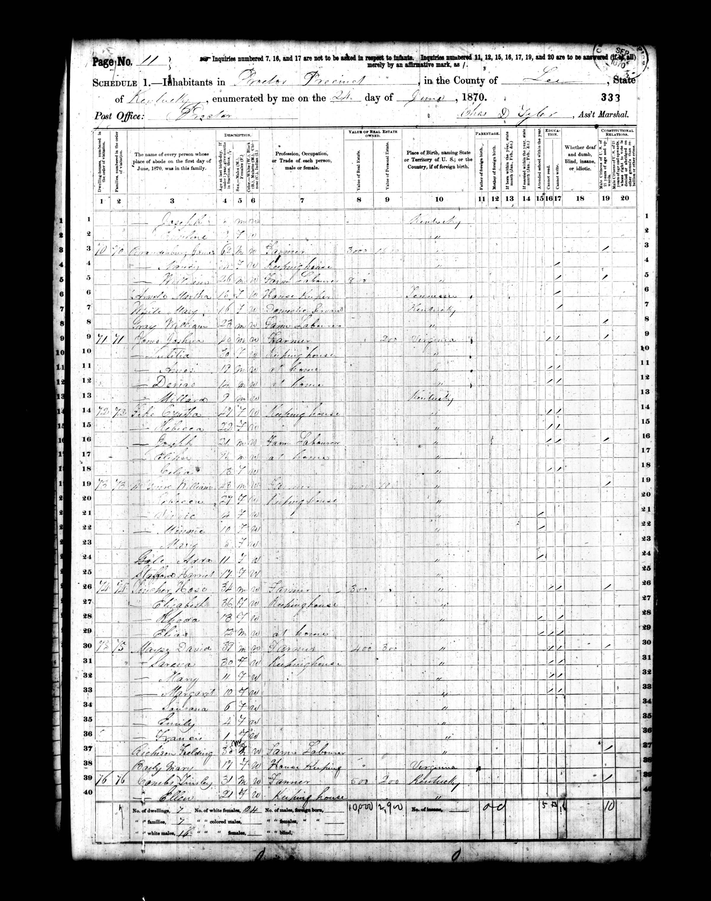

### 1b · 24 Jun 1870 · Dwelling 70 crop

**Role:** FAN  
**File:** [`sources/census/1870-lee-ky-proctor-p333a-dw70-crop.jpg`](sources/census/1870-lee-ky-proctor-p333a-dw70-crop.jpg)  
**Source:** S340 · C356 · DOC025

Lines 3–8. Mary White is a separate surname, not a Brandenburg daughter. William Gray is a labourer in the house, not a son of James.

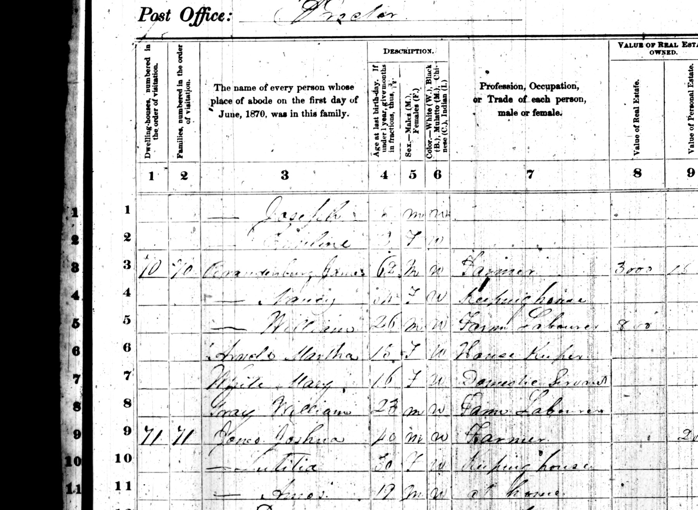

### 2a · 28 Jun 1870 · Sturgeon Precinct, 336b — Gray, Silas

**Role:** FAN (possible 1928 father of William; not merged)  
**File:** [`sources/census/1870-lee-ky-sturgeon-p336b-silas-gray.jpg`](sources/census/1870-lee-ky-sturgeon-p336b-silas-gray.jpg)  
**Source:** S341 · C348 · C357 · C358 · DOC026

Page No. 2, 28 June 1870. Dwelling **13/13**: **Gray, Silas**, 54, farmer (not Silus); **Minerva**, 48, **female**, keeping house; Amelia 21; Elihu 19. William is not in this house. Kendrick’s given-name Silus and Minerva sex M are transcript slips.

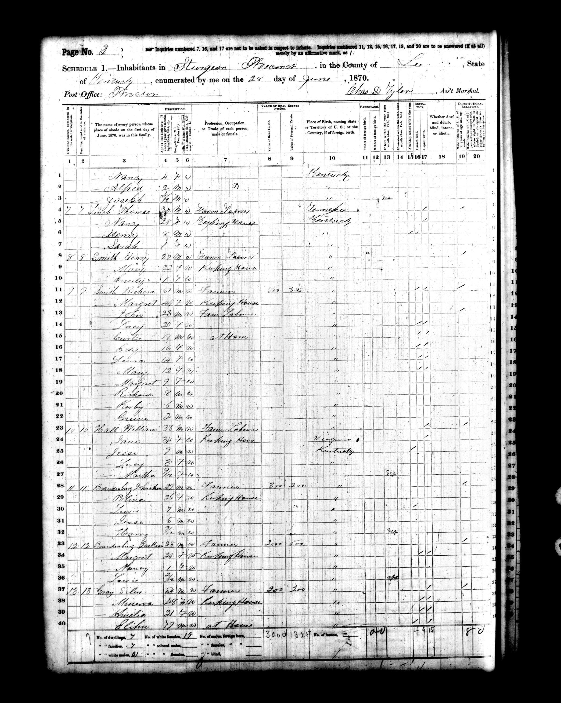

### 2b · 28 Jun 1870 · Silas Gray household crop

**Role:** FAN  
**File:** [`sources/census/1870-lee-ky-sturgeon-p336b-silas-crop.jpg`](sources/census/1870-lee-ky-sturgeon-p336b-silas-crop.jpg)  
**Source:** S341 · DOC026

Lines 37–40, including the page footer. Neighbour dwelling 12 is Brandenburg, Jackson, 38 — not merged with James 62.

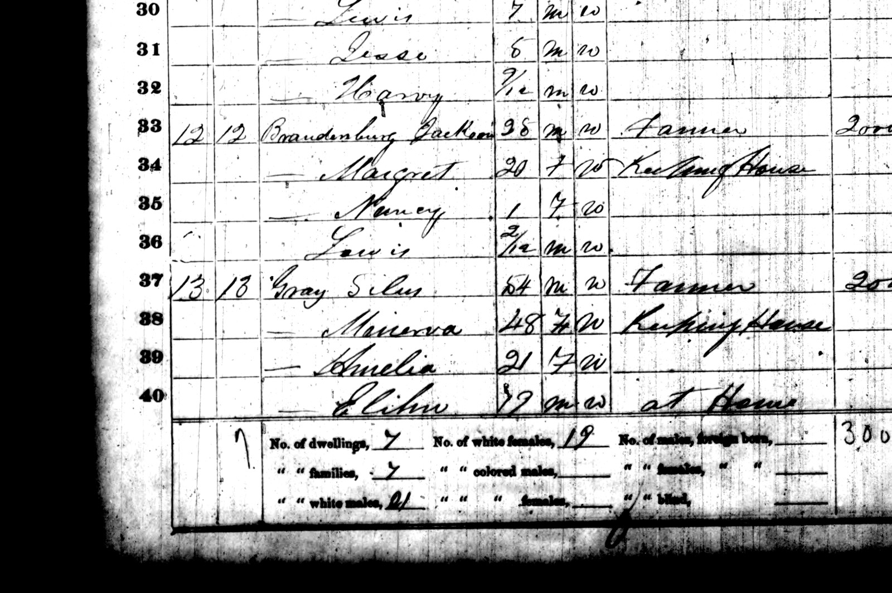

### 2c · 30 Jun 1870 · Stamped 337 — Silas household continuation

**Role:** FAN  
**File:** [`sources/census/1870-lee-ky-sturgeon-p337a-silas-continuation.jpg`](sources/census/1870-lee-ky-sturgeon-p337a-silas-continuation.jpg)  
**Source:** S341 · C348 · DOC026

Page No. 3, post office Proctor. John 18, Margret 16, Levi 14. The household ends here. No William.

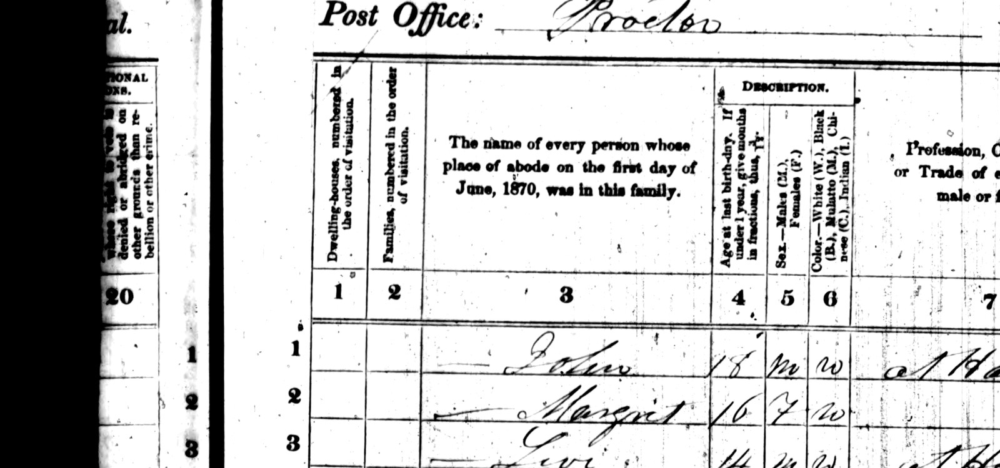

### 1 · 29 Jun 1870 · Sturgeon Precinct, page 3 (stamped 337)

**Role:** Context  
**File:** [`sources/census/1870-lee-ky-sturgeon-p337a-context.jpg`](sources/census/1870-lee-ky-sturgeon-p337a-context.jpg)  
**Source:** S042

Lee County, Kentucky, had been a county for one year. Enumerator Chas. D. Tyler took this sheet on 29 June 1870. Households Young, Kelly, Flanery, Horn and Bryant (dwelling 18) sit immediately before John Newman’s house on the next page.

### 2 · 29 Jun 1870 · John, Elizabeth, and infant Samuel Newman

**Role:** Family hit  
**File:** [`sources/census/1870-lee-ky-sturgeon-p337b-john-elizabeth-samuel.jpg`](sources/census/1870-lee-ky-sturgeon-p337b-john-elizabeth-samuel.jpg)  
**Source:** S042 · C062

Dwelling 19/19: Newman, John, 50, farm labourer; Elizabeth, 25, keeping house; and Samuel, aged 1, with eight others. This is the probable natal home of Dora’s later husband. Elizabeth, 25, cannot be the mother of Mary, 21 — the older girls belong to a prior wife or another relationship the schedule does not name. Not silently merged with the 1880 John-and-Mary house (conflict #9).

## 1880 — schedules and Soundex

### 3 · 1 Jun 1880 · John and Mary Newnam; Samuel, aged 11

**Role:** Family hit  
**File:** [`sources/census/1880-lee-ky-ed59-sheet1-p725-john-samuel.jpg`](sources/census/1880-lee-ky-ed59-sheet1-p725-john-samuel.jpg)  
**Source:** S040 · C060 · C061

Lee County ED 59, dwelling 3: John Newnam, 69, farmer (father born North Carolina); Mary, 57; Eli, 16; Susan, 20; Samuel, 11; Hannah, 9. Age 11 in June 1880 matches the June 1869 birth of Dora’s husband and the sixteen-year-old of the 1885 marriage return. Identification remains probable pending conflict #9.

### 4 · 1 Jun 1880 · Samuel McQueary, 13 — not a Newnam

**Role:** Rejected same-name  
**File:** [`sources/census/1880-lee-ky-ed59-sheet2-p726-mcqueary-samuel.jpg`](sources/census/1880-lee-ky-ed59-sheet2-p726-mcqueary-samuel.jpg)  
**Source:** S044 · C063

Continuation of dwelling 11, the McQueary household. Samuel, 13, is Samuel McQueary. The only Samuel Newnam in ED 59 is the eleven-year-old in Plate 3.

### 5 · 5 Jun 1880 · Elias and Mary Newnam; Dora, aged 8

**Role:** Family hit  
**File:** [`sources/census/1880-lee-ky-ed59-sheet6-p730-elias-dora.jpg`](sources/census/1880-lee-ky-ed59-sheet6-p730-elias-dora.jpg)  
**Source:** S010 · C001 · C003 · C004

The childhood record. Dwelling 46: Elias Newnam, 38, farmer; Mary, 38; William, 21; Malissa, 16; Francis, 14; Mary, 10; Dora, 8; Catharine, 6. A child of eight on 5 June 1880 was born in 1871 or early 1872. The death certificate’s year 1868 cannot stand. Neighbors: Joseph Newnam, 38, and John Newnam, 60.

### 6 · 1880 (index) · Soundex card — Elias Newnam household

**Role:** Family hit  
**File:** [`sources/soundex/ky1880-n550-p2105-elias-newnam.jpg`](sources/soundex/ky1880-n550-p2105-elias-newnam.jpg)  
**Source:** S001

NARA T750, code N-550. Family card for Newnam, Elias, 38, Lee County, vol. 18, ED 59, sheet 6, line 11. Lists Mary, William, Melissa (schedule: Malissa), Francis, and Mary. Footer “#1 see #2”.

### 7 · 1880 (index) · Soundex continuation — Dora and Catharine

**Role:** Family hit  
**File:** [`sources/soundex/ky1880-n550-p2106-elias-continuation-dora.jpg`](sources/soundex/ky1880-n550-p2106-elias-continuation-dora.jpg)  
**Source:** S002

Continuation card: Newnam, Dora, daughter, 8, Kentucky; Catharine, daughter, 6. This is the index confirmation of Plate 5.

## 1900 — Missouri Stone search (Tom A. candidates)

### 8 · 13 Jun 1900 · Douglas County, Missouri — Thomas and Nancy E. Stone

**Role:** Rejected same-name  
**File:** [`sources/census/1900-douglas-mo-ed159-stone-sheet.jpg`](sources/census/1900-douglas-mo-ed159-stone-sheet.jpg)  
**Source:** S085 · C101

Buchanan Township, ED 159, sheet 9B. Thomas Stone, woodchopper, born May 1856, age 44, with wife Nancy E. and five daughters. Closest-age 1900 Missouri Thomas to the 1920 Arkansas widower Tom A. Stone — still not merged (no middle initial; wife living; conflict #11).

### 9 · 13 Jun 1900 · Douglas County Stone household (crop)

**Role:** Rejected same-name  
**File:** [`sources/census/1900-douglas-mo-ed159-stone-hh-crop.jpg`](sources/census/1900-douglas-mo-ed159-stone-hh-crop.jpg)  
**Source:** S085 · C102

Crop of the Thomas and Nancy E. Stone lines. The Soundex clerk later wrote “Jesse C., son”; the original reads Ossie P., daughter.

### 10 · 1900 (index) · Missouri S-350 — Thomas Stone, 44, Douglas County

**Role:** Rejected same-name  
**File:** [`sources/soundex/mo1900-s350-p1678-stone-thomas-44-douglas.jpg`](sources/soundex/mo1900-s350-p1678-stone-thomas-44-douglas.jpg)  
**Source:** S085 · C092

Soundex card for the household in Plates 8–9. Finding aid only; the original schedule is the authority.

### 11 · 1900 (index) · Missouri S-350 — Douglas continuation, “Jesse C.”

**Role:** Rejected same-name  
**File:** [`sources/soundex/mo1900-s350-p1679-stone-thomas-douglas-jesse.jpg`](sources/soundex/mo1900-s350-p1679-stone-thomas-douglas-jesse.jpg)  
**Source:** S085 · C102

Clerk error: “Jesse C., son” is Ossie P., daughter, on the original (Plate 9). Not a son of Tom A. of Perry County.

### 12 · 1900 (index) · Missouri S-350 — Thomas Stone, 50, Caldwell County

**Role:** Rejected same-name  
**File:** [`sources/soundex/mo1900-s350-p1680-stone-thomas-50-caldwell.jpg`](sources/soundex/mo1900-s350-p1680-stone-thomas-50-caldwell.jpg)  
**Source:** S085 · C092

Wrong county, wrong age trajectory versus 1920 Tom A. of Perry County, Arkansas. Rejected.

### 13 · 1900 (index) · Missouri S-350 — Thomas A. Stone, 32, Dunklin County

**Role:** Rejected same-name  
**File:** [`sources/soundex/mo1900-s350-p1684-stone-thomas-a-32-dunklin.jpg`](sources/soundex/mo1900-s350-p1684-stone-thomas-a-32-dunklin.jpg)  
**Source:** S085 · C092

Has the middle initial A. Age 32 (born February 1868) with wife Matilda. Too young for the 1920 sixty-two-year-old. Not merged.

### 14 · 1900 (index) · Missouri S-350 — Thomas A. Stone, 24, Cooper County

**Role:** Rejected same-name  
**File:** [`sources/soundex/mo1900-s350-p1685-stone-thomas-a-24-cooper.jpg`](sources/soundex/mo1900-s350-p1685-stone-thomas-a-24-cooper.jpg)  
**Source:** S085 · C092

Nephew, born March 1876. Fails age. Not merged.

### 15 · 1900 (index) · Missouri S-350 — Tom Stone, 21, Black

**Role:** Rejected same-name  
**File:** [`sources/soundex/mo1900-s350-p1727-stone-tom-black-21.jpg`](sources/soundex/mo1900-s350-p1727-stone-tom-black-21.jpg)  
**Source:** S085 · C092

Fails race, age, and household. Not Tom A. of 1920 Arkansas.

### 16 · 1900 (index) · Missouri S-350 — Tom Stone, 31, Vernon County

**Role:** Rejected same-name  
**File:** [`sources/soundex/mo1900-s350-p1728-stone-tom-31-vernon.jpg`](sources/soundex/mo1900-s350-p1728-stone-tom-31-vernon.jpg)  
**Source:** S085 · C092

Coal-miner boarder, born May 1869. No wife, no daughters matching 1920. Not merged.

## 1910 — Soundex, Peebles test, and Sturgeon ED 99

### 17 · Apr 1910 · Kentucky N-550 — Millie / Missouri; no McCoy

**Role:** Negative search  
**File:** [`sources/soundex/ky1910-n550-p329-millie-missouri.jpg`](sources/soundex/ky1910-n550-p329-millie-missouri.jpg)  
**Source:** S021 · C031

Typed Miracode page for Kentucky Newman/Newnam. Alphabetically this is the slot immediately before Monroe, where a McCoy card would sit. None is printed. Dora’s son is not indexed in Kentucky that April.

### 18 · Apr 1910 · Kentucky N-550 — Monroe; still no McCoy

**Role:** Negative search  
**File:** [`sources/soundex/ky1910-n550-p330-monroe-no-mccoy.jpg`](sources/soundex/ky1910-n550-p330-monroe-no-mccoy.jpg)  
**Source:** S021 · C031

The next printed page, beginning Monroe. Combined with Plate 17, Kentucky has no McCoy Newman/Newnam in 1910.

### 19 · Apr 1910 · Kentucky N-550 — Sam / Samuel, none is the husband

**Role:** Rejected same-name  
**File:** [`sources/soundex/ky1910-n550-p342-sam-samuel-not-p002.jpg`](sources/soundex/ky1910-n550-p342-sam-samuel-not-p002.jpg)  
**Source:** S027 · C039

Sam, 74, of Knox; Samuel of Newport; a Black Samuel Noonan; a Louisville Samuel, 31; Samuel C. of Butler. None is Samuel P. Newnam of Lee County with Dora’s children.

### 20 · Apr 1910 · Kentucky N-550 — Samuel E. of Muhlenberg

**Role:** Rejected same-name  
**File:** [`sources/soundex/ky1910-n550-p343-samuel-e-muhlenberg-not-p002.jpg`](sources/soundex/ky1910-n550-p343-samuel-e-muhlenberg-not-p002.jpg)  
**Source:** S027 · C039

Samuel E., 41, with Lou E. and children Bertha, Luea, Joseph, Mary, Minnie. Wrong county, wrong wife, wrong children. Closes the Kentucky-head search for Dora’s first husband in April 1910.

### 20a · Apr 1910 · Kentucky N-550 — Charles T. Newman + Ella 40, Union County

**Role:** Rejected same-name  
**File:** [`sources/soundex/1910-ky-n550-p0255-charles-t-ella-union.jpg`](sources/soundex/1910-ky-n550-p0255-charles-t-ella-union.jpg)  
**Source:** S301 · C306 · DOC020

Typed Miracode: Union County, Charles T. head 29, Ella wife 40, Henry A. 12, Elisebeth 7. Not Dora of Sturgeon.

### 20b · Apr 1910 · Kentucky N-550 — Beattyville Chas + Emma

**Role:** Context (FAN)  
**File:** [`sources/soundex/1910-ky-n550-p0256-lee-beattyville-chas-emma.jpg`](sources/soundex/1910-ky-n550-p0256-lee-beattyville-chas-emma.jpg)  
**Source:** S301 · C307 · DOC021

Lee County, Beattyville, ED 91: Chas 21, Emma 23, Seldon, Addie 18. Wrong ages and wife. Already inside the Beattyville original sweep.

### 20c · Apr 1910 · Kentucky N-550 — Elizati Newnan, Lee ED 99

**Role:** Context (FAN)  
**File:** [`sources/soundex/1910-ky-n550-p0267-elizati-lee.jpg`](sources/soundex/1910-ky-n550-p0267-elizati-lee.jpg)  
**Source:** S301 · DOC022

Sturgeon ED 99 family 90: Elizati 30, Lucy 22, Robert, Willie, Nettie. Already inside the original ED 99 sweep. Not P001.

### 20d · Apr 1910 · Kentucky N-550 — Ella window (printed p. 266)

**Role:** Negative search  
**File:** [`sources/soundex/1910-ky-n550-p0268-ella-window.jpg`](sources/soundex/1910-ky-n550-p0268-ella-window.jpg)  
**Source:** S301 · C301–C305 · C308 · DOC019

The Ella given-name cards: Elkaner of Floyd; Ella 35 servant in Newport; Ella 13 Black in Lexington; Ellanora 4½ in Pendleton; Ellen 77 Irish lodger in Lexington. **No** Ella ~39 in Lee, Greene, or Owsley.

### 20e · Apr 1910 · Kentucky N-550 — after Ella (printed p. 267)

**Role:** Negative search  
**File:** [`sources/soundex/1910-ky-n550-p0269-after-ella-ellen-elsie.jpg`](sources/soundex/1910-ky-n550-p0269-after-ella-ellen-elsie.jpg)  
**Source:** S301 · C313 · DOC023

Ellen / Elliott / Ellis / Elsie / Emerald. The Ella slot is closed.

### 21 · Apr 1910 · Kentucky S-350 — Dora Stone, servant, Louisville

**Role:** Rejected same-name  
**File:** [`sources/soundex/ky1910-s350-p149-dora-servant-louisville.jpg`](sources/soundex/ky1910-s350-p149-dora-servant-louisville.jpg)  
**Source:** S026 · C038

STONE, DORA, servant, Black, 36, Louisville, with J. Frank Taylor. Fails race, age, occupation, and household. Dora Newnam was not indexed as Dora Stone in Kentucky that April.

### 22 · Apr 1910 · Kentucky S-350 — Dora Stone, 18, Wolfe County

**Role:** Rejected same-name  
**File:** [`sources/soundex/ky1910-s350-p150-dora-18-wolfe.jpg`](sources/soundex/ky1910-s350-p150-dora-18-wolfe.jpg)  
**Source:** S026 · C038

STONE, DORA, daughter-in-law, 18, Wolfe County, with Lucindy Stone. Age 18 versus about 39. The two Kentucky Dora Stones of 1910 are both the wrong women.

### 23 · Apr 1910 · Arkansas N-550 — Cora / Dan; no Coy

**Role:** Negative search  
**File:** [`sources/soundex/ar1910-n550-p678-cora-dan-no-coy.jpg`](sources/soundex/ar1910-n550-p678-cora-dan-no-coy.jpg)  
**Source:** S022 · C032

No Coy between Cora and Dan. Dora’s son is not indexed in Arkansas as a Newman head in April 1910.

### 24 · Apr 1910 · Arkansas N-550 — Dan E.; no Dora

**Role:** Negative search  
**File:** [`sources/soundex/ar1910-n550-p679-dan-e-no-dora.jpg`](sources/soundex/ar1910-n550-p679-dan-e-no-dora.jpg)  
**Source:** S022 · C032

After Dan the cards run Daneil W., David R., Dut H., then the E-names. No Dora, no Ella.

### 25 · Apr 1910 · Arkansas N-550 — Mary / Mayme

**Role:** Negative search  
**File:** [`sources/soundex/ar1910-n550-p701-mary-mayme.jpg`](sources/soundex/ar1910-n550-p701-mary-mayme.jpg)  
**Source:** S022 · C032

Mary through Mayme Newman cards. The McCoy window is the next plate.

### 26 · Apr 1910 · Arkansas N-550 — Melvina; no McCoy

**Role:** Negative search  
**File:** [`sources/soundex/ar1910-n550-p702-melvina-no-mccoy.jpg`](sources/soundex/ar1910-n550-p702-melvina-no-mccoy.jpg)  
**Source:** S022 · C032

After Mayme comes Melvina. No McCoy. Arkansas is closed for Newman Dora ~39 and McCoy in April 1910.

### 27 · Apr 1910 · Missouri N-550 — Cyrus / Daisy; no Coy

**Role:** Negative search  
**File:** [`sources/soundex/mo1910-n550-p710-cyrus-daisy-no-coy.jpg`](sources/soundex/mo1910-n550-p710-cyrus-daisy-no-coy.jpg)  
**Source:** S023 · C034

No Coy between Cyrus and Daisy. The Sullivan-Missouri hypothesis fails for this surname in 1910.

### 28 · Apr 1910 · Missouri N-550 — Dora L. Neimann of St. Louis

**Role:** Rejected same-name  
**File:** [`sources/soundex/mo1910-n550-p714-dollie-dora-l-neimann.jpg`](sources/soundex/mo1910-n550-p714-dollie-dora-l-neimann.jpg)  
**Source:** S023 · C035

The only Dora in the Missouri Newman block: Dora L. Neimann, 48, Illinois-born, mother-in-law of Arthur E. Felsh in St. Louis. Wrong age, birthplace, household. Not Dora Ella.

### 29 · Apr 1910 · Missouri N-550 — May / Michael; no McCoy

**Role:** Negative search  
**File:** [`sources/soundex/mo1910-n550-p819-may-michael-no-mccoy.jpg`](sources/soundex/mo1910-n550-p819-may-michael-no-mccoy.jpg)  
**Source:** S023 · C034

No McCoy between May and Michael. Missouri is closed for Newman Coy/McCoy in April 1910.

### 30 · Apr 1910 · Oklahoma N-550 — Newman sample; no Dora

**Role:** Negative search  
**File:** [`sources/soundex/ok1910-n550-newman-sample.jpg`](sources/soundex/ok1910-n550-newman-sample.jpg)  
**Source:** S049 · C068

Card-by-card reading of the Oklahoma Newman block found no Dora of thirty-nine born Kentucky and no household matching Samuel’s Sturgeon children.

### 31 · Apr 1910 · Texas N-550 — Dennis Newman sample

**Role:** Negative search  
**File:** [`sources/soundex/tx1910-n550-newman-dennis.jpg`](sources/soundex/tx1910-n550-newman-dennis.jpg)  
**Source:** S050 · C069

Texas Soundex Newman window, sampled. Other Doras appear in adjacent surnames (for example Dixon) and fail. Dora Ella Newnam is not indexed here.

### 32 · Apr 1910 · Tennessee N-550 — “D” tab; no Coy

**Role:** Negative search  
**File:** [`sources/soundex/tn1910-n550-p2177-d-tab-no-coy.jpg`](sources/soundex/tn1910-n550-p2177-d-tab-no-coy.jpg)  
**Source:** S025 · C036

Handwritten Tennessee N-550. After Clifford of Lauderdale comes a blank D tab. Coy is not there.

### 33 · Apr 1910 · Tennessee N-550 — Mary D.

**Role:** Negative search  
**File:** [`sources/soundex/tn1910-n550-p2461-mary-d.jpg`](sources/soundex/tn1910-n550-p2461-mary-d.jpg)  
**Source:** S028 · C031b

Start of the M-window where McCoy would file. Mary D. is present; McCoy is not.

### 34 · Apr 1910 · Tennessee N-550 — Mek. G.; not McCoy

**Role:** Negative search  
**File:** [`sources/soundex/tn1910-n550-p2463-mek-g-not-mccoy.jpg`](sources/soundex/tn1910-n550-p2463-mek-g-not-mccoy.jpg)  
**Source:** S028 · C031b

Mek. G. of Cheatham County sits in the slot a McCoy card would occupy. It is not McCoy Newnam.

### 35 · Apr 1910 · Tennessee N-550 — Melvin of Giles

**Role:** Negative search  
**File:** [`sources/soundex/tn1910-n550-p2465-melvin-giles.jpg`](sources/soundex/tn1910-n550-p2465-melvin-giles.jpg)  
**Source:** S028 · C031b

Two Melvins of Giles County. Still no McCoy.

### 36 · Apr 1910 · Tennessee N-550 — Minerva

**Role:** Negative search  
**File:** [`sources/soundex/tn1910-n550-p2466-minerva.jpg`](sources/soundex/tn1910-n550-p2466-minerva.jpg)  
**Source:** S028 · C031b

Minerva and Minnie cards. The McCoy window is closing.

### 37 · Apr 1910 · Tennessee N-550 — Mitchell, after the McCoy slot

**Role:** Negative search  
**File:** [`sources/soundex/tn1910-n550-p2469-mitchell-after-mccoy-slot.jpg`](sources/soundex/tn1910-n550-p2469-mitchell-after-mccoy-slot.jpg)  
**Source:** S028 · C031b

Mitchell follows. Tennessee has no McCoy Newman/Newnam in 1910.

### 38 · Apr 1910 · Kentucky P-142 — Peebles/Peeples/Peoples block begins

**Role:** Context  
**File:** [`sources/soundex/ky1910-p142-p235-p142-starts.jpg`](sources/soundex/ky1910-p142-p235-p142-starts.jpg)  
**Source:** S062 · C081

Start of the statewide 1910 Miracode P-142 household block. Searched for a Dora of thirty-nine as head or wife. A later Peebles marriage is not supported.

### 39 · Apr 1910 · Kentucky P-142 — Dottie / Clyde; no Dora

**Role:** Negative search  
**File:** [`sources/soundex/ky1910-p142-p238-dottie-clyde-no-dora.jpg`](sources/soundex/ky1910-p142-p238-dottie-clyde-no-dora.jpg)  
**Source:** S062 · C081

D-window of Kentucky Peebles/Peeples/Peoples. No Dora of thirty-nine as head.

### 40 · Apr 1910 · Kentucky P-142 — Edora Peoples, 65, Graves County

**Role:** Rejected same-name  
**File:** [`sources/soundex/ky1910-p142-p239-edora-peoples-65-graves-rejected.jpg`](sources/soundex/ky1910-p142-p239-edora-peoples-65-graves-rejected.jpg)  
**Source:** S062 · C082

The only near-hit in the D-window: Edora Peoples, a sixty-five-year-old Tennessee-born sister-in-law in Graves County. Fails age, birthplace, and relationship. Not Dora Ella.

### 41 · Apr 1910 · Arkansas P-142 — Clyde / Dave; no Dora ~39

**Role:** Negative search  
**File:** [`sources/soundex/ar1910-p142-p188-d-window-clyde-dave-no-dora.jpg`](sources/soundex/ar1910-p142-p188-d-window-clyde-dave-no-dora.jpg)  
**Source:** S063 · C083

Arkansas Peebles/Peeples D-window. Clyde through Dave. No Dora of thirty-nine.

### 42 · Apr 1910 · Arkansas P-142 — E. Edd Peoples of Yell County

**Role:** Rejected same-name  
**File:** [`sources/soundex/ar1910-p142-p189-yell-e-edd-peoples-not-dora.jpg`](sources/soundex/ar1910-p142-p189-yell-e-edd-peoples-not-dora.jpg)  
**Source:** S063 · C083

Yell County did have an E. Edd Peoples household: he twenty-seven, wife Catharine twenty-one. That is not Dora.

### 43 · Apr 1910 · Arkansas P-142 — Dora Sykes, 19, stepdaughter

**Role:** Rejected same-name  
**File:** [`sources/soundex/ar1910-p142-p190-ed-peebles-dora-sykes-19-rejected.jpg`](sources/soundex/ar1910-p142-p190-ed-peebles-dora-sykes-19-rejected.jpg)  
**Source:** S063 · C083

Dora Sykes, nineteen, stepdaughter of Ed Peebles in Mississippi County. Age 19 versus about 39. Rejected.

### 44 · Apr 1910 · Arkansas P-142 — Dora Bell Peoples, 16

**Role:** Rejected same-name  
**File:** [`sources/soundex/ar1910-p142-p200-julius-dora-bell-16-rejected.jpg`](sources/soundex/ar1910-p142-p200-julius-dora-bell-16-rejected.jpg)  
**Source:** S063 · C083 · C087

Dora Bell, sixteen, sister-in-law of Julius Peoples in Jefferson County. Age 16. Rejected. A third marriage to a Peebles before Stone is not supported.

### 45 · Apr 1910 · Fincastle ED 96 sheet 7A — Internet Archive PDF page 499

**Role:** Context  
**File:** [`sources/census/1910-po478-p0499-lee-fincastle-ed96-sheet7a.jpg`](sources/census/1910-po478-p0499-lee-fincastle-ed96-sheet7a.jpg)  
**Source:** S067 · C082/C084

Method note. Ancestry’s “image 499” is not this PDF page. Page 499 on the Internet Archive reel is Fincastle, ED 96, not Sturgeon. Sturgeon sheet 9B is PDF page 568 (Plate 54).

### 46 · 15 Apr 1910 · Sturgeon ED 99 sheet 1A — the precinct begins

**Role:** Context  
**File:** [`sources/census/1910-lee-ky-ed99-p551.jpg`](sources/census/1910-lee-ky-ed99-p551.jpg)  
**Source:** S067 · C088

Lee County, Precinct 7, Mag. Dist. 7, 15 April 1910. Header on this pass read Elam Brandenburg (a later pass read Elton E. Newnam on sheet 8A — conflict #13, unresolved). Dwelling 1 is not a Newnam house. Dora is not on this sheet.

### 47 · 21 Apr 1910 · Sturgeon ED 99 sheet 4A — Richard Newnam; dwelling 67 is Hamilton

**Role:** Rejected same-name  
**File:** [`sources/census/1910-lee-ky-ed99-p557.jpg`](sources/census/1910-lee-ky-ed99-p557.jpg)  
**Source:** S067 · S089 · C088 · C106

Richard Newnam, 45, and Sarah, 44, with children including twins David and Georgia. Not Samuel and Dora. On this sheet the 1900 dwelling-number 67 site is occupied by a Hamilton household, not by Samuel P. Newnam.

### 48 · 21 Apr 1910 · Sturgeon ED 99 sheet 4A (second capture)

**Role:** Negative search  
**File:** [`sources/census/1910-po478-p0557-lee-sturgeon-ed99-sheet4a.jpg`](sources/census/1910-po478-p0557-lee-sturgeon-ed99-sheet4a.jpg)  
**Source:** S089 · C106

Independent capture of the same sheet from a parallel research pass. Dwelling 67 = Hamilton, Robert. The 1900 Newnam house is gone.

### 49 · Apr 1910 · Sturgeon ED 99 sheet 5A — Elijah Newnan, dwelling 66

**Role:** Rejected same-name  
**File:** [`sources/census/1910-po478-p0559-lee-sturgeon-ed99-sheet5a-elijah-newnan.jpg`](sources/census/1910-po478-p0559-lee-sturgeon-ed99-sheet5a-elijah-newnan.jpg)  
**Source:** S089 · C088

Elijah Newnan at dwelling 66. Same-name neighbor, not Dora’s household.

### 50 · 26 Apr 1910 · Sturgeon ED 99 sheet 6A — Harry, Albert, John and Ollie Newman

**Role:** Rejected same-name  
**File:** [`sources/census/1910-lee-ky-ed99-p561.jpg`](sources/census/1910-lee-ky-ed99-p561.jpg)  
**Source:** S067 · C088

Sherman Ross’s brothers-in-law Harry Newman, 42, and Albert, 23. Next: John Newman, 31, married one year to Ollie, 19. Not Samuel (age, wife, duration).

### 51 · Apr 1910 · Sturgeon ED 99 sheet 6B — dwelling 67 is Garrett

**Role:** Negative search  
**File:** [`sources/census/1910-po478-p0560-lee-sturgeon-ed99-sheet6b-dw67-garrett.jpg`](sources/census/1910-po478-p0560-lee-sturgeon-ed99-sheet6b-dw67-garrett.jpg)  
**Source:** S089 · C106

A second 1910 dwelling numbered 67, occupied by John T. Garrett. The 1900 Samuel–Dora house is not here either.

### 52 · 27 Apr 1910 · Sturgeon ED 99 sheet 7A — Reuben Newnam

**Role:** Rejected same-name  
**File:** [`sources/census/1910-lee-ky-ed99-p563.jpg`](sources/census/1910-lee-ky-ed99-p563.jpg)  
**Source:** S067 · C088

Dwelling 101/134: Newnam, Reuben, 33, and Nannie, 26, with Edward, Elzie, and Mary. Not Samuel and Dora.

### 53 · 27 Apr 1910 · Sturgeon ED 99 sheet 7A (second capture) — Ruben Newnam

**Role:** Rejected same-name  
**File:** [`sources/census/1910-po478-p0563-lee-sturgeon-ed99-sheet7a-ruben-newnam.jpg`](sources/census/1910-po478-p0563-lee-sturgeon-ed99-sheet7a-ruben-newnam.jpg)  
**Source:** S089 · C088

Parallel capture of Reuben/Ruben Newnam at dwelling 101. Same rejection.

### 54 · Apr 1910 · Sturgeon ED 99 sheet 9B — Ancestry image 499 = this PDF page 568

**Role:** Context  
**File:** [`sources/census/1910-po478-p0568-lee-sturgeon-ed99-sheet9b.jpg`](sources/census/1910-po478-p0568-lee-sturgeon-ed99-sheet9b.jpg)  
**Source:** S089 · C088

The sheet Ancestry numbers as image 499. No Dora, Samuel, McCoy, or the 1899 child John H.

### 55 · Apr 1910 · Sturgeon ED 99 sheet 13B — a different John H. Newman

**Role:** Rejected same-name / FAN  
**File:** [`sources/census/1910-lee-ky-ed99-p576.jpg`](sources/census/1910-lee-ky-ed99-p576.jpg)  
**Source:** S067 · S311 · C088 · C089 · C317 · C319 · C320 · C322

Sheet 13 B, 11 May 1910. Dwelling 237/247: Newman, John H. — not Dora’s child. Dwelling 241/251: **Gray, Hardin** 34 and **Vista** 27 (4-4) with Rascoe, Hubert, Elcie, Deanna — Louisa is not in that house. Dwelling 245/255: Samuel and Martha Farmer. Family 248 is Treadway, Solomon. She was not still on Sturgeon Creek as a Newnam.

### 55a · 11 May 1910 · Hardin Gray and Vista — household crop

**Role:** FAN (Vesta Mayes Gray, Louisa’s daughter)  
**File:** [`sources/census/1910-lee-ky-ed99-sh13b-hardin-gray-crop.jpg`](sources/census/1910-lee-ky-ed99-sh13b-hardin-gray-crop.jpg)  
**Source:** S312 · C317 · DOC024

Crop of dwelling 241 family 251. Hardin Gray, 34, married 12 years, farmer; Vista, 27, four children living; father born Virginia. No mother-in-law. This is the original that a prior hunt said was missing from the film.

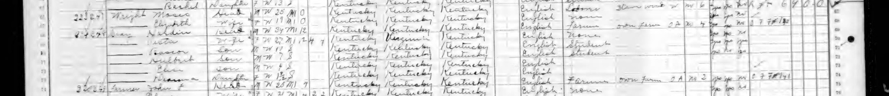

## 1920 — Kentucky Newman index and Beattyville original

### 56 · Jan 1920 · Kentucky N-550 — Dora Newman, 29, Paducah

**Role:** Rejected same-name  
**File:** [`sources/soundex/ky1920-n550-p4201-dora-29-paducah-rejected.jpg`](sources/soundex/ky1920-n550-p4201-dora-29-paducah-rejected.jpg)  
**Source:** S045 · C064

Daughter of Mary E. Vaelkel, age 29. Dora Ella would have been about 48. Rejected.

### 57 · Jan 1920 · Kentucky N-550 — Dora E. Newman, 10, Cumberland

**Role:** Rejected same-name  
**File:** [`sources/soundex/ky1920-n550-p4203-dora-e-10-cumberland-rejected.jpg`](sources/soundex/ky1920-n550-p4203-dora-e-10-cumberland-rejected.jpg)  
**Source:** S045 · C064

A child of ten. Not our Dora.

### 58 · Jan 1920 · Kentucky N-550 — “E” tab after the Dora window

**Role:** Negative search  
**File:** [`sources/soundex/ky1920-n550-p4205-e-tab-after-dora.jpg`](sources/soundex/ky1920-n550-p4205-e-tab-after-dora.jpg)  
**Source:** S045 · C064

The Dora given-name window in Kentucky Newman/Newnam ends. No woman of forty-eight. She was not indexed in Kentucky as Newman Dora in January 1920.

### 59 · Jan 1920 · Kentucky N-550 — E. T. Neuman, grandfather, Beattyville

**Role:** Family hit  
**File:** [`sources/soundex/ky1920-n550-p4208-et-newnam-beattyville.jpg`](sources/soundex/ky1920-n550-p4208-et-newnam-beattyville.jpg)  
**Source:** S046 · C091

Soundex card: Neuman, E.T., Grand Father of Burke, C.B., Beattyville. This is Dora’s father, living with his granddaughter Provie Hoover Burke. Derivative of Plate 60.

### 60 · 12 Jan 1920 · Beattyville ED 111 sheet 6A — C. B. Burke and E. T. Newman

**Role:** Family hit  
**File:** [`sources/census/1920-lee-ky-ed111-sh6a-burke-et-newman.jpg`](sources/census/1920-lee-ky-ed111-sh6a-burke-et-newman.jpg)  
**Source:** S073 · C091 · C095

Original schedule, 12 January 1920, enumerator Harry L. Perkins. Dwelling 106: C.B. Burke, 40, postmaster, owns free; wife Provie, 30, assistant postmaster; children Vivie M., 14, Vedia G., 10, George P.; Newman, E.T., Grand Father, 75, widowed, occupation none; boarders Bertie Combs (railroad clerk) and Warren C. Miller, 23, of Pennsylvania. Relationship is to the head; E.T. is grandfather of Provie, not of C.B. (conflict #12, resolved).

### 61 · 12 Jan 1920 · Burke household crop — E. T. Newman, grandfather

**Role:** Family hit  
**File:** [`sources/census/1920-lee-ky-ed111-sh6a-burke-hh-crop.jpg`](sources/census/1920-lee-ky-ed111-sh6a-burke-hh-crop.jpg)  
**Source:** S073 · C091

Crop of lines 17–24. Dora is not in this house. Her father is. She is not in Coy’s house at Danville, Yell County, either. The 1920 hole remains.

## Pass 34–37 additions (FAN originals and rejects)

### 7a · 1880 (index) · Elisha Gray, 28, Lee ED 59 sheet 28

**Role:** Rejected same-name  
**File:** [`sources/soundex/ky1880-g600-p4850-elisha-gray-lee-ed59.jpg`](sources/soundex/ky1880-g600-p4850-elisha-gray-lee-ed59.jpg)  
**Source:** S328 · C342 · DOC029

Soundex G-600. Wife M. Jane, 22; daughter Nancy, 1. Same district as Dora in 1880, not William × Mary J. (ages and children fail).

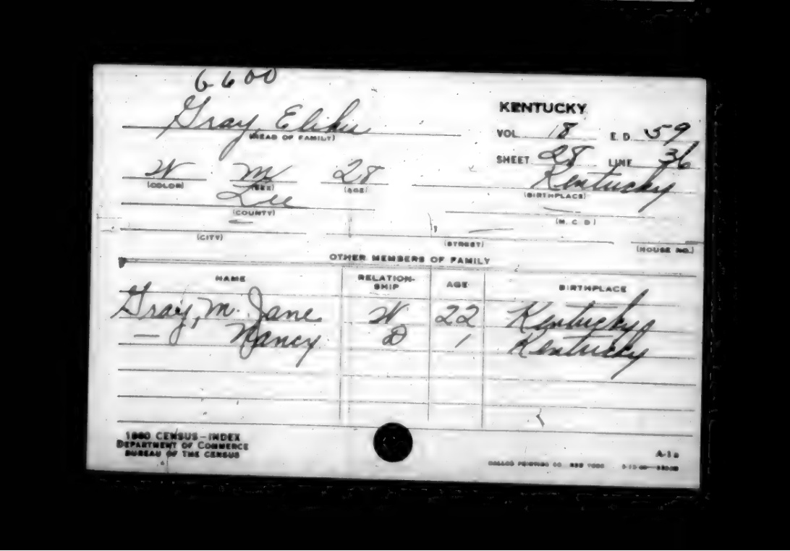

### 7b · 1880 (index) · Caroline Gray, 44, Virginia, Lee ED 59 sheet 43

**Role:** FAN  
**File:** [`sources/soundex/ky1880-g600-p4780-caroline-gray-lee-ed59.jpg`](sources/soundex/ky1880-g600-p4780-caroline-gray-lee-ed59.jpg)  
**Source:** S329 · C343 · C350 · DOC030

No William ~33 or Hardin ~4 in this house. Probable continuation of the 1870 Thomas Precinct Caroline.

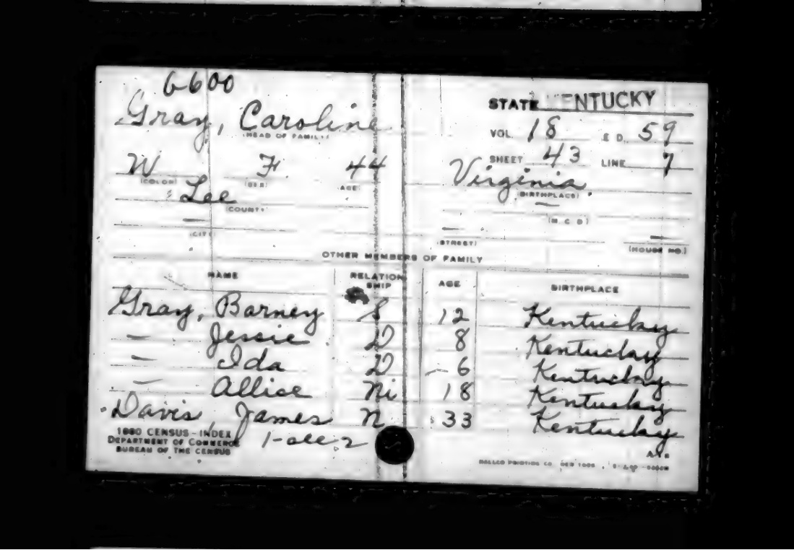

### 7c · 1880 (index) · William Gray, 45, Lewis County

**Role:** Rejected same-name  
**File:** [`sources/soundex/ky1880-g600-p0667-william-gray-lewis-rejected.jpg`](sources/soundex/ky1880-g600-p0667-william-gray-lewis-rejected.jpg)  
**Source:** S330 · C344 · DOC032

Lewis County, wife Maria, 36. Not Lee, not Mary J.

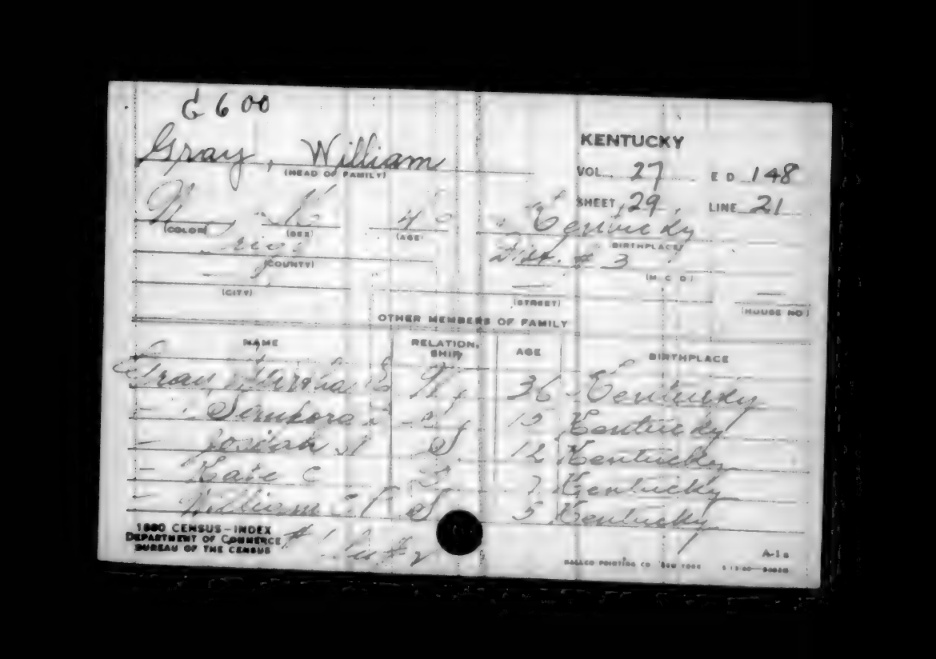

### 7d · 1 Jun 1900 · Sturgeon dwelling 84 — William Gray, 53

**Role:** FAN  
**File:** [`sources/census/1900-lee-ky-ed52-sh5b-hh84-william-gray.jpg`](sources/census/1900-lee-ky-ed52-sh5b-hh84-william-gray.jpg)  
**Source:** S315 · C326 · C332 · DOC027

Original crop, ED 52 sheet 5 B. William, May 1847, age **53**, married 29 years — not age 84 (that number is the dwelling). Mary J., January 1854, 7-7. Mother-in-law Elizabeth Brandenburgh, December 1831. Hardin is dwelling 85 on the next lines; that nativity crop is held by a sibling PR and was not re-opened here.

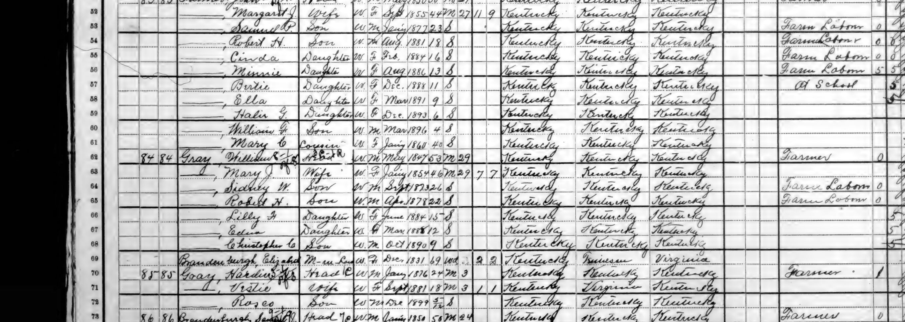

### 55b · 11 May 1910 · William Gray and Mary Jane — household crop

**Role:** FAN  
**File:** [`sources/census/1910-lee-ky-ed99-sh13b-william-gray-crop.jpg`](sources/census/1910-lee-ky-ed99-sh13b-william-gray-crop.jpg)  
**Source:** S322 · C321 · C332 · DOC031

Same sheet as Hardin (plate 55a). Dwelling 248 family 258: William, 60, married 40 years; Mary Jane, 56, 7-6. Columbus, 27, is the next head.

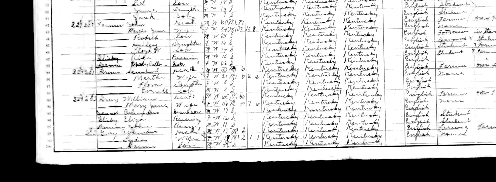

### 55c · 3 May 1910 · Rhodes, Henry C., and Dora M., 37, Missouri

**Role:** Rejected same-name  
**File:** [`sources/census/1910-bollinger-ed1-dora-e-stone-rejected.png`](sources/census/1910-bollinger-ed1-dora-e-stone-rejected.png)  
**Source:** S321 · C338 · C323 · DOC028

Crooked Creek Township, Bollinger County, Missouri, ED **1** sheet **10 A** — not Liberty ED 5. Husband **Rhodes**, not Stone. Wife **Dora M.**, 37, born **Missouri**, 6-6. A sibling label “Dora E. Stone” is a surname misread of this page. Not P001.

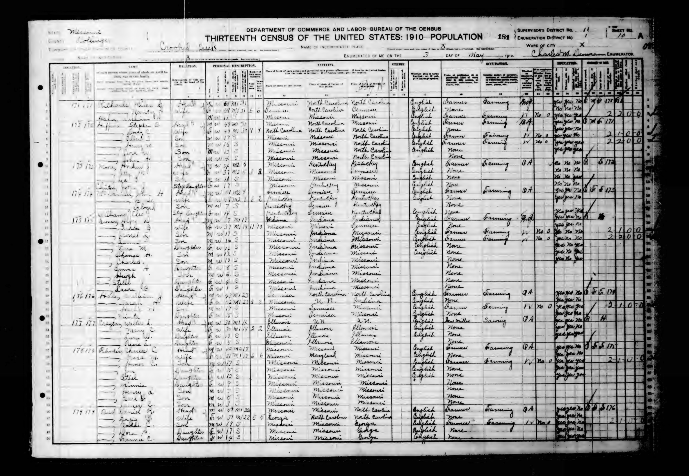

## Pass 38 additions

### 1b · 17 Jun 1870 · Travellers Rest dwelling 131 — Elias Newman, 26

**Role:** Family hit (negative for Dora)  
**File:** [`sources/census/1870-owsley-travrest-elias-hh131-pdfp090.jpg`](sources/census/1870-owsley-travrest-elias-hh131-pdfp090.jpg)  
**Source:** S355 · C375 · C067 · DOC033

Original. Page 14, stamped 348. Elias 26, Mary 26, four children, no Dora. Header 17 June (not Kendrick’s 7 June). Next door Isaac 37.

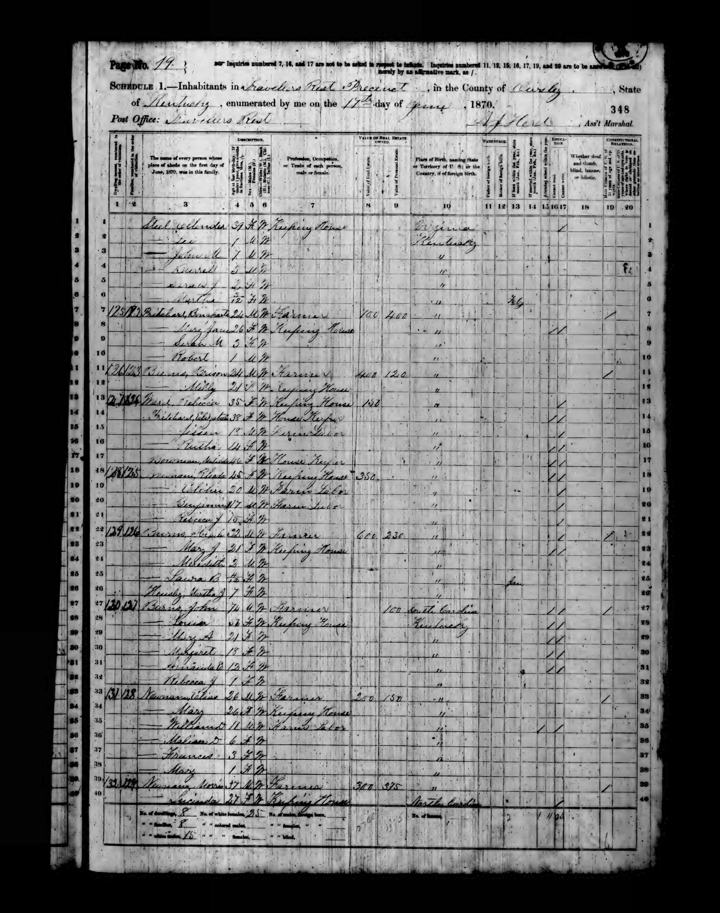

### 7e · 17 Jun 1880 · Lee ED 59 page 28 — Elisha Gray, 28

**Role:** Rejected same-name  
**File:** [`sources/census/1880-lee-ky-ed59-sheet28-p753-elisha-gray.jpg`](sources/census/1880-lee-ky-ed59-sheet28-p753-elisha-gray.jpg)  
**Source:** S363 · C389 · C342 · DOC038

Original, extracted from T9-427 PDF page 753. Wife M. Jane 22, daughter Nancy 1. Not William × Mary J.

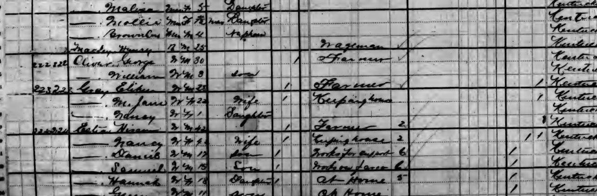

### 7f · 28 Jun 1880 · Lee ED 59 page 43 — Caroline Gray, 44, Virginia

**Role:** FAN  
**File:** [`sources/census/1880-lee-ky-ed59-sheet43-p768-caroline-gray.jpg`](sources/census/1880-lee-ky-ed59-sheet43-p768-caroline-gray.jpg)  
**Source:** S364 · C390 · C343 · DOC039

Original, PDF page 768. No William ~33 or Hardin ~4.

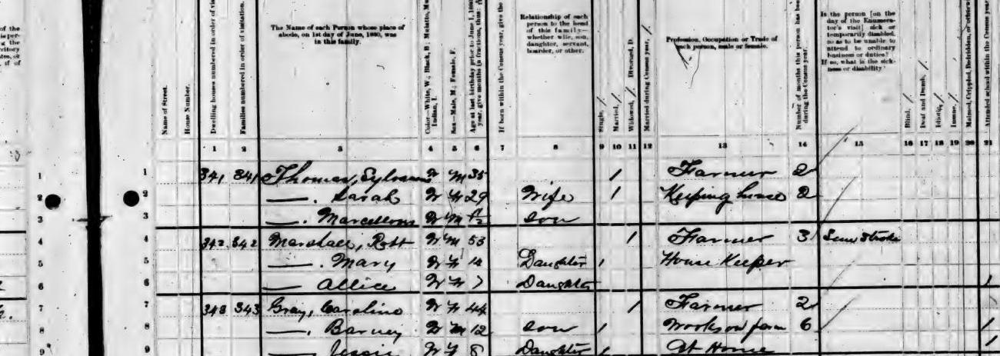

### 62 · 19 Apr 1910 · Liberty ED 4 sheet 13 A — Letha Sullivan, servant, 12

**Role:** FAN (not P001; not Coy’s wife)  
**File:** [`sources/census/1910-bollinger-ed4-letha-sullivan-servant.png`](sources/census/1910-bollinger-ed4-letha-sullivan-servant.png)  
**Source:** S351 · C370 · DOC034

Conrad household. Letha 12, Missouri / Indiana / Missouri. Independent re-read of a sibling PNG.

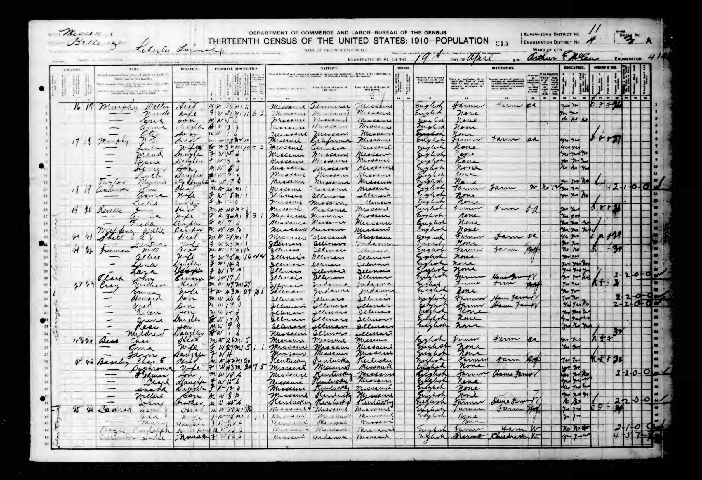

### 63 · 23 May 1910 · Liberty ED 4 sheet 15 B — Newnam children and Mary Estes MIL

**Role:** FAN / rejected claimed household  
**File:** [`sources/census/1910-bollinger-ed4-sullivan-newnam-mil.png`](sources/census/1910-bollinger-ed4-sullivan-newnam-mil.png)  
**Source:** S352 · C372 · C373 · DOC035

Not John Sullivan + Sarah Newman. Nellie Solomon[?] with Newnam Walter 5 and Isabelle 3; Seabaugh with Estes, Mary MIL 60.

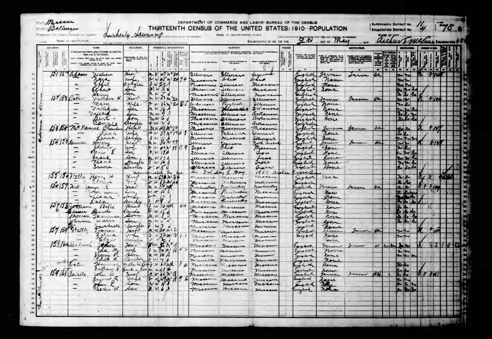

### 64 · 16 Apr 1910 · Fillmore ED 2 sheet 8 A — John H. Newnam and Dora, 36, Missouri

**Role:** Rejected same-name  
**File:** [`sources/census/1910-bollinger-ed2-john-h-newnam-dora-rejected.png`](sources/census/1910-bollinger-ed2-john-h-newnam-dora-rejected.png)  
**Source:** S353 · C371 · DOC036

Dwelling 48/49. Dora born Missouri, 7-6. Not P001.

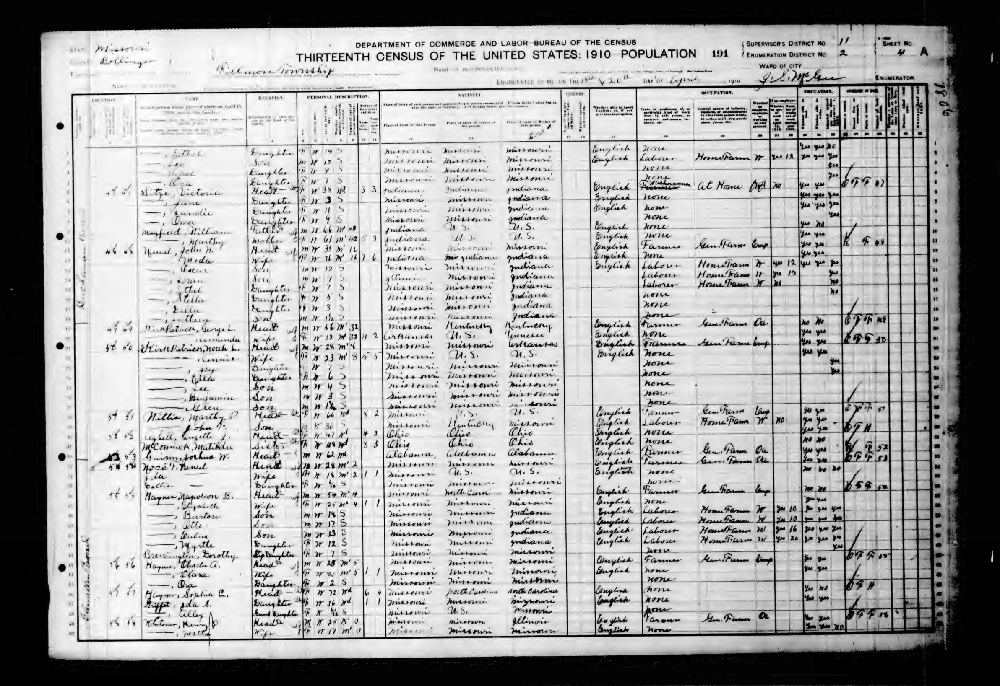

### 65 · 8 Apr 1910 · Bollinger ED 5 sheet 8 B — filename Letha E. not confirmed

**Role:** Negative search  
**File:** [`sources/census/1910-bollinger-ed5-sullivan-letha-e-dau2.png`](sources/census/1910-bollinger-ed5-sullivan-letha-e-dau2.png)  
**Source:** S354 · C378 · DOC037

No confirmed Letha E., daughter, age 2.

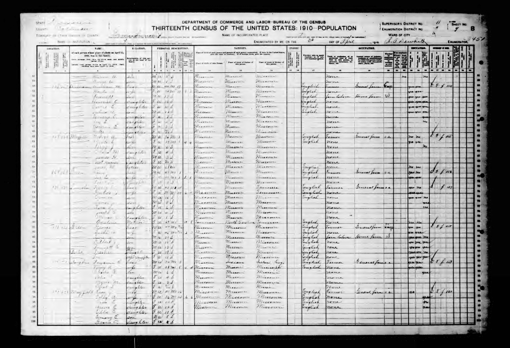

## Pass 39–40 additions

### 7g · 12 Jul 1860 · Owsley Page 64 — Silas Gray, 46, and William, 13

**Role:** FAN (Silas-as-father of C332)  
**File:** [`sources/census/1860-owsley-p64-pdfp363-silas-gray.jpg`](sources/census/1860-owsley-p64-pdfp363-silas-gray.jpg)  
**Source:** S369 · C395 · C396 · C398 · DOC040

Page No. 64, 12 July 1860, A.C. Gibson, post office Booneville. Dwelling **440/444**: Silas Gray, 46, farmer, realty 150 / personal 100; Minerva, 44; Eliza, 15, domestic; **William, 13**; Amelia, 9; Elihu, 8; John, 7; Margaret J., 5; Levi, 1. All Kentucky-born. This is the original that proves Silas is the 1928 father of William.

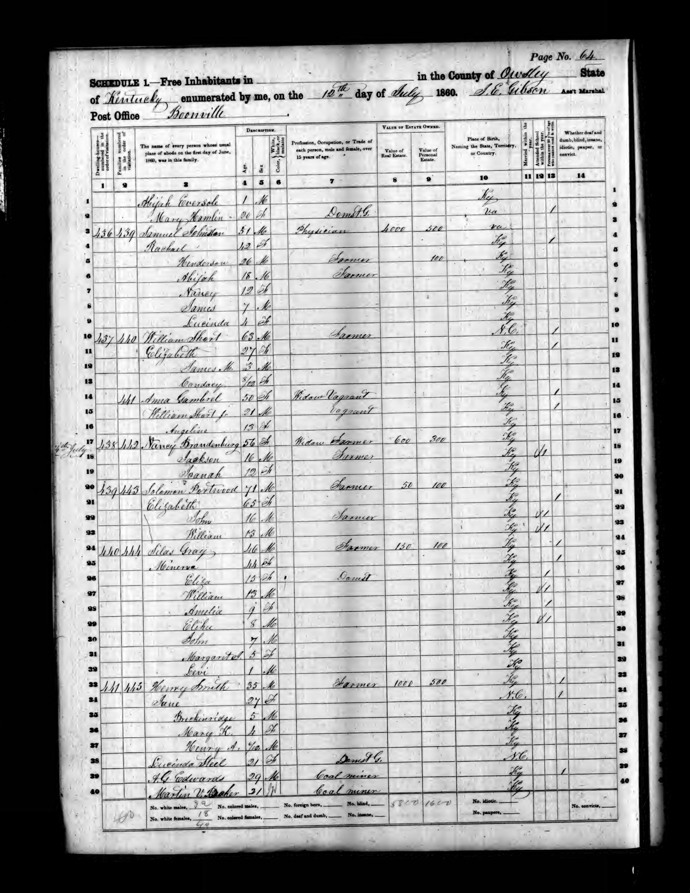

Household crop:

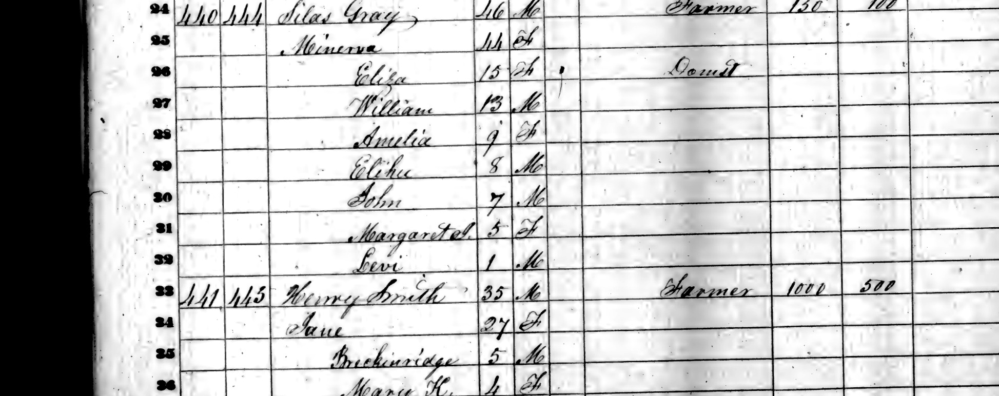

### 7h · 14 Jul 1860 · Owsley Page 67 — James Brandenburg, 52

**Role:** FAN (1870 marriage house; negative for Mary White)  
**File:** [`sources/census/1860-owsley-pdfp366-james-brandenburg.jpg`](sources/census/1860-owsley-pdfp366-james-brandenburg.jpg)  
**Source:** S370 · C400 · C401 · DOC041

Page No. 67, 14 July 1860, post office Proctor. Dwelling **458/462**: Jas Brandenburg, 52; Nancy, 43; William B., 16; James K.P., 14. **No Mary White** in this house.

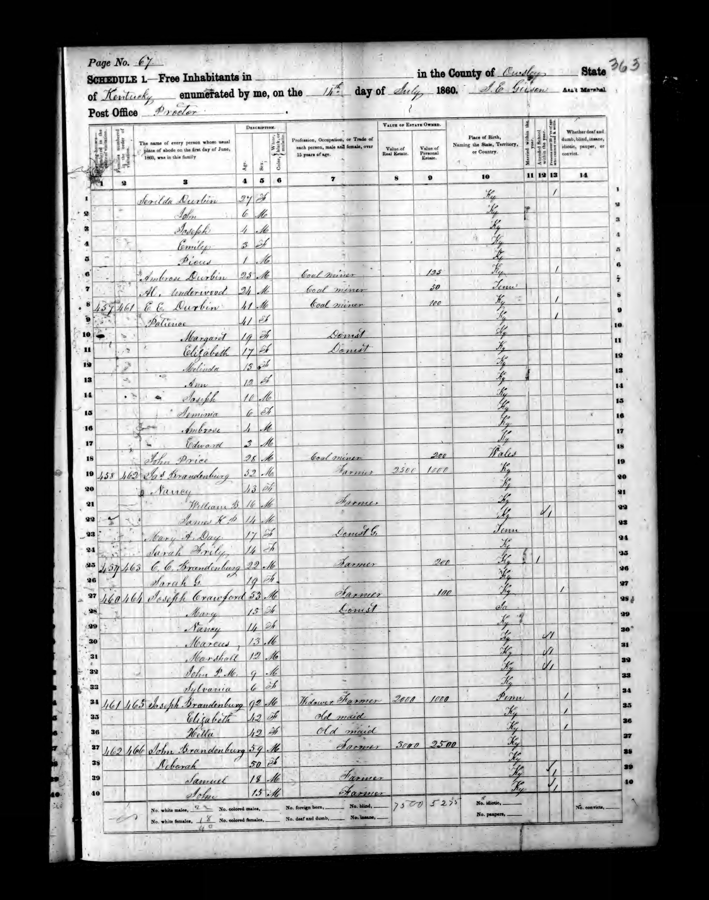

### 7i · 1 Jun 1880 · Lee ED 59 sheet 1 — William Gray, 30, Hardin labelled Son

**Role:** FAN (C332 1880 household)  
**File:** [`sources/census/1880-lee-ky-ed59-sheet1-p726-william-gray.jpg`](sources/census/1880-lee-ky-ed59-sheet1-p726-william-gray.jpg)  
**Source:** S376 · C409 · C410 · C411 · DOC042

Page No. 1, 1 June 1880, James J. Hampton. Dwelling **2/2**: Gray, William, 30, farmer; Mary J., 23, wife; Susan, 9, daughter; Sidney, 6, son; **Hardin, 3, son**; Robert, 2, son. Next door dwelling **3/3** is John Newnam (plate 3). Adult ages on this sheet are about three years young; do not average with conflict **#21**.

Household crop:

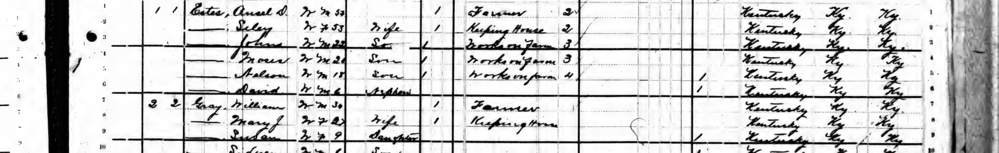

### 7j · 10 Jun 1880 · Lee ED 59 sheet 16 — Silas Gray, 66, father born N.C.

**Role:** FAN (same Silas as 1860/1870)  
**File:** [`sources/census/1880-lee-ky-ed59-sheet16-p741-silas-gray.jpg`](sources/census/1880-lee-ky-ed59-sheet16-p741-silas-gray.jpg)  
**Source:** S377 · C412 · C413 · C414 · DOC043

Page No. 16, 10 June 1880. Dwelling **126/126**: Gray, Silas, 66, farmer, born Kentucky, father **N.C.**, mother Ky; Minerva, 60; Levi, 21. The 1880 G-600 Soundex miss for Silas-as-head is an index failure, not an absence.

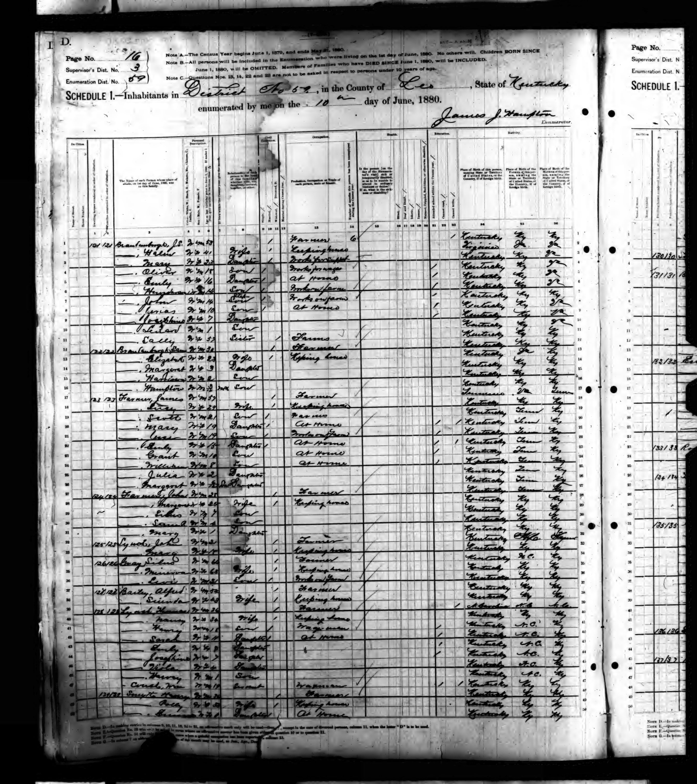

## Pass 41 additions

### 7k · 24 Aug 1850 · Owsley 289B — Thomas Gray, 47 (not Silas)

**Role:** FAN (negative control)  
**File:** [`sources/census/1850-owsley-pdfp370-thomas-gray.jpg`](sources/census/1850-owsley-pdfp370-thomas-gray.jpg)  
**Source:** S382 · C425 · C435 · DOC044

Enumerator page 20, 24 August 1850, Luther Bravener. Dwelling **168/168**: Thomas Gray, 47; Lucy, 45; Thomas, 17; Sarah, 5. This is the indexed 289B Gray house. It is not Silas.

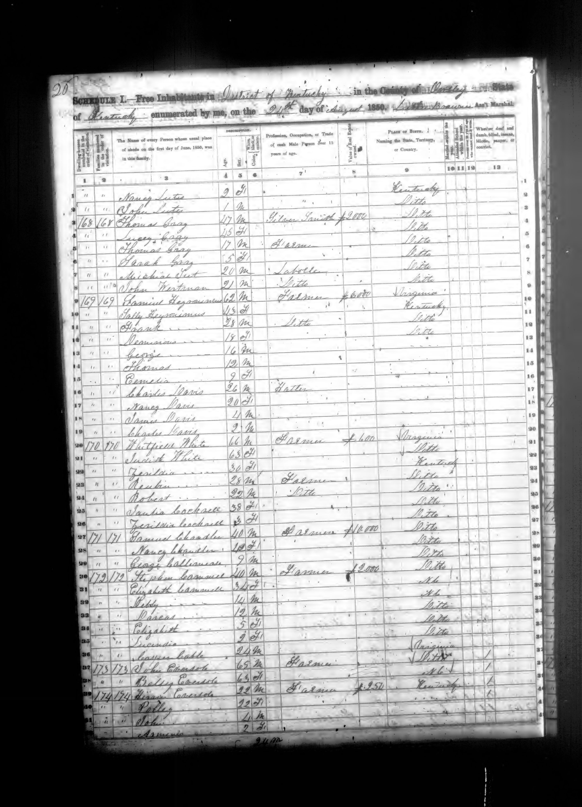

### 7l · 1850 · Owsley 306A — James Gray, 32, and a different William, 12

**Role:** FAN (negative control)  
**File:** [`sources/census/1850-owsley-pdfp405-james-gray.jpg`](sources/census/1850-owsley-pdfp405-james-gray.jpg)  
**Source:** S383 · C426 · DOC045

Dwelling **403/403**: James Gray, 32; Sally, 38; Angeline, 14; William, 12. William twelve is not the boy who is thirteen in Silas’s 1860 house.

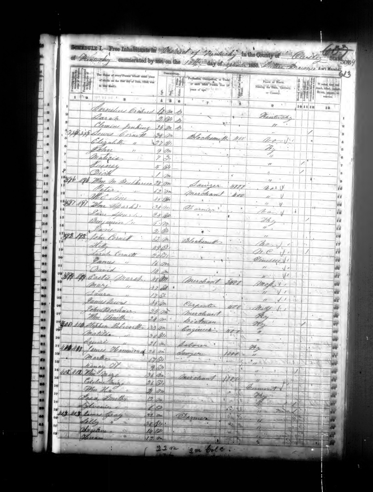

### 7m · 1850 · Owsley 314B — John Gray, 40, and Charles Gray, 26, with Manerva

**Role:** FAN (negative control; Charles DISPROVED as Silas)  
**File:** [`sources/census/1850-owsley-pdfp420-john-charles-gray.jpg`](sources/census/1850-owsley-pdfp420-john-charles-gray.jpg)  
**Source:** S384 · C427 · C428 · C436 · DOC046

Dwelling **571**: John Gray, 40, and Dolly, 37. Dwelling **575**: Charles Gray, 26, farmer, and Manerva, 30, with Polly, Betsy, Nancy, Abel, and Eliza — no William aged about three. Charles is not Silas.

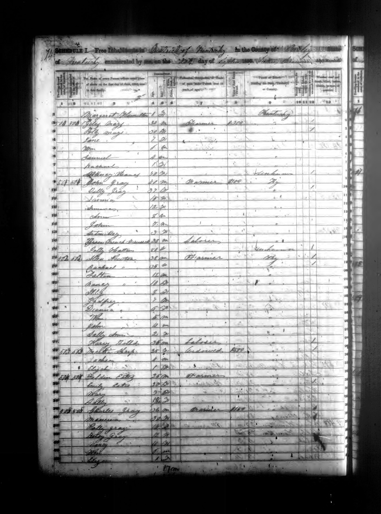

### 7n · 1850 · Estill 99B — Marcus Gray, 68, labourer, South Carolina

**Role:** FAN (negative control; DISPROVED as Silas)  
**File:** [`sources/census/1850-estill-pdfp433-st99B-marcus-gray.jpg`](sources/census/1850-estill-pdfp433-st99B-marcus-gray.jpg)  
**Source:** S396 · C444 · C453 · DOC047

Dwelling **734/734**: Marcus Gray, 68, labourer, born South Carolina; Barsheba, 41; Jasper, Jackson, Marcus, Morgan, George, Loucinda. This is Estill’s only Gray house on the 1850 film. It is not Silas.

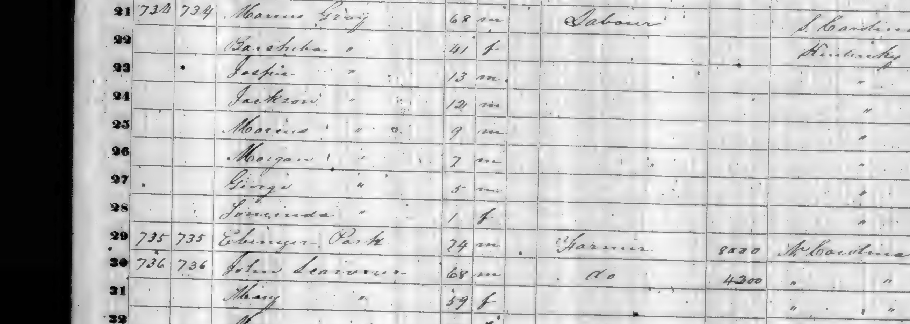

## Pass 43 additions

### 7o · 3 Aug 1850 · Breathitt Dist 2 stamped 1A — county opening (Andrew Pense)

**Role:** mapping (Breathitt start on M432-193)  
**File:** [`sources/census/1850-breathitt-pdfp197-st1A-hdr.jpg`](sources/census/1850-breathitt-pdfp197-st1A-hdr.jpg)  
**Source:** S405 · C457

District No 2, 3 August 1850, Saml Hargis. Dwelling **1/1**: Andrew Pense, 51, farmer. Matches Tennille’s Dist 2 start.

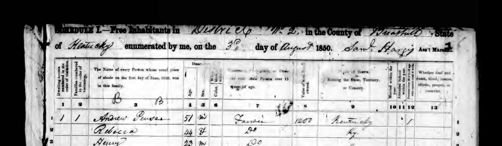

Household crop:

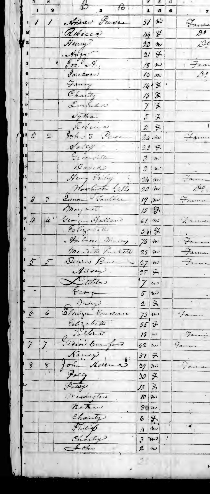

### 7p · 16 Aug 1850 · Breathitt Dist 2 stamped 8A — Elijah Green, 36 (not Silas)

**Role:** FAN (negative control; DISPROVED as Silas)  
**File:** [`sources/census/1850-breathitt-pdfp211-st8A-elijah-green-hh.jpg`](sources/census/1850-breathitt-pdfp211-st8A-elijah-green-hh.jpg)  
**Source:** S408 · C461 · DOC050

Dwelling **105/105**: Elijah Green, 36, farmer; Ally, 27. Surname Green; wife Ally, not Minerva. Age 36 is coincidental.

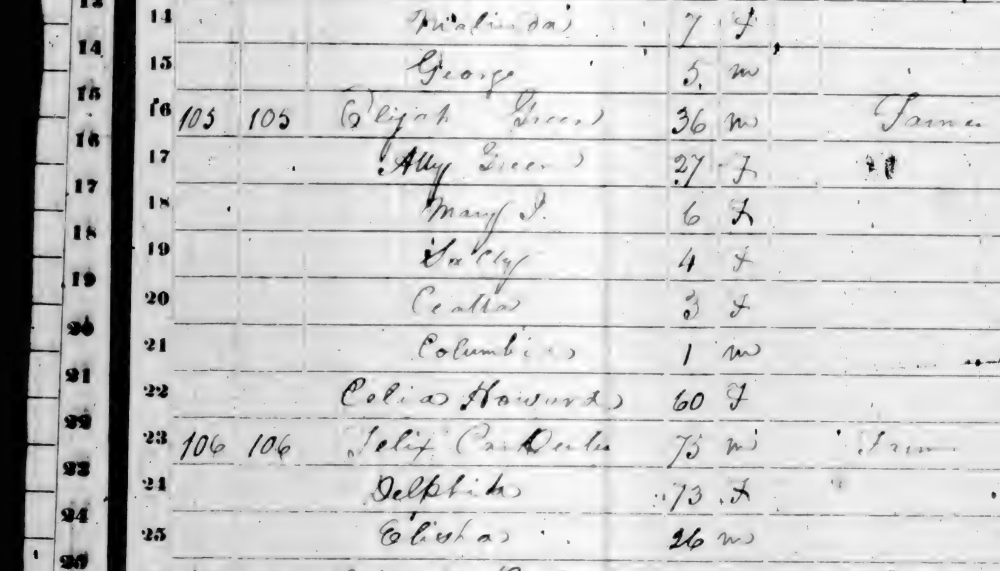

### 7q · 1850 · Breathitt Dist 2 stamped 14A — Taulbee Silas, 1 (not Silas Gray)

**Role:** FAN (negative control; DISPROVED as Silas Gray)  
**File:** [`sources/census/1850-breathitt-pdfp223-st14A-taulbee-silas.jpg`](sources/census/1850-breathitt-pdfp223-st14A-taulbee-silas.jpg)  
**Source:** S406 · C459 · DOC048

Continuation of Taulbee dwelling **181**: Silas, 1, male, after Green, 12, and Elsbury, 5. Next dwelling **183** is Jefferson Tolby, 25. This infant is not Silas Gray.

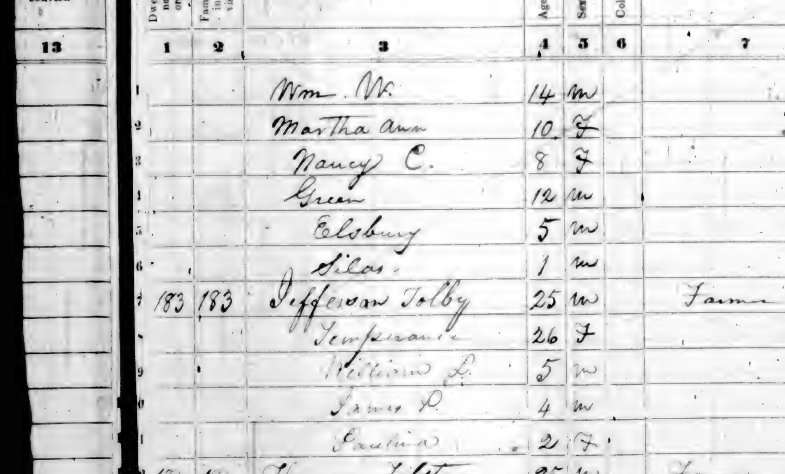

### 7r · 1850 · Breathitt stamped 17B blank and Dist 1 stamped 18A

**Role:** mapping (Tennille’s 17A→18A skip; Dist 1 start)  
**File:** [`sources/census/1850-breathitt-pdfp230-st17B-blank-hdr.jpg`](sources/census/1850-breathitt-pdfp230-st17B-blank-hdr.jpg)  
**Source:** S409 · C462 · C457

Stamped **17B** is a blank schedule. Dist 1 opens at stamped **18A**, 27 July 1850, John Hargis; dwelling **1/1** John Hargis, 48, lawyer.

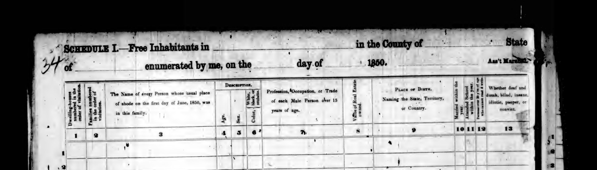

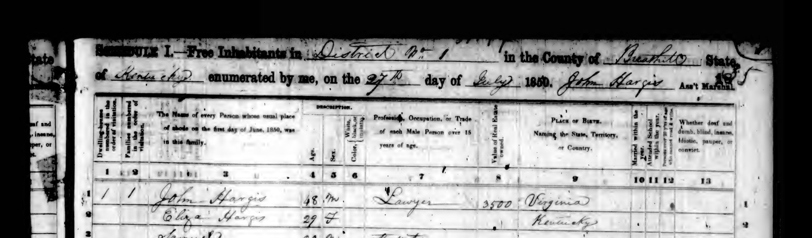

### 7s · 1850 · Breathitt Dist 1 stamped 21A — Siras Bryant, 22 (not Gray)

**Role:** FAN (negative control; upgrades C452)  
**File:** [`sources/census/1850-breathitt-pdfp237-st21A-bryant-siras.jpg`](sources/census/1850-breathitt-pdfp237-st21A-bryant-siras.jpg)  
**Source:** S407 · C460 · DOC049

Dwelling **52/52**: Elijah Bryant, 56; Mary, 45; **Siras Bryant, 22**, farmer. Original given name is **Siras**, not Tennille’s Sisas. Not Gray.

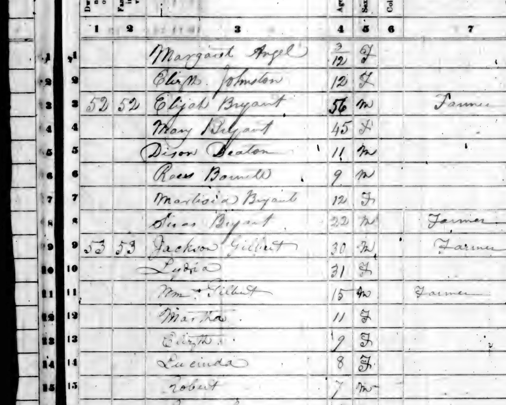

### 7t · 1850 · Breathitt Dist 1 stamped 32A — Wm. L. Griffing, 35 (not Gray)

**Role:** FAN (negative control)  
**File:** [`sources/census/1850-breathitt-pdfp259-st32A-griffing.jpg`](sources/census/1850-breathitt-pdfp259-st32A-griffing.jpg)  
**Source:** S409 · C464

**Wm. L. Griffing**, 35, clerk-merchant. Griffing is not Gray.

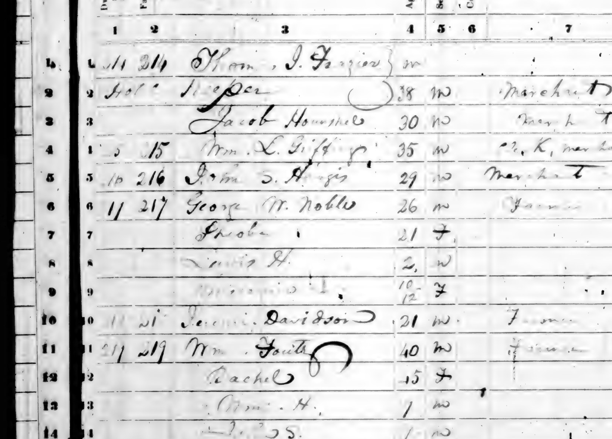

### 7u · 14 Aug 1850 · Madison Dist 1 stamped 212A — John Green, 44, and Silas Green, 20

**Role:** FAN (negative control; DISPROVED as Silas Gray)  
**File:** [`sources/census/1850-madison-pdfp428-john-green-hh.jpg`](sources/census/1850-madison-pdfp428-john-green-hh.jpg)  
**Source:** S411 · C468 · C469 · DOC051

Dwelling **184**: John Green, 44, farmer; Nancy, 39; **Silas, 20**; Christopher, 13; Elizabeth, 11; Larry, 3. Next, Joseph Rathburn; **Bryant Gentry**, 45. Silas Green, 20, in his father’s house is not Silas Gray ~36. Madison Dist 1 opens at stamped **200A** (3 August, G. Clay Smith).

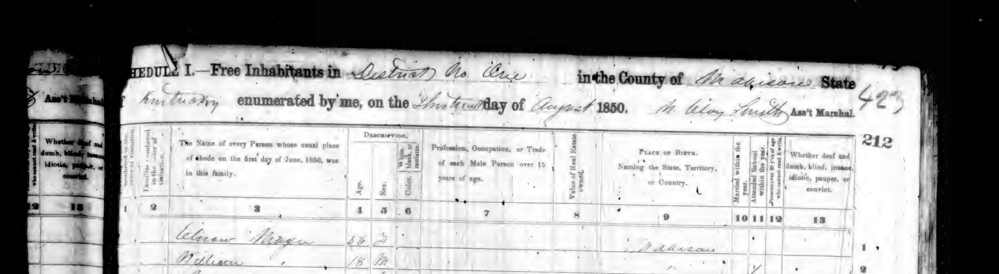

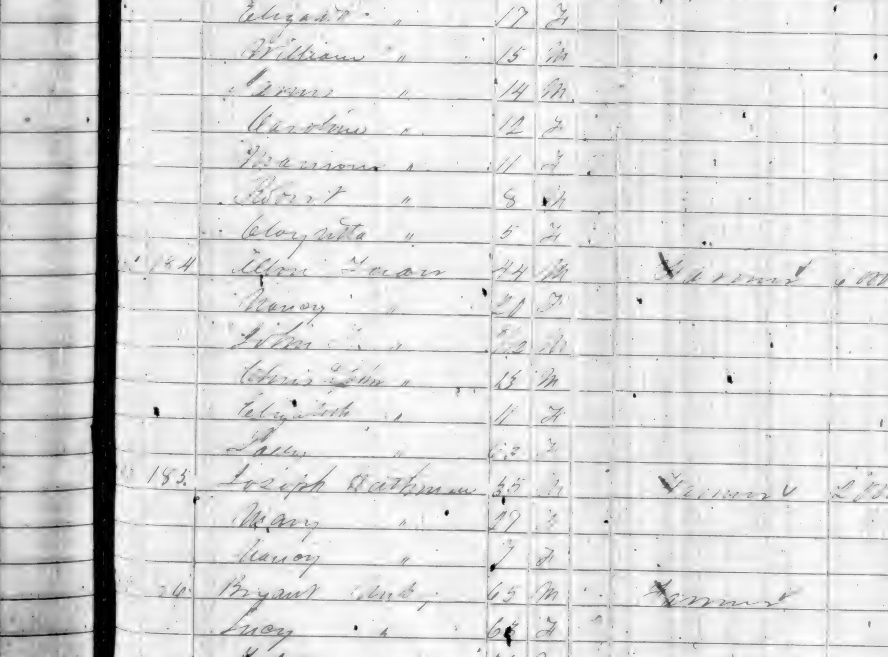

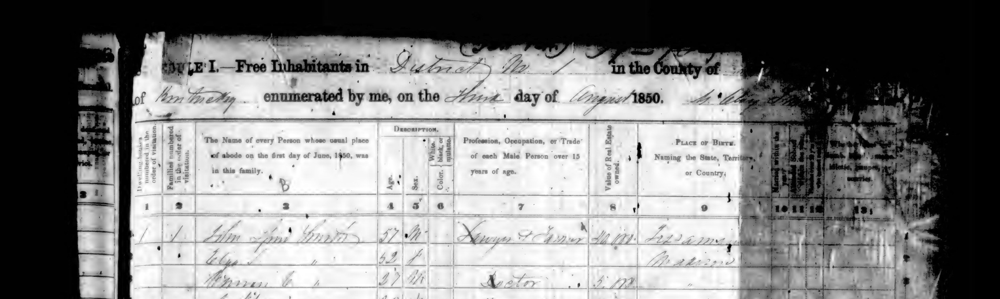

## Pass 44 additions

### 7v · 15 Aug 1850 · Owsley stamped 279A — Silas Ratliff, 8/12 (not Silas Gray)

**Role:** FAN (negative control; DISPROVED as Silas Gray)  
**File:** [`sources/census/1850-owsley-pdfp349-st279A-ratliff.jpg`](sources/census/1850-owsley-pdfp349-st279A-ratliff.jpg)  
**Source:** S416 · C474 · DOC052

Dwelling **33/33**: Reubin Ratliff, 28, farmer; Sarah, 24; Mary, 5; Lucinda, 4; **Silas, 8/12**. This infant is the only given-name Silas in Bawden’s 277A–296A files. He is not Silas Gray.

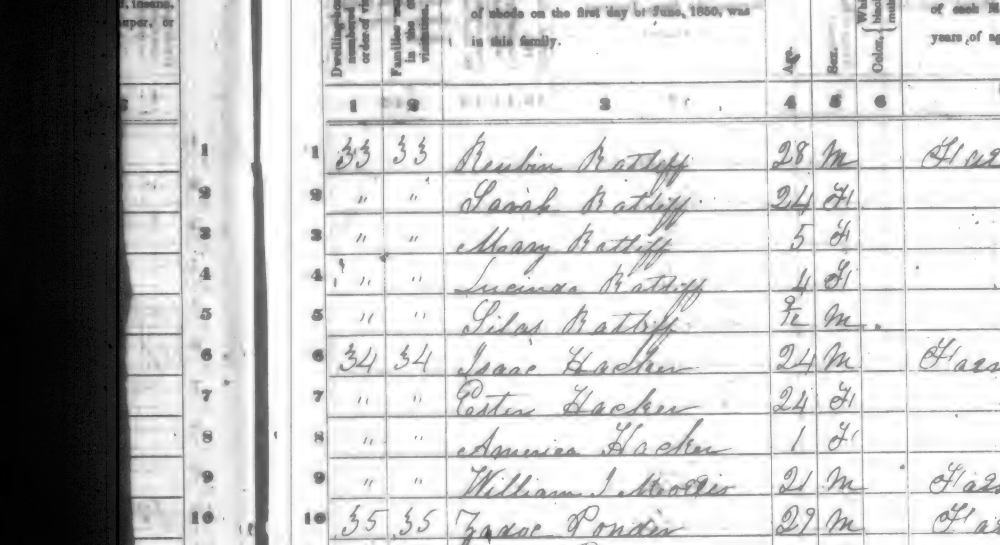

## Pass 45 additions

### 7w · 4 Sept 1850 · Owsley stamped 298A — Silas Wilson, 6 (not Silas Gray)

**Role:** FAN (negative control; DISPROVED as Silas Gray)  
**File:** [`sources/census/1850-owsley-pdfp389-st298A-wilson-silas.jpg`](sources/census/1850-owsley-pdfp389-st298A-wilson-silas.jpg)  
**Source:** S420 · C478 · DOC054

Dwelling **289/289**: William Wilson, 40, farmer; Sally, 38; Larkin, 20; Henry, 15; Woodson, 12; Malinda, 8; **Silas, 6**; Jane, 5. Flannigan indexed this house as **WILDER**. The original surname is **Wilson**. He is not Silas Gray.

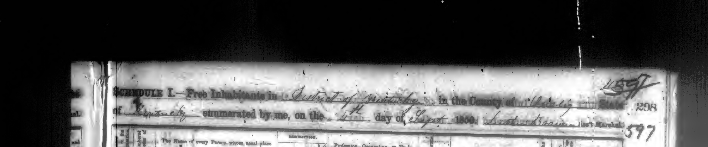

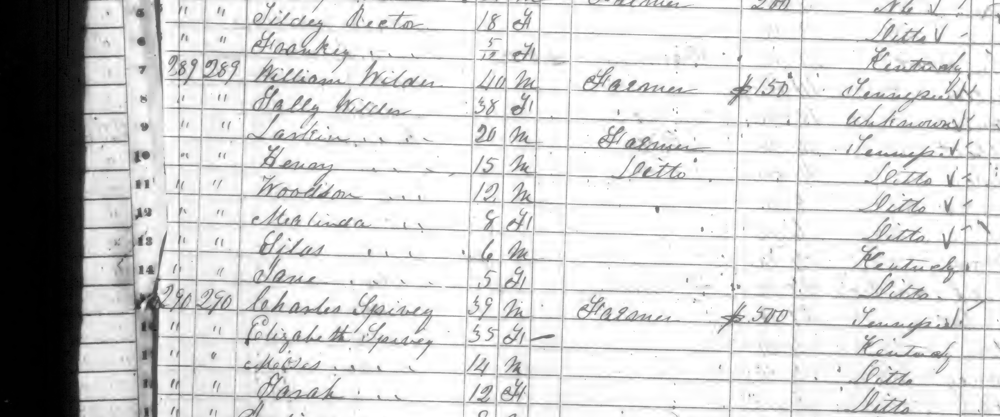

### 7x · 20 Sept 1850 · Owsley stamped 309B — Silas Phillips, 15 (not Silas Gray)

**Role:** FAN (negative control; DISPROVED as Silas Gray)  
**File:** [`sources/census/1850-owsley-pdfp410-st309B-phillips-silas.jpg`](sources/census/1850-owsley-pdfp410-st309B-phillips-silas.jpg)  
**Source:** S421 · C479 · DOC055

Dwelling **437/437**: B. F. Phillips, 44, blacksmith, Virginia; Susan, 41; John, 21; Nancy, 19; Zachariah, 17; **Silas, 15**; James, 13; Eliza, 11; Benjamin, 9; Susan, 7; Rody, 5; Thomas, 3; Henry, 2. Capital **S** matches **Susan** on the page. He is not Giles and not Silas Gray.

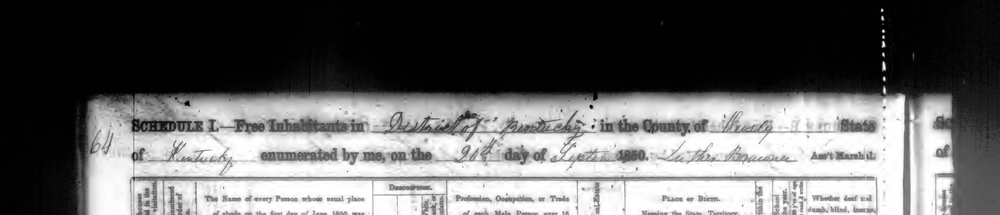

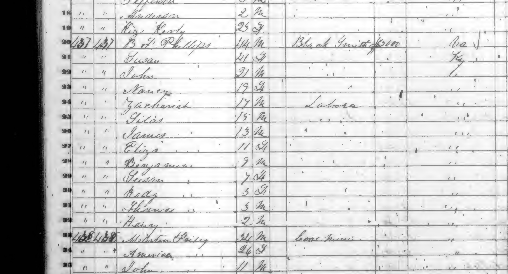

### 7y · 1850 · Owsley stamped 320A — Squire Bowman, 24 (Cyrus withdrawn)

**Role:** FAN (negative control; first-pass Cyrus withdrawn)  
**File:** [`sources/census/1850-owsley-pdfp431-st320A-bowman-squire.jpg`](sources/census/1850-owsley-pdfp431-st320A-bowman-squire.jpg)  
**Source:** S422 · C480 · DOC053

Dwelling **581/581**: Thomas Bowman, 68, farmer, Virginia; Polley, 60; **Squire, 24**, farmer; Rodey, 26; Martha, 2; Maria, 1/12; John Campbell, 23; Emily, 21. A name-column first pass read **Cyrus**. The household original is **Squire**. He is not Silas.

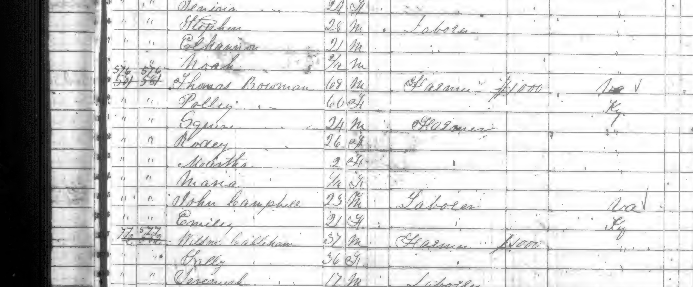

## Pass 46 additions

### 7z · 5 Sept 1850 · Owsley stamped 299B — Harrison Newman, 33, and Elias, 8

**Role:** FAN (PROBABLE identity of Elias 8 with P004 via 1932 extract; not merged as PROVEN)  
**File:** [`sources/census/1850-owsley-pdfp392-st299B-harrison-newman.jpg`](sources/census/1850-owsley-pdfp392-st299B-harrison-newman.jpg)  
**Source:** S425 · C486 · C487 · C509 · DOC056

Dwelling **313/313**: Harrison Newman, 33, farmer, $50; Susan, 24; William, 10; **Elias, 8**; Henry, 6; Balinda, 2. Nativity Kentucky by ditto. Flannigan’s age **3** for Elias is a derivative error. Identity with Elias T. Newnam (born 18 April 1842) is **probable**, not proved. Next door, John Newman, 23. Above, Rebecca Tincher’s Elias, 17, is a different man.

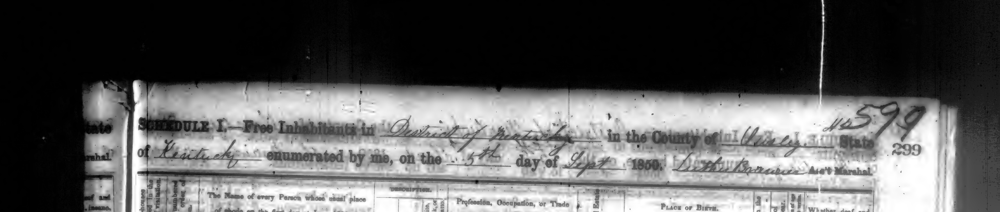

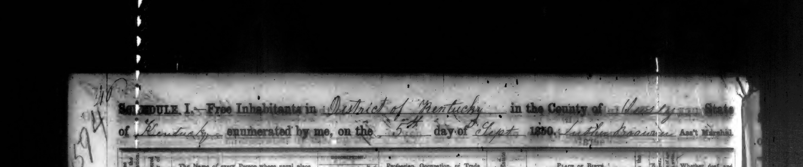

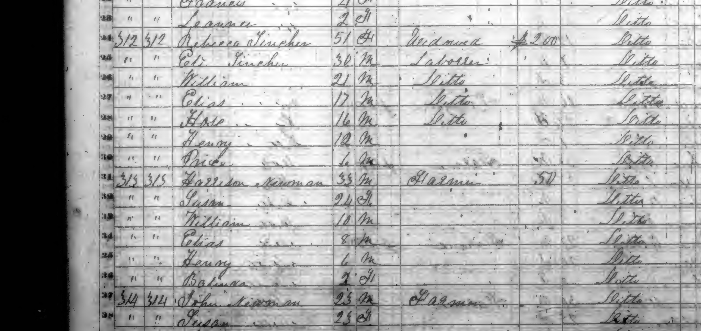

## Pass 47 additions

### 8a · 5 Sept 1850 · Owsley stamped 299B — William Newman, 26 (not Harrison)

**Role:** FAN (separate Newman house; not merged with Harrison 33)  
**File:** [`sources/census/1850-owsley-pdfp392-st299B-william-newman.jpg`](sources/census/1850-owsley-pdfp392-st299B-william-newman.jpg)  
**Source:** S427 · C491 · DOC057

Dwelling **311/311**: William Newman, 26, farmer, $325; Jane, 22; Francis, 4, female; Leanner, 2. Nativity Kentucky by ditto. Two dwellings later is Harrison, 33.

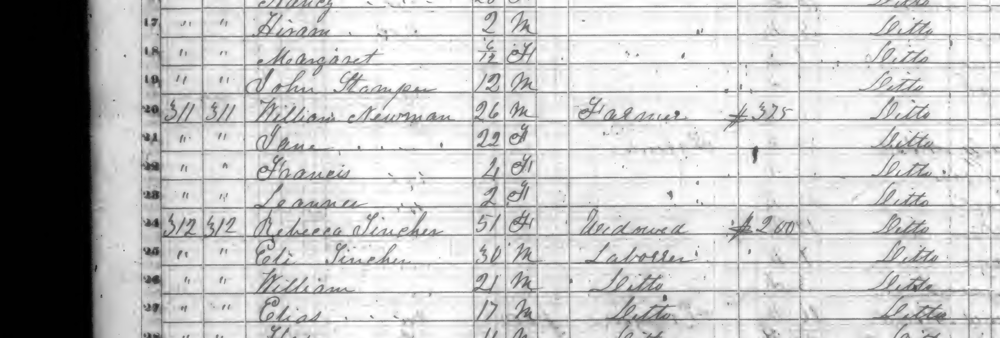

### 8b · 5 Sept 1850 · Owsley stamped 300A — John Newman, 60, born Tennessee (not 1880 John 69)

**Role:** FAN (DISPROVED as C060)  
**File:** [`sources/census/1850-owsley-pdfp393-st300A-john-newman.jpg`](sources/census/1850-owsley-pdfp393-st300A-john-newman.jpg)  
**Source:** S428 · C492 · DOC058

Dwelling **321/321**: John Newman, 60, farmer, $1000, born **Tennessee**; Lear, 55, Kentucky; Morris, 23, labourer. He is not the 1880 John, 69, born Kentucky, father North Carolina.

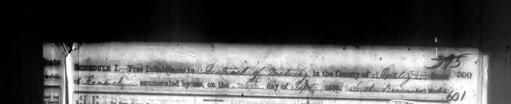

### 8c · 5 Sept 1850 · Owsley stamped 300A — Andrew Mays and Giles, 1/12

**Role:** FAN (PROVEN natal house of C132 Jiles 20, with 1860 Giles 11)  
**File:** [`sources/census/1850-owsley-pdfp393-st300A-andrew-mays.jpg`](sources/census/1850-owsley-pdfp393-st300A-andrew-mays.jpg)  
**Source:** S429 · C493 · C494 · DOC059

Dwelling **317/317**: Andrew Mays, 25, farmer, $100; Rachel, 23; **Giles, 1/12**. Flannigan’s **5/12** is withdrawn. Next door, William Mays, 56, with **Jessee Caster**, 14 — Flannigan’s EASTERS is a surname misread.

## Pass 48 additions

### 8d · 9 July 1860 · Owsley Page 54 — H.H. Newman, 44, and Elias, 18

**Role:** FAN (PROVEN same household as 1850 Harrison; Elias 18 PROBABLE vs P004 via 1932 extract)  
**File:** [`sources/census/1860-owsley-pdfp353-hh364-hh-newman.jpg`](sources/census/1860-owsley-pdfp353-hh364-hh-newman.jpg)  
**Source:** S431 · C497 · C498 · C499 · DOC060

Dwelling **364/364**, Booneville: H.H. Newman, 44, farmer, $200/$100; Susan, 36; William, 20; **Elias, 18**; H.H., 15; Belinda, 12; John, 10; Marshall V., 8; Mary J., 6; Joseph, 4; Jesse, 4/12. All Kentucky. The 1850 Harrison house under initials.

### 8e · 9 July 1860 · Owsley PDF 354 — Andrew Mays, 31, and Giles, 11

**Role:** FAN (PROVEN same house as 1850 Giles 1/12 and 1870 Jiles 20)  
**File:** [`sources/census/1860-owsley-pdfp354-andrew-giles.jpg`](sources/census/1860-owsley-pdfp354-andrew-giles.jpg)  
**Source:** S432 · C500 · DOC061

Dwelling **375/375**: Andrew Mays, 31, farmer, $300/$200; Rachael, 26; **Giles, 11**; Elizabeth, 9; Margaret, 7; Sarah, 4; Mary, 1/12.

### 8f · 10–11 July 1860 · Owsley Pages 59–60 — John Newnam, 68, born Delaware, and Harrison, 15

**Role:** FAN (not merged with 1850 John 60 Tennessee; Harrison 15 DISPROVED as Harrison 33)  
**File:** [`sources/census/1860-owsley-pdfp358-john68-lear.jpg`](sources/census/1860-owsley-pdfp358-john68-lear.jpg)  
**Source:** S433 · C501 · DOC062

Dwelling **407/407**, Proctor: John Newnam, 68, farmer, $1200/$900, born **Delaware**; Lear, 63, Kentucky. Next page, Harrison Newman, 15, farmer — a youth in this house, not the Booneville H.H. of 44.

### 8g · 17 June 1870 · Travellers Rest — Harrison Newman, 53

**Role:** FAN (same house as 1860 H.H. 44; Henry ~25 absent)  
**File:** [`sources/census/1870-owsley-travrest-p15-hh134-harrison.jpg`](sources/census/1870-owsley-travrest-p15-hh134-harrison.jpg)  
**Source:** S458 · C542 · C543 · C544 · DOC070

Dwelling **134/131**: Harrison Newman, 53, farmer, $160/$153; Susan, 47; John, 18; Marshay, 16, female; Mary, 14; Joseph, 12; Morris, 8; Lucy Ann, 5; Hiram, 2; Sarah M., 2. No Henry of twenty-five.

### 8h · 8 August 1870 · Town of Beattyville — Newman, Henry, 24

**Role:** FAN (PROBABLE the 1860 H.H. 15; not merged as proved)  
**File:** [`sources/census/1870-lee-beattyville-p315a-hh19-henry.jpg`](sources/census/1870-lee-beattyville-p315a-hh19-henry.jpg)  
**Source:** S460 · C550 · C551 · C553 · DOC071

Dwelling **19/19**: Henry Newman, 24, works in a coal mine; Mary, 23, keeping house; Ellen, 5, female; Millia, 3; John, 8/12, born October. That is the 1880 Buck Creek house, now proved from the original. It is not proved to be the 1860 boy.

### 8i · 8 June 1880 · Owsley ED 80 Page 9 — Newman, Henry, 34

**Role:** FAN (same house as 1870 Beattyville Henry 24; not merged as proved with 1860 H.H. 15)  
**File:** [`sources/census/1880-owsley-ed80-p9-hh74-henry.jpg`](sources/census/1880-owsley-ed80-p9-hh74-henry.jpg)  
**Source:** S467 · C561 · C562 · C563 · DOC073

Dwelling **74/77**: Newman, Henry, 34, farm laborer; Mary, 33, wife, keeping house, father born in England; Ellen F., 14; Milla A., 12; Chalista, 7; Laura B., 4; Arthur, 2. Enumerator Robert W. Minter. Stamp **309**.

### 8j · 1 June 1840 · Estill overlay 0059 — John Tincher and Christian Tincher

**Role:** FAN (young Tincher heads in Estill; not merged as brothers of Belinda/Millie)  
**File:** [`sources/census/1840-estill-m704-109-leaf66-tincher.jpg`](sources/census/1840-estill-m704-109-leaf66-tincher.jpg)  
**Source:** S468 · C567 · C568 · DOC074

Warren Lewis, County of Estill. **John Tincher**: males 2 under 5, 1 aged 5–10, 1 aged 20–30; female 1 aged 20–30. **Christian Tincher**: male 1 under 5, 1 aged 20–30; females 2 under 5, 1 aged 5–10, 1 aged 20–30. Neither is a man of fifty. No Newman head on this page.

### 8k · 1840 · Estill recap overlay 0081 — J.G. Riddle, 5535 inhabitants

**Role:** FAN (closes Warren Lewis’s Estill name pages on M704-109)  
**File:** [`sources/census/1840-estill-m704-109-leaf89-recap.jpg`](sources/census/1840-estill-m704-109-leaf89-recap.jpg)  
**Source:** S468 · C571 · DOC075

Estill County. Assistant marshal **J.G. Riddle**. One recapitulation. Total inhabitants **5535** (a **5543** figure also appears; print both). Certified by Richard Ricketts. Compared with the aggregate.

### 8l · 1 June 1840 · Estill overlay 0063 — William Newton, not Tincher

**Role:** FAN (withdrawn Tincher misread)  
**File:** [`sources/census/1840-estill-m704-109-leaf70-william-newton.jpg`](sources/census/1840-estill-m704-109-leaf70-william-newton.jpg)  
**Source:** S468 · C572 · DOC076

Same Lewis Estill division. The head near the foot is **William Newton**; **Jonathan Newton** follows. Male ticks include ages 15–20, 20–30, and 40–50. Do not treat the older male as a named Elias Tincher.

### 8m · 1 June 1840 · Clay IA leaf 105 — Cornett / Joel Gray (no Newman or Tincher)

**Role:** Negative search (Clay named-head page; no Newman/Tincher)  
**File:** [`sources/census/1840-clay-m704-108-leaf105-names.jpg`](sources/census/1840-clay-m704-108-leaf105-names.jpg)  
**Source:** S474 · C579 · DOC077

County of Clay. Heads include Edward Cornett, **Joel Gray**, **Lynn S. Tinsley**, Isaac Simpson. Tinsley is not Tincher. No Newman or Tincher head on this page, or on the other twenty-two Clay name pages.

### 8n · 1840 · Clay recap overlay 0127 — Recapitulation of Clay County, pages 1–23

**Role:** Context (closes Clay’s 23 name pages on M704-108)  
**File:** [`sources/census/1840-clay-m704-108-leaf135-recap.jpg`](sources/census/1840-clay-m704-108-leaf135-recap.jpg)  
**Source:** S474 · C580 · DOC078

Left-column heading “Recapitulation of Clay County.” Numbered rows 1 through 23. Overlay **0127**. Next county on the reel is Clinton.

### 8o · 1 June 1840 · Breathitt IA leaf 132 — first name page (no Newman or Tincher)

**Role:** Negative search (first Breathitt named-head page)  
**File:** [`sources/census/1840-breathitt-m704-105-leaf132-names.jpg`](sources/census/1840-breathitt-m704-105-leaf132-names.jpg)  
**Source:** S476 · C584 · DOC079

Heading Breathitt County. Enumerator William Haddix. **John Bowman** is not Newman. No Newman or Tincher head on this page, or on the other eleven even name pages through leaf 154.

### 8p · 1 June 1840 · Breathitt IA leaf 154 — last name page, Total

**Role:** Negative search (last Breathitt named-head page)  
**File:** [`sources/census/1840-breathitt-m704-105-leaf154-names.jpg`](sources/census/1840-breathitt-m704-105-leaf154-names.jpg)  
**Source:** S476 · C584 · DOC079

Heading Breathitt County. The name column ends **Total**. No Newman or Tincher head.

### 8q · 1840 · Breathitt recap IA leaf 156 — Abstract, 11 rows

**Role:** Context (closes Breathitt’s name pages on M704-105)  
**File:** [`sources/census/1840-breathitt-m704-105-leaf156-recap.jpg`](sources/census/1840-breathitt-m704-105-leaf156-recap.jpg)  
**Source:** S476 · C585 · DOC080

Heading Breathitt County. Label Abstract. Eleven numbered recap rows plus a total line. Next county on the reel is Breckinridge.

### 8r · 1 June 1840 · Estill McIlvain overlay 0088 — Estill County margin

**Role:** Negative search (second Estill enumerator; county proved; no Newman/Tincher)  
**File:** [`sources/census/1840-estill-m704-109-leaf96-mcilvain-estill-margin.jpg`](sources/census/1840-estill-m704-109-leaf96-mcilvain-estill-margin.jpg)  
**Source:** S468 · C587 · C588 · DOC081

Andrew McIlvain. Left margin **Estill County**. Representative page of the 25-page McIlvain name run. **Benj Stone** and **Hiram McGuire** sit on this page; they are not merged. No Newman or Tincher head on this page, or on the other twenty-four McIlvain name pages.

### 8s · 1 June 1840 · Estill McIlvain overlay 0129 — Valentine R. Ward (fishergenes p.68)

**Role:** FAN (closes the fishergenes “Estill p.68” match)  
**File:** [`sources/census/1840-estill-m704-109-leaf138-ward-fishergenes.jpg`](sources/census/1840-estill-m704-109-leaf138-ward-fishergenes.jpg)  
**Source:** S468 · S472 · C589 · DOC082

Same McIlvain Estill division. **Valentine R. Ward** with two males under five. This is the name half of the fishergenes two-page spread labelled “1840 Estill p.68.” Ancestry page 68 is not NARA overlay 68.

### 8t · 1 June 1840 · Estill McIlvain overlay 0121 — Wm Fincher, not Tincher

**Role:** FAN (withdrawn Tincher misread)  
**File:** [`sources/census/1840-estill-m704-109-leaf130-fincher.jpg`](sources/census/1840-estill-m704-109-leaf130-fincher.jpg)  
**Source:** S468 · C590 · DOC083

Same McIlvain Estill division. The head after M’Cagy Pitman is **Wm Fincher**. Capital F, *-incher*, not Tincher.

### 8u · 1840 · Edmonson divider overlay 0141 — W. Edwards, 2914

**Role:** Context (closes McIlvain Estill; opens Edmonson on M704-109)  
**File:** [`sources/census/1840-edmonson-m704-109-leaf151-divider.jpg`](sources/census/1840-edmonson-m704-109-leaf151-divider.jpg)  
**Source:** S477 · C591 · DOC084

Large hand “Edmonson County 31.” Assistant marshal **W. Edwards**. Total **2914**. Signatory **William Hoge**. McIlvain is not this division.

## Pass 50 note — cemetery overview (not a numbered plate)

**File:** [`sources/cemetery/brandenburg-quillen-bq2.jpg`](sources/cemetery/brandenburg-quillen-bq2.jpg)  
**Source:** S442 · C516 · C517 · DOC064

Brandenburg-Quillen, Heidelberg. **Image seen.** 344×208 pixels. Individual inscriptions are **not readable**. The Mary A. and Elias T. lines used in this pass are from the HTML transcripts, not from this photograph.

## Pass 51 note — FAG portrait (not a numbered plate)

**File:** [`sources/cemetery/fag-elias-t-newnam-101658752-portrait.jpg`](sources/cemetery/fag-elias-t-newnam-101658752-portrait.jpg)  
**Source:** S452 · S453 · C532 · DOC067

Find A Grave memorial **101658752**. **Image seen.** 531×442 pixels. A framed outdoor portrait of an elderly bearded man and a boy. **Not a gravestone.** Caption on the mat is damaged and **not independently readable**. Does not close **B062**.

### 8v · 1907–1922 · M850 1661 p0502 — Newnam, Elias T., Bugler 14 Ky V Cav

**File:** [`sources/military/m850-1661-p0502-newnam-elias-t-front.jpg`](sources/military/m850-1661-p0502-newnam-elias-t-front.jpg)  
**Source:** S502 · C646 · DOC093

Bottom card. **Newnam, Elias T.** Army Invalid, cert **631218**, Bugler Co. 14 Ky V Cav, Louisville, home Proctor, Ky. Died field blank. Top card is Newmyer, John B., unmerged.

### 8w · 1907–1922 · M850 1661 p0503 — Elias T. reverse

**File:** [`sources/military/m850-1661-p0503-newnam-elias-t-reverse.jpg`](sources/military/m850-1661-p0503-newnam-elias-t-reverse.jpg)  
**Source:** S502 · C646 · C666 · DOC093

Bottom card reverse. GROUP 2 paid to **4 Aug 1922**, then Trans. to Mo. Payment Card.

### 8x · 6 Aug 1916 · M850 1661 p0508 — Newnam, Henry H., DEAD

**File:** [`sources/military/m850-1661-p0508-newnam-henry-h-front.jpg`](sources/military/m850-1661-p0508-newnam-henry-h-front.jpg)  
**Source:** S502 · C648 · DOC094

Top card. **Newnam, Henry H.** Pvt Co C 14 Ky V Cav, cert **798864**, died **6 Aug 1916**, Travelers Rest, payable widow **Manerva**. Bottom card is James M. Newnam, unmerged.

### 8y · 6 Aug 1916 · M850 1661 p0509 — Henry H. reverse

**File:** [`sources/military/m850-1661-p0509-newnam-henry-h-reverse.jpg`](sources/military/m850-1661-p0509-newnam-henry-h-reverse.jpg)  
**Source:** S502 · C648 · DOC094

Top card reverse. Cert **798864**, stamped DEAD.

### 8z · 1916–1920 · M850 1661 p0512 — Newnam, Manerva, widow of Henry H.

**File:** [`sources/military/m850-1661-p0512-newnam-manerva-front.jpg`](sources/military/m850-1661-p0512-newnam-manerva-front.jpg)  
**Source:** S502 · C650 · DOC095

Top card. **Newnam, Manerva**, Army Widow of **Henry H.** Priv Co C 14 Ky Cav, cert **837778**, married **1895**, died **28 Aug 1920**. Bottom card is Mary, dependent of Thomas G, unmerged.

### 8aa · 1916–1920 · M850 1661 p0513 — Manerva reverse

**File:** [`sources/military/m850-1661-p0513-newnam-manerva-reverse.jpg`](sources/military/m850-1661-p0513-newnam-manerva-reverse.jpg)  
**Source:** S502 · C650 · DOC095

Top card reverse. Cert **837778**.

### 8ab · 1907–1917 · M850 1660 p0627 — Newman, Eli O., 9 Ind (not Elias T.)

**File:** [`sources/military/m850-1660-p0627-newman-eli-o-eliza-not-elias-t.jpg`](sources/military/m850-1660-p0627-newman-eli-o-eliza-not-elias-t.jpg)  
**Source:** S503 · C651 · DOC096

Newman given-name Elias slot. **Eli O.** Pvt I 9 Ind, Indianapolis, died 9 Jul 1917. Next card Eliza widow of Lazarus, 149 NY Inf. **No** Elias T. of 14 Ky Cav.

### 8ac · 1907–1920 · M850 1660 p0767 — Newman, Henry H., Corp A 81 Pa (not 14 Ky Cav)

**File:** [`sources/military/m850-1660-p0767-newman-henry-h-81pa-not-14kycav.jpg`](sources/military/m850-1660-p0767-newman-henry-h-81pa-not-14kycav.jpg)  
**Source:** S503 · C651 · DOC096

Bottom card. **Newman, Henry H.** Corp Co A 81 Pa, Philadelphia, cert **1008927**. Top card Henry W. 1 Ind VHA Detroit. **Not** Co C 14th KY Cav.

### 8ad · 1 Jun 1900 · Owsley ED 89 sheet 7 B header

**File:** [`sources/census/1900-owsley-ed89-sh7b-hdr.jpg`](sources/census/1900-owsley-ed89-sh7b-hdr.jpg)  
**Source:** S508 · C669 · DOC098

Kentucky, Owsley, Mag Dist **2**, ED **89**, sheet **7 B**. T623-547 leaf 579.

### 8ae · 1 Jun 1900 · Dwelling 114/115 — Newnam, Henry H. 55; Minerva 48

**File:** [`sources/census/1900-owsley-ed89-sh7b-hh114-henry.jpg`](sources/census/1900-owsley-ed89-sh7b-hh114-henry.jpg)  
**Source:** S508 · C669 · DOC098

Henry H. Oct 1844 age **55** m 35; Minerva 48 m 35 **4-2** VaVaVa; Arthur, Josephine, Lou V., Walter. Kendrick age 53 withdrawn.

### 8af · 1 Jun 1900 · Household crop — Henry H. and Minerva

**File:** [`sources/census/1900-owsley-ed89-sh7b-hh114-henry-crop.jpg`](sources/census/1900-owsley-ed89-sh7b-hh114-henry-crop.jpg)  
**Source:** S508 · C669 · DOC098

Two-pass diplomatic crop. Surname **Newnam**. Josephine 17 is the 1916 Gilbert candidate.

### 8ag · 18 Apr 1910 · Owsley ED 170 sheet 2 A header

**File:** [`sources/census/1910-owsley-ed170-sh2a-hdr.jpg`](sources/census/1910-owsley-ed170-sh2a-hdr.jpg)  
**Source:** S509 · C672 · DOC099

Kentucky, Owsley, Mag Dist **7 Wild Dog**, SD **11**, ED **170**, sheet **2 A**. Enumerator **James W. McCuan**, 18 April 1910.

### 8ah · 18 Apr 1910 · Dwelling 20/20 — Newman, Henry H. 68 m2 15; Manerva 56

**File:** [`sources/census/1910-owsley-ed170-sh2a-hh20-henry-manerva.jpg`](sources/census/1910-owsley-ed170-sh2a-hh20-henry-manerva.jpg)  
**Source:** S509 · C672 · DOC099

**m2 15** both lines; Manerva **5-4**; Farmer General Farm OA. Couple alone. Conflict **#25** vs 1900 m 35.

### 8ai · 18 Apr 1910 · Household crop — Henry H. and Manerva

**File:** [`sources/census/1910-owsley-ed170-sh2a-hh20-crop.jpg`](sources/census/1910-owsley-ed170-sh2a-hh20-crop.jpg)  
**Source:** S509 · C672 · DOC099

Nativity Henry KKK; Manerva Virginia Virginia Kentucky.

### 8aj · Apr 1910 · Owsley ED 165 sheet 7 B header

**File:** [`sources/census/1910-owsley-ed165-sh7b-hdr.jpg`](sources/census/1910-owsley-ed165-sh7b-hdr.jpg)  
**Source:** S519 · C693 · DOC101

Kentucky, Owsley, Mag Dist **2 Sturgeon**, sheet **7 B**. ED stamp faint; Sturgeon Mag Dist 2 on T624-**498** is ED **165**.

### 8ak · Apr 1910 · Dwelling 119/119 — Newman, Arthur 27 m1 8; Florence 23; Omer 3

**File:** [`sources/census/1910-owsley-ed165-sh7b-hh119-arthur.jpg`](sources/census/1910-owsley-ed165-sh7b-hh119-arthur.jpg)  
**Source:** S519 · C693 · DOC101

Farmer General Farm OA. Florence **1-1**, nativity Kentucky Tennessee Kentucky. Next hh Moore, James.

### 8al · Apr 1910 · Names crop — Arthur, Florence, Omer

**File:** [`sources/census/1910-owsley-ed165-sh7b-hh119-names.jpg`](sources/census/1910-owsley-ed165-sh7b-hh119-names.jpg)  
**Source:** S519 · C693 · DOC101

Pass 2 given names from this crop.

### 8am · 1 Jan 1920 · Owsley ED 94 sheet 1 A header

**File:** [`sources/census/1920-owsley-ed94-sh1a-hdr.jpg`](sources/census/1920-owsley-ed94-sh1a-hdr.jpg)  
**Source:** S518 · C690 · DOC102

Kentucky, Owsley, Wild Dog Precinct No. **7**, SD **10**, ED **94**, sheet **1 A**.

### 8an · 1 Jan 1920 · Owsley ED 94 sheet 7 B header

**File:** [`sources/census/1920-owsley-ed94-sh7b-hdr.jpg`](sources/census/1920-owsley-ed94-sh7b-hdr.jpg)  
**Source:** S518 · C690 · DOC102

Last population sheet of Wild Dog Precinct No. 7. Hh **1–129** name columns: nil Newman/Newnam.

### 8ao · 1 Jan 1920 · ED 94 sh 1 B hh 18 — Evans, William 68; Minerva 67

**File:** [`sources/census/1920-owsley-ed94-sh1b-hh18-evans.jpg`](sources/census/1920-owsley-ed94-sh1b-hh18-evans.jpg)  
**Source:** S518 · C691 · DOC102

Rejected. Surname **Evans**. Not Manerva Newnam.

### 8ap · 1 Jan 1920 · Owsley ED 90 sheet 7 A header

**File:** [`sources/census/1920-owsley-ed90-sh7a-hdr.jpg`](sources/census/1920-owsley-ed90-sh7a-hdr.jpg)  
**Source:** S525 · C700 · DOC103

Kentucky, Owsley, Island Creek Precinct No. **3**, SD **10**, ED **90**, sheet **7 A**. Enumerator date not on the retained crop.

### 8aq · 1 Jan 1920 · Dwelling 113/121 — Newman, Arthur 45; Florence 33; Omer 12; Grant 3½

**File:** [`sources/census/1920-owsley-ed90-sh7a-hh113-arthur.jpg`](sources/census/1920-owsley-ed90-sh7a-hh113-arthur.jpg)  
**Source:** S525 · C700 · DOC103

Farmer General Farm OA, farm schedule 110. **No** Manerva in the house. Next hh McConnell, Mary H. 49 wd.

### 8ar · 1 Jan 1920 · Names crop — Arthur, Florence, Omer, Grant

**File:** [`sources/census/1920-owsley-ed90-sh7a-hh113-names.jpg`](sources/census/1920-owsley-ed90-sh7a-hh113-names.jpg)  
**Source:** S525 · C700 · C702 · DOC103

Pass 2 given names from this crop. Manerva is not a line.

### 8as · 1920 (index) · N-550 Newman, Arthur 45, Owsley ED 90 sheet 7 line 32

**File:** [`sources/soundex/ky1920-n550-p4109-newman-arthur-owsley.jpg`](sources/soundex/ky1920-n550-p4109-newman-arthur-owsley.jpg)  
**Source:** S526 · C700 · DOC104

Vol **76**. Florence 33, Omer 12, Grant 3½. Matches the ED 90 original.

### 8at · 1 Jan 1920 · Owsley ED 89 sheet 13 A header

**File:** [`sources/census/1920-owsley-ed89-sh13a-hdr.jpg`](sources/census/1920-owsley-ed89-sh13a-hdr.jpg)  
**Source:** S527 · C703 · DOC105

Last populated sheet of Sturgeon Precinct No. 2. Enumerator: 1,222 people in the district. Name columns of sh **11 A–13 A**: nil Newman head.

### 8au · 1920 (index) · N-550 leaf 4630 — Minnie 12 Logan, not Minerva

**File:** [`sources/soundex/ky1920-n550-p4630-minnie-not-minerva.jpg`](sources/soundex/ky1920-n550-p4630-minnie-not-minerva.jpg)  
**Source:** S528 · C705 · DOC104

The alphabetical slot where Minerva Newman would sit. Granddaughter of John Neal. Not C650.

### 8av · 1 Jan 1920 · Owsley ED 90 sheet 9 A header

**File:** [`sources/census/1920-owsley-ed90-sh9a-hdr.jpg`](sources/census/1920-owsley-ed90-sh9a-hdr.jpg)  
**Source:** S531 · C713 · C714 · DOC107

Kentucky, Owsley, Island Creek Precinct No. **3**, ED **90**, sheet **9 A**. Enumerator **Oscar J. Judd**. Continuation of Moore, Marion: Dora Daughter 10, not P001. Name columns of sh **9 A–13 B**: nil Newman head.

### 8aw · 1 Jan 1920 · Owsley ED 90 sheet 13 B header

**File:** [`sources/census/1920-owsley-ed90-sh13b-hdr.jpg`](sources/census/1920-owsley-ed90-sh13b-hdr.jpg)  
**Source:** S531 · C713 · DOC107

Last sheet of Island Creek Precinct No. 3. Combined with Arthur on sh **7 A**: entire ED **90** has one Newman household.

### 8ax · 1 Jan 1920 · ED 89 sh 3 A hh 37 — Barker, Malvera 64 wd

**File:** [`sources/census/1920-owsley-ed89-sh3a-hh37-baker-manerva.jpg`](sources/census/1920-owsley-ed89-sh3a-hh37-baker-manerva.jpg)  
**Source:** S532 · C711 · DOC107

Rejected. Surname **Barker**. Mother of Martha Eversole, 44 wd. Filename is a first-pass misnomer. Not C650.

### 8ay · 1 Jan 1920 · ED 89 sh 7 B hh 122 — Wilson, Harden 70 × Minerva 70

**File:** [`sources/census/1920-owsley-ed89-sh7b-hh122-wilson-manerva.jpg`](sources/census/1920-owsley-ed89-sh7b-hh122-wilson-manerva.jpg)  
**Source:** S533 · C712 · DOC107

Rejected. Surname **Wilson**. Husband Harden living (Henry died 1916). Arthor 36 is not Arthur Newman.

### 8az · 1 Jan 1920 · Owsley ED 91 sheet 1 A header

**File:** [`sources/census/1920-owsley-ed91-sh1a-hdr.jpg`](sources/census/1920-owsley-ed91-sh1a-hdr.jpg)  
**Source:** S537 · C715 · C716 · DOC107

Cow Creek Precinct No. **4**, ED **91**, sheet **1 A**. Enumerator **J.S./A.S. Dooley**. Partial: the district continues after leaf **1133**. Banning, Dora wife 44, not P001.

### 8ba · 1920 (index) · N-550 Newman, Walter 39, Logan

**File:** [`sources/soundex/ky1920-n550-p4776-newman-walter-logan.jpg`](sources/soundex/ky1920-n550-p4776-newman-walter-logan.jpg)  
**Source:** S534 · C717 · C718 · DOC108

Ora 29, Mary 7, Ruth 1 6/12. Not Henry’s 1900 son (Logan vs Owsley; age 39 vs expected ~31). No Manerva.

### 8bb · 1920 (index) · N-550 Newman, Walter A 33, Louisville

**File:** [`sources/soundex/ky1920-n550-p4778-newman-walter-a-louisville.jpg`](sources/soundex/ky1920-n550-p4778-newman-walter-a-louisville.jpg)  
**Source:** S534 · C717 · C719 · DOC108

Elva 27, Walter 1½, Poplar Level Road. Unmerged vs Henry’s son. No Manerva.

### 8bc · 1 Jan 1920 · Owsley ED 91 sheet 4 A header

**File:** [`sources/census/1920-owsley-ed91-sh4a-hdr.jpg`](sources/census/1920-owsley-ed91-sh4a-hdr.jpg)  
**Source:** S539 · C729 · C731 · DOC109

Cow Creek Precinct No. **4**, ED **91**, sheet **4 A**. Enumerator **J.S. Dooley**. Remainder after Pass 67 sh **1 A–3 B**.

### 8bd · 1 Jan 1920 · Allen, Ella wife 30 — not P001

**File:** [`sources/census/1920-owsley-ed91-sh4a-hh54-allen-ella.jpg`](sources/census/1920-owsley-ed91-sh4a-hh54-allen-ella.jpg)  
**Source:** S541 · C731 · DOC109

Rejected. Husband **Robert Allen**. Age **30** vs ~48.

### 8be · 1 Jan 1920 · Owsley ED 91 sheet 7 A header

**File:** [`sources/census/1920-owsley-ed91-sh7a-hdr.jpg`](sources/census/1920-owsley-ed91-sh7a-hdr.jpg)  
**Source:** S539 · C729 · C730 · DOC109

Still Cow Creek Precinct No. **4**, ED **91**, sheet **7 A**.

### 8bf · 1 Jan 1920 · Cale, Tom + Minerva 73 — not Manerva Newnam

**File:** [`sources/census/1920-owsley-ed91-sh7a-hh110-cale-minerva.jpg`](sources/census/1920-owsley-ed91-sh7a-hh110-cale-minerva.jpg)  
**Source:** S540 · C730 · DOC109

Rejected. Surname **Cale**. Age **73** vs ~66. Relationship written **widower** [sic].

### 8bg · 1 Jan 1920 · Owsley ED 91 sheet 14 A header

**File:** [`sources/census/1920-owsley-ed91-sh14a-hdr.jpg`](sources/census/1920-owsley-ed91-sh14a-hdr.jpg)  
**Source:** S539 · C729 · DOC109

Last populated Cow Creek sheet. Lines **1–15** only; hh **241** Young, John. Leaf **1155** unused B.

### 8bh · 1 Jan 1920 · Owsley ED 92 sheet 1 A header

**File:** [`sources/census/1920-owsley-ed92-sh1a-hdr.jpg`](sources/census/1920-owsley-ed92-sh1a-hdr.jpg)  
**Source:** S542 S550 · C743 C752 · DOC111

Next precinct after Cow Creek. Stamped Sheet **1 A**, Buffalo Precinct No. **5**, enumerator **Fred Hubbard**, 8 Jan 1920. Printed form is a **B-side**; first household on the image is **14**. Name column of the filmed ED now read in Pass 69 (**C743**). Hh **1–13** residual.

### 8bi · 1 Jan 1920 · Owsley ED 88 sheet 1 A header

**File:** [`sources/census/1920-owsley-ed88-sh1a-hdr.jpg`](sources/census/1920-owsley-ed88-sh1a-hdr.jpg)  
**Source:** S546 · C739 · DOC110

Booneville Precinct No. **1**, ED **88**, sheet **1 A**. Enumerator **W.M. Dooley**, 12 January 1920.

### 8bj · 1 Jan 1920 · Taylor, William + Manerva Mother 73 — not Manerva Newnam

**File:** [`sources/census/1920-owsley-ed88-sh14a-hh231-taylor-manerva.jpg`](sources/census/1920-owsley-ed88-sh14a-hh231-taylor-manerva.jpg)  
**Source:** S547 · C740 · DOC110

Rejected. Surname **Taylor**. Relationship **Mother**. Age **73** vs ~66.

### 8bk · 1 Jan 1920 · Magee, Cal + Dora wife 25 — not P001

**File:** [`sources/census/1920-owsley-ed88-sh15a-hh248-magee-dora.jpg`](sources/census/1920-owsley-ed88-sh15a-hh248-magee-dora.jpg)  
**Source:** S548 · C741 · DOC110

Rejected. Husband **Cal Magee**. Age **25** vs ~48.

### 8bl · 1 Jan 1920 · Needham, Sally 63 — not Newman

**File:** [`sources/census/1920-owsley-ed88-sh17b-hh310-needham-sally.jpg`](sources/census/1920-owsley-ed88-sh17b-hh310-needham-sally.jpg)  
**Source:** S549 · C742 · DOC110

Rejected. Surname **Needham**. Maggard **Minerva** daughter **17** is a different girl.

### 8bm · 1 Jan 1920 · Owsley ED 88 sheet 19 A header

**File:** [`sources/census/1920-owsley-ed88-sh19a-hdr.jpg`](sources/census/1920-owsley-ed88-sh19a-hdr.jpg)  
**Source:** S546 · C739 · DOC110

Last populated Booneville / Town of Booneville sheet. Enumerator closeout. Leaf **1075** unused B.

### 8bn · 1 Jan 1920 · Owsley ED 88 unused 19 B

**File:** [`sources/census/1920-owsley-ed88-unused-19b-hdr.jpg`](sources/census/1920-owsley-ed88-unused-19b-hdr.jpg)  
**Source:** S546 · C739 · DOC110

Blank B-side. Lines **51–100** empty.

### 8bo · 1 Jan 1920 · McIntosh, Millard + Dora wife 37 — not P001

**File:** [`sources/census/1920-owsley-ed92-sh1b-hh27-mcintosh-dora.jpg`](sources/census/1920-owsley-ed92-sh1b-hh27-mcintosh-dora.jpg)  
**Source:** S551 · C744 · DOC111

Rejected. Husband **Millard McIntosh**. Age **37** vs ~48.

### 8bp · 1 Jan 1920 · Baker, John + Minervey wife 50 — not Manerva Newnam

**File:** [`sources/census/1920-owsley-ed92-sh5b-hh95-baker-minervey.jpg`](sources/census/1920-owsley-ed92-sh5b-hh95-baker-minervey.jpg)  
**Source:** S552 · C745 · DOC111

Rejected. Surname **Baker**. Age **50** vs ~66.

### 8bq · 1 Jan 1920 · Owsley ED 92 sheet 7 B header

**File:** [`sources/census/1920-owsley-ed92-sh7b-hdr.jpg`](sources/census/1920-owsley-ed92-sh7b-hdr.jpg)  
**Source:** S550 · C743 · DOC111

Last Buffalo Precinct No. **5** sheet. Enumerator **Fred Hubbard**, 16 January 1920.

### 8br · 1 Jan 1920 · Owsley ED 93 sheet 1 A header

**File:** [`sources/census/1920-owsley-ed93-sh1a-hdr.jpg`](sources/census/1920-owsley-ed93-sh1a-hdr.jpg)  
**Source:** S553 · C746 · DOC112

Buck Creek Precinct No. **6**, ED **93**, sheet **1 A**. Enumerator **J.G. Easley** / **W.C. Dooley**, 2/3 January 1920.

### 8bs · 1 Jan 1920 · Marcum, Harvey + Manerva wife 54 — not Manerva Newnam

**File:** [`sources/census/1920-owsley-ed93-sh6b-hh94-marcum-manerva.jpg`](sources/census/1920-owsley-ed93-sh6b-hh94-marcum-manerva.jpg)  
**Source:** S554 · C747 · DOC112

Rejected. Surname **Marcum**. Husband **Harvey** living. Age **54** vs ~66.

### 8bt · 1 Jan 1920 · McPherson, John + Dara wife 40 — not P001

**File:** [`sources/census/1920-owsley-ed93-sh11a-hh178-mcpherson-dara.jpg`](sources/census/1920-owsley-ed93-sh11a-hh178-mcpherson-dara.jpg)  
**Source:** S555 · C748 · DOC112

Rejected. Diplomatic given name **Dara**. Husband **John McPherson**. Age **40** vs ~48.

### 8bu · 1 Jan 1920 · Owsley ED 93 unused 11 B

**File:** [`sources/census/1920-owsley-ed93-unused-11b-hdr.jpg`](sources/census/1920-owsley-ed93-unused-11b-hdr.jpg)  
**Source:** S553 · C746 · DOC112

Blank B-side after the last populated Buck Creek sheet.

### 8bv · 21 Apr 1910 · Owsley ED 165 sheet 9 A header

**File:** [`sources/census/1910-owsley-ed165-sh9a-hdr.jpg`](sources/census/1910-owsley-ed165-sh9a-hdr.jpg)  
**Source:** S558 · C753 · DOC113

Kentucky, Owsley, Mag Dist **2 Sturgeon**, ED **165**, sheet **9 A**. Enumerator **John F. Brewer**, 21 April 1910. Two sheets after Arthur’s house on 7 B.

### 8bw · 21 Apr 1910 · Dwelling 147/147 — Gilbert, Robert 29 m2 8; Josie 26 m1 8 1-0

**File:** [`sources/census/1910-owsley-ed165-sh9a-hh147-gilbert-josie.jpg`](sources/census/1910-owsley-ed165-sh9a-hh147-gilbert-josie.jpg)  
**Source:** S558 · C753 · C754 · DOC113

Charles Fork Road. Couple alone. **PROBABLE** Henry’s 1900 daughter Josephine / 1916 Josephine Gilbert. Age 26 matches 19 Oct 1883; 1900 Oct 1882 is one year earlier and is not averaged.

### 8bx · 21 Apr 1910 · Dwelling 154/154 — Lynch, Benton 34; Laura wife 34

**File:** [`sources/census/1910-owsley-ed165-sh9b-hh154-lynch-laura.jpg`](sources/census/1910-owsley-ed165-sh9b-hh154-lynch-laura.jpg)  
**Source:** S559 · C759 · DOC113

Given name **Laura** only. Surname ditto **Lynch**. A published transcript adds Newman in parentheses; that word is **not** on the original. **POSSIBLE** unmerged vs 1880 Laura B., aged four.

### 8by · 1920 (index) · Soundex G-416 — Gilbert, Robert 84, Owsley — clerk error

**File:** [`sources/soundex/ky1920-g416-p2263-gilbert-robert-84-owsley.jpg`](sources/soundex/ky1920-g416-p2263-gilbert-robert-84-owsley.jpg)  
**Source:** S560 · C755 · C756 · DOC114

Vol **76** ED **92** sh **5** ln **96**. Enumerated with **Baker, Robert**, relationship **Father-in-law**. Age **84** vs the 1910 husband ~39. The original names **John**.

### 8bz · 1 Jan 1920 · Baker, Robert + Gilbert, John FIL 84 — not the 1910 Robert

**File:** [`sources/census/1920-owsley-ed92-sh5a-hh90-baker-gilbert-fil.jpg`](sources/census/1920-owsley-ed92-sh5a-hh90-baker-gilbert-fil.jpg)  
**Source:** S561 · C756 · DOC115

Stamped 5 A on a B-form. Line **96**: **Gilbert, John** father-in-law **84** Wd. Hard Rule 6: original over Soundex.

### 8ca · Apr 1910 · Owsley ED 168 sheet 5 B header

**File:** [`sources/census/1910-owsley-ed168-sh5b-hdr.jpg`](sources/census/1910-owsley-ed168-sh5b-hdr.jpg)  
**Source:** S564 · C765 · DOC116

Kentucky, Owsley, Mag Dist **5 Buffalo**, Buffalo Precinct No. **5**, ED **168**, sheet **5 B**. Enumerator **George M. Hogg[?]**. Printed B-form.

### 8cb · Apr 1910 · Dwelling 76/76 — Gilbert, John 74 m2 18; Darkis[?] wife 39

**File:** [`sources/census/1910-owsley-ed168-sh5b-hh76-gilbert-john.jpg`](sources/census/1910-owsley-ed168-sh5b-hh76-gilbert-john.jpg)  
**Source:** S564 · C765 · C766 · DOC116

Next door is **Baker, Robert H.**, 31, with wife **Laura**, 28. That John is **PROBABLE** the 1920 father-in-law aged 84. Baker wives are **not** silently merged. Kendrick “Daughter (Darkis)” withdrawn; original relationship is **Wife**.

### 8cc · 1920 (index) · Soundex G-416 — Gilbert, Douglas 7, Owsley ED 92 sh 2

**File:** [`sources/soundex/ky1920-g416-p2020-gilbert-douglas-owsley.jpg`](sources/soundex/ky1920-g416-p2020-gilbert-douglas-owsley.jpg)  
**Source:** S568 · C768 · DOC117

Vol **76** ED **92** sh **2** ln **42**. Enumerated with **Colwell, William**, relationship **Step-son**. Proves Soundex clerks indexed filmed ED 92 sheets. The John given-name window has no Gilbert, John as a head.

### 8cd · Apr 1910 · Owsley ED 168 sheet 1 A header

**File:** [`sources/census/1910-owsley-ed168-sh1a-hdr.jpg`](sources/census/1910-owsley-ed168-sh1a-hdr.jpg)  
**Source:** S573 · C775 · DOC118

Kentucky, Owsley, Mag Dist **5 Buffalo**, Buffalo Precinct No. **5**, ED **168**, sheet **1 A**. Enumerator **George M. Hogg[?]**. Stamp **168**.

### 8ce · Apr 1910 · Dwelling 1/1 — Combs, Samuel 37; Hulda 33; Nancy 2 2/12

**File:** [`sources/census/1910-owsley-ed168-sh1a-hh1-combs-samuel.jpg`](sources/census/1910-owsley-ed168-sh1a-hh1-combs-samuel.jpg)  
**Source:** S573 · C775 · C777 · DOC118

Kendrick 1910 Buffalo opener original-verified. Line 4 is **Nancy Daughter 2 2/12**, not Isaac 12.

### 8cf · Apr 1910 · Dwellings 5–6 — Gabbard Elijah × Amy; Gabbard Lee × Eliza

**File:** [`sources/census/1910-owsley-ed168-sh1a-hh5-6-gabbard.jpg`](sources/census/1910-owsley-ed168-sh1a-hh5-6-gabbard.jpg)  
**Source:** S573 · C775 · C779 · C780 · DOC118

Two Gabbard heads on the opener sheet. Do **not** merge with the 1920 Soundex Elijah of Lee or Lee of Breathitt.

### 8cg · Apr 1910 · Dwelling 10/10 — Rice, William E.; Dora daughter 2 2/12

**File:** [`sources/census/1910-owsley-ed168-sh1b-hh10-rice-dora.jpg`](sources/census/1910-owsley-ed168-sh1b-hh10-rice-dora.jpg)  
**Source:** S574 · C776 · DOC118

Age **2** versus ~39. **DISPROVED** as P001.

### 8ch · 1920 (index) · Soundex C-512 — Combs, Samuel B. 42, Owsley ED 90

**File:** [`sources/soundex/ky1920-c512-p1644-combs-samuel-b-owsley.jpg`](sources/soundex/ky1920-c512-p1644-combs-samuel-b-owsley.jpg)  
**Source:** S575 · C777 · C778 · DOC119

Vol **76** ED **90** line **72** (sheet blank). Hulda 42, Nancy 11, Addie 6, James 3¾. **PROBABLE** 1910 dw 1; **not** ED 92 sh 1. Head age +5 is not averaged.

### 8ci · 1920 (index) · Soundex G-163 — Gabbard, Elijah 41, Lee ED 113

**File:** [`sources/soundex/ky1920-g163-p3189-gabbard-elijah-lee.jpg`](sources/soundex/ky1920-g163-p3189-gabbard-elijah-lee.jpg)  
**Source:** S576 · C779 · DOC120

Vol **59** ED **113** sh **5** ln **1** × Annie. **Not merged** with 1910 Buffalo Elijah × Amy.

### 8cj · 1920 (index) · Soundex G-163 — Gabbard, Lee 47, Breathitt ED 48

**File:** [`sources/soundex/ky1920-g163-p3434-gabbard-lee-breathitt.jpg`](sources/soundex/ky1920-g163-p3434-gabbard-lee-breathitt.jpg)  
**Source:** S576 · C780 · DOC120

Vol **6** ED **48** sh **9** ln **85** × Orlena. **Not merged** with 1910 Buffalo Lee × Eliza 1-1 Lillie 6.

### 8ck · 1920 (index) · Soundex C-512 — Combs, Louise 54, Madison (not Lowe)

**File:** [`sources/soundex/ky1920-c512-p1252-combs-louise-not-lowe.jpg`](sources/soundex/ky1920-c512-p1252-combs-louise-not-lowe.jpg)  
**Source:** S580 · C789 · DOC119

Vol **67** ED **103** sh **11** ln **17**. Consecutive with Loya on the next leaf. No Combs, Lowe card.

### 8cl · 1920 (index) · Soundex C-512 — Combs, Loya 32, Boyd (not Lowe)

**File:** [`sources/soundex/ky1920-c512-p1253-combs-loya-not-lowe.jpg`](sources/soundex/ky1920-c512-p1253-combs-loya-not-lowe.jpg)  
**Source:** S580 · C789 · DOC119

Vol **8** ED **28** sh **7** ln **24**. Consecutive after Louise. Closes the C-512 Lowe given-name slot.

### 8cm · 1920 (index) · Soundex G-000 — Gay, Walker 44, Owsley ED 90

**File:** [`sources/soundex/ky1920-g000-p4320-gay-walker-owsley-ed90.jpg`](sources/soundex/ky1920-g000-p4320-gay-walker-owsley-ed90.jpg)  
**Source:** S581 · C790 · DOC121

Vol **76** ED **90** sh **3** ln **95** × Martha. **Not** ED 92 sh 1. **Not** 1910 Buffalo Gay, Matilda 32 Wd.

### 8cn · 1920 (index) · Soundex G-000 — Guy, Massie 16, Bell (not Matilda)

**File:** [`sources/soundex/ky1920-g000-p4175-guy-massie-not-matilda.jpg`](sources/soundex/ky1920-g000-p4175-guy-massie-not-matilda.jpg)  
**Source:** S581 · C791 · DOC121

Vol **6** ED **32** sh **5** ln **75**. Sister-in-law of Liber, Alonzo. Consecutive with Gee, Matilda 19.

### 8co · 1920 (index) · Soundex G-000 — Gee, Matilda 19, Fayette SIL

**File:** [`sources/soundex/ky1920-g000-p4176-gee-matilda-19-fayette.jpg`](sources/soundex/ky1920-g000-p4176-gee-matilda-19-fayette.jpg)  
**Source:** S581 · C791 · DOC121

Vol **25** ED **60** sh **12** ln **60**. Age **19** versus ~42. **DISPROVED** as 1910 Gay, Matilda 32 Wd. Closes the G-000 Matilda given-name slot.

### 8cp · 1920 (index) · Soundex R-200 — Rice, William 38, Franklin × Ollie

**File:** [`sources/soundex/ky1920-r200-p2550-rice-william-38-franklin.jpg`](sources/soundex/ky1920-r200-p2550-rice-william-38-franklin.jpg)  
**Source:** S582 · C792 · DOC122

Vol **27** ED **93** sh **1** ln **18**. Age 38 versus ~56; Ollie not Eliza. **DISPROVED** as 1910 Buffalo Rice, William E.

### 8cq · 1920 (index) · Soundex R-200 — Rice, William Mu 56, Louisville boarder

**File:** [`sources/soundex/ky1920-r200-p2600-rice-william-mu-56-louisville.jpg`](sources/soundex/ky1920-r200-p2600-rice-william-mu-56-louisville.jpg)  
**Source:** S582 · C792 · DOC122

Vol **49** ED **176** sh **6** ln **88**. Race **Mu**, Virginia, boarder. **DISPROVED** as 1910 William E.

### 8cr · 1920 (index) · Soundex H-435 — Helton, William 59, Knox Living Alone

**File:** [`sources/soundex/ky1920-h435-p1450-helton-william-59-knox.jpg`](sources/soundex/ky1920-h435-p1450-helton-william-59-knox.jpg)  
**Source:** S583 · C793 · DOC123

Vol **57** ED **129** sh **15** ln **60**. Knox, alone, age 59 versus ~50. **DISPROVED** as 1910 Buffalo Helton, William × Eliza.

### 8cs · 1920 (index) · Soundex B-653 — Brandy, Robert 45, Mason (not Robb)

**File:** [`sources/soundex/ky1920-b653-p1631-brandy-robert-not-robb.jpg`](sources/soundex/ky1920-b653-p1631-brandy-robert-not-robb.jpg)  
**Source:** S584 · C794 · DOC124

Vol **69** ED **172** sh **8** ln **97**. Consecutive after Ronald. No Robb card.

### 8ct · 1920 (index) · Soundex B-653 — Brandenburgh, Robert 37, Lee × Ida

**File:** [`sources/soundex/ky1920-b653-p1634-brandenburgh-robert-37-lee.jpg`](sources/soundex/ky1920-b653-p1634-brandenburgh-robert-37-lee.jpg)  
**Source:** S584 · C794 · DOC124

Vol **59** ED **113** sh **7** ln **21**. Lee, Robert not Robb, wife Ida. **Not** 1910 Buffalo Brandenburg, Robb.

### 8cu · 1920 (index) · Soundex R-300 — Reed, David M. 45, Clark × Nannie

**File:** [`sources/soundex/ky1920-r300-p2530-reed-david-m-45-clark.jpg`](sources/soundex/ky1920-r300-p2530-reed-david-m-45-clark.jpg)  
**Source:** S585 · C795 · DOC125

Vol **16** ED **35** sh **11** ln **97**. Clark × Nannie. **DISPROVED** as 1910 Buffalo Reid, David × Lucinda.

### 8cv · 1920 (index) · Soundex S-520 — Sims, Dollie 29, Lincoln (not William)

**File:** [`sources/soundex/ky1920-s520-p3547-sims-dollie-not-william.jpg`](sources/soundex/ky1920-s520-p3547-sims-dollie-not-william.jpg)  
**Source:** S586 · C796 · DOC126

Vol **60** ED **83** sh **12** ln **98**. Consecutive with S-530. S-520 ended in the D window. No William card.

### 8cw · 1920 (index) · Soundex H-630 start — Howard, Dan 39, Clark

**File:** [`sources/soundex/ky1920-h630-p0020-howard-dan-h630-start.jpg`](sources/soundex/ky1920-h630-p0020-howard-dan-h630-start.jpg)  
**Source:** S587 · C797 · DOC127

Vol **16** ED **22** sh **5** ln **3**. First H-630 card on ky079. ky078 is still H-620–H-625.

### 8cx · 1920 (index) · Soundex H-630 — Howard, Drucilla 16, Leslie DIL

**File:** [`sources/soundex/ky1920-h630-p0117-howard-drucilla-16-leslie.jpg`](sources/soundex/ky1920-h630-p0117-howard-drucilla-16-leslie.jpg)  
**Source:** S587 · C797 · DOC127

Vol **60** ED **161** sh **5** ln **94**. Age **16** versus ~50. **DISPROVED** as 1910 Buffalo Hardy, Drucilla 40 Wd. Closes the H-630 Drucilla given-name slot.

### 8cy · Apr 1910 · Owsley ED 168 sheet 1 B — Baker, Jesse / Evans, John

**File:** [`sources/census/1910-owsley-ed168-sh1b-hh14-15-baker-evans.jpg`](sources/census/1910-owsley-ed168-sh1b-hh14-15-baker-evans.jpg)  
**Source:** S589 · C801 · DOC128

Dw **14/14 Baker, Jesse** 42 m1 19 × Emily 40 10-9 + nine children. Dw **15/15 Evans, John** 45 m1 17 × Susan 29 4-2. Sheet 1 B ends at dwelling 15.

### 8cz · Apr 1910 · Owsley ED 168 sheet 2 A header

**File:** [`sources/census/1910-owsley-ed168-sh2a-hdr.jpg`](sources/census/1910-owsley-ed168-sh2a-hdr.jpg)  
**Source:** S590 · C802 · DOC129

Mag Dist **5** Buffalo Precinct No. **5**, sheet **2 A**, stamp ~3142. Line 1 is dwelling **16**.

### 8da · 19 Apr 1910 · Owsley ED 168 sheet 2 B header

**File:** [`sources/census/1910-owsley-ed168-sh2b-hdr.jpg`](sources/census/1910-owsley-ed168-sh2b-hdr.jpg)  
**Source:** S590 · C802 · DOC129

Enumerated **19 Apr 1910**, sheet **2 B**, stamp ~3992, enumerator **George M. Hogg[?]**.

### 8db · 19 Apr 1910 · Dwelling 26/26 — Gay, Henry 46 × Nancy 40

**File:** [`sources/census/1910-owsley-ed168-sh2b-hh26-gay-henry.jpg`](sources/census/1910-owsley-ed168-sh2b-hh26-gay-henry.jpg)  
**Source:** S590 · C802 · DOC129

**Gay, Henry** Head **46 m1 23**; **Nancy** Wife **40** 10-9; nine children including **Eliza** 6 and **Luther** 2. **PROBABLE** 1920 dw 105.

### 8dc · 14 Jan 1920 · Owsley ED 92 sheet 6 A header

**File:** [`sources/census/1920-owsley-ed92-sh6a-hdr.jpg`](sources/census/1920-owsley-ed92-sh6a-hdr.jpg)  
**Source:** S591 · C803 · DOC130

Buffalo Precinct No. **5**, ED **92**, stamped **6 A** (B-form lines 51–100), enumerator **Fred Hubbard**, **14 Jan 1920**.

### 8dd · 14 Jan 1920 · Dwelling 105/105 — Gay, Henry 55[?]

**File:** [`sources/census/1920-owsley-ed92-sh6a-hh105-gay-henry.jpg`](sources/census/1920-owsley-ed92-sh6a-hh105-gay-henry.jpg)  
**Source:** S591 · C803 · DOC130

Ln **80** **Gay, Henry** Head farmer **55**[?] × Nancy **53**, Roda **17**, Elzie **15**, Luther **11**, Estill **8**. **Not** missing sheet 1.

### 8de · 1920 (index) · Soundex G-000 — Gay, Henry 55, Owsley ED 92 sh 6

**File:** [`sources/soundex/ky1920-g000-p3995-gay-henry-owsley-ed92.jpg`](sources/soundex/ky1920-g000-p3995-gay-henry-owsley-ed92.jpg)  
**Source:** S592 · C803 · DOC131

Vol **76** ED **92** sh **6** ln **80**. Copies the original (Hard Rule 6). Pass 73 isolate at 4000 missed this card.

### 8df · 1920 (index) · Soundex R-200 — Rice, Elizabeth 82, Lawrence

**File:** [`sources/soundex/ky1920-r200-p2490-rice-elizabeth-82-lawrence.jpg`](sources/soundex/ky1920-r200-p2490-rice-elizabeth-82-lawrence.jpg)  
**Source:** S593 · C804 · DOC132

Vol **38** ED **142** sh **4** ln **37**. GD Bell 49. **DISPROVED** as 1910 Rice Elizabeth 46 Wd.

### 8dg · 1920 (index) · Soundex R-200 — Rice, Elizabeth 17, Greenup SIL

**File:** [`sources/soundex/ky1920-r200-p2470-rice-elizabeth-17-greenup.jpg`](sources/soundex/ky1920-r200-p2470-rice-elizabeth-17-greenup.jpg)  
**Source:** S593 · C804 · DOC132

Dark card. SIL of Leep[?] J.W. **DISPROVED** as 1910 Rice Elizabeth 46 Wd.

### 8dh · 1920 (index) · Soundex R-200 — Rice, Ben A. 52, Pendleton × Addie

**File:** [`sources/soundex/ky1920-r200-p1304-rice-ben-a-52-pendleton.jpg`](sources/soundex/ky1920-r200-p1304-rice-ben-a-52-pendleton.jpg)  
**Source:** S593 · C804 · DOC132

Vol **77** ED **147** sh **11** ln **28**. **DISPROVED** as 1910 Rice Benjamin 25 × Cynthia.

### 8di · 1920 (index) · Soundex R-200 — Rice, Ben H. 32, Mason × Rosamond

**File:** [`sources/soundex/ky1920-r200-p1312-rice-ben-h-32-mason.jpg`](sources/soundex/ky1920-r200-p1312-rice-ben-h-32-mason.jpg)  
**Source:** S593 · C804 · DOC132

Vol **69** ED **165** sh **8** ln **41**. **DISPROVED** as 1910 Rice Benjamin 25 × Cynthia.

### 8dj · 1920 (index) · Soundex R-200 — Rice, Ben W. 50, Hancock × Mary

**File:** [`sources/soundex/ky1920-r200-p1318-rice-ben-w-50-hancock.jpg`](sources/soundex/ky1920-r200-p1318-rice-ben-w-50-hancock.jpg)  
**Source:** S593 · C804 · DOC132

Vol **33** ED **65** sh **7** ln **13**. **DISPROVED** as 1910 Rice Benjamin 25 × Cynthia.

### 8dk · 1920 (index) · Soundex R-200 — Ross, Ballard G. 46, Owsley ED 93

**File:** [`sources/soundex/ky1920-r200-p1250-ross-ballard-g-owsley-ed93.jpg`](sources/soundex/ky1920-r200-p1250-ross-ballard-g-owsley-ed93.jpg)  
**Source:** S593 · C804 · DOC132

Vol **76** ED **93** sh **3** ln **67**. Buck Creek, already filmed. Not Rice. Not missing sheet 1.

### 8dl · 14 Jan 1920 · Owsley ED 92 sheet 6 B header

**File:** [`sources/census/1920-owsley-ed92-sh6b-hdr.jpg`](sources/census/1920-owsley-ed92-sh6b-hdr.jpg)  
**Source:** S595 · C808 · DOC133

Buffalo Precinct No. **5**, enumerator **Fred Hubbard**, **14 Jan 1920**, stamped **6 B**.

### 8dm · 14 Jan 1920 · Owsley ED 92 sheet 6 B names

**File:** [`sources/census/1920-owsley-ed92-sh6b-names.jpg`](sources/census/1920-owsley-ed92-sh6b-names.jpg)  
**Source:** S595 · C808 · C818 · C819 · DOC133

Name column: Abner Casey dw **111**, Abner Lewis dw **113**, Barrett Bruce dw **115**. **Nil Evans, John**.

### 8dn · 14 Jan 1920 · Dwelling 113/113 — Abner, Lewis 50 × Susan 42

**File:** [`sources/census/1920-owsley-ed92-sh6b-hh113-abner-lewis.jpg`](sources/census/1920-owsley-ed92-sh6b-hh113-abner-lewis.jpg)  
**Source:** S595 · C808 · DOC133

Head **50**. **PROBABLE** 1910 dw **16**. Not missing sheet 1.

### 8do · 14 Jan 1920 · Dwelling 115/115 — Barrett, Bruce 42 × Anna

**File:** [`sources/census/1920-owsley-ed92-sh6b-hh115-barrett-bruce.jpg`](sources/census/1920-owsley-ed92-sh6b-hh115-barrett-bruce.jpg)  
**Source:** S595 · S665 · C819 · C925 · C926 · DOC133 · DOC178

Head **Bruce**, not a crop that starts at Anna. **POSSIBLE** 1910 Barrett Ben. Pass 86: Soundex **2451** copies this original (Hard Rule 6). Ln **46** **Lottie/Lotty**, not Sallie. Dw **116** Barrett, Billy 22 is the next house, **not merged**.

### 8dp · 16 Jan 1920 · Owsley ED 92 sheet 7 A header

**File:** [`sources/census/1920-owsley-ed92-sh7a-hdr.jpg`](sources/census/1920-owsley-ed92-sh7a-hdr.jpg)  
**Source:** S596 · C810 · DOC134

Buffalo Creek No. **5**, enumerator **Fred Hubbard**, **16 Jan 1920**, stamped **7 A**.

### 8dq · 16 Jan 1920 · Dwelling 117/117 — Abner, Samuel 53 × Maria 51

**File:** [`sources/census/1920-owsley-ed92-sh7a-hh117-abner-samuel.jpg`](sources/census/1920-owsley-ed92-sh7a-hh117-abner-samuel.jpg)  
**Source:** S596 · C809 · DOC134

Head **53**. **PROBABLE** 1910 dw **20**. Grandson Daniel Chester, 8.

### 8dr · 16 Jan 1920 · Dwelling 119/119 — Gabbard, W.B. 42 × Rosa 32

**File:** [`sources/census/1920-owsley-ed92-sh7a-hh119-gabbard-wb.jpg`](sources/census/1920-owsley-ed92-sh7a-hh119-gabbard-wb.jpg)  
**Source:** S596 · C813 · DOC134

Wife **Rosa**, not Kate. **POSSIBLE** 1910 Willis B. × Laura[?]; wife-name conflict keeps it below PROBABLE.

### 8ds · 16 Jan 1920 · Dwelling 124/124 line 34 — Baker, Jesse 54 × Emily 51

**File:** [`sources/census/1920-owsley-ed92-sh7a-hh123-baker-jesse.jpg`](sources/census/1920-owsley-ed92-sh7a-hh123-baker-jesse.jpg)  
**Source:** S596 · C810 · DOC134

Filename says hh123; diplomatic dwelling is **124/124** at line **34**. **PROBABLE** 1910 dw **14**. Not missing sheet 1.

### 8dt · 1920 (index) · Soundex B-260 — Baker, Jesse 54, Owsley ED 92 sh 7 ln 34

**File:** [`sources/soundex/ky1920-b260-p5030-baker-jesse-owsley-ed92.jpg`](sources/soundex/ky1920-b260-p5030-baker-jesse-owsley-ed92.jpg)  
**Source:** S597 · C811 · DOC135

Vol **76** ED **92** sh **7** ln **34**. Copies the original (Hard Rule 6: Emley/Charley are derivative).

### 8du · 1920 (index) · Soundex B-260 — Baker, Jesse continuation

**File:** [`sources/soundex/ky1920-b260-p5031-baker-jesse-cont.jpg`](sources/soundex/ky1920-b260-p5031-baker-jesse-cont.jpg)  
**Source:** S597 · C811 · DOC135

Pearl S **12**; Lacy DL **18**. Continuation of card 5030.

### 8dv · 1920 (index) · Soundex E-152 — Evans, John 38, Estill × Lula

**File:** [`sources/soundex/ky1920-e152-p1430-evans-john-38-estill.jpg`](sources/soundex/ky1920-e152-p1430-evans-john-38-estill.jpg)  
**Source:** S598 · C812 · DOC136

Vol **20** ED **44** sh **15** ln **86**. **DISPROVED** as 1910 Evans John 45 × Susan.

### 8dw · 1920 (index) · Soundex E-152 — Evans, John B 45, Daviess × Mary

**File:** [`sources/soundex/ky1920-e152-p1450-evans-john-45-daviess.jpg`](sources/soundex/ky1920-e152-p1450-evans-john-45-daviess.jpg)  
**Source:** S598 · C812 · DOC136

Black; Tennessee; Daviess; Mary not Susan. **DISPROVED**.

### 8dx · 1920 (index) · Soundex E-152 — Joseph given-name divider

**File:** [`sources/soundex/ky1920-e152-p1515-joseph-divider.jpg`](sources/soundex/ky1920-e152-p1515-joseph-divider.jpg)  
**Source:** S598 · C812 · DOC136

Leaf **1515** closes the E-152 John slot. **Nil** Evans, John ~55 × Susan Owsley as a head before it.

### 8dy · 11 Jan 1920 · Owsley ED 92 sheet 3 B header

**File:** [`sources/census/1920-owsley-ed92-sh3b-hdr.jpg`](sources/census/1920-owsley-ed92-sh3b-hdr.jpg)  
**Source:** S601 · C821 · DOC138

Buffalo Precinct No. **5**, enumerator **Fred Hubbard**, **11 Jan 1920**, stamped **3 B**.

### 8dz · 11 Jan 1920 · Owsley ED 92 sheet 3 B names

**File:** [`sources/census/1920-owsley-ed92-sh3b-names.jpg`](sources/census/1920-owsley-ed92-sh3b-names.jpg)  
**Source:** S600 · S601 · C821 · C822 · DOC137 · DOC138

Name column: Bowman Henry dw **59**, Bowman Sile dw **60**, Bowman Andy dw **61**. **Nil Evans, John**.

### 8ea · 11 Jan 1920 · Dwelling 59/59 — Bowman, Henry 67 Wd

**File:** [`sources/census/1920-owsley-ed92-sh3b-hh59-bowman-henry.jpg`](sources/census/1920-owsley-ed92-sh3b-hh59-bowman-henry.jpg)  
**Source:** S601 · C821 · DOC138

Not the 1910 Bales house. Not missing sheet 1.

### 8eb · 11 Jan 1920 · Dwelling 60/60 — Bowman, Sile 60 × Liddie 53

**File:** [`sources/census/1920-owsley-ed92-sh3b-hh60-bowman-sile.jpg`](sources/census/1920-owsley-ed92-sh3b-hh60-bowman-sile.jpg)  
**Source:** S601 · C822 · DOC138

Other Bowman house. Not merged with 1910 dw **31**.

### 8ec · 11 Jan 1920 · Dwelling 61/61 — Bowman, Andy 37 × Allice

**File:** [`sources/census/1920-owsley-ed92-sh3b-hh61-bowman-andy.jpg`](sources/census/1920-owsley-ed92-sh3b-hh61-bowman-andy.jpg)  
**Source:** S601 · C822 · DOC138

Other Bowman house. Not merged with 1910 dw **31**.

### 8ed · 13 Jan 1920 · Owsley ED 92 sheet 5 B header

**File:** [`sources/census/1920-owsley-ed92-sh5b-hdr.jpg`](sources/census/1920-owsley-ed92-sh5b-hdr.jpg)  
**Source:** S602 · C823 · C824 · DOC139

Buffalo Precinct No. **5**, enumerator **Fred Hubbard**, **13 Jan 1920**, stamped **5 B**.

### 8ee · 13 Jan 1920 · Owsley ED 92 sheet 5 B names

**File:** [`sources/census/1920-owsley-ed92-sh5b-names.jpg`](sources/census/1920-owsley-ed92-sh5b-names.jpg)  
**Source:** S600 · S602 · C823 · C824 · DOC137 · DOC139

Name column includes Bowman Jack dw **98** and Dean George dw **100**. **Nil Evans, John**.

### 8ef · 13 Jan 1920 · Dwellings 98 and 100 — Bowman, Jack f 57 Wd; Dean, George 44 × Jane

**File:** [`sources/census/1920-owsley-ed92-sh5b-hh98-100-bowman-jack-dean.jpg`](sources/census/1920-owsley-ed92-sh5b-hh98-100-bowman-jack-dean.jpg)  
**Source:** S602 · C823 · C824 · DOC139

Jack is diplomatically female. Dean George × Jane is **not** 1910 George × Martha.

### 8eg · 19 Apr 1910 · Dwelling 31/31 — Bales, John B. 40 × Annie 45

**File:** [`sources/census/1910-owsley-ed168-sh2b-hh31-bales-john.jpg`](sources/census/1910-owsley-ed168-sh2b-hh31-bales-john.jpg)  
**Source:** S603 · C825 · DOC140

Pass 74 “Bowman[?]” **corrected**. Surname is **Bales**.

### 8eh · 1920 (index) · Soundex B-550 — Bawman, Harry 42, Louisville

**File:** [`sources/soundex/ky1920-b550-p2300-bawman-harry-louisville.jpg`](sources/soundex/ky1920-b550-p2300-bawman-harry-louisville.jpg)  
**Source:** S604 · C826 · DOC141

Harry given-name bound of the Henry window. **DISPROVED** as Bowman Henry 67 Owsley.

### 8ei · 1920 (index) · Soundex B-550 — Bauman, Henry 74, Campbell

**File:** [`sources/soundex/ky1920-b550-p2320-bauman-henry-74-campbell.jpg`](sources/soundex/ky1920-b550-p2320-bauman-henry-74-campbell.jpg)  
**Source:** S604 · C826 · DOC141

Bavaria; Bellevue; Mary 68 Canada. **DISPROVED**.

### 8ej · 1920 (index) · Soundex B-550 — Bowman, Henry 43, Owsley ED 89

**File:** [`sources/soundex/ky1920-b550-p2336-bowman-henry-43-owsley-ed89.jpg`](sources/soundex/ky1920-b550-p2336-bowman-henry-43-owsley-ed89.jpg)  
**Source:** S604 · C826 · DOC141

Owsley but Sturgeon ED **89** × Martha. **DISPROVED** as ED **92** Henry 67.

### 8ek · 1920 (index) · Soundex B-550 — Biehman, Henry 65, Newport

**File:** [`sources/soundex/ky1920-b550-p2340-biehman-henry-65-newport.jpg`](sources/soundex/ky1920-b550-p2340-biehman-henry-65-newport.jpg)  
**Source:** S604 · C826 · DOC141

Campbell; Clara 62. **DISPROVED**.

### 8el · 1920 (index) · Soundex B-550 — Bowman, Henry W. 69, Louisville

**File:** [`sources/soundex/ky1920-b550-p2348-bowman-henry-w-69-louisville.jpg`](sources/soundex/ky1920-b550-p2348-bowman-henry-w-69-louisville.jpg)  
**Source:** S604 · C826 · DOC141

Age-nearest Bowman Henry; Bavaria; lives alone. **DISPROVED**.

### 8em · 1920 (index) · Soundex B-550 — Bowman, Jack 33, Pike × Anna

**File:** [`sources/soundex/ky1920-b550-p2400-bowman-jack-33-pike.jpg`](sources/soundex/ky1920-b550-p2400-bowman-jack-33-pike.jpg)  
**Source:** S604 · C823 · DOC141

Virginia-born; Pike; Anna 23. **DISPROVED** as original Jack f 57 Owsley.

### 8en · 1920 (index) · Soundex C-652 — Carmack/Carmicle, George 46, Casey

**File:** [`sources/soundex/ky1920-c652-p2650-carmack-george-casey.jpg`](sources/soundex/ky1920-c652-p2650-carmack-george-casey.jpg)  
**Source:** S605 · C827 · DOC142

Casey Co. × Janie. **Not** 1910 Buffalo Carmack James 40.

### 8eo · 1920 (index) · Soundex C-652 — Crenshaw, J.A. 50, Edmondson

**File:** [`sources/soundex/ky1920-c652-p2750-crenshaw-ja-edmondson.jpg`](sources/soundex/ky1920-c652-p2750-crenshaw-ja-edmondson.jpg)  
**Source:** S605 · C827 · DOC142

Missouri-born × Rhoda. **DISPROVED** as Carmack James.

### 8ep · 1920 (index) · Soundex C-652 — Carnaghy, James 50, Clay × Bertha

**File:** [`sources/soundex/ky1920-c652-p2780-carnaghy-james-50-clay.jpg`](sources/soundex/ky1920-c652-p2780-carnaghy-james-50-clay.jpg)  
**Source:** S605 · C827 · DOC142

Clay not Owsley; Bertha not the 1910 Buffalo house. **DISPROVED**.

### 8eq · 1920 (index) · Soundex C-652 — Cornish, John 63, Mercer

**File:** [`sources/soundex/ky1920-c652-p2850-cornish-john-63-mercer.jpg`](sources/soundex/ky1920-c652-p2850-cornish-john-63-mercer.jpg)  
**Source:** S605 · C827 · DOC142

John given-name. **DISPROVED** as Carmack James.

### 8er · 19 Apr 1910 · Dwelling 23/23 — Carmack, Jacob 82; Lyda 77

**File:** [`sources/census/1910-owsley-ed168-sh2a-hh23-carmack-jacob.jpg`](sources/census/1910-owsley-ed168-sh2a-hh23-carmack-jacob.jpg)  
**Source:** S607 · C837 · DOC143

Pass 74 Martha 70 **CORRECTED** to Lyda 77.

### 8es · 19 Apr 1910 · Dwelling 24/24 — McIntosh, Daniel 42; Fannie[?] Harris 31

**File:** [`sources/census/1910-owsley-ed168-sh2a-hh24-mcintosh-daniel.jpg`](sources/census/1910-owsley-ed168-sh2a-hh24-mcintosh-daniel.jpg)  
**Source:** S607 · C835 · DOC143

Wife 31 m 13 4-4; Laura through Ople.

### 8et · 19 Apr 1910 · Dwelling 25/25 — Carmack, James 40; Maribe 33

**File:** [`sources/census/1910-owsley-ed168-sh2b-hh25-carmack-james.jpg`](sources/census/1910-owsley-ed168-sh2b-hh25-carmack-james.jpg)  
**Source:** S607 · C838 · DOC143

m1 19; 7-6; Maud 13, Dewey 10 on this crop.

### 8eu · 19 Apr 1910 · Dwelling 27/27 — Gaine[?], Reece; Daniel, Linda; Bessie

**File:** [`sources/census/1910-owsley-ed168-sh2b-hh27-gaine-reece.jpg`](sources/census/1910-owsley-ed168-sh2b-hh27-gaine-reece.jpg)  
**Source:** S607 · C832 · DOC143

Head diplomatically Gaine[?], Reece 26. Wife line written in full Daniel, Linda 19 1-1. Bessie 4/12.

### 8ev · 19 Apr 1910 · Dwellings 28–30 — Dean Daniel B., George × Martha, Maggie 65

**File:** [`sources/census/1910-owsley-ed168-sh2b-hh28-30-dean.jpg`](sources/census/1910-owsley-ed168-sh2b-hh28-30-dean.jpg)  
**Source:** S608 · C843 · DOC144

Pass 74 Lizzie 63 **CORRECTED** to Maggie 65.

### 8ew · 19 Apr 1910 · Dwellings 32–33 — Gabbard Michael × Addie; Willis × Jane

**File:** [`sources/census/1910-owsley-ed168-sh2b-hh32-33-gabbard.jpg`](sources/census/1910-owsley-ed168-sh2b-hh32-33-gabbard.jpg)  
**Source:** S608 · C840 · DOC144

Pass 74 Lewis[?] **CORRECTED** to Willis. Sudie 7.

### 8ex · 14 Jan 1920 · Dwelling 106/106 — Daniel, Reece 38; Lula; Bessie 10

**File:** [`sources/census/1920-owsley-ed92-sh6a-hh106-daniel-reece.jpg`](sources/census/1920-owsley-ed92-sh6a-hh106-daniel-reece.jpg)  
**Source:** S609 · C833 · DOC145

Same sheet as Gay Henry dw 105. **PROBABLE** 1910 dw 27. **Not** missing sh 1.

### 8ey · 1920 (index) · Soundex G-500 — Guyn, Raymond 34, Woodford

**File:** [`sources/soundex/ky1920-g500-p2360-guyn-raymond-34-woodford.jpg`](sources/soundex/ky1920-g500-p2360-guyn-raymond-34-woodford.jpg)  
**Source:** S610 · C834 · DOC146

Woodford × Mabel. **DISPROVED** as 1910 Reece.

### 8ez · 1920 (index) · Soundex G-500 — Guinn, Richard 47, Louisville

**File:** [`sources/soundex/ky1920-g500-p2365-guinn-richard-47-louisville.jpg`](sources/soundex/ky1920-g500-p2365-guinn-richard-47-louisville.jpg)  
**Source:** S610 · C834 · DOC146

Reece would file between Raymond 2360 and this Richard.

### 8fa · 1920 (index) · Soundex G-500 — Gwinn, Robert 27, Whitley

**File:** [`sources/soundex/ky1920-g500-p2380-gwinn-robert-27-whitley.jpg`](sources/soundex/ky1920-g500-p2380-gwinn-robert-27-whitley.jpg)  
**Source:** S610 · C834 · DOC146

SIL of Stanfill Asa. **DISPROVED** as 1910 Reece.

### 8fb · 1920 (index) · Soundex M-253 — McIntosh, Daniel continuation

**File:** [`sources/soundex/ky1920-m253-p3730-mcintosh-daniel-cont.jpg`](sources/soundex/ky1920-m253-p3730-mcintosh-daniel-cont.jpg)  
**Source:** S611 · C836 · DOC147

Lecy 11 / Donie 7. See 1. Children do not match 1910 Buffalo.

### 8fc · 1920 (index) · Soundex M-253 — Mackintosh, Daniel 23, Knox

**File:** [`sources/soundex/ky1920-m253-p3735-mackintosh-daniel-23-knox.jpg`](sources/soundex/ky1920-m253-p3735-mackintosh-daniel-23-knox.jpg)  
**Source:** S611 · C836 · DOC147

Age 23 vs ~52; Knox vs Owsley. **DISPROVED**.

### 8fd · 1920 (index) · Soundex G-163 — Gabbard, William 42, Jackson

**File:** [`sources/soundex/ky1920-g163-p3710-gabbard-william-42-jackson.jpg`](sources/soundex/ky1920-g163-p3710-gabbard-william-42-jackson.jpg)  
**Source:** S612 · C841 · DOC148

Jackson × Sarah. **DISPROVED** as 1910 Willis × Jane + Sudie.

### 8fe · 1920 (index) · Soundex G-163 — Gabbart, Willie 58, Taylor

**File:** [`sources/soundex/ky1920-g163-p3735-gabbart-willie-58-taylor.jpg`](sources/soundex/ky1920-g163-p3735-gabbart-willie-58-taylor.jpg)  
**Source:** S612 · C841 · DOC148

Age 58 vs ~40; Taylor. **DISPROVED**.

### 8ff · 1920 (index) · Soundex G-163 — Gabbard, Mellie 15, Owsley ED 94

**File:** [`sources/soundex/ky1920-g163-p3530-gabbard-mellie-15-owsley.jpg`](sources/soundex/ky1920-g163-p3530-gabbard-mellie-15-owsley.jpg)  
**Source:** S612 · C842 · DOC148

Step-daughter of Maddin, Melvine. Owsley FAN; not Michael. ED 94 is not filmed Buffalo.

### 8fg · 1920 (index) · Soundex C-652 — Crank, James 14, Jackson

**File:** [`sources/soundex/ky1920-c652-p2765-crank-james-14-jackson.jpg`](sources/soundex/ky1920-c652-p2765-crank-james-14-jackson.jpg)  
**Source:** S613 · C839 · DOC149

Nephew of Crank Samuel. **DISPROVED** as Carmack James ~50.

### 8fh · 1920 (index) · Soundex C-652 — Crenshaw, James 26, Louisville

**File:** [`sources/soundex/ky1920-c652-p2768-crenshaw-james-26-louisville.jpg`](sources/soundex/ky1920-c652-p2768-crenshaw-james-26-louisville.jpg)  
**Source:** S613 · C839 · DOC149

Age 26 vs ~50; Louisville vs Owsley. **DISPROVED**.

### 8fi · 1920 (index) · Soundex E-152 — “Evans, John W.” 54, Owsley ED 88

**File:** [`sources/soundex/ky1920-e152-p1511-evans-john-w-54-owsley.jpg`](sources/soundex/ky1920-e152-p1511-evans-john-w-54-owsley.jpg)  
**Source:** S617 · C848 · DOC151

Clerk wrote Evans × Cassel/Molly. Original is Edmonds (8fj). **DISPROVED** as Evans and as 1910 Buffalo John × Susan.

### 8fj · 12 Jan 1920 · ED 88 sh 1 B ln 72 — Edmonds, John W.

**File:** [`sources/census/1920-owsley-ed88-sh1b-ln72-edmonds-john-w.jpg`](sources/census/1920-owsley-ed88-sh1b-ln72-edmonds-john-w.jpg)  
**Source:** S616 · C847 · DOC150

Head **54 S**; nephew Carielee 19; niece Molly 18. Booneville, not Buffalo. Hard Rule 6.

### 8fk · 1920 (index) · Soundex E-152 — Evans, John 59, ED 300 × Alice

**File:** [`sources/soundex/ky1920-e152-p1432-evans-john-59-owsley-ed300.jpg`](sources/soundex/ky1920-e152-p1432-evans-john-59-owsley-ed300.jpg)  
**Source:** S618 · C850 · DOC151

County written Owsley; vol **93** ED **300** is not an Owsley ED. Wife Alice + adult children. **DISPROVED** as 1910 Buffalo.

### 8fl · 1920 (index) · Soundex E-152 — Eubanks, Susan 83, Pulaski

**File:** [`sources/soundex/ky1920-e152-p2157-eubanks-susan-83-pulaski.jpg`](sources/soundex/ky1920-e152-p2157-eubanks-susan-83-pulaski.jpg)  
**Source:** S619 · C851 · DOC152

Mother of William L. **DISPROVED** as 1910 Susan ~39 Owsley.

### 8fm · 1920 (index) · Soundex E-152 — Effinger, Susan C. 81, Fulton

**File:** [`sources/soundex/ky1920-e152-p2159-effinger-susan-c-81-fulton.jpg`](sources/soundex/ky1920-e152-p2159-effinger-susan-c-81-fulton.jpg)  
**Source:** S619 · C851 · DOC152

Last Susan given-name card before Evans Susie. **DISPROVED**.

### 8fn · 1920 (index) · Soundex E-152 — Evans, Susie 49, Louisville

**File:** [`sources/soundex/ky1920-e152-p2160-evans-susie-49-louisville.jpg`](sources/soundex/ky1920-e152-p2160-evans-susie-49-louisville.jpg)  
**Source:** S619 · C851 · DOC152

Sister-in-law of Bassett A.Z. **DISPROVED** as 1910 Susan.

### 8fo · 1920 (index) · Soundex E-152 — T given-name divider

**File:** [`sources/soundex/ky1920-e152-p2163-t-divider.jpg`](sources/soundex/ky1920-e152-p2163-t-divider.jpg)  
**Source:** S619 · C851 · DOC152

Closes the Susan given-name window.

### 8fp · 1920 (index) · Soundex E-152 — Evans, Lula 14, Carter SIL

**File:** [`sources/soundex/ky1920-e152-p1684-evans-lula-14-carter.jpg`](sources/soundex/ky1920-e152-p1684-evans-lula-14-carter.jpg)  
**Source:** S623 · C857 · DOC154

Age 14 matches 1910 Buffalo Lula 4. County Carter; sister-in-law of Parsons, George. **DISPROVED**.

### 8fq · 1920 (index) · Soundex E-152 — Evans, Lula 36, Fleming

**File:** [`sources/soundex/ky1920-e152-p1685-evans-lula-36-fleming.jpg`](sources/soundex/ky1920-e152-p1685-evans-lula-36-fleming.jpg)  
**Source:** S623 · C858 · DOC154

Head 36 × Elsa 60. **DISPROVED** as 1910 Buffalo Lula ~14.

### 8fr · 1920 (index) · Soundex E-152 — Evans, Robert E. 53, Owsley ED 89

**File:** [`sources/soundex/ky1920-e152-p2023-evans-robert-e-53-owsley.jpg`](sources/soundex/ky1920-e152-p2023-evans-robert-e-53-owsley.jpg)  
**Source:** S624 · C860 · DOC155

Owsley ED **89** × Margie 51. **DISPROVED** as 1910 Buffalo Robert (~11). Different Owsley Evans house; not merged.

### 8fs · 1920 (index) · Soundex E-152 — Evans, Robert T. 54, Elliott A-2

**File:** [`sources/soundex/ky1920-e152-p2036-evans-robert-t-54-elliott-a2.jpg`](sources/soundex/ky1920-e152-p2036-evans-robert-t-54-elliott-a2.jpg)  
**Source:** S624 · C859 · DOC155

Father of Evans, William C. Proves A-2 cards exist in this Robert window. **DISPROVED**.

### 8ft · 1920 (index) · Soundex E-152 — Evans, Robey S. 15, Union nephew

**File:** [`sources/soundex/ky1920-e152-p2037-evans-robey-s-15-union.jpg`](sources/soundex/ky1920-e152-p2037-evans-robey-s-15-union.jpg)  
**Source:** S624 · C859 · DOC155

Nephew of Wright, Samuel W. Young A-2 near-miss. **DISPROVED**.

### 8fu · 1920 (index) · Soundex E-152 — Evans, John H. 46, Lee Beattyville × Julia

**File:** [`sources/soundex/ky1920-e152-p1479-evans-john-h-46-lee-beattyville.jpg`](sources/soundex/ky1920-e152-p1479-evans-john-h-46-lee-beattyville.jpg)  
**Source:** S625 · C862 · DOC156

Daughters Katherine 14 and Elizabeth 11. Wife Julia ≠ Susan. **DISPROVED** as 1910 Buffalo. Lee Evans FAN only.

### 8fv · 1920 (index) · Soundex E-152 — Evans, John W. 28, Lee × Dora 24

**File:** [`sources/soundex/ky1920-e152-p1509-evans-john-w-28-lee-dora.jpg`](sources/soundex/ky1920-e152-p1509-evans-john-w-28-lee-dora.jpg)  
**Source:** S625 · C863 · DOC156

Dora 24 vs ~48; husband John W vs T.A. Stone. **DISPROVED as P001**.

### 8fw · 1920 · ED 89 sheet 9 A header

**File:** [`sources/census/1920-owsley-ed89-sh9a-hdr.jpg`](sources/census/1920-owsley-ed89-sh9a-hdr.jpg)  
**Source:** S628 · C868 · DOC158

Sturgeon Precinct No. 2. Enumerator John M. Wilson, 13 January 1920. Stamp 254.

### 8fx · 1920 · Evans, Robert E. 53, Sturgeon ED 89

**File:** [`sources/census/1920-owsley-ed89-sh9a-ln30-evans-robert-e.jpg`](sources/census/1920-owsley-ed89-sh9a-ln30-evans-robert-e.jpg)  
**Source:** S628 · C868 · DOC158

Line 30 dwelling 150/153. Wife Margie 51. Hard Rule 6 original of Soundex 2023. **DISPROVED** as 1910 Buffalo Robert. Not merged.

### 8fy · 1920 (index) · Soundex A-156 — “Arch” 29, Owsley ED 92

**File:** [`sources/soundex/ky1920-a156-p1450-abner-arch-owsley-ed92.jpg`](sources/soundex/ky1920-a156-p1450-abner-arch-owsley-ed92.jpg)  
**Source:** S629 · C869 · DOC159

Volume 76, ED 92, sheet 6, line 25. Clerk wrote Arch for original Casey. Hard Rule 6: original Casey stands.

### 8fz · 1920 (index) · Soundex A-156 — Isaac W. 3½, Owsley ED 90 A-2

**File:** [`sources/soundex/ky1920-a156-p1520-abner-isaac-owsley-ed90.jpg`](sources/soundex/ky1920-a156-p1520-abner-isaac-owsley-ed90.jpg)  
**Source:** S629 · C871 · DOC159

Grandson of Hill, Samuel. Island Creek, not Buffalo. Proves A-156 indexed Owsley including A-2.

### 8ga · 1920 (index) · Soundex A-156 — Louis 41, Lee × Sarah

**File:** [`sources/soundex/ky1920-a156-p1585-abner-louis-41-lee.jpg`](sources/soundex/ky1920-a156-p1585-abner-louis-41-lee.jpg)  
**Source:** S629 · C872 · DOC160

Lee County, not Owsley. Sarah, not Susan. **DISPROVED** as 1920 Buffalo Lewis 50. Original Lewis is a Soundex miss.

### 8gb · 1920 (index) · Soundex A-156 — Samuel 53, Owsley ED 92

**File:** [`sources/soundex/ky1920-a156-p1628-abner-samuel-owsley-ed92.jpg`](sources/soundex/ky1920-a156-p1628-abner-samuel-owsley-ed92.jpg)  
**Source:** S629 · C873 · DOC160

Volume 76, ED 92, sheet 7, line 1. Copies original Samuel × Maria + Chester. Hard Rule 6: original Maria stands.

### 8gc · 1920 (index) · Soundex C-652 — Carmack, Jacob 32, Clay

**File:** [`sources/soundex/ky1920-c652-p2763-carmack-jacob-32-clay.jpg`](sources/soundex/ky1920-c652-p2763-carmack-jacob-32-clay.jpg)  
**Source:** S630 · C874 · DOC161

Closes the remaining James leaves. **DISPROVED** as Carmack, James ~50 Owsley. Clay FAN only.

### 8gd · 1920 (index) · Soundex M-253 — McIntosh, Daniel W. 50, Carroll

**File:** [`sources/soundex/ky1920-m253-p3729-mcintosh-daniel-50-carroll.jpg`](sources/soundex/ky1920-m253-p3729-mcintosh-daniel-50-carroll.jpg)  
**Source:** S632 · C876 · DOC161

Head of already-filed continuation 3730. Wife Rosa. **DISPROVED** as 1910 Buffalo Daniel.

### 8ge · 1920 (index) · Soundex G-500 — Goham[?], Raymond 31, Franklin

**File:** [`sources/soundex/ky1920-g500-p2361-goham-raymond-31-franklin.jpg`](sources/soundex/ky1920-g500-p2361-goham-raymond-31-franklin.jpg)  
**Source:** S631 · C875 · DOC161

Consecutive Raymond then Richard. No Reece between 2360 and 2365. Closes the G-500 residual. Do not hunt D-540.

### 8gf · 1920 · ED 92 sh 2 A header — Buffalo Precinct No. 5

**File:** [`sources/census/1920-owsley-ed92-sh2a-hdr.jpg`](sources/census/1920-owsley-ed92-sh2a-hdr.jpg)  
**Source:** S636 · C882 · DOC164

Stamped 2 A, printed B-form, 8 January 1920, enumerator Fred Hubbard, SD 10 ED 92. First household 32. Inverted A/B pairing continues.

### 8gg · 1920 · ED 92 sh 2 B header — Buffalo Precinct No. 5

**File:** [`sources/census/1920-owsley-ed92-sh2b-hdr.jpg`](sources/census/1920-owsley-ed92-sh2b-hdr.jpg)  
**Source:** S636 · C882 · DOC164

Stamped 2 B, printed A-form, 6 January 1920, enumerator Fred Hubbard.

### 8gh · 1920 · Colwell, William + Gilbert Loyd 10 / Douglas 7

**File:** [`sources/census/1920-owsley-ed92-sh2b-hh48-colwell-gilbert.jpg`](sources/census/1920-owsley-ed92-sh2b-hh48-colwell-gilbert.jpg)  
**Source:** S636 · C882 · DOC164

Dwelling 48/48. Line 39 **Gilbert, Loyd** Step son **10**. Line 42 **Gilbert, Douglas** Step son **7**. Hard Rule 6 of Soundex 2063 (clerk 16 / ln 59) and of Soundex 2020. Not missing sheet 1.

### 8gi · 1920 · Baker, Hubert dau Dora 21

**File:** [`sources/census/1920-owsley-ed92-sh2b-hh43-baker-hubert-dora.jpg`](sources/census/1920-owsley-ed92-sh2b-hh43-baker-hubert-dora.jpg)  
**Source:** S636 · C888 · DOC164

Dwelling 43/43. Daughter Dora, 21. **DISPROVED as P001**.

### 8gj · 1920 (index) · Soundex G-416 — Gilbert, Loue I. 69, Cumberland

**File:** [`sources/soundex/ky1920-g416-p2059-gilbert-loue-i-69-cumberland.jpg`](sources/soundex/ky1920-g416-p2059-gilbert-loue-i-69-cumberland.jpg)  
**Source:** S635 · C880 · DOC163

Volume 20, ED 69, sheet 10, line 89. Wife Carey. **DISPROVED** as original Buffalo Lewis 67.

### 8gk · 1920 (index) · Soundex G-416 — Gilbert, Louis H. 19, Jefferson

**File:** [`sources/soundex/ky1920-g416-p2060-gilbert-louis-h-19-jefferson.jpg`](sources/soundex/ky1920-g416-p2060-gilbert-louis-h-19-jefferson.jpg)  
**Source:** S635 · C880 · DOC163

Louisville Chestnut 1511, volume 45, ED 51, sheet 8, line 50. Wife Willie. **DISPROVED** as original Buffalo Lewis 67.

### 8gl · 1920 (index) · Soundex G-416 — Gilbert, Loyd A-2, Owsley ED 92

**File:** [`sources/soundex/ky1920-g416-p2063-gilbert-loyd-owsley-ed92.jpg`](sources/soundex/ky1920-g416-p2063-gilbert-loyd-owsley-ed92.jpg)  
**Source:** S635 · C881 · DOC163

Enumerated with Colwell, William, relationship Step-son. Clerk age 16 / line 59. Hard Rule 6: original age **10**, line **39**.

### 8gm · 1920 (index) · Soundex G-416 — Gilbert, Lewis 55, Harlan A-2

**File:** [`sources/soundex/ky1920-g416-p2043-gilbert-lewis-55-harlan.jpg`](sources/soundex/ky1920-g416-p2043-gilbert-lewis-55-harlan.jpg)  
**Source:** S640 · C893 · DOC167

Volume 35, ED 85, sheet 19, line 9. Enumerated with Napier, Cae[?], relationship Sister. **DISPROVED** as original Buffalo Lewis 67.

### 8gn · 1920 (index) · Soundex G-416 — Gilbert, Lewis H. 53, Jefferson

**File:** [`sources/soundex/ky1920-g416-p2052-gilbert-lewis-h-53-jefferson.jpg`](sources/soundex/ky1920-g416-p2052-gilbert-lewis-h-53-jefferson.jpg)  
**Source:** S640 · C894 · DOC167

Highland Park Kenworthie[?] 318, volume 43, ED 24, sheet 10, line 51. Wife Annie C. **DISPROVED** as original Buffalo Lewis 67.

### 8go · 1920 (index) · Soundex D-500 — Dean, George 43, Owsley ED 92

**File:** [`sources/soundex/ky1920-d500-p5090-dean-george-43-owsley-ed92.jpg`](sources/soundex/ky1920-d500-p5090-dean-george-43-owsley-ed92.jpg)  
**Source:** S645 · C904 · DOC169

Volume 76, ED 92, sheet 6, line 93. Wife Martha 40. Hard Rule 6: original dw **107** George × Martha. Copies the original.

### 8gp · 14 Jan 1920 · ED 92 sh 6 A dw 107 — Dean, George × Martha

**File:** [`sources/census/1920-owsley-ed92-sh6a-hh107-dean-george-martha.jpg`](sources/census/1920-owsley-ed92-sh6a-hh107-dean-george-martha.jpg)  
**Source:** S646 · C903 · DOC170

Enumerator Fred Hubbard, Buffalo Precinct No. 5, stamped 6 A. **PROBABLE** 1910 dw 29. **Not** missing sheet 1. C824 George × Jane on sh 5 B is a different couple.

### 8gq · 1920 (index) · Soundex G-163 — Gabbard, Elisha 40, Owsley ED 92

**File:** [`sources/soundex/ky1920-g163-p3199-gabbard-elisha-40-owsley-ed92.jpg`](sources/soundex/ky1920-g163-p3199-gabbard-elisha-40-owsley-ed92.jpg)  
**Source:** S649 · C907 · DOC172

Volume 76, ED 92, sheet 2, line 33. Wife Sarah 30; Woodrow 4; Nargie 2. Hard Rule 6: original is **Gilbert, Chester** ~32. Clerk Gabbard/Elisha/40. **DISPROVED** as 1910 Elisha 61 × Mary.

### 8gr · 6 Jan 1920 · ED 92 sh 2 B dw 47 — Gilbert, Chester × Sarah

**File:** [`sources/census/1920-owsley-ed92-sh2b-hh47-gilbert-chester.jpg`](sources/census/1920-owsley-ed92-sh2b-hh47-gilbert-chester.jpg)  
**Source:** S648 · C907 · DOC172

Enumerator Fred Hubbard, stamped 2 B. Original of Soundex 3199. Woodrow 4 and Maggie ~2. **Not** missing sheet 1.

### 8gs · 1920 (index) · Soundex B-260 — Baker, Jerry 42, Owsley ED 92

**File:** [`sources/soundex/ky1920-b260-p5025-baker-jerry-42-owsley-ed92.jpg`](sources/soundex/ky1920-b260-p5025-baker-jerry-42-owsley-ed92.jpg)  
**Source:** S647 · C906 · DOC171

Volume 26 (not 76), ED 92, sheet 2, line 22. Hard Rule 6: original ln 22 is Baker granddaughter 13 in dw 44 Baker, Lee × Lucy. **DISPROVED** as 1910 James 35 × Caroline.

### 8gt · 6 Jan 1920 · ED 92 sh 2 B ln 16–23 — Baker, Lee Jerry slot

**File:** [`sources/census/1920-owsley-ed92-sh2b-ln16-23-baker-lee-jerry-slot.jpg`](sources/census/1920-owsley-ed92-sh2b-ln16-23-baker-lee-jerry-slot.jpg)  
**Source:** S648 · C906 · DOC171

Enumerator Fred Hubbard, stamped 2 B. Dw 44 Baker, Lee ~43 × Lucy; ln 22 granddaughter 13. Original of Soundex 5025.

### 8gu · 1920 (index) · Soundex B-630 — Barrett, Ben 60, Livingston

**File:** [`sources/soundex/ky1920-b630-p2397-barrett-ben-60-livingston.jpg`](sources/soundex/ky1920-b630-p2397-barrett-ben-60-livingston.jpg)  
**Source:** S655 · C915 · DOC174

Volume 63, ED 117, sheet 3, line 78. Birthplace United States. The Barrett Ben head in the Ben slot. **DISPROVED** as 1910 Buffalo Ben 32.

### 8gv · 1920 (index) · Soundex B-630 — Barrett, Ben 18, Franklin

**File:** [`sources/soundex/ky1920-b630-p2392-barrett-ben-18-franklin.jpg`](sources/soundex/ky1920-b630-p2392-barrett-ben-18-franklin.jpg)  
**Source:** S656 · C916 · DOC174

Volume 22, ED 28, sheet 15, line 4. Birthplace Not Reported. **DISPROVED** as 1910 Buffalo Ben 32.

### 8gw · 1920 (index) · Soundex B-630 — Barett, Bent 24, Owsley ED 88

**File:** [`sources/soundex/ky1920-b630-p2413-barrett-bent-24-owsley-ed88.jpg`](sources/soundex/ky1920-b630-p2413-barrett-bent-24-owsley-ed88.jpg)  
**Source:** S657 · C917 · DOC175

Volume 76, ED 88, sheet 11, line 76. Hard Rule 6: original is Booneville FM 195 Barett, Bent 24 × Mary. **DISPROVED** as 1910 Ben 32 / 1920 Bruce 42.

### 8gx · 20 Jan 1920 · ED 88 sh 11 B FM 195 — Barett, Bent × Mary

**File:** [`sources/census/1920-owsley-ed88-sh11b-hh195-barrett-bent.jpg`](sources/census/1920-owsley-ed88-sh11b-hh195-barrett-bent.jpg)  
**Source:** S657 · C917 · DOC175

Enumerator 20 January 1920, Booneville No 1, stamped 11 B. Original of Soundex 2413. Maybe 3 and Stanley 1. **Not** Buffalo ED 92.

### 8gy · 1920 (index) · Soundex B-630 — Barrett, Arch 46, Lee

**File:** [`sources/soundex/ky1920-b630-p2345-barrett-arch-46-lee.jpg`](sources/soundex/ky1920-b630-p2345-barrett-arch-46-lee.jpg)  
**Source:** S655 · C918 · DOC174

Volume 59, ED 113, sheet 5, line 82. Given Arch. Lee FAN only. **DISPROVED** as 1910 Ben 32.

### 8gz · 1920 (index) · Soundex B-630 — Barrett, Bruce 42, Owsley ED 92

**File:** [`sources/soundex/ky1920-b630-p2451-barrett-bruce-42-owsley-ed92.jpg`](sources/soundex/ky1920-b630-p2451-barrett-bruce-42-owsley-ed92.jpg)  
**Source:** S662 · C925 · DOC177

Volume 76, ED 92, sheet 6, line 40. Hard Rule 6 of original dw **115**. Soundex miss of C819 **WITHDRAWN**.

### 8ha · 1920 (index) · Soundex B-630 — Barrett Bruce continuation Lotty D 9

**File:** [`sources/soundex/ky1920-b630-p2452-barrett-bruce-cont-lotty.jpg`](sources/soundex/ky1920-b630-p2452-barrett-bruce-cont-lotty.jpg)  
**Source:** S662 · C925 · DOC177

Continuation of 2451. Copies original ln **46** Lottie. Pass 76 “Sallie Dau” **CORRECTED**.

### 8hb · 1920 (index) · Soundex B-630 — Barrett, Billy 22, Owsley ED 92

**File:** [`sources/soundex/ky1920-b630-p2438-barrett-billy-22-owsley-ed92.jpg`](sources/soundex/ky1920-b630-p2438-barrett-billy-22-owsley-ed92.jpg)  
**Source:** S663 · C926 · DOC178

Volume 76, ED 92, sheet 6, line 47. Hard Rule 6 of original dw **116**. **Not merged** with Bruce 42.

### 8hc · 1920 (index) · Soundex B-630 — Board, Bruce 40, Muhlenberg

**File:** [`sources/soundex/ky1920-b630-p2456-board-bruce-40-muhlenberg.jpg`](sources/soundex/ky1920-b630-p2456-board-bruce-40-muhlenberg.jpg)  
**Source:** S664 · C927 · DOC177

Volume 73, ED 81, sheet 10, line 60. Surname Board ≠ Barrett; Muhlenberg ≠ Owsley. **DISPROVED** as C819.

